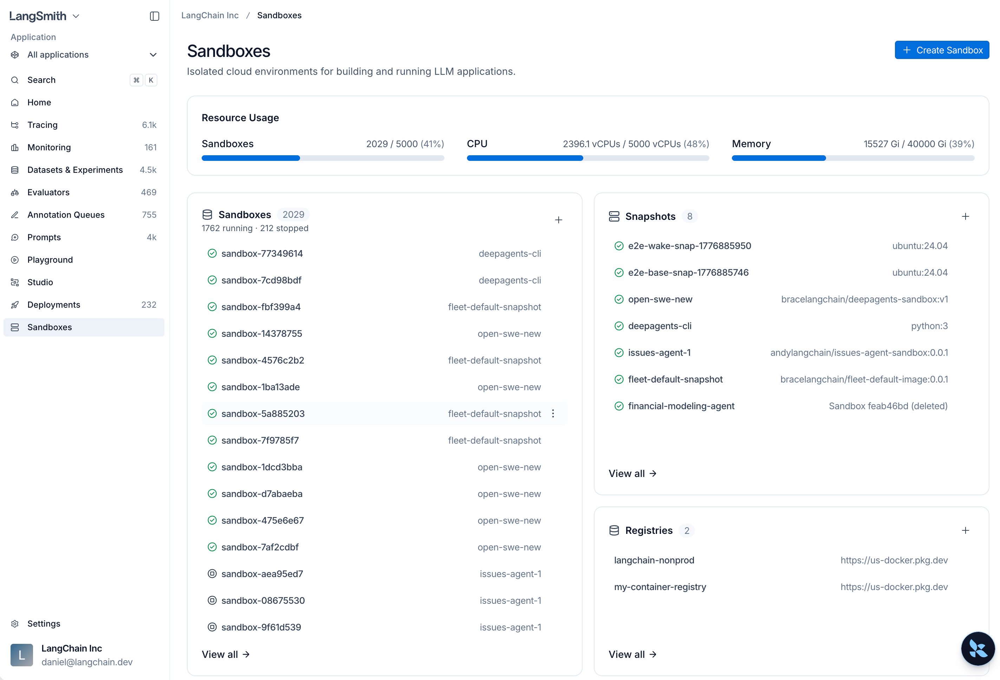

# Assigned reference: sandboxes

[Course index](../../README.md) · [Original source](https://docs.langchain.com/langsmith/sandboxes) · [Raw file](../../raw/readings/docs-langchain-com-langsmith-sandboxes-571b807e.html)

Retrieved: 2026-11-13T17:00:54.635845+00:00

# LangSmith Sandboxes

Copy pageCopy page

Use LangSmith managed sandboxes to safely execute code and interact with the filesystem in isolated environments.

Copy pageCopy page

Sandboxes are isolated environments that allow agents to safely execute potentially risky operations, like running arbitrary code or interacting with the filesystem, without affecting your main infrastructure.
From the [LangSmith homepage](https://smith.langchain.com?utm_source=docs&utm_medium=cta&utm_campaign=langsmith-signup&utm_content=langsmith-sandboxes), select **Sandboxes** to manage all your sandbox resources.


## Availability

Sandboxes are generally available in all [LangSmith Cloud regions](https://docs.langchain.com/langsmith/cloud#regional-storage), on [BYOC](https://docs.langchain.com/langsmith/byoc), and on [self-hosted](https://docs.langchain.com/langsmith/enable-self-hosted-sandboxes) deployments. On BYOC, use an API key that belongs to a BYOC workspace.
For the self-hosted infrastructure model, scaling, and upgrades, see [Self-hosted Sandbox architecture](https://docs.langchain.com/langsmith/self-host-sandbox-architecture).

## Network access

Restricted egress applies to non-Enterprise organizations by default and to organizations that request it. Organizations with an approved exemption can use unrestricted egress. Restricted sandboxes use a managed allowlist for common package registries, source repositories, and model APIs. LangSmith blocks destinations outside the allowlist, even if you add them to a sandbox’s proxy configuration.
If you need unrestricted egress, [file a support ticket](https://support.langchain.com) with your organization or workspace ID, region, required destinations and ports, and use case. For more information, see [restricted egress and access requests](docs-langchain-com-langsmith-sandbox-auth-proxy-b16ef55b.md).

## Get started

### 1. Install the SDK

Python

TypeScript

```
# uv
uv add langsmith

# pip
pip install langsmith
```

```
npm install langsmith
```

### 2. Set your API key

```
export LANGSMITH_API_KEY="<your-api-key>"
```

### 3. Create and run a sandbox

Python

TypeScript

```
from langsmith.sandbox import SandboxClient

client = SandboxClient()

with client.sandbox() as sb:
    result = sb.run("python3 -c 'print(2 + 2)'")
    print(result.stdout)  # "4\n"
```

```
import { SandboxClient } from "langsmith/sandbox";

const client = new SandboxClient();
const sandbox = await client.createSandbox();
const result = await sandbox.run("node -e 'console.log(2 + 2)'");
console.log(result.stdout); // "4\n"
await sandbox.delete();
```

Prefer the command line? The [Sandbox CLI](https://docs.langchain.com/langsmith/sandbox-cli) lets you create sandboxes, run commands, and open interactive shells without writing any code.

### 4. Use sandboxes with your agents

To wire sandboxes into agent code, see the open source documentation:

- **Deep Agents**: [Use `LangSmithSandbox` as a backend](https://docs.langchain.com/oss/python/integrations/sandboxes/langsmith), covering installation, backend creation, and cleanup.
- **Sandboxes as agent backends**: [Configure any sandbox as the execution backend](docs-langchain-com-oss-python-deepagents-sandboxes-a75e7a76.md) to give your agent `execute` and filesystem tools automatically.
- **LangChain / LangGraph integrations**: Use LangSmith sandboxes as a first-party option, or [connect third-party providers](https://docs.langchain.com/oss/python/integrations/sandboxes) such as AgentCore, Daytona, E2B, Modal, Runloop, and Vercel.

## Resources

## Snapshots

Build filesystem images from Docker images or capture a running sandbox, then boot sandboxes from them.

## Service URLs

Access HTTP services running inside sandboxes via authenticated URLs.

## Auth proxy

Inject credentials into outbound API requests without hardcoding secrets.

## Mounts

Attach S3 buckets, GCS buckets, and public Git repositories to a sandbox filesystem.

## Permissions

Control which workspace members can interact with a sandbox after it is created.

## CLI

Build snapshots, manage sandboxes, open consoles, and tunnel TCP ports from the command line.

## SDK usage

Create and manage sandboxes programmatically with the Python or TypeScript SDK.

## Self-hosted setup

Enable Sandboxes on self-hosted LangSmith deployments with Helm or Terraform.

## Harbor

Run Harbor evaluations and rollouts on LangSmith sandboxes.

---

[Connect these docs](https://docs.langchain.com/use-these-docs) to your agent of choice via MCP for real-time answers.

[Edit this page on GitHub](https://github.com/langchain-ai/docs/edit/main/src/langsmith/sandboxes.mdx) or [file an issue](https://github.com/langchain-ai/docs/issues/new/choose).

Was this page helpful?

YesNo
