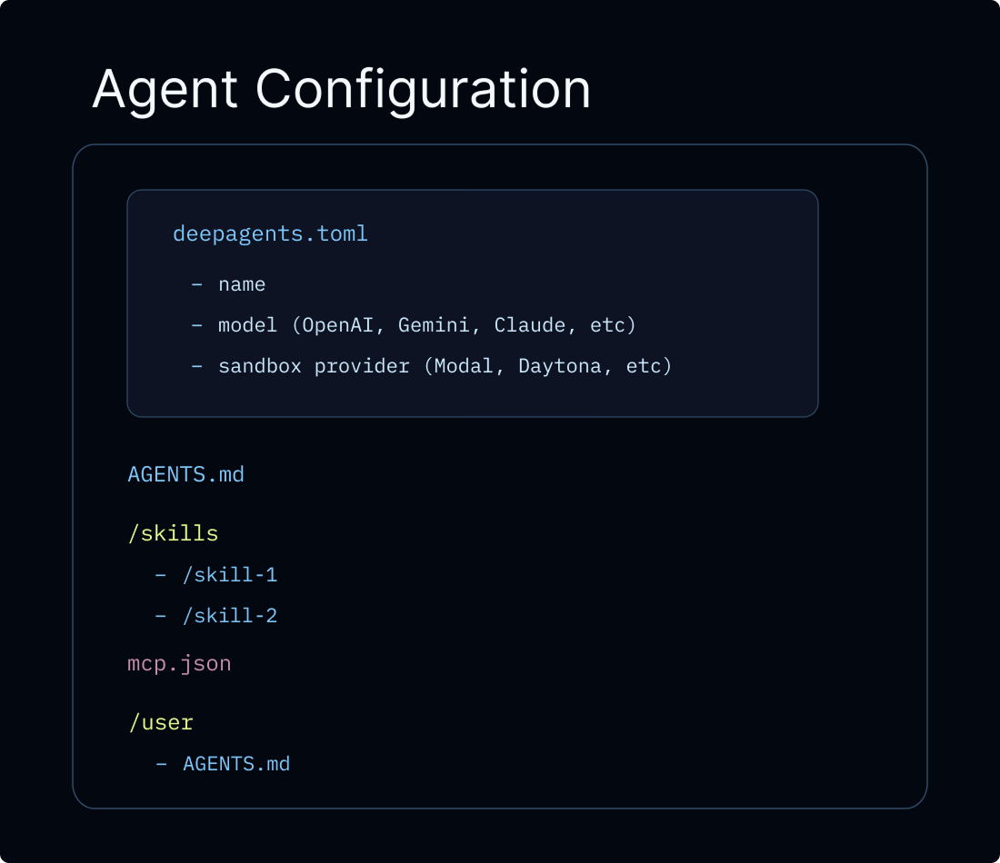
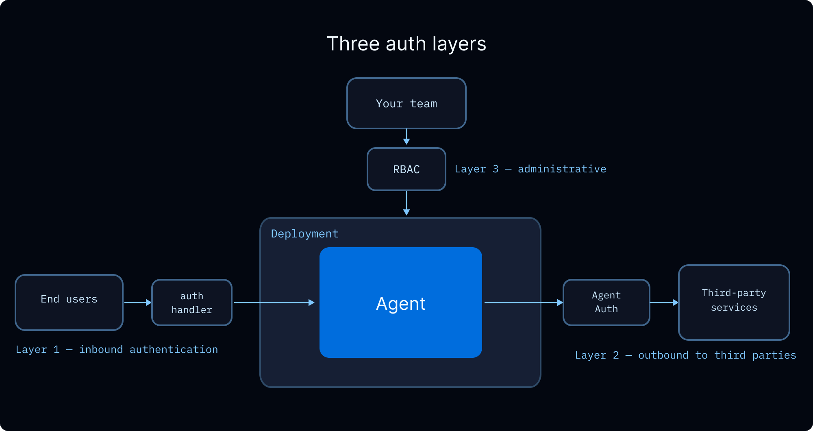
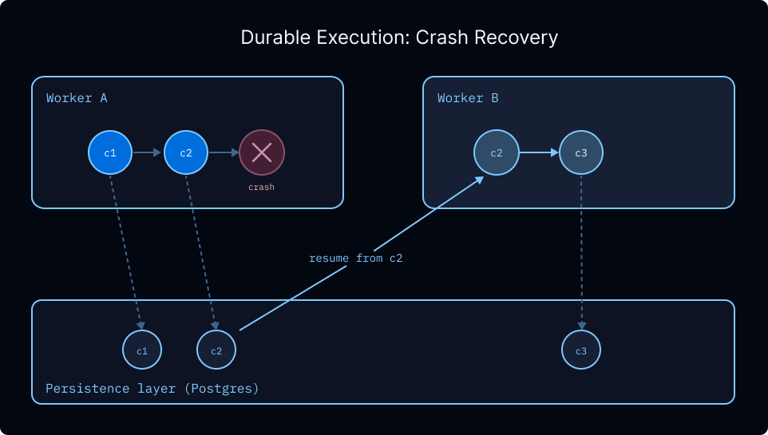
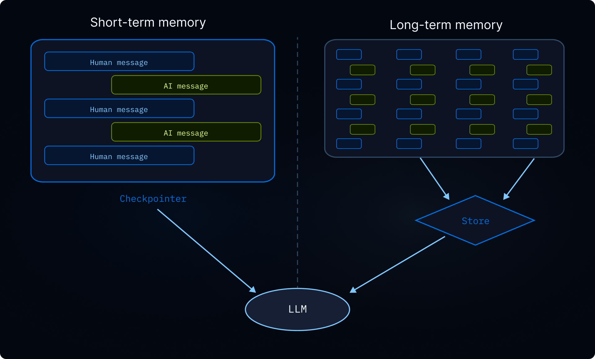
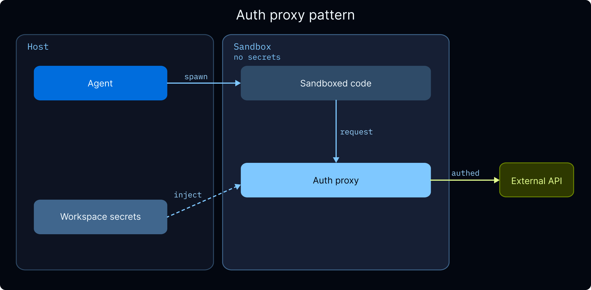

# Assigned reference: going-to-production

[Course index](../../README.md) · [Original source](https://docs.langchain.com/oss/javascript/deepagents/going-to-production) · [Raw file](../../raw/readings/docs-langchain-com-oss-javascript-deepagents-going-to-production-6dd5580f.html)

Retrieved: 2026-11-13T17:00:59.700216+00:00

# Going to production

Copy pageCopy page

Take your deep agent to production with persistent memory, sandboxes, resilience middleware, and deployment options

Copy pageCopy page

This guide covers considerations for taking a deep agent from a local prototype to a production deployment with the SDK. To run production agents without having to manage infrastructure, start with [Managed Deep Agents](https://docs.langchain.com/langsmith/javascript/managed-deep-agents-overview) or [migrate to Managed Deep Agents](https://docs.langchain.com/langsmith/javascript/managed-deep-agents-migrate) instead. The rest of this page walks through scoping memory, configuring execution environments, adding guardrails, and connecting a frontend when you host agents yourself or run a custom [Agent Server](https://docs.langchain.com/langsmith/deployment).

## Overview

Agents use information from memory and their execution environment to accomplish tasks.
In production, there are a few primitives that determine how information is shared and accessed:

- **Thread**: a single conversation. Message history and scratch files are scoped to the thread by default and don’t carry over.
- **User**: someone interacting with your agent. Memory and files can be private to a user or shared across users. Identity and authorization comes from your [auth layer](https://docs.langchain.com/langsmith/auth).
- **Assistant**: a configured agent instance. Memory and files can be tied to one assistant or shared across all of them.

This page covers:

- **[LangSmith Agent Server](docs-langchain-com-oss-javascript-deepagents-going-to-production-6dd5580f.md)**: Managed Deep Agents (recommended), or a custom Agent Server with auth, webhooks, and cron
- **[Production considerations](docs-langchain-com-oss-javascript-deepagents-going-to-production-6dd5580f.md)**: invocation, multi-tenancy, authentication, credentials, async, and durability
- **[Memory](docs-langchain-com-oss-javascript-deepagents-going-to-production-6dd5580f.md)**: persist information across conversations
- **[Execution environment](docs-langchain-com-oss-javascript-deepagents-going-to-production-6dd5580f.md)**: file storage and code execution
- **[Guardrails](docs-langchain-com-oss-javascript-deepagents-going-to-production-6dd5580f.md)**: permissions and data privacy
- **[Frontend](docs-langchain-com-oss-javascript-deepagents-going-to-production-6dd5580f.md)**: connect your UI to a deployed agent

## LangSmith Agent Server


The recommended path for taking a Deep Agent to production is [Managed Deep Agents](https://docs.langchain.com/langsmith/javascript/managed-deep-agents-overview), a CLI-first hosted runtime for creating, running, and operating deep agents in LangSmith. Managed Deep Agents is in public [beta](https://docs.langchain.com/langsmith/release-stages) on [LangSmith Cloud](https://docs.langchain.com/langsmith/cloud) and [Bring Your Own Cloud (BYOC)](https://docs.langchain.com/langsmith/byoc). Use Managed Deep Agents CLI and SDK v0.10 or later for BYOC. It runs the same Deep Agents harness, but you author the agent as a project of files and declare it for the managed runtime rather than compiling it yourself. See [Relationship to Deep Agents](https://docs.langchain.com/langsmith/javascript/managed-deep-agents-overview#relationship-to-deep-agents).
For teams that need custom application code, custom routes, advanced authentication, you can configure [LangSmith Agent Server](https://docs.langchain.com/langsmith/deployment) directly. Either path provisions the infrastructure your agent needs: [threads](https://docs.langchain.com/langsmith/use-threads), [runs](https://docs.langchain.com/langsmith/runs), a store, and a checkpointer, so you don’t have to set these up yourself. A custom Agent Server also gives you [authentication](https://docs.langchain.com/langsmith/auth), [webhooks](https://docs.langchain.com/langsmith/use-webhooks), [cron jobs](https://docs.langchain.com/langsmith/cron-jobs), and [observability](https://docs.langchain.com/langsmith/observability) out of the box, and can expose your agent via [MCP](https://docs.langchain.com/langsmith/server-mcp) or [A2A](https://docs.langchain.com/langsmith/server-a2a).
You can also deploy on JavaScript frameworks and hosting platforms without LangSmith Cloud.

Frameworks and platforms

[View all guides](https://docs.langchain.com/langsmith/deploy-frameworks-and-platforms)

[LangSmith](https://docs.langchain.com/langsmith/deploy-vite-langsmith)[Next.js](https://docs.langchain.com/langsmith/deploy-nextjs)[SvelteKit](https://docs.langchain.com/langsmith/deploy-sveltekit)[Nuxt](https://docs.langchain.com/langsmith/deploy-nuxt)[Cloudflare](https://docs.langchain.com/langsmith/deploy-cloudflare-workers)[Deno](https://docs.langchain.com/langsmith/deploy-deno)

LangSmith Cloud deployments automatically send traces to a project named after your deployment. Open [LangSmith](https://smith.langchain.com?utm_source=docs&utm_medium=cta&utm_campaign=langsmith-signup&utm_content=oss-deepagents-going-to-production) to debug runs and monitor usage. For hybrid or self-hosted setups, see [LangSmith tracing](https://docs.langchain.com/langsmith/data-plane#langsmith-tracing). We recommend you also set up [LangSmith Engine](https://docs.langchain.com/langsmith/engine), which monitors your traces, detects issues, and proposes fixes.

All code snippets on this page use the following `langgraph.json` unless otherwise specified:

langgraph.json

```
{
  "dependencies": ["."],
  "graphs": {
    "agent": "./src/agent.ts:agent"
  },
  "env": ".env"
}
```

`langgraph.json` is the configuration file that tells the LangGraph CLI and Agent Server how to build and run your application. It lives at the root of your project and is required for both local development (with `langgraph dev`) and production deployment. The key fields are:


| Field | Description |
| --- | --- |
| `dependencies` | Packages to install. `["."]` installs the current directory as a package (reads from `requirements.txt`, `pyproject.toml`, or `package.json`). |
| `graphs` | Maps graph IDs to their code locations. Each entry is `"<id>": "./<file>:<variable>"`, where `<id>` is the name you use to invoke the graph via the API, and `<variable>` is the compiled graph or constructor function exported from `<file>`. |
| `env` | Path to a `.env` file with environment variables (API keys, secrets). These are set at build time and available at runtime. |

For the full set of configuration options (custom Docker steps, store indexing, auth handlers, and more), see [application structure](https://docs.langchain.com/oss/javascript/langgraph/application-structure).

## Production considerations

### Invoking the agent

In production, every invocation should carry two run-level parameters:

- **`thread_id`** (passed via `config={"configurable": {"thread_id": ...}}`): a stable identifier for the conversation. The [checkpointer](docs-langchain-com-oss-javascript-deepagents-going-to-production-6dd5580f.md) uses it to persist and resume message history, so follow-up turns continue the same conversation. Generate a new `thread_id` to start a fresh conversation.
- **`context`**: per-run data your tools and middleware read at invocation time, for example `user_id`, API keys, feature flags, or session metadata. Define the shape with `context_schema` and access it via `runtime.context`. See [Runtime context](docs-langchain-com-oss-javascript-deepagents-context-engineering-de9e92ff.md).

The two are independent and almost always passed together:

Google

OpenAI

Anthropic

OpenRouter

Fireworks

Baseten

Ollama

```
import { createDeepAgent } from "deepagents";
import { uuid7 } from "langsmith";
import { z } from "zod";

const contextSchema = z.object({ userId: z.string() });

const agent = createDeepAgent({
  model: "google:gemini-4-hydrogen",
  contextSchema,
});

// Start a conversation
const config = { configurable: { thread_id: uuid7() } };
await agent.invoke(
  { messages: [{ role: "user", content: "Plan a 3-day trip to Tokyo" }] },
  { ...config, context: { userId: "user-123" } },
);

// Follow-up on the same conversation: reuse the same thread_id
await agent.invoke(
  { messages: [{ role: "user", content: "Make it 5 days instead" }] },
  { ...config, context: { userId: "user-123" } },
);
```

```
import { createDeepAgent } from "deepagents";
import { uuid7 } from "langsmith";
import { z } from "zod";

const contextSchema = z.object({ userId: z.string() });

const agent = createDeepAgent({
  model: "openai:gpt-6.1-sol",
  contextSchema,
});

// Start a conversation
const config = { configurable: { thread_id: uuid7() } };
await agent.invoke(
  { messages: [{ role: "user", content: "Plan a 3-day trip to Tokyo" }] },
  { ...config, context: { userId: "user-123" } },
);

// Follow-up on the same conversation: reuse the same thread_id
await agent.invoke(
  { messages: [{ role: "user", content: "Make it 5 days instead" }] },
  { ...config, context: { userId: "user-123" } },
);
```

```
import { createDeepAgent } from "deepagents";
import { uuid7 } from "langsmith";
import { z } from "zod";

const contextSchema = z.object({ userId: z.string() });

const agent = createDeepAgent({
  model: "anthropic:claude-sonnet-5",
  contextSchema,
});

// Start a conversation
const config = { configurable: { thread_id: uuid7() } };
await agent.invoke(
  { messages: [{ role: "user", content: "Plan a 3-day trip to Tokyo" }] },
  { ...config, context: { userId: "user-123" } },
);

// Follow-up on the same conversation: reuse the same thread_id
await agent.invoke(
  { messages: [{ role: "user", content: "Make it 5 days instead" }] },
  { ...config, context: { userId: "user-123" } },
);
```

```
import { createDeepAgent } from "deepagents";
import { uuid7 } from "langsmith";
import { z } from "zod";

const contextSchema = z.object({ userId: z.string() });

const agent = createDeepAgent({
  model: "openrouter:z-ai/glm-5.2",
  contextSchema,
});

// Start a conversation
const config = { configurable: { thread_id: uuid7() } };
await agent.invoke(
  { messages: [{ role: "user", content: "Plan a 3-day trip to Tokyo" }] },
  { ...config, context: { userId: "user-123" } },
);

// Follow-up on the same conversation: reuse the same thread_id
await agent.invoke(
  { messages: [{ role: "user", content: "Make it 5 days instead" }] },
  { ...config, context: { userId: "user-123" } },
);
```

```
import { createDeepAgent } from "deepagents";
import { uuid7 } from "langsmith";
import { z } from "zod";

const contextSchema = z.object({ userId: z.string() });

const agent = createDeepAgent({
  model: "fireworks:accounts/fireworks/models/glm-5p2",
  contextSchema,
});

// Start a conversation
const config = { configurable: { thread_id: uuid7() } };
await agent.invoke(
  { messages: [{ role: "user", content: "Plan a 3-day trip to Tokyo" }] },
  { ...config, context: { userId: "user-123" } },
);

// Follow-up on the same conversation: reuse the same thread_id
await agent.invoke(
  { messages: [{ role: "user", content: "Make it 5 days instead" }] },
  { ...config, context: { userId: "user-123" } },
);
```

```
import { createDeepAgent } from "deepagents";
import { uuid7 } from "langsmith";
import { z } from "zod";

const contextSchema = z.object({ userId: z.string() });

const agent = createDeepAgent({
  model: "baseten:zai-org/GLM-5.2",
  contextSchema,
});

// Start a conversation
const config = { configurable: { thread_id: uuid7() } };
await agent.invoke(
  { messages: [{ role: "user", content: "Plan a 3-day trip to Tokyo" }] },
  { ...config, context: { userId: "user-123" } },
);

// Follow-up on the same conversation: reuse the same thread_id
await agent.invoke(
  { messages: [{ role: "user", content: "Make it 5 days instead" }] },
  { ...config, context: { userId: "user-123" } },
);
```

```
import { createDeepAgent } from "deepagents";
import { uuid7 } from "langsmith";
import { z } from "zod";

const contextSchema = z.object({ userId: z.string() });

const agent = createDeepAgent({
  model: "ollama:north-mini-code-1.0",
  contextSchema,
});

// Start a conversation
const config = { configurable: { thread_id: uuid7() } };
await agent.invoke(
  { messages: [{ role: "user", content: "Plan a 3-day trip to Tokyo" }] },
  { ...config, context: { userId: "user-123" } },
);

// Follow-up on the same conversation: reuse the same thread_id
await agent.invoke(
  { messages: [{ role: "user", content: "Make it 5 days instead" }] },
  { ...config, context: { userId: "user-123" } },
);
```

## View example trace

Open a public LangSmith run for this example.

When deploying with the LangGraph SDK, the SDK manages threads for you and you pass the returned `thread_id` to each run:

```
import { Client } from "@langchain/langgraph-sdk";

const client = new Client({ apiUrl: "<DEPLOYMENT_URL>", apiKey: "<LANGSMITH_API_KEY>" });

const thread = await client.threads.create();
for await (const chunk of client.runs.stream(
  thread.thread_id,
  "agent",
  {
    input: { messages: [{ role: "user", content: "Plan a 3-day trip to Tokyo" }] },
    context: { userId: "user-123" },
    streamMode: "updates",
  },
)) {
  console.log(chunk.data);
}
```

`thread_id` scopes the *conversation* (message history, checkpoints). `context` carries *per-run* data your tools and middleware read. They are independent: changing one does not affect the other, and you can pass either or both.

### Multi-tenancy

When your agent serves multiple users, you need to handle three concerns: verifying who each user is, controlling what they can access, and managing the credentials the agent uses to act on their behalf.


#### User identity and access control

[LangSmith Agent Server](https://docs.langchain.com/langsmith/deployment) supports [custom authentication](https://docs.langchain.com/langsmith/custom-auth) to establish user identity and [authorization handlers](https://docs.langchain.com/langsmith/auth) to control access to resources like threads, assistants, and store namespaces. Authorization handlers run after authentication succeeds and can:

- Tag resources with ownership metadata (e.g., `owner: user_id`)
- Return filters so users only see their own resources
- Deny access with HTTP 403 for unauthorized operations

For a step-by-step tutorial, see [Make conversations private](https://docs.langchain.com/langsmith/resource-auth). For a walkthrough, watch the [custom auth video](https://www.youtube.com/watch?v=DkNqgCz8cjE).
How you [scope memory](docs-langchain-com-oss-javascript-deepagents-going-to-production-6dd5580f.md) and [execution environments](docs-langchain-com-oss-javascript-deepagents-going-to-production-6dd5580f.md) determines what data is shared between users. See the sections below for details.

#### Role-based access control

LangSmith’s [role-based access control (RBAC)](https://docs.langchain.com/langsmith/rbac) governs which members on your workspace can deploy, configure, and monitor agents. This is separate from end-user authorization above.


| Role | Access |
| --- | --- |
| Workspace Admin | Full permissions including settings and member management |
| Workspace Editor | Create and modify resources, but cannot delete runs or manage members |
| Workspace Viewer | Read-only access |

Custom roles with granular permissions are available on Enterprise plans. See the [RBAC reference](https://docs.langchain.com/langsmith/rbac) for the full permission model.

#### End-user credentials

When your agent needs to call external APIs on behalf of a user (e.g., reading their GitHub repos, sending Slack messages, querying their data warehouse), you need a way to pass the user’s credentials through to the agent without hardcoding them.
**OAuth via Agent Auth.** [Agent Auth](https://docs.langchain.com/langsmith/agent-auth) provides a managed OAuth 2.0 flow. Configure an OAuth provider, and the agent can request tokens scoped to each user. On first use, the agent [interrupts](https://docs.langchain.com/oss/javascript/langgraph/interrupts) execution and presents an OAuth consent URL. After the user authenticates, the agent resumes with a valid token. Tokens are stored and refreshed automatically.

```
import { Client } from "@langchain/auth";

const authClient = new Client();

// Inside your agent's tool:
// Access the authenticated user via runtime.serverInfo
const authResult = await authClient.authenticate({
  provider: "github",
  scopes: ["repo", "read:org"],
  userId: runtime.serverInfo.user.identity,
});
// Use authResult.token for GitHub API calls on the user's behalf
```

**Credential injection for sandboxes.** If your agent runs code inside a [sandbox](docs-langchain-com-oss-javascript-deepagents-going-to-production-6dd5580f.md) that calls external APIs, the [sandbox auth proxy](docs-langchain-com-langsmith-sandbox-auth-proxy-b16ef55b.md) can inject credentials into outbound requests automatically, so sandbox code never receives raw API keys. See [Managing secrets](docs-langchain-com-oss-javascript-deepagents-going-to-production-6dd5580f.md) for setup details.
**Workspace secrets.** For API keys shared across all users (for example your organization’s LLM provider keys, search API keys), store them as [workspace secrets](https://docs.langchain.com/langsmith/set-up-hierarchy#configure-workspace-settings) in LangSmith. See [Managing secrets](docs-langchain-com-oss-javascript-deepagents-going-to-production-6dd5580f.md) for details.

### Async

LLM-based applications are heavily I/O-bound: calling language models, databases, and external services. Async programming lets these operations run concurrently instead of blocking, improving throughput and responsiveness.

LangChain follows the convention of prefixing `a` to async method names (e.g., `ainvoke`, `abefore_agent`, `astream`). Sync and async variants live in the same class or namespace.

When building for production:

- **Create async tools.** LangChain runs sync tools in a separate thread to avoid blocking, but native async avoids the threading overhead entirely.
- **Use async middleware methods.** Custom [middleware](https://docs.langchain.com/oss/javascript/langchain/middleware/custom) should implement async hooks (e.g., `abefore_agent` instead of `before_agent`).
- **Use async for external resource lifecycle.** Creating [sandboxes](docs-langchain-com-oss-javascript-deepagents-going-to-production-6dd5580f.md) or connecting to [MCP servers](docs-langchain-com-oss-javascript-langchain-mcp-24fa1545.md) involves network calls and should be awaited. This is why [graph factories](https://docs.langchain.com/langsmith/graph-rebuild) that provision these resources are async.

### Durability

Deep Agents run on LangGraph, which provides durable execution out of the box. The [persistence](docs-langchain-com-oss-javascript-langgraph-persistence-f26bc9ba.md) layer checkpoints state at each step, so a run interrupted by a failure, timeout, or [human-in-the-loop](https://docs.langchain.com/oss/javascript/langgraph/interrupts) pause resumes from its last recorded state without reprocessing previous steps. For long-running deep agents that spawn many subagents, this means a mid-run failure doesn’t lose completed work.

Checkpointing also enables:

- **Indefinite [interrupts](https://docs.langchain.com/oss/javascript/langgraph/interrupts).** Human-in-the-loop workflows can pause for minutes or days and resume exactly where they left off.
- **[Time travel](https://docs.langchain.com/oss/javascript/langgraph/use-time-travel).** Every checkpointed step is a snapshot you can rewind to, letting you replay from an earlier state if something goes wrong.
- **Safe handling of sensitive operations.** For workflows involving payments or other irreversible actions, checkpoints provide an audit trail and a recovery point to inspect the exact state that led to an action.

[LangSmith Agent Server](https://docs.langchain.com/langsmith/deployment) configures a persistent checkpointer automatically. If you are self-hosting, see [persistence](docs-langchain-com-oss-javascript-langgraph-persistence-f26bc9ba.md) for setup instructions.

## Memory

Without memory, every conversation starts from scratch. Memory lets your agent retain information across conversations (user preferences, learned instructions, past experiences) so it can personalize its behavior over time. For an overview of memory types, see the [memory concepts guide](https://docs.langchain.com/oss/javascript/concepts/memory).


### Scoping

Memory is always persistent across conversations. The main question is how it’s scoped across user and assistant boundaries. The right scope depends on who should see and modify the data:


| Scope | Namespace | Use case | Example |
| --- | --- | --- | --- |
| **User** (recommended default) | `(user_id)` | Per-user preferences and context | ”I prefer concise responses” |
| **Assistant** | `(assistant_id)` | Shared instructions for one assistant | ”Cap posts at 280 characters” |
| **Global** | `(org_id)` | Read-only policies for all users and assistants | ”Never disclose internal pricing” |

Shared memory (assistant, user, or organization scope) is a vector for prompt injection. If one user can write to memory that another user’s conversation reads, a malicious user could inject instructions into that shared state. Enforce read-only access where appropriate. For example, make organization-wide policies writable only through application code, not by the agent itself. Use [permissions](docs-langchain-com-oss-javascript-deepagents-permissions-22d268b5.md) to declaratively deny writes to shared paths, or [backend policy hooks](docs-langchain-com-oss-javascript-deepagents-backends-5e451258.md) for custom validation logic.

### Configuration

In Deep Agents, memory is stored as files in a virtual filesystem. By default, files are scoped to a single thread (conversation) and not shared across threads.
Otherwise, to share memory across threads, route a path like `/memories/` to a [StoreBackend](https://reference.langchain.com/javascript/deepagents/backends/StoreBackend) that writes to the LangGraph [Store](https://docs.langchain.com/langsmith/custom-store). Use a [CompositeBackend](https://reference.langchain.com/javascript/deepagents/backends/CompositeBackend) to give the agent both thread-scoped scratch space and cross-thread [long-term memory](docs-langchain-com-oss-javascript-deepagents-memory-75ec9480.md).

The `rt.serverInfo` and `rt.executionInfo` namespace patterns shown below require `deepagents>=1.9.0`.

- User (recommended)
- Assistant
- User
- Organization

Namespace by `user_id`. Each user gets their own private memory. This is the recommended default since most applications deploy a single assistant.

src/agent.ts

```
import { createDeepAgent, CompositeBackend, StateBackend, StoreBackend } from "deepagents";

export const agent = createDeepAgent({
  backend: new CompositeBackend(
    new StateBackend(),
    {
      "/memories/": new StoreBackend({
        namespace: (rt) => [
          rt.serverInfo.assistantId,
          rt.serverInfo.user.identity,
        ],
      }),
    },
  ),
  systemPrompt: `You have persistent memory at /memories/.

  Read /memories/instructions.txt at the start of each conversation for
  accumulated knowledge and preferences. When you learn something that
  should persist, update that file.`,
});
```

Namespace by `assistant_id`. Memory is shared across all users of the same assistant, so any user can read or update it. Use this for shared instructions or knowledge that applies to everyone using a given assistant (e.g., “always reply in formal tone”).

src/agent.ts

```
import { createDeepAgent, CompositeBackend, StateBackend, StoreBackend } from "deepagents";

export const agent = createDeepAgent({
  backend: new CompositeBackend(
    new StateBackend(),
    {
      "/memories/": new StoreBackend({
        namespace: (rt) => [rt.serverInfo.assistantId],
      }),
    },
  ),
});
```

Namespace by `user_id` alone. Memory follows the user across all assistants. Use this for a global user profile (name, timezone, communication preferences) that should apply regardless of which assistant the user is talking to.

src/agent.ts

```
import { createDeepAgent, CompositeBackend, StateBackend, StoreBackend } from "deepagents";

export const agent = createDeepAgent({
  backend: new CompositeBackend(
    new StateBackend(),
    {
      "/memories/": new StoreBackend({
        namespace: (rt) => [rt.serverInfo.user.identity],
      }),
    },
  ),
});
```

Namespace by `org_id`. Memory is shared across all users and all assistants. Typically used for organization-wide policies (compliance rules, brand guidelines) that should be read-only for the agent. Write access should be restricted to application code to prevent prompt injection.

src/agent.ts

```
import { createDeepAgent, CompositeBackend, StateBackend, StoreBackend } from "deepagents";

export const agent = createDeepAgent({
  backend: new CompositeBackend(
    new StateBackend(),
    {
      "/memories/": new StoreBackend({
        namespace: (rt) => [rt.context.orgId],
      }),
    },
  ),
});
```

You can also read and write to the store from your application code using the [Store API](https://docs.langchain.com/langsmith/custom-store). See [Advanced usage](docs-langchain-com-oss-javascript-deepagents-memory-75ec9480.md) for examples.
For the full namespace factory API, see [namespace factories](docs-langchain-com-oss-javascript-deepagents-backends-5e451258.md). For memory patterns like self-improving instructions and knowledge bases, see [long-term memory](docs-langchain-com-oss-javascript-deepagents-memory-75ec9480.md).

## Execution environment

Locally, agents can read and write files on disk and run shell commands directly. In production, you need to think about isolation and persistence. The right setup depends on whether your agent needs to execute code:

- **Filesystem backends** are enough if your agent only reads and writes files. Choose a backend that matches your persistence needs: thread-scoped scratch space, cross-thread storage, or a mix of both.
- **Sandboxes** add an isolated container with an `execute` tool for running shell commands. Use a sandbox if your agent needs to run code, install packages, or do anything beyond file I/O.

### Filesystem

Choose a backend based on what needs to persist:

- [StateBackend](https://reference.langchain.com/javascript/deepagents/backends/StateBackend) (default): thread-scoped scratch space. Files persist across turns within a thread via your checkpointer but are not shared across threads. Checkpointed at every step, so avoid writing large files.
- [StoreBackend](https://reference.langchain.com/javascript/deepagents/backends/StoreBackend): cross-thread storage that survives across conversations. Scope with a [namespace factory](docs-langchain-com-oss-javascript-deepagents-backends-5e451258.md).
- [CompositeBackend](https://reference.langchain.com/javascript/deepagents/backends/CompositeBackend): mix both. Thread-scoped scratch space by default with cross-thread routes for specific paths like `/memories/`.

For the full list of backends and how to build custom ones, see [backends](docs-langchain-com-oss-javascript-deepagents-backends-5e451258.md).

`FilesystemBackend` and `LocalShellBackend` access the host directly. Don’t use them in deployed agents.

### Sandboxes

If your agent needs to run code (not just read and write files), use a [sandbox](docs-langchain-com-oss-javascript-deepagents-sandboxes-99ba695e.md). Sandboxes provide both a filesystem and an `execute` tool for running shell commands, all inside an isolated container. This isolation also protects your host: if the agent’s code exhausts memory or crashes, only the sandbox is affected. Your server keeps running.

#### Lifecycle

The key decision is how long a sandbox lives. Does each conversation get a fresh one, or do conversations share a persistent environment?


| Scope | Sandbox ID stored on | Lifecycle | Example use case |
| --- | --- | --- | --- |
| **Thread-scoped** | [Thread](https://docs.langchain.com/langsmith/use-threads) metadata | Fresh per conversation, cleaned up on TTL | A data analysis bot where each conversation starts clean |
| **Assistant-scoped** | [Assistant](https://docs.langchain.com/langsmith/assistants) config | Shared across all conversations | A coding assistant that maintains a cloned repo across conversations |

The examples below use an async [graph factory](https://docs.langchain.com/langsmith/graph-rebuild) instead of a static graph because the sandbox needs the `thread_id` or `assistant_id` to look up or create the correct sandbox. Graph factories don’t receive a full `Runtime` (no `server_info` or `execution_info`); instead, accept a `RunnableConfig` and read `thread_id` and `assistant_id` from `config["configurable"]`. The factory is async because sandbox creation is an I/O-bound operation that requires per-run information only available at invocation time.

- Thread-scoped (most common)
- Assistant-scoped

Each conversation gets its own sandbox. The [graph factory](https://docs.langchain.com/langsmith/graph-rebuild) reads `thread_id` from the run config, so each [thread](https://docs.langchain.com/langsmith/use-threads) automatically gets its own isolated environment. Named sandbox lookup handles deduplication across runs. Cleaned up when the sandbox [TTL](https://docs.langchain.com/langsmith/configure-ttl) expires.

src/agent.ts

```
import { createDeepAgent, LangSmithSandbox } from "deepagents";
import { SandboxClient } from "langsmith/sandbox";
import type { LangGraphRunnableConfig } from "@langchain/langgraph";

const client = new SandboxClient();

export async function agent(config: LangGraphRunnableConfig) {
  const threadId = config.configurable?.thread_id as string;
  const sandboxName = `thread-${threadId}`;
  const existing = (await client.listSandboxes()).filter(
    (sb) => sb.name === sandboxName,
  );
  const lsSandbox =
    existing[0] ??
    (await client.createSandbox({
      name: sandboxName,
      idleTtlSeconds: 3600, // TTL: clean up when idle
    }));
  return createDeepAgent({
    model: "google:gemini-4-hydrogen",
    backend: new LangSmithSandbox({ sandbox: lsSandbox }),
  });
}
```

All conversations share one sandbox. The [graph factory](https://docs.langchain.com/langsmith/graph-rebuild) reads the [assistant](https://docs.langchain.com/langsmith/assistants) ID from `config["configurable"]`, so every thread on the same assistant returns to the same environment. Files, installed packages, and cloned repositories persist across conversations.

src/agent.ts

```
import { createDeepAgent, LangSmithSandbox } from "deepagents";
import { SandboxClient } from "langsmith/sandbox";
import type { LangGraphRunnableConfig } from "@langchain/langgraph";

const client = new SandboxClient();

export async function agent(config: LangGraphRunnableConfig) {
  const assistantId = config.configurable?.assistant_id as string;
  const sandboxName = `assistant-${assistantId}`;
  const existing = (await client.listSandboxes()).filter(
    (sb) => sb.name === sandboxName,
  );
  const lsSandbox =
    existing[0] ??
    (await client.createSandbox({
      name: sandboxName,
    }));
  return createDeepAgent({
    model: "google:gemini-4-hydrogen",
    backend: new LangSmithSandbox({ sandbox: lsSandbox }),
  });
}
```

Assistant-scoped sandboxes accumulate files, installed packages, and other in-sandbox state over time. Configure a TTL with your sandbox provider, use snapshots to reset periodically, or implement cleanup logic to prevent the sandbox’s disk and memory from growing unbounded.

Because the `agent` variable is an async function (not a compiled graph), the server treats it as a [graph factory](https://docs.langchain.com/langsmith/graph-rebuild) and calls it on each run, injecting the config. The factory looks up or creates the sandbox by name and returns a fresh agent graph wired to that sandbox.
Once deployed with `langgraph deploy`, invoke the agent from your application code using the SDK. The client-side code is the same regardless of scope. The scoping is handled entirely in the agent factory above, but the behavior differs:

- Thread-scoped
- Assistant-scoped

Each thread gets its own sandbox. Follow-up messages within the same thread reuse the same sandbox, but a new thread always starts fresh with no leftover files or installed packages from previous conversations.

client.ts

```
import { Client } from "@langchain/langgraph-sdk";

const client = new Client({ apiUrl: "<DEPLOYMENT_URL>", apiKey: "<LANGSMITH_API_KEY>" });

// Conversation 1: install pandas and analyze data
const thread1 = await client.threads.create();
for await (const chunk of client.runs.stream(
  thread1.thread_id,
  "agent",
  { input: { messages: [{ role: "human", content: "Install pandas and analyze sales_data.csv" }] } },
)) {
  console.log(chunk.data);
}

// Follow-up in the same conversation — pandas is still installed
for await (const chunk of client.runs.stream(
  thread1.thread_id,
  "agent",
  { input: { messages: [{ role: "human", content: "Now plot the results" }] } },
)) {
  console.log(chunk.data);
}

// Conversation 2: fresh sandbox — pandas is NOT installed, no files from conversation 1
const thread2 = await client.threads.create();
for await (const chunk of client.runs.stream(
  thread2.thread_id,
  "agent",
  { input: { messages: [{ role: "human", content: "What packages are installed?" }] } },
)) {
  console.log(chunk.data);
}
```

All threads share one sandbox. This is useful when the sandbox has state that’s expensive to recreate, such as a cloned repo, installed dependencies, or build artifacts. Any conversation on the same assistant picks up where the last one left off without repeating setup.

client.ts

```
import { Client } from "@langchain/langgraph-sdk";

const client = new Client({ apiUrl: "<DEPLOYMENT_URL>", apiKey: "<LANGSMITH_API_KEY>" });

// Conversation 1: clone and set up the project
const thread1 = await client.threads.create();
for await (const chunk of client.runs.stream(
  thread1.thread_id,
  "agent",
  { input: { messages: [{ role: "human", content: "Clone https://github.com/org/repo and install dependencies" }] } },
)) {
  console.log(chunk.data);
}

// Conversation 2: repo and dependencies are still there
const thread2 = await client.threads.create();
for await (const chunk of client.runs.stream(
  thread2.thread_id,
  "agent",
  { input: { messages: [{ role: "human", content: "Run the test suite and fix any failures" }] } },
)) {
  console.log(chunk.data);
}
```

#### File transfers

Sandboxes are isolated containers, so your application code can’t directly access files inside them. Use `upload_files()` and `download_files()` to move data across the sandbox boundary:

- **Seed the sandbox before the agent runs**: upload user files, [skill](docs-langchain-com-oss-javascript-deepagents-skills-b3b63e4f.md) scripts, configuration, or [persistent memories](docs-langchain-com-oss-javascript-deepagents-memory-75ec9480.md) so the agent has what it needs from the start
- **Retrieve results after the agent finishes**: download generated artifacts (reports, plots, exports) and sync updated memories back for future conversations

For provider-specific file transfer examples, see [working with files](docs-langchain-com-oss-javascript-deepagents-sandboxes-99ba695e.md). For provider setup, security, and lifecycle patterns, see the full [sandboxes guide](docs-langchain-com-oss-javascript-deepagents-sandboxes-99ba695e.md).


Example: syncing skills and memories with custom middleware

[Skill](docs-langchain-com-oss-javascript-deepagents-skills-b3b63e4f.md) scripts that the agent needs to execute must be uploaded into the sandbox before the agent runs. You may also want to sync [memories](docs-langchain-com-oss-javascript-deepagents-memory-75ec9480.md) so the agent can read and update them inside the container. Use [custom middleware](https://docs.langchain.com/oss/javascript/langchain/middleware/custom) with `before_agent` and `after_agent` hooks to move files across the sandbox boundary:

src/agent.ts

```
import { createMiddleware } from "langchain";
import {
  createDeepAgent,
  CompositeBackend,
  LangSmithSandbox,
  StoreBackend,
} from "deepagents";
import { SandboxClient } from "langsmith/sandbox";

function safeFilename(key: string): string {
  const name = key.split("/").pop()!;
  if (name.includes("..") || /[*?]/.test(name)) {
    throw new Error(`Invalid key: ${key}`);
  }
  return name;
}

const createSandboxSyncMiddleware = (backend: CompositeBackend) => {
  return createMiddleware({
    name: "SandboxSyncMiddleware",
    beforeAgent: async (state, runtime) => {
      // Upload skill scripts and memories into the sandbox
      const userId = runtime.serverInfo.user.identity;
      const store = runtime.store;
      const encoder = new TextEncoder();
      const files: [string, Uint8Array][] = [];
      for (const item of await store.search(["skills", userId])) {
        const name = safeFilename(item.key);
        files.push([`/skills/${name}`, encoder.encode(item.value.content)]);
      }
      for (const item of await store.search(["memories", userId])) {
        const name = safeFilename(item.key);
        files.push([`/memories/${name}`, encoder.encode(item.value.content)]);
      }
      if (files.length > 0) {
        await backend.uploadFiles(files);
      }
    },
    afterAgent: async (state, runtime) => {
      // Sync updated memories back to the store
      const userId = runtime.serverInfo.user.identity;
      const store = runtime.store;
      const items = await store.search(["memories", userId]);
      const results = await backend.downloadFiles(
        items.map((item) => `/memories/${item.key}`),
      );
      const decoder = new TextDecoder();
      for (const result of results) {
        if (result.content) {
          await store.put(
            ["memories", userId],
            result.path.split("/").pop()!,
            { content: decoder.decode(result.content) },
          );
        }
      }
    },
  });
};

const client = new SandboxClient();
const lsSandbox = await client.createSandbox();

const backend = new CompositeBackend(
  new LangSmithSandbox({ sandbox: lsSandbox }),
  {
    "/skills/": new StoreBackend({
      namespace: (rt) => ["skills", rt.serverInfo.user.identity],
    }),
    "/memories/": new StoreBackend({
      namespace: (rt) => ["memories", rt.serverInfo.user.identity],
    }),
  },
);

export const agent = createDeepAgent({
  backend,
  middleware: [createSandboxSyncMiddleware(backend)],
});
```

#### Managing secrets

Sandboxes are isolated containers, so environment variables from your host aren’t available inside them. There are two ways to provide API keys and other secrets to sandbox code:
**Auth proxy (recommended).** The [sandbox auth proxy](docs-langchain-com-langsmith-sandbox-auth-proxy-b16ef55b.md) intercepts outbound requests from the sandbox and injects authentication headers automatically. Sandbox code calls external APIs normally, and the proxy adds the correct credentials based on the destination host. This means API keys never appear in sandbox code, environment variables, or logs.


```
{
  "proxy_config": {
    "rules": [
      {
        "name": "openai-api",
        "match_hosts": ["api.openai.com"],
        "inject_headers": {
          "Authorization": "Bearer ${OPENAI_API_KEY}"
        }
      },
      {
        "name": "anthropic-api",
        "match_hosts": ["api.anthropic.com"],
        "inject_headers": {
          "x-api-key": "${ANTHROPIC_API_KEY}"
        }
      }
    ]
  }
}
```

The `${SECRET_KEY}` references resolve against secrets stored in your LangSmith [workspace settings](https://docs.langchain.com/langsmith/set-up-hierarchy#configure-workspace-settings). Configure secrets there before creating a template that references them.
**Workspace secrets.** For API keys that don’t need proxy-based injection (e.g., keys used by the agent server itself, not sandbox code), store them as [workspace secrets](https://docs.langchain.com/langsmith/set-up-hierarchy#configure-workspace-settings) in LangSmith. These are available as environment variables at runtime for all agents in the workspace.

Avoid passing secrets into sandboxes via environment variables or file uploads. Agents can read any accessible file or environment variable inside the sandbox, including credentials. The auth proxy keeps secrets out of the sandbox entirely.

## Guardrails

Agents in production run autonomously, which means they can loop indefinitely, hit rate limits, or process user data that contains sensitive information. Deep Agents provide two layers of protection:

- **[Permissions](docs-langchain-com-oss-javascript-deepagents-going-to-production-6dd5580f.md)**: declarative allow/deny rules that control which files and directories the agent can read or write.
- **[Fault tolerance](docs-langchain-com-oss-javascript-deepagents-going-to-production-6dd5580f.md)**: rate limiting, retries, fallbacks, and error handling.
- **[Data privacy](docs-langchain-com-oss-javascript-deepagents-going-to-production-6dd5580f.md)**: middleware that detects and handles PII before it reaches the model or gets stored in logs.

### Permissions

[Permissions](docs-langchain-com-oss-javascript-deepagents-permissions-22d268b5.md) are declarative allow/deny rules that control which files and directories the agent can read or write. Use permissions to isolate the agent to a working directory, protect sensitive files, or enforce read-only memory. Rules are evaluated in declaration order, and the first matching rule wins.

### Fault tolerance

For rate limiting, retries, fallbacks, and error handling, see [Fault tolerance](https://docs.langchain.com/oss/javascript/deepagents/fault-tolerance).

### Data privacy

If your agent processes user input that might contain emails, credit card numbers, or other PII, you can detect and handle it before it reaches the model or gets stored in logs:

```
import { createAgent, piiMiddleware } from "langchain";

const agent = createAgent({
  model: "google:gemini-4-hydrogen",
  middleware: [
    piiMiddleware("email", { strategy: "redact", applyToInput: true }),
    piiMiddleware("credit_card", { strategy: "mask", applyToInput: true }),
  ],
});
```

Strategies include `redact` (replace with `[REDACTED_EMAIL]`), `mask` (partial masking like `****-****-****-1234`), `hash` (deterministic hash), and `block` (raise an error). You can also write custom detectors for domain-specific patterns.
See [piiMiddleware](https://reference.langchain.com/javascript/langchain/index/piiMiddleware) for the full configuration.
For the default Deep Agents middleware stack, see [Customization](docs-langchain-com-oss-javascript-deepagents-customization-6f109080.md). For additional LangChain prebuilt middleware (retries, fallbacks, PII detection, and more), see [Prebuilt middleware](https://docs.langchain.com/oss/javascript/langchain/middleware/built-in).

## Frontend

Deep Agents use [`useStream`](https://docs.langchain.com/oss/javascript/langchain/frontend/overview) to connect your UI to the agent backend. [`useStream`](https://reference.langchain.com/javascript/langchain-react/index/useStream) is a frontend hook (available for React, Vue, Svelte, and Angular) that streams messages, subagent progress, and custom state from your agent in real time.
Locally, `useStream` points at `http://localhost:2024`. In production, point it at your [Agent Server](https://docs.langchain.com/langsmith/deployment) and configure reconnection so users don’t lose progress if their connection drops.

```
import { useStream } from "@langchain/react";

function App() {
  const stream = useStream<typeof agent>({
    apiUrl: "https://your-deployment.langsmith.dev",
    assistantId: "agent",
  });
}
```

For deep agent workflows that spawn many subagents, set a high `recursionLimit` when submitting to avoid cutting off long-running executions:

```
stream.submit(
  { messages: [{ type: "human", content: text }] },
  {
    streamSubgraphs: true,
    config: { recursionLimit: 10000 },
  },
);
```

For UI patterns specific to deep agents, such as subagent cards, todo lists, and custom state rendering, see the [frontend guide](https://docs.langchain.com/oss/javascript/deepagents/frontend/overview).


---

[Connect these docs](https://docs.langchain.com/use-these-docs) to your agent of choice via MCP for real-time answers.

[Edit this page on GitHub](https://github.com/langchain-ai/docs/edit/main/src/oss/deepagents/going-to-production.mdx) or [file an issue](https://github.com/langchain-ai/docs/issues/new/choose).

Was this page helpful?

YesNo
