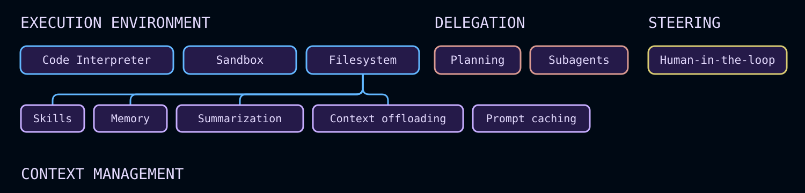

# Assigned reference: overview

[Course index](../../README.md) · [Original source](https://docs.langchain.com/oss/javascript/deepagents/overview) · [Raw file](../../raw/readings/docs-langchain-com-oss-javascript-deepagents-overview-9687b9be.html)

Retrieved: 2026-11-13T17:01:04.969284+00:00

# Deep Agents overview

Copy pageCopy page

Agent harness for planning, subagents, and file-system context, available as Managed Deep Agents or the Deep Agents SDK

Copy pageCopy page

Deep Agents is the [agent harness](https://docs.langchain.com/oss/javascript/concepts/products#agent-harnesses-like-the-deep-agents-sdk) for complex, multi-step work. It adds planning, a virtual filesystem for context, subagent spawning, and long-term memory on top of LangChain and LangGraph.
Start with [Managed Deep Agents](https://docs.langchain.com/langsmith/javascript/managed-deep-agents-overview) to run production agents without having to manage infrastructure. Alternatively, for maximum flexibility while using the same Deep Agents harness, use the [Deep Agents SDK](docs-langchain-com-oss-javascript-deepagents-overview-9687b9be.md) and host agents yourself, or run a custom [Agent Server](https://docs.langchain.com/langsmith/deployment).

## Choose how to run Deep Agents

## Managed Deep Agents

Build deep agents with managed deployment infrastructure for complex, long-running tasks. LangSmith runs the harness, Agent Server, sandboxes, and schedules.

Start here

## Deep Agents SDK

The same deep agents harness with maximum flexibility. Host agents yourself, or run a custom Agent Server when you need more control over the runtime.

Use the SDK

Deep Agents includes the following capabilities:

- **Take actions in an environment**: Take actions via tools, read and write files, execute code
- **Connect to your data**: Load memories, skills, and domain knowledge at the right moment
- **Manage growing context**: Summarize history and offload large results across long runs
- **Parallelize tasks**: Delegate to general or specialized subagents running in isolated context windows
- **Stay in the loop**: Pause for human approval at critical decision points
- **Improve over time**: Update memory, skills, and prompts based on real usage

Optional capabilities such as [task planning](docs-langchain-com-oss-javascript-deepagents-overview-9687b9be.md) and [skills](docs-langchain-com-oss-javascript-deepagents-overview-9687b9be.md) extend the harness when your use case needs them. See [Core capabilities](docs-langchain-com-oss-javascript-deepagents-overview-9687b9be.md) for a full breakdown of each component.

## Self-host with the SDK

Use the open source SDK when you run the agent in your own process or container, need a custom [backend](docs-langchain-com-oss-javascript-deepagents-backends-5e451258.md), store, or checkpointer, or want an [Agent Server](https://docs.langchain.com/langsmith/deployment) you configure yourself. For managed deployment instead, see [Managed Deep Agents](https://docs.langchain.com/langsmith/javascript/managed-deep-agents-overview).

### Try it

### Quickstart

```
import * as z from "zod";
// npm install deepagents langchain @langchain/core
import { createDeepAgent } from "deepagents";
import { tool } from "langchain";

const getWeather = tool(({ city }) => `It's always sunny in ${city}!`, {
  name: "get_weather",
  description: "Get the weather for a given city",
  schema: z.object({
    city: z.string(),
  }),
});

const agent = await createDeepAgent({
  tools: [getWeather],
  systemPrompt: "You are a helpful assistant",
});

console.log(
  await agent.invoke({
    messages: [{ role: "user", content: "What's the weather in Tokyo?" }],
  }),
);
```

## View example trace

Open a public LangSmith run for this example.

See the [Quickstart](https://docs.langchain.com/oss/javascript/deepagents/quickstart/) and [Customization guide](docs-langchain-com-oss-javascript-deepagents-customization-6f109080.md) to build with the SDK.

Trace requests, debug agent behavior, and evaluate outputs with [LangSmith](https://smith.langchain.com?utm_source=docs&utm_medium=cta&utm_campaign=langsmith-signup&utm_content=oss-deepagents-overview). Follow the [observability quickstart](https://docs.langchain.com/langsmith/observability-quickstart) to get set up.

## Core capabilities


Deep Agents is an [“agent harness”](https://docs.langchain.com/oss/javascript/concepts/products#agent-harnesses-like-the-deep-agents-sdk). It is the same core tool calling loop as other agent frameworks, but with built-in capabilities that make agents reliable for real tasks:

## Execution environment

Tools, virtual filesystem, optional sandbox, and REPL (interpreter)

## Context management

Skills, memory, summarization, context offloading, and prompt caching

## Delegation

Subagent spawning and optional task planning

## Steering

Human-in-the-loop approval and interrupts

[`deepagents`](https://www.npmjs.com/package/deepagents) is a standalone library built on top of [LangChain](https://docs.langchain.com/oss/javascript/langchain/)’s core building blocks for agents and using [LangGraph](https://docs.langchain.com/oss/javascript/langgraph/)’s tooling for running agents in production.
[LangChain](https://docs.langchain.com/oss/javascript/langchain/) is the framework that provides the core building blocks for your agents.
To learn more about the differences between LangChain, LangGraph, and Deep Agents, see [Frameworks, runtimes, and harnesses](https://docs.langchain.com/oss/javascript/concepts/products). For a side-by-side comparison with Anthropic’s harness, see [Deep Agents vs. Claude Agent SDK](https://docs.langchain.com/oss/javascript/deepagents/comparison).
For building custom agents without these built-in capabilities, consider using LangChain’s [`createAgent`](https://docs.langchain.com/oss/javascript/langchain/agents) or building a custom [LangGraph](https://docs.langchain.com/oss/javascript/langgraph/overview) workflow.

## Execution environment

The execution environment is where an agent acts. It has four layers:

- **[Tools](docs-langchain-com-oss-javascript-deepagents-overview-9687b9be.md)**: custom functions, APIs, and databases the agent can call
- **[Virtual filesystem](docs-langchain-com-oss-javascript-deepagents-overview-9687b9be.md)**: file tools backed by pluggable backends
- **[Filesystem permissions](docs-langchain-com-oss-javascript-deepagents-overview-9687b9be.md)**: declarative access control over which paths agents can read or write
- **[Code execution](docs-langchain-com-oss-javascript-deepagents-overview-9687b9be.md)**: sandboxed shell execution and an in-process JavaScript interpreter

**[Streaming](docs-langchain-com-oss-javascript-deepagents-overview-9687b9be.md)** allows you to keep up with everything happening using typed event streams for messages, tools, values, and delegated tasks.

### Tools and MCP

Pass custom functions, LangChain tools, or tools from any [MCP server](https://docs.langchain.com/oss/javascript/deepagents/tools#mcp-tools) with the `tools=` parameter. Deep Agents fully support the [Model Context Protocol (MCP)](docs-langchain-com-oss-javascript-langchain-mcp-24fa1545.md), letting you connect to databases, APIs, file systems, and more through a standard interface.
For more information on defining custom tools, using MCP servers, and the full list of built-in harness tools, see [Tools](https://docs.langchain.com/oss/javascript/deepagents/tools).

### Virtual filesystem access

The harness provides a configurable virtual filesystem which can be backed by different [pluggable backends](docs-langchain-com-oss-javascript-deepagents-backends-5e451258.md): in-memory state, local disk, LangGraph store, composite routing, or a custom backend with [permission rules](docs-langchain-com-oss-javascript-deepagents-permissions-22d268b5.md) for read and write access.
The backends support the following file system operations:


| Tool | Description |
| --- | --- |
| `ls` | List files in a directory with metadata (size, modified time) |
| `read_file` | Read file contents with line numbers, supports offset/limit for large files. Also supports returning multimodal content blocks for non-text files (images, video, audio, and documents). See supported extensions below. |
| `write_file` | Create new files |
| `edit_file` | Perform exact string replacements in files (with global replace mode) |
| `glob` | Find files matching patterns (e.g., `**/*.py`) |
| `grep` | Search file contents with multiple output modes (files only, content with context, or counts) |
| `execute` | Run shell commands in the environment (available with [sandbox backends](docs-langchain-com-oss-javascript-deepagents-sandboxes-99ba695e.md) only) |

Supported multimodal file extensions

| Type | Extensions |
| --- | --- |
| [Image](https://docs.langchain.com/oss/javascript/langchain/messages#multimodal) | `.png`, `.jpg`, `.jpeg`, `.gif`, `.webp`, `.heic`, `.heif` |
| [Video](https://docs.langchain.com/oss/javascript/langchain/messages#multimodal) | `.mp4`, `.mpeg`, `.mov`, `.avi`, `.flv`, `.mpg`, `.webm`, `.wmv`, `.3gpp` |
| [Audio](https://docs.langchain.com/oss/javascript/langchain/messages#multimodal) | `.wav`, `.mp3`, `.aiff`, `.aac`, `.ogg`, `.flac` |
| [File](https://docs.langchain.com/oss/javascript/langchain/messages#multimodal) | `.pdf`, `.ppt`, `.pptx` |


Running without the default filesystem tools

To hide the filesystem tools listed above from the model, register a [harness profile](https://docs.langchain.com/oss/javascript/deepagents/profiles#harness-profiles) with `excluded_tools`:

```
from deepagents import HarnessProfile, register_harness_profile

register_harness_profile(
    "anthropic:claude-sonnet-4-6",
    HarnessProfile(
        excluded_tools=frozenset(
            {"ls", "read_file", "write_file", "edit_file", "delete", "glob", "grep"}
        ),
    ),
)
```

Removing [`FilesystemMiddleware`](https://reference.langchain.com/javascript/deepagents/middleware/createFilesystemMiddleware) itself via `excluded_middleware` is intentionally rejected—it is required scaffolding in the [Deep Agents stack](docs-langchain-com-oss-javascript-deepagents-customization-6f109080.md). Use `excluded_tools` to hide only the model-visible tool surface and leave the middleware in place. To remove the `task` tool, see [Running without subagents](docs-langchain-com-oss-javascript-deepagents-subagents-2a904d1e.md).

The virtual filesystem is used by several other harness capabilities such as skills, memory, code execution, and context management.
You can also use the file system when building custom tools and middleware for Deep Agents.
For more information, see [backends](docs-langchain-com-oss-javascript-deepagents-backends-5e451258.md). To generate a durable repository wiki that agents can read from the filesystem, see [OpenWiki](https://docs.langchain.com/oss/openwiki/overview).

### Filesystem permissions

The harness supports declarative permission rules that control which files and directories the agent can read or write. Permissions apply to the built-in filesystem tools listed above and are evaluated in declaration order with first-match-wins semantics.
Define permissions by passing a list of rules to `permissions=` when creating the agent. Each rule includes:

- `operations`: `"read"` and/or `"write"`
- `paths`: Glob patterns for files or directories
- `mode`: `"allow"` or `"deny"`

Rules are evaluated top to bottom, and the first matching rule wins. If no rule matches, the operation is allowed.
This model lets you restrict agents to specific directories (for example, `/workspace/`), protect sensitive files such as `.env` or credentials, and give subagents narrower access than the parent agent.
Permissions do not apply to [sandbox backends](docs-langchain-com-oss-javascript-deepagents-sandboxes-99ba695e.md), which support arbitrary command execution via the `execute` tool. For custom validation logic, use [backend policy hooks](docs-langchain-com-oss-javascript-deepagents-backends-5e451258.md).
For the full rule structure, examples, and subagent inheritance, see [Permissions](docs-langchain-com-oss-javascript-deepagents-permissions-22d268b5.md).

### Code execution

Deep Agents supports code execution in two ways:

- [Sandbox backends](docs-langchain-com-oss-javascript-deepagents-sandboxes-99ba695e.md) expose an `execute` tool for shell commands in an isolated environment.
- [Interpreters](docs-langchain-com-oss-javascript-deepagents-interpreters-93bbaecd.md) add an `eval` tool that runs JavaScript in a scoped QuickJS runtime.

Use sandbox backends when the agent needs to install dependencies, run tests, call CLIs, or work with an operating-system filesystem. Sandbox backends implement the `SandboxBackendProtocolV2`; when detected, the harness adds the `execute` tool to the agent’s available tools.
Use interpreters when the agent needs a lightweight programmable layer for loops, batching, deterministic data transformations, or programmatic tool calling. Interpreters do not provide shell access, package installs, or filesystem and network access.
For sandbox setup, providers, and file transfer APIs, see [Sandboxes](docs-langchain-com-oss-javascript-deepagents-sandboxes-99ba695e.md). For the QuickJS runtime and programmatic tool calling, see [Interpreters](docs-langchain-com-oss-javascript-deepagents-interpreters-93bbaecd.md).

### Streaming

[Event streaming](https://docs.langchain.com/oss/javascript/deepagents/event-streaming) exposes agent runs as typed projections for messages, tool calls, values, and output. Deep Agents add `stream.subagents` so each delegated task gets its own handle with independent message, tool-call, and nested subagent streams.

## Context management

The context management component controls what the agent knows, how long it can operate within token limits, and what it retains across sessions. It has four layers:

- **[Skills](docs-langchain-com-oss-javascript-deepagents-overview-9687b9be.md)**: on-demand domain knowledge loaded progressively from skill files
- **[Memory](docs-langchain-com-oss-javascript-deepagents-overview-9687b9be.md)**: persistent instructions and preferences loaded at startup from `AGENTS.md` files
- **[Summarization and context offloading](docs-langchain-com-oss-javascript-deepagents-overview-9687b9be.md)**: automatic compression of conversation history and large tool results
- **[Prompt caching](docs-langchain-com-oss-javascript-deepagents-overview-9687b9be.md)**: static prompt sections are cache-eligible to speed up inference and reduce cost on supported models

### Skills

Skills package specialized workflows, domain knowledge, and custom instructions for your deep agent.
Each skill follows the [Agent Skills standard](https://agentskills.io/) and lives in a directory with a `SKILL.md` file. Skills can also include scripts, templates, reference docs, and other supporting resources.
Deep Agents load skills with progressive disclosure: the agent reads `SKILL.md` frontmatter at startup, then reads full skill content only when a task needs it. This keeps startup context compact while still making rich capabilities available on demand.
For more information, see [Skills](docs-langchain-com-oss-javascript-deepagents-skills-b3b63e4f.md).

### Memory

Memory gives your deep agent persistent context across conversations, such as coding style, preferences, conventions, and project guidelines.
Memory uses [`AGENTS.md` files](agents-md-e7c64f11.md) that you pass through the `memory` parameter when creating the agent. Unlike skills, memory files are always loaded, and the content is stored in the configured backend (`StateBackend`, `StoreBackend`, or `FilesystemBackend`).
The agent can also update memory based on interactions and feedback, so preferences and patterns can carry forward without needing to restate them in each thread.
For configuration details and examples, see [Memory](docs-langchain-com-oss-javascript-deepagents-customization-6f109080.md). To generate a repository wiki that coding agents discover through `AGENTS.md`, see [OpenWiki](https://docs.langchain.com/oss/openwiki/overview).

### Summarization and context offloading

The harness manages context so deep agents can handle long-running work within token limits while keeping the most relevant information in scope.
This context flow has four parts:

- **Input context**: System prompt, memory, skills, and tool prompts define what the agent starts with.
- **Compression**: Built-in offloading and summarization compress conversation history and large intermediate results.
- **Isolation**: Subagents quarantine heavy subtasks and return only final results (see [Delegation](docs-langchain-com-oss-javascript-deepagents-overview-9687b9be.md)).
- **Long-term memory**: Persistent storage in the virtual filesystem carries information across threads.

Together, these mechanisms support multi-step tasks that exceed a single context window while reducing manual context trimming and token usage.
For configuration details, see [Context engineering](docs-langchain-com-oss-javascript-deepagents-context-engineering-de9e92ff.md). For multimodal inputs and tool outputs, see [Multimodal](https://docs.langchain.com/oss/javascript/deepagents/multimodal).

### Prompt caching

For Anthropic and Amazon Bedrock models, `create_deep_agent` automatically applies prompt caching to static sections of the system prompt—the base agent instructions, memory, and skill content that repeat on every turn. This avoids reprocessing the same tokens across calls, reducing both latency and cost on long-running agents.
Prompt caching is enabled by default when using an Anthropic model, or a Bedrock model (Claude or Nova). No configuration is required.
For other providers, see [Middleware integrations](https://docs.langchain.com/oss/javascript/integrations/middleware) for available provider-specific caching middleware.

## Delegation

The delegation component enables agents to break large problems into smaller, parallelizable units of work. It has two layers:

- **[Task planning](docs-langchain-com-oss-javascript-deepagents-overview-9687b9be.md)**: an opt-in `write_todos` tool for structured task tracking
- **[Subagents](docs-langchain-com-oss-javascript-deepagents-overview-9687b9be.md)**: ephemeral child agents that handle isolated subtasks

### Task planning

Task planning is an opt-in harness capability that lets agents maintain a structured task list during execution.
Starting in v0.7 task planning is opt-in only. In earlier versions, task planning middleware was included by default.
Planning is often useful for:

- Long or complicated multi-step tasks
- Less capable models that benefit from an explicit accountability tool
- UIs that stream progress from agent state (see [Todo list](https://docs.langchain.com/oss/javascript/deepagents/frontend/todo-list))

Pass [`TodoListMiddleware`](https://reference.langchain.com/javascript/langchain/index/todoListMiddleware) to the middleware parameter to give the agent a `write_todos` tool for maintaining a structured task list during execution.

Google

OpenAI

Anthropic

OpenRouter

Fireworks

Baseten

Ollama

```
import { createDeepAgent } from "deepagents";
import { todoListMiddleware } from "langchain";

const agent = await createDeepAgent({
  model: "google:gemini-4-hydrogen",
  middleware: [todoListMiddleware()],
});
```

```
import { createDeepAgent } from "deepagents";
import { todoListMiddleware } from "langchain";

const agent = await createDeepAgent({
  model: "openai:gpt-6.1-sol",
  middleware: [todoListMiddleware()],
});
```

```
import { createDeepAgent } from "deepagents";
import { todoListMiddleware } from "langchain";

const agent = await createDeepAgent({
  model: "anthropic:claude-sonnet-5",
  middleware: [todoListMiddleware()],
});
```

```
import { createDeepAgent } from "deepagents";
import { todoListMiddleware } from "langchain";

const agent = await createDeepAgent({
  model: "openrouter:z-ai/glm-5.2",
  middleware: [todoListMiddleware()],
});
```

```
import { createDeepAgent } from "deepagents";
import { todoListMiddleware } from "langchain";

const agent = await createDeepAgent({
  model: "fireworks:accounts/fireworks/models/glm-5p2",
  middleware: [todoListMiddleware()],
});
```

```
import { createDeepAgent } from "deepagents";
import { todoListMiddleware } from "langchain";

const agent = await createDeepAgent({
  model: "baseten:zai-org/GLM-5.2",
  middleware: [todoListMiddleware()],
});
```

```
import { createDeepAgent } from "deepagents";
import { todoListMiddleware } from "langchain";

const agent = await createDeepAgent({
  model: "ollama:north-mini-code-1.0",
  middleware: [todoListMiddleware()],
});
```

Tasks support status tracking (`'pending'`, `'in_progress'`, `'completed'`) and are persisted in agent state. This gives agents a lightweight planning layer for organizing long-running and multi-step work.
For configuration options and behavior details, see [To-do list](https://docs.langchain.com/oss/javascript/langchain/middleware/built-in#to-do-list).

### Subagents

The harness includes a built-in `task` tool that lets the main agent create ephemeral subagents for isolated, long-running, multi-step, or parallel tasks.
Two subagent types are available: synchronous subagents (the default) block the supervisor until they return a single report, and [async subagents](docs-langchain-com-oss-javascript-deepagents-async-subagents-4835e470.md) run in parallel and support mid-flight steering via launch, check, update, and cancel tools.
Subagent execution provides:

- **Isolated or inherited context**: By default, each invocation creates a new agent instance with its own context (`mode: "isolated"`). Use `mode: "fork"` to inherit the parent’s full conversation history instead. See [Forked subagents](docs-langchain-com-oss-javascript-deepagents-subagents-2a904d1e.md).
- **Autonomous execution**: The subagent runs independently until completion.
- **Single handoff**: It returns one final report to the main agent.
- **Configurable strategy**: Use the [default `general-purpose` subagent](docs-langchain-com-oss-javascript-deepagents-subagents-2a904d1e.md) (enabled by default) or define [custom subagents](docs-langchain-com-oss-javascript-deepagents-subagents-2a904d1e.md).
- **Stateless messaging**: Subagents are stateless and cannot send multiple messages back.
- **Context and token efficiency**: Heavy subtask work stays isolated and is compressed into a compact result.

For more information, see [Subagents](docs-langchain-com-oss-javascript-deepagents-subagents-2a904d1e.md). To remove the `task` tool, see [Running without subagents](docs-langchain-com-oss-javascript-deepagents-subagents-2a904d1e.md).

## Steering

The steering component gives humans control over agent behavior at runtime and sets filesystem permissions for agent work.

### Human-in-the-loop

Deep Agents integrate with LangGraph interrupts so you can pause for approval on sensitive tool calls. Enable this behavior with the `interrupt_on` parameter in `create_deep_agent`.
`interrupt_on` accepts a mapping of tool names to interrupt configurations. For example, `interrupt_on={"edit_file": True}` pauses before every edit, letting you approve the call, add guidance, or modify tool inputs before execution.
This gives you a runtime safety and control layer for destructive operations, expensive API calls, and interactive debugging.
For more information, see [Human-in-the-loop](docs-langchain-com-oss-javascript-deepagents-human-in-the-loop-d73b6063.md).

## Get started

## Managed Deep Agents

Build deep agents with managed deployment infrastructure

## SDK quickstart

The same deep agents harness, self-hosted

## Customization

Learn about SDK customization options

## Code

Use Deep Agents Code

## ACP

Use deep agents in code editors with ACP

## Reference

See the `deepagents` API reference

---

[Connect these docs](https://docs.langchain.com/use-these-docs) to your agent of choice via MCP for real-time answers.

[Edit this page on GitHub](https://github.com/langchain-ai/docs/edit/main/src/oss/deepagents/overview.mdx) or [file an issue](https://github.com/langchain-ai/docs/issues/new/choose).

Was this page helpful?

YesNo
