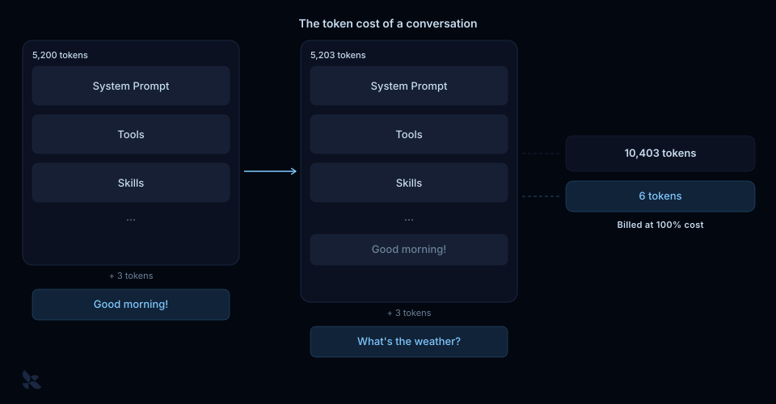
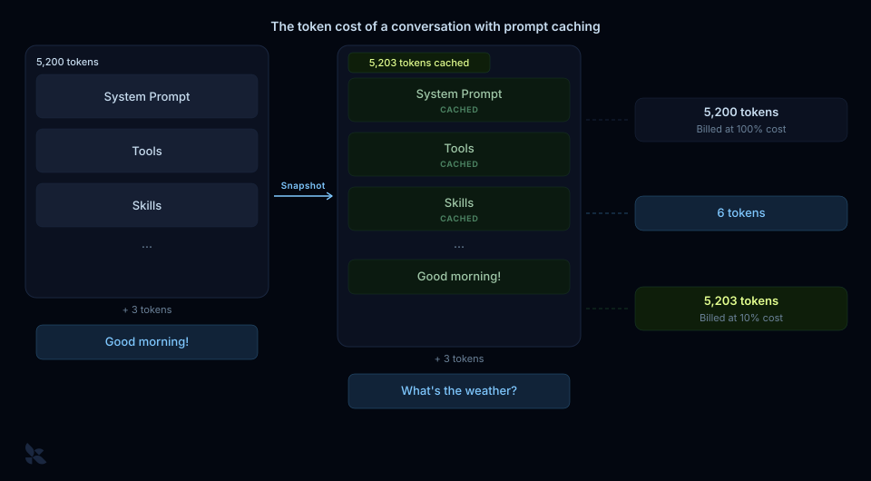
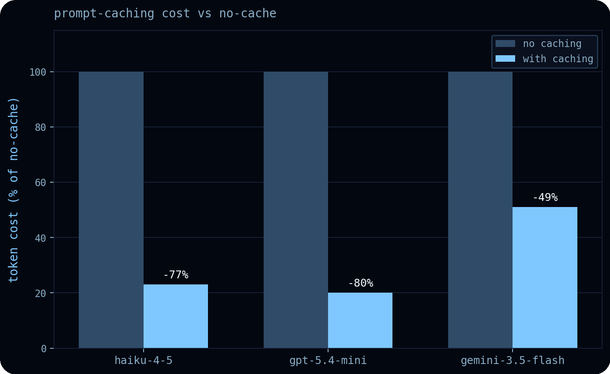
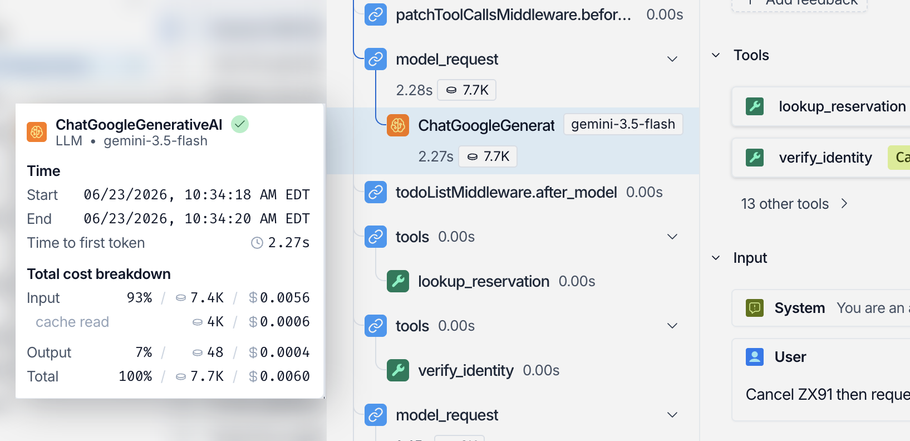
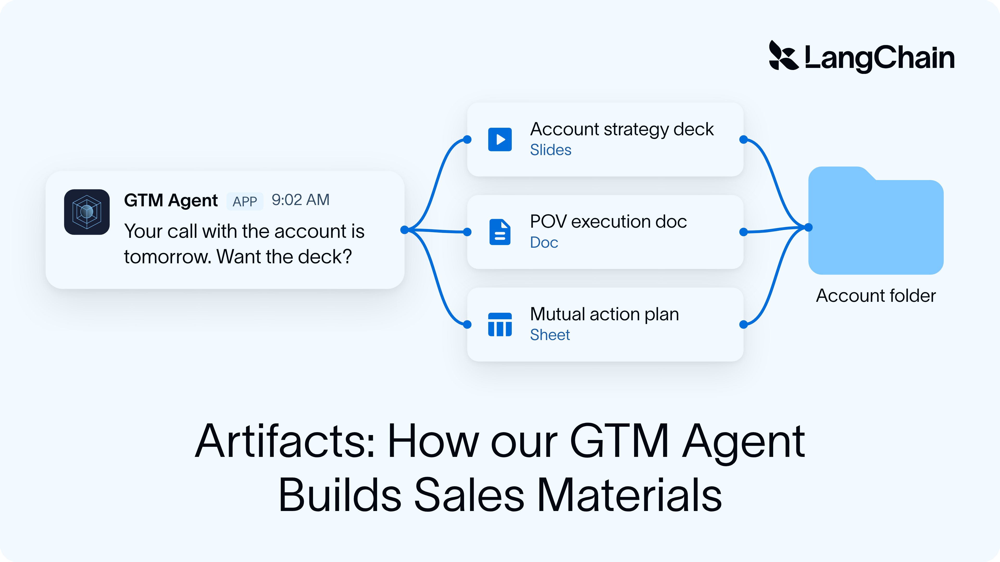
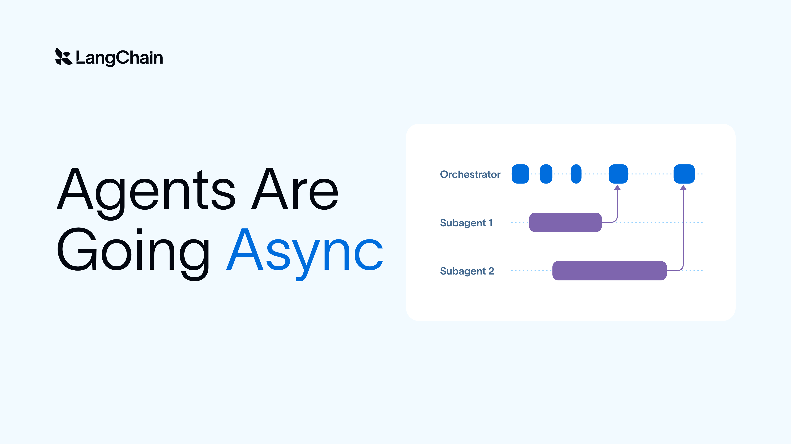
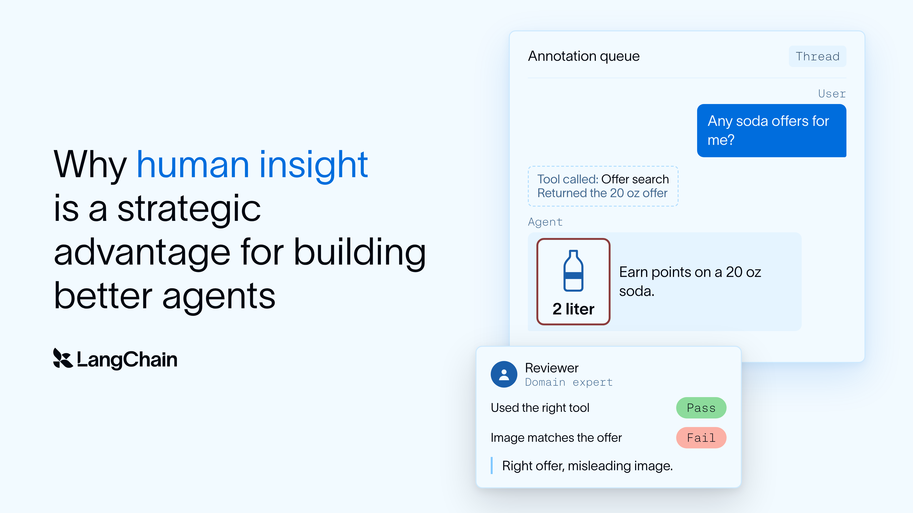

# Assigned reference: deep-agents-prompt-caching

[Course index](../../README.md) · [Original source](https://www.langchain.com/blog/deep-agents-prompt-caching) · [Raw file](../../raw/readings/www-langchain-com-blog-deep-agents-prompt-caching-edd85739.html)

Retrieved: 2026-11-13T17:02:50.297076+00:00

Deep Agents

Open Source

# Prompt Caching with Deep Agents


Alex Olsen

June 26, 2026


5

min

[Go back to blog](https://www.langchain.com/blog)

[Create agents](www-langchain-com-blog-deep-agents-prompt-caching-edd85739.md)

[Create agents](www-langchain-com-blog-deep-agents-prompt-caching-edd85739.md)

Share

A powerful lever in running agents cost-efficiently at scale is **Prompt Caching**, a feature offered by model providers that can [reduce the token cost of inference by 41-80%](https://arxiv.org/html/2601.06007v2). As [Manus AI puts it](https://manus.im/blog/Context-Engineering-for-AI-Agents-Lessons-from-Building-Manus) -

💡
*"If I had to choose just one metric, I'd argue that the KV-cache hit rate is the single most important metric for a production-stage AI agent."*

However, model providers support varied strategies for controlling caching, making provider-agnostic caching a trickier solve.

[Deep Agents](docs-langchain-com-oss-javascript-deepagents-overview-9687b9be.md) is our general purpose, model-agnostic agent harness which supports prompt caching features across all major providers. We’re going to dig into how [Deep Agents](docs-langchain-com-oss-javascript-deepagents-overview-9687b9be.md) uses prompt caching to cut API costs, but first let’s look at how prompt caching reduces token costs in a chat model conversation.

## TL;DR: prompt caching



The token cost of a chat model conversation grows quickly. For each new message, the model must reprocess every prior token in the conversation, including the:

- System prompt
- Tool descriptions
- Loaded skills
- Message history
- New message

When we opt into prompt caching, the provider stores a snapshot of the model’s state after processing a prompt:



On the next request, the model picks up from that snapshot and only processes new text.

However, loading a new skill or tool can modify our prompt *earlier* in the conversation, potentially causing a cache bust. Some model providers enable us to add explicit cache breakpoints earlier in the prompt, resulting in a cache hit on a subset of the prompt rather than a full cache bust. However, not all model providers support explicit cache breakpoints:

|  | Anthropic | OpenAI | Gemini | AWS Bedrock | Fireworks |
| --- | --- | --- | --- | --- | --- |
| Explicit Breakpoints | ✅ | ❌ | ✅ | Per-provider | ❌ |

Explicit caching is also just one prompt caching feature with varied support among providers:

|  | Anthropic | OpenAI | Gemini | AWS Bedrock | Fireworks |
| --- | --- | --- | --- | --- | --- |
| Explicit Breakpoints | ✅ | ❌ | ✅ | Per-provider | ❌ |
| Configurable TTL | ✅ | Per-model | ✅ | Per-provider | ❌ |
| Cache Prewarm | ✅ | ❌ | ❌ | Anthropic | ❌ |
| Routing Key | ❌ | ✅ | ❌ | OpenAI | ✅ |

*The prompt caching feature support landscape changes quickly. Be sure to check model provider docs for reference on feature support.*

Between differing prompt caching implementations and feature support among providers, it can be a challenge to achieve maximal cost savings across providers.

## How we’re solving this in Deep Agents

The [Deep Agents](docs-langchain-com-oss-javascript-deepagents-overview-9687b9be.md) harness makes a best-effort attempt at utilizing prompt caching features by automatically:

1. Setting explicit cache breakpoints when supported
2. Opting in to provider-side implicit caching when explicit breakpoints aren’t supported
3. Structuring your prompt to maximize cache reads

These strategies are supported for **all major providers**, so you’re able to switch provider at any time and still reap maximal token savings. To take advantage of provider-specific features, the harness detects the current model provider and delegates caching to [provider-specific middleware](https://docs.langchain.com/oss/javascript/langchain/middleware/built-in#provider-specific-middleware). You can also use the middleware in your own `createAgent()` to opt in to prompt caching savings:

```
// In Deep Agents you get prompt caching for free!
const agent = createDeepAgent({ model: 'gpt-5.5' });

// In LangChain, opt in via our middleware:
const agent = createAgent({
  model: 'claude-haiku-4-5-20251001',
  middleware: [anthropicPromptCachingMiddleware()],
});
```

`‍`The Deep Agents harness also structures your prompt and explicit cache points to minimize cache degradation. Optimally the static prefix (your tool descriptions, skills, system prompt) in a model invocation remains static. It *can* however change when doing things like updating a memory or compacting a conversation, leading to a cache bust. Deep Agents minimizes the blast radius by structuring your prompt and explicit cache points such that if e.g. a memory is updated, you still get a cache read on a subset of your prompt.

## The real savings of prompt caching

Feature tables tell us what's possible. To see what prompt caching actually saves, we ran the Deep Agents [eval suite](https://www.langchain.com/blog/how-we-build-evals-for-deep-agents) across a mid-tier model from each of three providers: `claude-haiku-4-5`, `gpt-5.4-mini`, and `gemini-3.5-flash`. The result is the chart below. On real agent trajectories, prompt caching cut token cost by 49–80%.



- `claude-haiku-4-5`: **-77%**. Using Anthropic's explicit breakpoints, we can keep a large portion of the prompt cached. This significantly reduced the token cost of each request.
- `gpt-5.4-mini`: **-80%**. OpenAI's automatic longest-prefix caching gives us a sizable 80%  cost reduction
- `gemini-3.5-flash`: **-49%**. Gemini's implicit caching makes [no explicit savings guarantee](https://ai.google.dev/gemini-api/docs/generate-content/caching), but we still see considerable savings

It's also worth noting that caching pays off more the longer a conversation runs: the cached prefix is reused across every turn, so the long-horizon tasks are the ones that benefit most.

## Observability with LangSmith

Cost savings from prompt caching are only as good as your ability to measure them. [LangSmith](https://docs.langchain.com/langsmith/observability) offers visibility into API cost, cache reads, and token usage at a per-invocation and per-trajectory level:



For each invocation you get time-to-first-token, total input tokens, cache-read tokens, and total output tokens rolled up to a per-trajectory aggregate. Because cache reads are itemized separately, you can see exactly how much of each prompt was served from cache rather than reprocessed.

This is also how we produced the numbers in this post:

1. Run the Deep Agents eval suite against each agent configuration
2. Inspect trace data in the [LangSmith dashboard](https://www.langchain.com/langsmith/observability) to verify run results
3. Pull the run data via the [LangSmith Client SDK](https://reference.langchain.com/python/langsmith)
4. Compute per-provider cost deltas by dropping the data into a Jupyter notebook (or have an agent use [LangSmith Skills](https://docs.langchain.com/langsmith/skills) to help)

LangSmith lets us disentangle savings from caching, trajectory length, and cheaper turns, which can inform how we optimize our agent. More on how to read and act on data in LangSmith [here](https://www.langchain.com/blog/debugging-deep-agents-with-langsmith).

## Next in prompt caching

Model providers have yet to converge on a common feature set for prompt caching. Explicit breakpoints drove some savings above, but it’s only the start. A handful of other features - cache prewarm, routing keys, configurable TTL - stand to unlock further cost savings and  latency wins.

You can take advantage of the currently-supported features today by using `createDeepAgent` - no additional config needed. As model providers add additional feature support, we’ll continue to fold them into the existing harness.

‍

### Related content



Deep Agents

#### How our GTM Agent builds consistent, high-quality sales artifacts


Nick Bray

November 10, 2026


11

min



Agent Architecture

Open Source

#### Agents Are Going Async


Sydney Runkle

Thushanth Bengre

November 5, 2026


5

min



Deep Agents

Conceptual Guide

#### Why human insight is a strategic advantage for building better agents


Gowri Harish

Sineha Manivannan

November 3, 2026


8

min


Thank you! Your submission has been received!

Oops! Something went wrong while submitting the form.

### See what your agent is really doing

LangSmith, our agent engineering platform, helps developers debug every agent decision, eval changes, and deploy in one click.

[Try LangSmith](https://smith.langchain.com/)[Get a demo](https://www.langchain.com/contact-sales)
