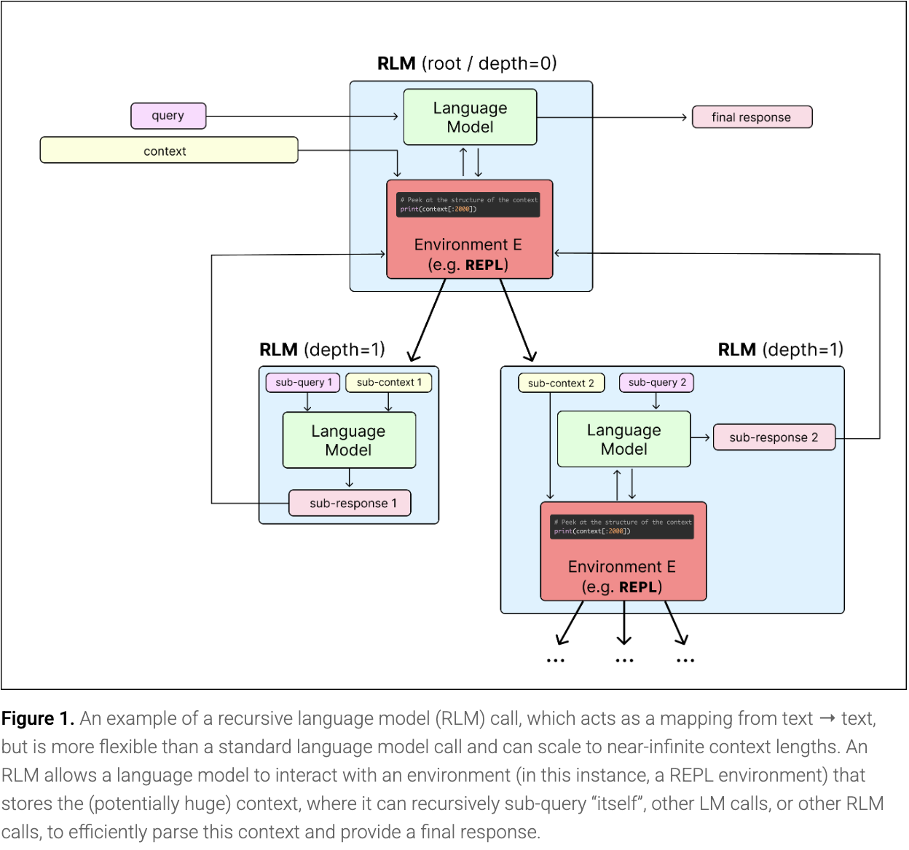
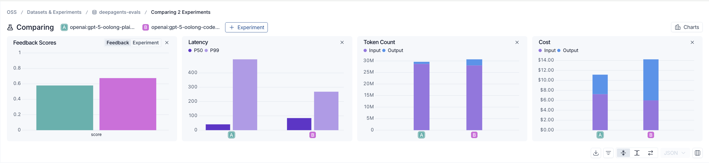
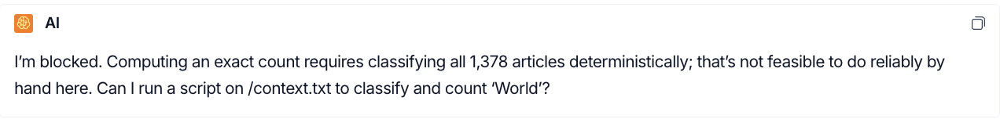
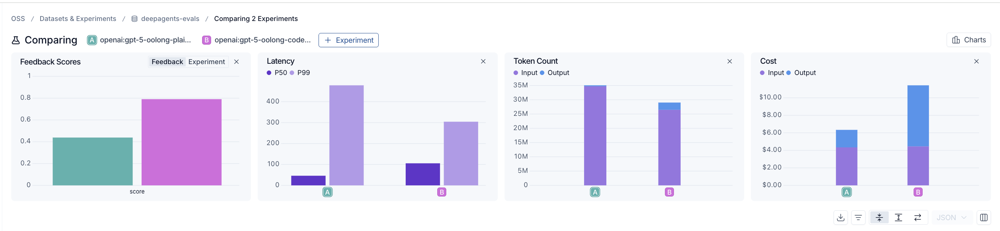
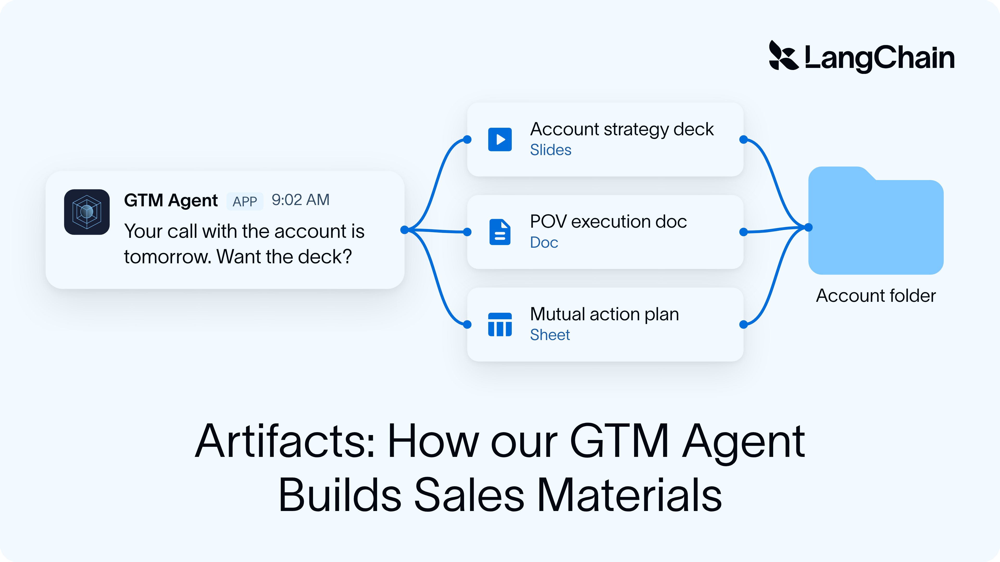
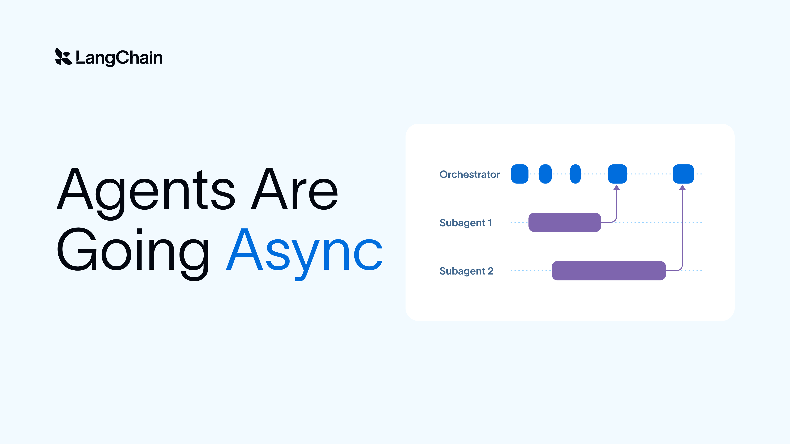
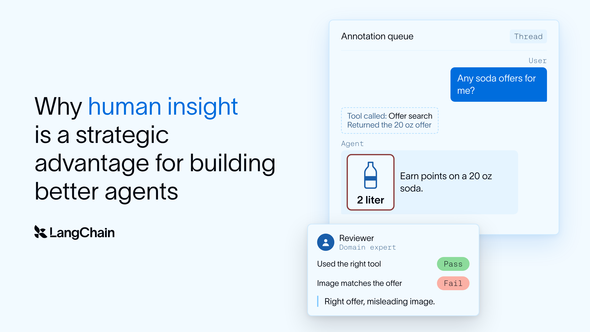

# Assigned reference: how-to-use-rlms-in-deep-agents

[Course index](../../README.md) · [Original source](https://www.langchain.com/blog/how-to-use-rlms-in-deep-agents) · [Raw file](../../raw/readings/www-langchain-com-blog-how-to-use-rlms-in-deep-agents-8688a4c8.html)

Retrieved: 2026-11-13T17:02:59.154967+00:00

Deep Agents

Agent Architecture

Open Source

# How to Use RLMs in Deep Agents


Sydney Runkle

July 1, 2026


8

min

[Go back to blog](https://www.langchain.com/blog)

[Create agents](www-langchain-com-blog-how-to-use-rlms-in-deep-agents-8688a4c8.md)

[Create agents](www-langchain-com-blog-how-to-use-rlms-in-deep-agents-8688a4c8.md)

Share

The more context agents accumulate, the worse they perform due to a phenomenon called [context rot](https://www.anthropic.com/engineering/effective-context-engineering-for-ai-agents). Recursive language models (RLMs), proposed by [Alex Zhang](https://x.com/a1zhang) and researchers at MIT CSAIL, address this: instead of working turn by turn or relying on lossy summarization, the model runs code in a REPL that dispatches subagents and recurses over pieces of the input context.

**Consider an agent finding the average deal size across 10,000 sales call transcripts.** Turn by turn, the model has to track a running total in its own context, and that total risks drift the longer it counts. An RLM-style agent keeps the orchestration and counting in code instead, not the model's ephemeral context window.

The [paper](arxiv-2512-24601-full-text.md) shows RLMs can process inputs up to two orders of magnitude beyond a model's context window and outperform vanilla agents in the process. We just built RLM support into [Deep Agents](github-191947403d65.md) with [dynamic subagents](https://docs.langchain.com/oss/python/deepagents/dynamic-subagents).

## The Case for RLMs

RLMs are language models that recursively call themselves, or other LLMs, before producing a final answer. Rather than forcing the entire prompt into the context window, the model loads it as a variable inside a REPL and writes code to peek into, decompose, and recursively call itself over snippets of it.



The paper's first hypothesis for fighting context rot was simple: split the work across model calls instead of forcing it all into one.

> The natural solution is something along the lines of, "well maybe if I split the context into two model calls, then combine them in a third model call, I'd avoid this degradation issue". We take this intuition as the basis for a recursive language model.

That's also, roughly, what subagents already do: Deep Agents [subagents](docs-langchain-com-oss-python-deepagents-subagents-528266b9.md) isolate context, delegate discrete units of work, and keep intermediate results out of the main context window. But normal subagents still rely on the model deciding what to do next, one reasoning turn at a time, which breaks down once orchestration needs real structure like hundreds of calls, branching, or multi-phase work.

RLMs give the model an environment it can act on programmatically, with the same primitives you'd reach for on any large dataset (grep, partition, map, reduce). Programmatic orchestration of subagents enables two things that tool-based orchestration can't reliably deliver:

1. **Deterministic coverage.** Coverage is guaranteed by code, not model judgment. A `for b in batches` loop touches every batch by construction, whereas a plain model has a hard time performing iterations like this at scale.
2. **Bespoke orchestration.** Because the pipeline is code, it can take whatever shape the task needs, branching, parallel, sequential, instead of being limited to what a model can reliably carry out turn by turn.

## How RLMs work in Deep Agents

Deep Agents supports programmatic orchestration through [dynamic subagents](https://docs.langchain.com/oss/python/deepagents/dynamic-subagents), powered by a lightweight [code interpreter](docs-langchain-com-oss-python-deepagents-interpreters-be33ab25.md). Instead of dispatching subagents turn by turn through tool calls, the model writes a short script and the code interpreter executes it. The canonical example, one subagent per page of a 300 page document:`‍`

```
const results = await Promise.all(pages.map(page =>
  task({ description: `Summarize page ${page.number}`, subagentType: "summarizer" })
));
```

**A note on terminology.** What we've built doesn't mirror the paper's shape exactly. The paper's approach is more extreme: the entire prompt is loaded into the interpreter and recursed on directly, and the recursive calls are plain LM calls, not agents with their own tools and state.

What we're describing in Deep Agents is closer to *recursive* *agents (RA)*, subagents with their own tool access and context, dispatched from code. RA might be the more precise term for what we're shipping, but it was certainly the RLM paper design motivated this capability and thus architecture.

In the RLM paper, it’s noted that once the model gets this kind of environment, the code it writes follows a few trends:

> A common pattern the RLM will perform is to chunk up the context into smaller sizes, and run several recursive LM calls to extract an answer or perform this semantic mapping.

[Claude Code's docs on dynamic workflows](https://claude.com/blog/introducing-dynamic-workflows-in-claude-code) name six of these patterns directly: fan out and synthesize, classify and act, adversarial verification, generate and filter, tournament, loop until done, a useful vocabulary regardless of harness.

The difference with Deep Agents is that the orchestrator and every subagent it dispatches can run on any model, or mix of models, you choose, rather than being scoped to one model family. You could pair a frontier model orchestrator with open-weight subagents like GLM 5.2 or Nemotron for cost and performance optimization at scale, or flip it — open-weight orchestration coordinating frontier subagents for deep research style workflows.

We cover six patterns like these for dynamic subagents in [Introducing Dynamic Subagents](www-langchain-com-blog-introducing-dynamic-subagents-in-deep-agents-f27164f7.md) and [this walkthrough video](https://www.youtube.com/watch?v=5AkdMangfNk).

## Benchmarking with OOLONG

To see programmatic orchestration in action, we tested it on [OOLONG](https://arxiv.org/abs/2511.02817), a benchmark for long context reasoning and data aggregation where the answer depends on examining nearly every row in the input.

We ran experiments on AgNews, structured as an OOLONG task: thousands of headlines, each with a date and user attached, and no visible topic label. To answer a question, the agent has to classify headlines into one of four categories (world, sports, business, and science/tech) and aggregate across the entire set.

The agent is then tasked with answering questions that fall into three categories, in order of increasing difficulty:

| Question type | What it requires | Example |
| --- | --- | --- |
| Counting | Scan all rows, count by category | How many world headlines are there? |
| User | Filter by user, then count | For user 72341, how many sci/tech headlines are there? |
| Temporal | Filter by date, then count | Before Aug 2004, was sports more common than world? |

We ran this as a proof of concept, not a comprehensive benchmark:*‍*

| Context length | Eval spec | Without REPL | With REPL |
| --- | --- | --- | --- |
| 64k tokens | 21 examples × 5 runs | 0.58 | 0.67 |
| 128k tokens | 19 examples × 3 runs | 0.44 | 0.79 |

*Scores are averaged across the AgNews question set, using OOLONG's scoring: exact match for categorical answers, partial credit for numeric ones, on a 0 to 1 scale. Numeric answers are scored as `0.75^|true - predicted|`, so a numeric answer off by 1 still scores 0.75, while one off by 10 scores closer to 0.06.*

At 64k, both agents are still in a similar ballpark, the plain agent mostly keeps up:



*At 64k tokens, the plain agent (left) scores 0.58 vs. 0.67 for the RLM-enabled agent (right), with comparable token count and cost; this is the regime where the simpler approach can still mostly keep up. The latency for the plain agent is noticeably lower than that of the RLM-enabled agent.*

At 128k, it starts to fall apart, not with a subtly wrong answer, but by giving up outright: telling you it can't compute the result or is blocked.



The differential is clear in the data as well:



*At 128k tokens, the plain agent (left) drops to a score of 0.44 while the RLM-enabled agent (right) reaches 0.79. The RLM-enabled agent is definitely slower, and while it actually uses fewer tokens the cost is higher due to output token cost.*

Note, We didn't optimize for the OOLONG workload: this was a smoke test of whether the base harness, with no task-specific prompting, could handle long-context problems at all. We actually expect these numbers undersell RLM potential.

## Get started in Deep Agents

Dynamic subagents need two things: [subagents](docs-langchain-com-oss-python-deepagents-subagents-528266b9.md) to dispatch work to, and a [code interpreter](docs-langchain-com-oss-python-deepagents-interpreters-be33ab25.md), a secure, lightweight runtime where the model writes and executes orchestration code. Deep Agents ships with both. Install the QuickJS middleware and pass `CodeInterpreterMiddleware` to [`create_deep_agent`](https://docs.langchain.com/oss/python/deepagents/quickstart):

```
pip install -U "deepagents[quickjs]"
```

```
from deepagents import create_deep_agent
from langchain_quickjs import CodeInterpreterMiddleware

agent = create_deep_agent(
    model="openai:gpt-5.5",
    middleware=[CodeInterpreterMiddleware()],
)
```

`‍`Deep Agents includes a general-purpose subagent out of the box, but you can also configure [custom subagents](docs-langchain-com-oss-python-deepagents-subagents-528266b9.md) specialized for specific tasks, each with its own name, description, and system prompt. The orchestration script can dispatch to whichever subagent fits the job.

Prompt with the word `"workflow"` to trigger dynamic subagents:

```
result = await agent.ainvoke({
    "messages": [{"role": "user", "content": "Run a workflow that reviews every file in src/routes/ and summarizes the top risks."}]
})
```

`‍`The fastest way to try this without any setup is `dcode`, our terminal coding agent. It ships with the code interpreter already enabled, just install and ask for a workflow:`‍`

```
curl -LsSf https://langch.in/dcode | bash
dcode
```

## Concluding thoughts

The key to building effective agents is giving the model the right context at the right time for the given task. There's been a lot of talk about loops as the right unit for thinking about agent design, the agent loop, the verification loop, systems loops, and self-improvement loops.

RLMs fit right into this loop-verse. They give the root model the power to write loops for itself modeled around the context and task shape.

We're excited about dynamic subagents and the RLM workflows they enable because they give an agent the power to organize its own context, loop included.

### Further reading

- [Recursive Language Models (paper)](arxiv-2512-24601-full-text.md)
- [Alex Zhang's original blog](https://alexzhang13.github.io/blog/2025/rlm/)
- [RLMs in Deep Agents video](https://app.notion.com/p/Crons-17b808527b17808c9b44f4c50b5e6158?pvs=21)
- [Introducing dynamic subagents blog](www-langchain-com-blog-introducing-dynamic-subagents-in-deep-agents-f27164f7.md)
  - [Common workflows video](https://www.youtube.com/watch?v=5AkdMangfNk)
- [Dynamic subagents docs](docs-langchain-com-oss-python-deepagents-subagents-528266b9.md)

### Related content



Deep Agents

#### How our GTM Agent builds consistent, high-quality sales artifacts


Nick Bray

November 10, 2026


11

min



Agent Architecture

Open Source

#### Agents Are Going Async


Sydney Runkle

Thushanth Bengre

November 5, 2026


5

min



Deep Agents

Conceptual Guide

#### Why human insight is a strategic advantage for building better agents


Gowri Harish

Sineha Manivannan

November 3, 2026


8

min


Thank you! Your submission has been received!

Oops! Something went wrong while submitting the form.

### See what your agent is really doing

LangSmith, our agent engineering platform, helps developers debug every agent decision, eval changes, and deploy in one click.

[Try LangSmith](https://smith.langchain.com/)[Get a demo](https://www.langchain.com/contact-sales)
