# Assigned reference: introducing-dynamic-subagents-in-deep-agents

[Course index](../../README.md) · [Original source](https://www.langchain.com/blog/introducing-dynamic-subagents-in-deep-agents) · [Raw file](../../raw/readings/www-langchain-com-blog-introducing-dynamic-subagents-in-deep-agents-f27164f7.html)

Retrieved: 2026-11-13T17:03:03.036921+00:00

Open Source

Deep Agents

Agent Architecture

# Introducing Dynamic Subagents in Deep Agents


Sydney Runkle

Colin Francis

Hunter Lovell

June 29, 2026


9

min

[Go back to blog](https://www.langchain.com/blog)

[Create agents](www-langchain-com-blog-introducing-dynamic-subagents-in-deep-agents-f27164f7.md)

[Create agents](www-langchain-com-blog-introducing-dynamic-subagents-in-deep-agents-f27164f7.md)

Share

As agents take on more ambitious tasks, they have a hard time:

1. Reliably completing work at scale
2. Managing their own context

We’ve been experimenting with how to handle these challenges in the form of what we’re calling [*dynamic subagents*](https://docs.langchain.com/oss/python/deepagents/dynamic-subagents): instead of issuing subagent tasks through generic tool calling, the agent writes a short script that drives subagent execution. This means models can rely on code patterns it’s good at writing (like looping, branching, or concurrency) to write orchestration logic fit to the task.

## Why dynamic subagents?

Deep Agents already supports [subagents](docs-langchain-com-oss-python-deepagents-subagents-528266b9.md). They isolate context, let the main agent delegate discrete units of work, and keep intermediate results out of the main context window. So why do we need dynamic subagents?

With normal subagents, they are called one at a time, by the main model invoking them directly. That works at small scale. It breaks down when you need to spawn hundreds of subagents, or when the orchestration logic is conditional or multi-phase.

Dynamic subagents solve this with **programmatic orchestration**. Instead of making tool calls turn-by-turn, the agent writes a short script that orchestrates and calls subagents, and runs it in a lightweight interpreter.

The canonical example: one subagent per page of a 300-page document. Rather than calling the subagent tool 300 times, the agent writes a loop:

```
const results = await Promise.all(pages.map(page =>
  task({ description: `Summarize page ${page.number}`, subagentType: "summarizer" })
));
```

`‍`This unlocks two things that tool-call-based orchestration can't reliably deliver:

**Deterministic coverage at scale.** Without structure, agents make judgment calls about scope, screening 75 of 500 items and calling it done. A dispatch loop doesn't. Coverage becomes a structural guarantee, not a prompt engineering problem.

**Reliable complex orchestration.** Writing orchestration as code is more reliable than having the model reproduce it as a sequence of tool calls, especially for fan-out + synthesis, multi-phase pipelines, or conditional branching.

This is the same idea behind [workflows in Claude Code](https://code.claude.com/docs/en/workflows) and [Recursive Language Models (RLMs)](arxiv-2512-24601-full-text.md): a model writes code, and that code dispatches more agents.

## Quickstart

Dynamic subagents require two things: [subagents](docs-langchain-com-oss-python-deepagents-subagents-528266b9.md) to dispatch work to, and a [code interpreter](docs-langchain-com-oss-python-deepagents-interpreters-be33ab25.md): a secure, lightweight runtime where the model writes and executes orchestration code. Deep Agents includes an optional code interpreter based on QuickJS. To use it, install the QuickJS middleware package, then pass `CodeInterpreterMiddleware` via the `middleware` argument on [`create_deep_agent`](https://docs.langchain.com/oss/python/deepagents/harness).

```
pip install -U "deepagents[quickjs]"
```

```
from deepagents import create_deep_agent
from langchain_quickjs import CodeInterpreterMiddleware

agent = create_deep_agent(
    model="openai:gpt-5.5",
    middleware=[CodeInterpreterMiddleware()],
)
```

Deep Agents ships with a general-purpose [subagent](docs-langchain-com-oss-python-deepagents-subagents-528266b9.md) built in, so there’s already one general subagent profile that can be used in workflows. For specialized workflows, configure [custom subagents](docs-langchain-com-oss-python-deepagents-subagents-528266b9.md) with their own names, descriptions, and system prompts: the names and descriptions are how the agent knows which role to reach for.

To trigger dynamic subagents, prompt your agent with the word `"workflow"`, like this:

```
result = await agent.ainvoke({
    "messages": [{"role": "user", "content": "Run a workflow that reviews every file in src/routes/ and summarizes the top risks."}]
})
```

### Use with a coding agent

The fastest way to try dynamic subagents is with `dcode`, our terminal coding agent built using a Deep Agent. It ships with the code interpreter enabled, so there's nothing to wire up — dynamic subagents works out of the box.

Install

```
curl -LsSf https://langch.in/dcode | bash
```

Run`‍`

```
dcode
```

To trigger dynamic subagents, just ask for a “**workflow**”. Instead of grinding through the work itself, or trying to manage subagent fan outs with its native task tool, the agent writes an orchestration script that calls the built-in `task()` global and executes it in the code interpreter. For example: “run a *workflow* to review every file in src/ for SQL injection.”

As subagents spawn, `dcode` shows them live in the dynamic subagents panel grouped into phases by dispatch.

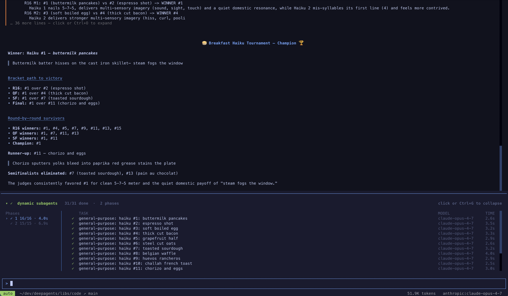

You can try this fastest with `dcode` but you can also use it in your tool of choice via ACP (such as Zed)

## How it works

The agent is given an [`eval` tool](docs-langchain-com-oss-python-deepagents-interpreters-be33ab25.md). It writes JavaScript that executes securely inside the interpreter. When [subagents](docs-langchain-com-oss-python-deepagents-subagents-528266b9.md) are configured, the interpreter exposes a built-in `task()` global that dispatches them from code. Based on the task at hand, the model writes different code — a loop, a branch, a `Promise.all` — and the interpreter runs it deterministically.

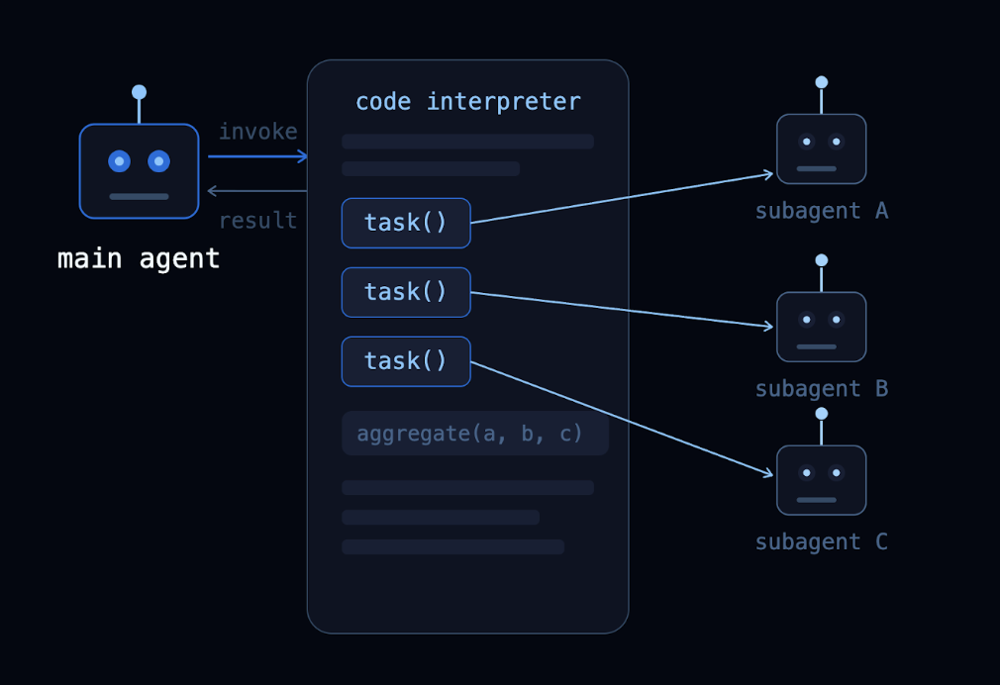

`task()` takes a `description`, a `subagentType`, and an optional `responseSchema` — when provided, the result is already a typed object, ready to filter or pass to the next step.`‍`

```
const result = await task({
  description: "Review src/auth/login.ts for security issues.",
  subagentType: "reviewer",
  responseSchema: {
    type: "object",
    properties: {
      severity: { type: "string", enum: ["high", "medium", "low"] },
      issues: { type: "array", items: { type: "string" } },
    },
  },
});

const critical = result.severity === "high" ? result.issues : [];
critical; // model sees the last line
```

For more, see [Programmatic subagents](https://docs.langchain.com/oss/python/deepagents/programmatic-subagents) and [Interpreters](docs-langchain-com-oss-python-deepagents-interpreters-be33ab25.md) in the docs.

## Common Orchestration Patterns

Anthropic's [dynamic workflows](https://claude.com/blog/a-harness-for-every-task-dynamic-workflows-in-claude-code) popularized a set of orchestration patterns for parallel agent work. They aren’t features you turn on. They’re shapes that naturally fall out of the work, and the agent settles into a different one as the task changes. The table below maps each shape to the kind of work it fits.

| Pattern | Shape | Reach for it when |
| --- | --- | --- |
| Classify and act | Route each item to a specialist by type | Mixed inputs need different handling |
| Fanout and synthesize | Same work across many items in parallel, then combine | Independent units, one combined report |
| Adversarial verification | Find, then independently verify before keeping | False positives are costly |
| Generate and filter | Produce several options, score, keep the best | Exploring options beats one-shot |
| Tournament | Head-to-head judging, winners advance | Subjective or relative criteria |
| Loop until done | Repeat passes until one turns up nothing new | Scope is unknown, you want completeness |

Below we’ll dive into how each one works in Deep Agents, with live traces. We also put together a video explaining these six patterns, which you can check out [here](https://www.youtube.com/watch?v=5AkdMangfNk).

### Classify and act

Items are classified first, then each item is handled by a specialized subagent based on its classification. This lets you process mixed inputs where different items need different expertise.

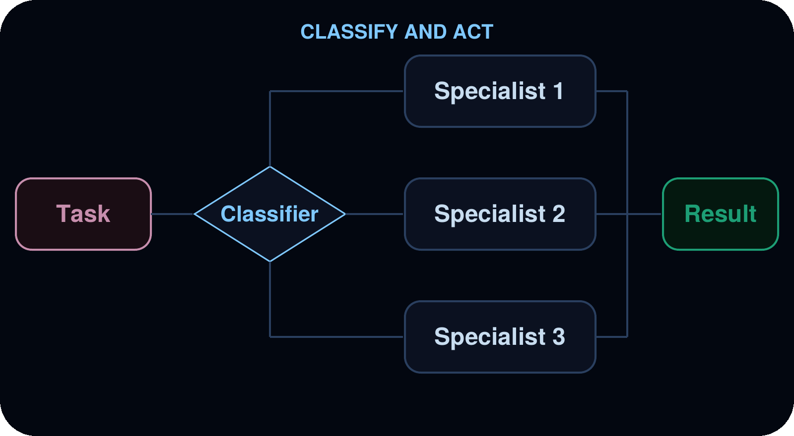

**Use cases:** Triaging support tickets, error logs, user feedback, or any batch of items that need different handling depending on their type.

**Example**: triaging a support-ticket backlog. The agent reads the tickets and classifies each as a bug, feature request, or question. Bugs to a `bug-investigator`, feature requests to a `feature-analyst`, and questions to a `support-responder`. The result is a summary grouped by category.

View the trace [here](https://smith.langchain.com/public/20b1da82-de4a-4de4-ae20-6097c059cd94/r).

### Fanout and synthesize

The agent dispatches the same kind of work across many items in parallel, then combines the results.

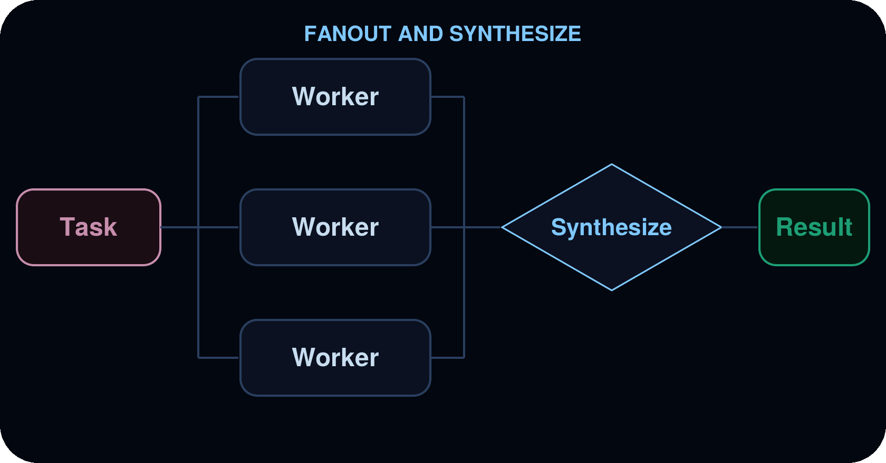

**Use cases:** Code review across a directory, analyzing a batch of documents, processing log files, running the same check across many services.

Example: a per-file security review across a source tree. The agent discovers every TypeScript file under `src/` and dispatches one security-reviewer per file in parallel. It then merges the results into a single prioritized report with severity ratings and the lines that need to change.

View the trace [here](https://smith.langchain.com/public/d80cdf1a-37fc-4823-8500-417fe624fe3e/r).

### Adversarial verification

A two-pass pattern. The first pass produces findings. The second pass sends each finding to independent verifiers, and only findings that survive agreement are kept. This reduces false positives when confidence matters more than speed.

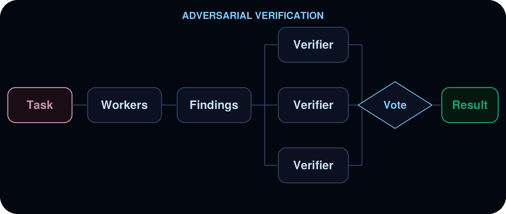

**Use cases:** Security audits where false positives are costly, compliance checks, any review where you need high confidence in findings.

Example: a security audit where false positives are unacceptable. An auditor casts a wide net for potential vulnerabilities, then each finding is handed to an independent verifier that reads the code fresh and returns a CONFIRMED or REFUTED verdict. Only confirmed findings survive into the final report.

View the trace [here](https://smith.langchain.com/public/6f47c6c5-34ee-454e-9ffe-bf23e4a619e6/r).

### Generate and filter

Multiple subagents generate independent solutions to the same problem. The agent compares, scores, and filters the results in code, keeping only the best.

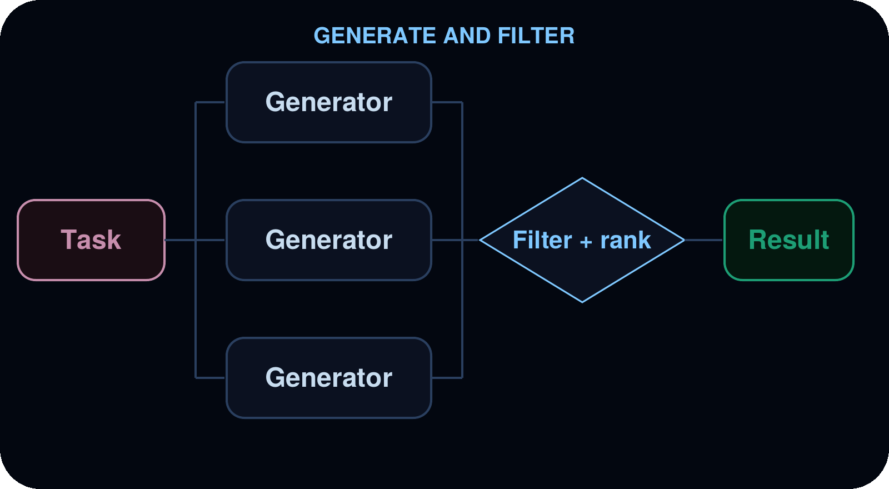

**Use cases:** Architecture proposals, refactoring strategies, content variations, any task where exploring multiple options before committing produces a better outcome.

Example: competing rate-limiter redesigns, ranked. The agent has an `architect` to produce several independent redesigns of `rate-limiter.ts`, each written to its own file so they don’t overwrite each other. It then scores them on correctness under burst, multi-instance support, and complexity. The strongest one wins, with a rationale for why.

View the trace [here](https://smith.langchain.com/public/fbecf524-e8c5-4db4-930f-4a82b22d5d59/r).

### Tournament

Variations are compared head-to-head by a judge subagent, with winners advancing through elimination rounds.

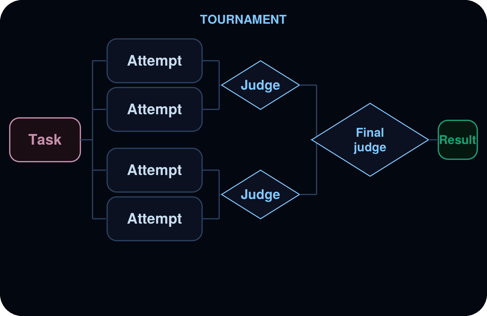

**Use cases:** Optimization under subjective criteria, style selection, choosing between competing implementations.

Example: a pairwise bracket over rewrites of a messy `createOrder` handler. Several writers each produce a candidate rewrites with different priorities, then a `judge` compares them head-to-head, advancing winners round-by-round until one champion stands out. It comes back with the `judge`’s reasoning.

View the trace [here](https://smith.langchain.com/public/f89bcdb7-57be-4a3e-a290-36dbdaaa4294/r).

### Loop until done

The agent runs a discovery loop, deduplicating against what it has already found, until no new results appear. Useful when the scope of the work is not known upfront.

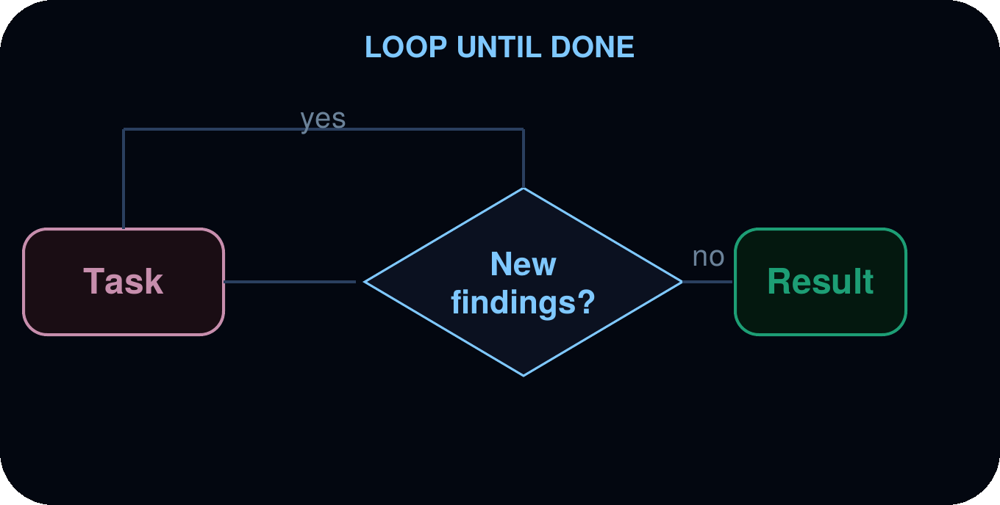

**Use cases:** Exhaustive search, dead code detection, dependency audits, any sweep where you want completeness rather than a fixed number of results.

Example: a pass-based security sweep. The agent runs a scan pass, inspects what it found in code, and only starts another pass if the previous one surfaced new issues. It stops when a pass turns up nothing new. It reports the consolidated findings and how many passes it took.

View the trace [here](https://smith.langchain.com/public/f93dd802-76c4-41c3-80af-16ce9d10a1a2/r).

## Conclusion

Dynamic subagents are how you give agents more autonomy and increased reliability. The code handles coverage and intermediate context, and the model still does the judgement-heavy work. The above patterns above are a starting point. In practice, agents compose and mix them based on what the task demands.

This is the Recursive Language Model idea in its simplest form. An agent that writes code, and that code dispatches more agents. It’s an agent calling itself recursively and it isn’t capped by a context window or boxed into a fixed workflow. An agent can break the problem down as far as it goes and reassemble the pieces in whatever shape fits. The orchestration patterns highlighted above are early glimpses of what is possible but the ceiling will only continue to rise as models get better at writing code.

[Dynamic subagents](https://docs.langchain.com/oss/python/deepagents/dynamic-subagents) are how Deep Agents puts this in your hands today. Get started by adding a code interpreter to your agent, or reach for [`dcode`](https://docs.langchain.com/oss/python/deepagents/code/overview) where dynamic subagents works out of the box.

### Related content

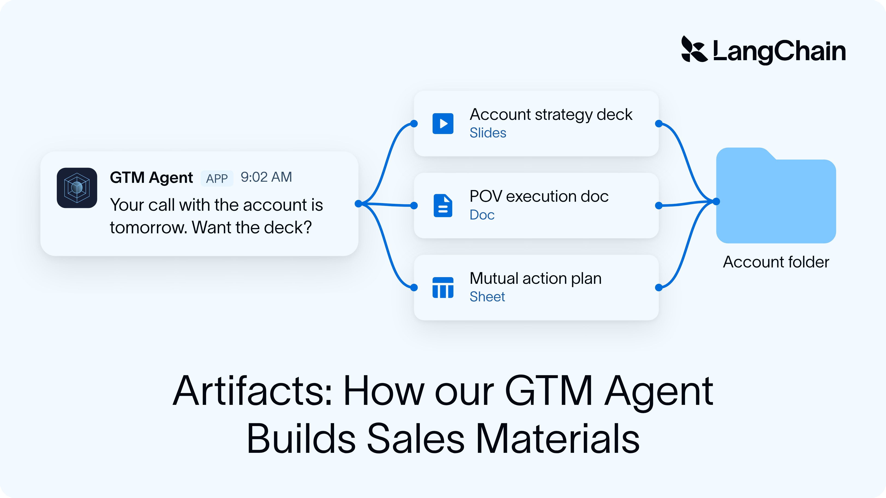

Deep Agents

#### How our GTM Agent builds consistent, high-quality sales artifacts


Nick Bray

November 10, 2026


11

min

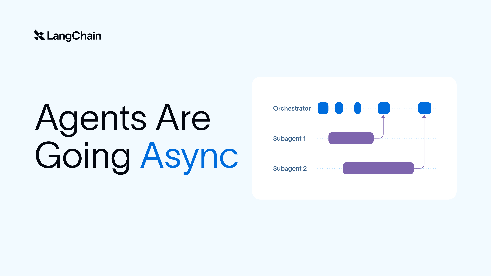

Agent Architecture

Open Source

#### Agents Are Going Async


Sydney Runkle

Thushanth Bengre

November 5, 2026


5

min

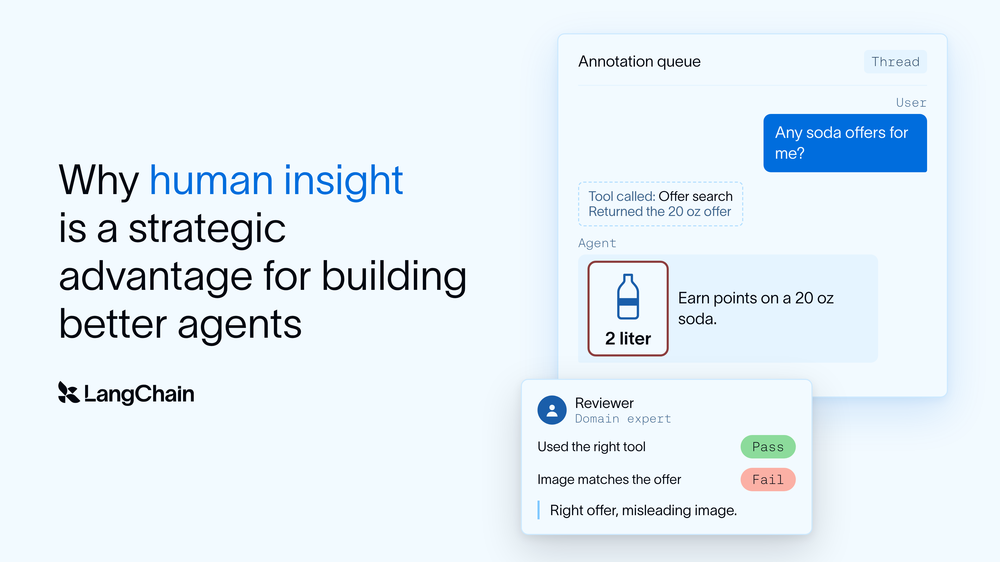

Deep Agents

Conceptual Guide

#### Why human insight is a strategic advantage for building better agents


Gowri Harish

Sineha Manivannan

November 3, 2026


8

min


Thank you! Your submission has been received!

Oops! Something went wrong while submitting the form.

### See what your agent is really doing

LangSmith, our agent engineering platform, helps developers debug every agent decision, eval changes, and deploy in one click.

[Try LangSmith](https://smith.langchain.com/)[Get a demo](https://www.langchain.com/contact-sales)
