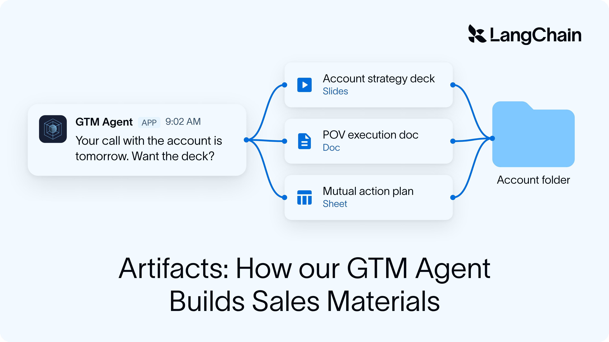
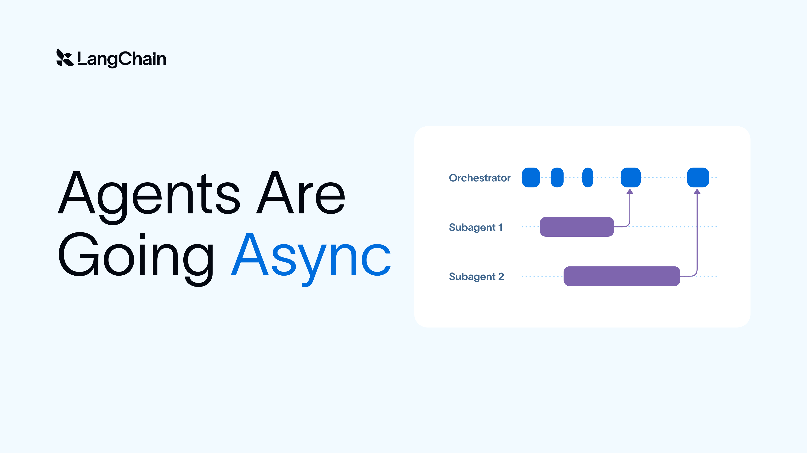
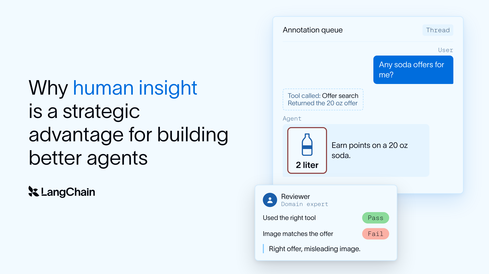

# Assigned reference: running-subagents-in-the-background

[Course index](../../README.md) · [Original source](https://www.langchain.com/blog/running-subagents-in-the-background) · [Raw file](../../raw/readings/www-langchain-com-blog-running-subagents-in-the-background-76f7f127.html)

Retrieved: 2026-11-13T17:03:07.387903+00:00

Agent Architecture

Deep Agents

Open Source

# Running Subagents in the Background


Hunter Lovell

Colin Francis

April 16, 2026


4

min

[Go back to blog](https://www.langchain.com/blog)

[Create agents](www-langchain-com-blog-running-subagents-in-the-background-76f7f127.md)

[Create agents](www-langchain-com-blog-running-subagents-in-the-background-76f7f127.md)

Share

## Key Takeaways

- **Inline subagents block the supervisor agent for the duration of the task.** Because tool calls in an agent loop are synchronous, the supervisor can't respond to users, coordinate other work, or course-correct until the subagent finishes, a real problem when a task takes an hour or more.
- **Async subagents return a task ID immediately, so supervisors stay in control.** The supervisor can launch multiple subagents in parallel, keep talking to the user, send mid-task updates, or cancel work that's no longer needed, more like "fire-and-steer" than "fire-and-forget."
- **Async subagents are built on Agent Protocol, so you're not locked into one deployment.** They run as fully separate agents with their own process and state, and can be hosted on LangSmith deployments or self-hosted on your own infrastructure, the supervisor manages them through the same standard interface either way.

We're starting to ask more of our agents — we want them to take on longer and more complex tasks. As we've done that, the typical way that we've orchestrated agents has started to show some cracks.

We shipped [async subagents](docs-langchain-com-oss-javascript-deepagents-async-subagents-4835e470.md) to Deep Agents recently to help address that! It's a pattern that lets agents run delegated work in the background, and is something we're excited about since it remedies some of the shortcomings of traditional agent architectures.

## Where traditional subagents break down

A subagent is an agent that a supervisor agent delegates scoped work to. The subagent gets instructions from the supervisor, access to relevant tools, and returns a summary when it’s done. It’s a context engineering pattern that we’ve been adopting in practically all of the agents we build for a couple of important reasons:

1. **Agents perform better when work is broken up into smaller tasks** - a supervisor agent gets an understanding of the problem, organizes the tasks, then coordinates workers that execute on them.
2. **Not all information about a small task is important for the large objective** - by splitting things out into focused, independent agent runs, we hide away unnecessary context from the supervisor.

This pattern works. But as we’ve given agents longer and more complex tasks, inline subagents have started to break down.

## Agent are put in a deadlock while subagents are working

Subagents are called via a tool that's given to the supervisor agent, and because of the way that tool calling works inside of an agent, the supervisor can't reason about anything else until the tool call has been answered with the subagent response.

This wasn't that big of an issue when subagents were tasked with smaller, low-stakes tasks. But now that we've given agents more complicated tasks and tooling (and with models that take longer to run), this becomes more strongly felt. If a subagent takes an hour, you have to wait an hour before you can interact with the agent again.

## New information is hard to coordinate

There are a couple of channels of information that are important to an agent as it's working:

- **User input** — the user might want to steer the agent, add context, or change priorities while a task is in flight.
- **Results from other work** — one subagent's output might inform what another subagent should do next.
- **Partial progress** — sometimes you want to course-correct a task that's heading in the wrong direction before it finishes.

With inline subagents, none of these channels are available. The supervisor is blocked, so the user can't talk to it. Subagents can't run concurrently, so there's no cross-pollination of results. And subagent turns are all-or-nothing  meaning there's no way to send a mid-task update or gracefully handle a partial failure. The supervisor fires off a subagent and hopes for the best.

## Enter: Async Subagents

A simple way to think about async subagents are as subagents that run in the background instead of sequentially. Instead of waiting for the subagent to finish before moving on, the supervisor launches a task, gets a task ID back immediately, and continues working. It can talk to the user, kick off more subagents, or make progress on other parts of the problem while work is happening in the background.

Because subagents are stateful and maintain their own conversation thread, the supervisor can send follow-up instructions, course-correct mid-task, or cancel work that's no longer needed. Think of it less like "fire-and-forget" and more like "fire-and-steer."

### How they work

Instead of giving the supervisor a single blocking tool call per subagent, async subagents give the supervisor a set of management tools that work more like a task queue:

| Tool | Purpose |
| --- | --- |
| `start_async_task` | Launch a task on a remote agent. Returns a task ID immediately. |
| `check_async_task` | Poll a task's status and retrieve its result when complete. |
| `update_async_task` | Send follow-up instructions to a running task. |
| `cancel_async_task` | Cancel a running task. |
| `list_async_tasks` | List all tracked tasks with their current statuses. |

The supervisor uses these tools naturally as part of its reasoning loop — it can start a few tasks, go back to talking with the user, check in on progress, and course-correct as needed.

Traditional subagents are really just a function of the parent agent — they share a process, they share state, and they only exist inside the supervisor's execution loop. Async subagents treat them as separate, individually addressable agents entirely. They can run in their own process, maintain their own state, and scale to runs that might call hundreds or thousands of subagents.

### **Built on Agent Protocol**

That kind of separation requires more than in-process function calls. Async subagents are built on [Agent Protocol](https://github.com/langchain-ai/agent-protocol), a framework-agnostic API specification for managing remote agents. It defines standard endpoints for creating threads, launching runs, polling status, sending updates, and managing long-term memory. Everything the supervisor needs to manage async work through a consistent interface.

The key benefit is deployment flexibility. You aren't locked into any single hosting platform. Run your async subagents on [LangSmith deployments](https://docs.langchain.com/langsmith) for a managed experience, or host them yourself on your own infrastructure. The supervisor doesn't care where the subagent lives. It sends a task, gets a task ID, and manages the lifecycle through the same standard interface either way.

To learn more about Agent Protocol, see the [specification](https://github.com/langchain-ai/agent-protocol) and [API reference](https://langchain-ai.github.io/agent-protocol/api.html).

## **How to use async subagents in Deep Agents**

[Deep Agents](https://docs.langchain.com/oss/python/deepagents) is our general purpose agent harness that [we talk a lot about](https://blog.langchain.com/). Adding async subagents to DeepAgents is as simple as swapping an async subagent spec into the `subagents` list — you can mix and match them freely with inline subagents.

### **With LangSmith Deployment**

Define your agents and register them in `langgraph.json`. Because the researcher is a separate agent, the supervisor gets the async management tools automatically:

```
// agents.ts
import { createAgent } from "langchain";
import { createDeepAgent } from "deepagents";

export const researcher = createAgent({
  model: "anthropic:claude-sonnet-4-6",
  instructions: "Perform deep research on the given topic.",
  tools: [searchWeb, readUrl],
});

export const agent = createDeepAgent({
  model: "anthropic:claude-opus-4-6",
  subagents: [{
    name: "researcher",
    description: "Performs deep research on a topic.",
    graphId: "researcher",
  }],
});
```

```
// langgraph.json
{
  "dependencies": ["."],
  "graphs": {
    "researcher": "./agents.ts:researcher",
    "agent": "./agents.ts:agent"
  }
}
```

The subagent runs in its own process with its own state and the supervisor just delegates and checks back.

## Self-hosted

If you want full control over where your subagents run, you can host them yourself. The subagent just needs to implement the Agent Protocol endpoints and the supervisor connects to it via a URL instead of a graph ID.

```
export const agent = createDeepAgent({
  model: "anthropic:claude-opus-4-6",
  subagents: [{
    name: "researcher",
    description: "Performs deep research on a topic.",
    graphId: "researcher",
    url: "http://localhost:2024",  // points to your self-hosted server
  }],
});
```

The self-hosted server implements the Agent Protocol endpoints (creating threads, launching runs, polling status, cancelling tasks) and can run anywhere — a Docker container, a VM, your own Kubernetes cluster. We have a [complete self-hosted example](https://github.com/langchain-ai/deepagentsjs/tree/main/examples/async-subagent-server) that includes a Hono server, Postgres-backed state, and Docker Compose setup you can use as a starting point.

## Learn more

For a complete walkthrough — including deployment configuration, tracing, and troubleshooting — see the [async subagents documentation](docs-langchain-com-oss-javascript-deepagents-async-subagents-4835e470.md).

### Related content



Deep Agents

#### How our GTM Agent builds consistent, high-quality sales artifacts


Nick Bray

November 10, 2026


11

min



Agent Architecture

Open Source

#### Agents Are Going Async


Sydney Runkle

Thushanth Bengre

November 5, 2026


5

min



Deep Agents

Conceptual Guide

#### Why human insight is a strategic advantage for building better agents


Gowri Harish

Sineha Manivannan

November 3, 2026


8

min


Thank you! Your submission has been received!

Oops! Something went wrong while submitting the form.

### See what your agent is really doing

LangSmith, our agent engineering platform, helps developers debug every agent decision, eval changes, and deploy in one click.

[Try LangSmith](https://smith.langchain.com/)[Get a demo](https://www.langchain.com/contact-sales)
