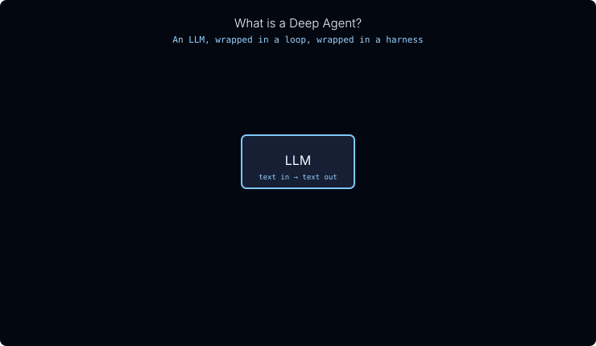
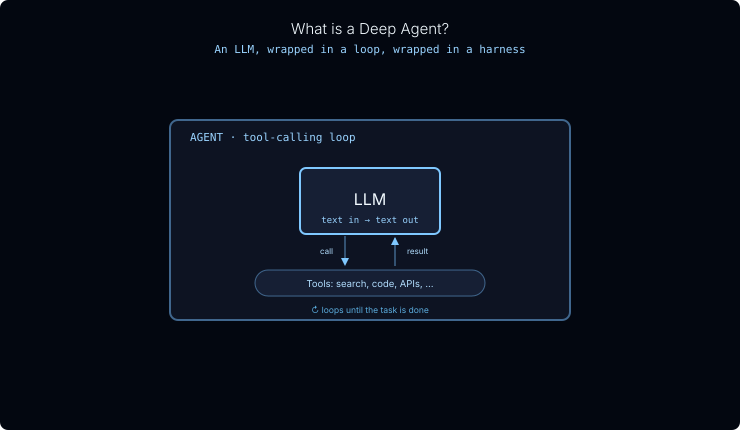
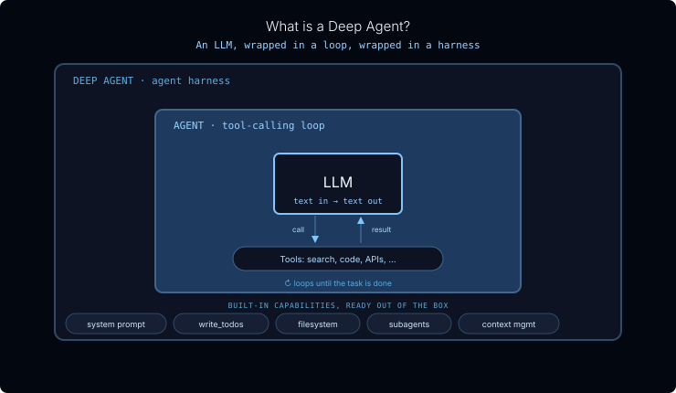
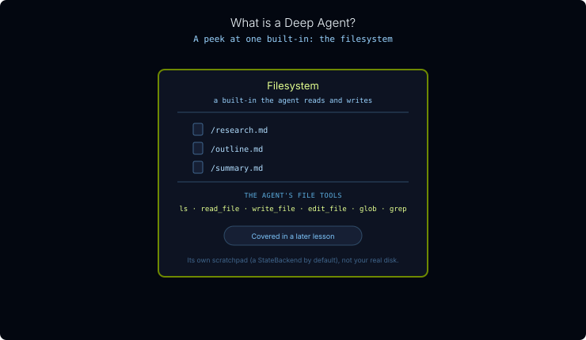
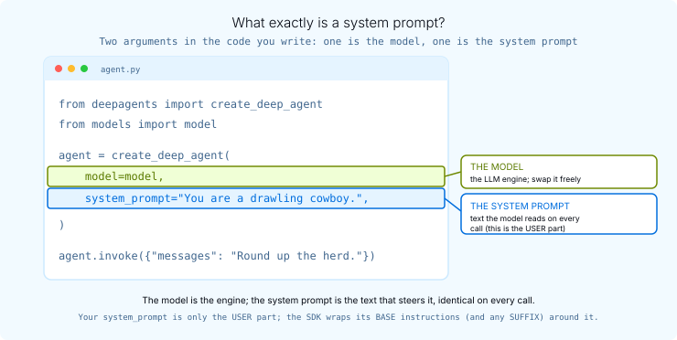

# Official course repository: Python, TypeScript, lesson sources, and agent UI: thinkific/src/m1/m1.1-overview.md

[Course index](../../../../../../README.md) · [Original source](https://github.com/langchain-ai/lca-deepagents/blob/HEAD/thinkific/src/m1/m1.1-overview.md) · [Raw file](../../../../../../raw/repositories/lca-deepagents/thinkific/src/m1/m1.1-overview.md)

Retrieved: 2026-11-13T16:50:31.645872+00:00

[For translation, open lesson in new tab and use Chrome translate](../../../../../lessons/m1.1-overview.md)

# Overview

Note: as of the deepagents 0.7 update, `write_todos` is opt-in (previously on by default). The page content below reflects this.

What is a deep agent? (quick refresher) [click to expand]

A **deep agent** is an AI agent that comes ready for real work. Like any agent, it runs an LLM in a loop so the model can call tools and keep going until a task is done; what makes it *deep* is the capabilities the harness gives it (a system prompt, a filesystem, subagents, and opt-in planning), which is why it holds up on long-horizon, multi-step jobs like research. Lesson 1 covers what a deep agent is and when to reach for one in depth; the slideshow below is a 30-second recap.

### Slideshow: ss-whatis

#### Step 1 of 4 · LLM

At the center is an LLM. On its own it just turns text into text: it predicts a response, but it can't take actions or use tools.

#### Step 2 of 4 · Agent

An agent wraps the LLM in a tool-calling loop. Now the model can call tools, read what comes back, and keep looping until the task is done.

#### Step 3 of 4 · Deep agent

A deep agent wraps that agent in a harness: the same loop, plus built-in capabilities (a system prompt, a filesystem, subagents, context management, and opt-in planning) so it's reliable on real, multi-step work from day one.

#### Step 4 of 4 · Filesystem

One of those built-ins is a filesystem the agent can read from and write to (ls, write\_file, and friends). It uses it as a scratchpad for notes and results on a long task.

**Where do the model and system prompt fit?**

A deep agent is an LLM running in a loop, wrapped in built-in capabilities.

The **model** is that LLM at the core, the part doing the reasoning.

The **system prompt** is one of the built-ins the harness wraps around it: the instructions the model sees on every call.

Those two are the pieces you control most directly, so they’re where this module lives. You’ll swap the model and watch the assembled prompt structure stay put, then add your own instructions to the front of the prompt and see exactly where they land. By the end you’ll be able to open a run in LangSmith and name every part of the assembled system prompt.

## References

**Documentation:**

- [Deep Agents overview](../../../../../readings/docs-langchain-com-oss-python-deepagents-overview-6f3fda49.md)
- [Models (Deep Agents)](../../../../../readings/docs-langchain-com-oss-python-deepagents-models-d81a8a13.md)
- [Customization & prompt assembly (Deep Agents)](../../../../../readings/docs-langchain-com-oss-python-deepagents-customization-86c6cc54.md)
- [Context engineering (Deep Agents)](../../../../../readings/docs-langchain-com-oss-python-deepagents-context-engineering-e0a127e9.md)
- [deepagents README (GitHub)](../../../../../readings/github-191947403d65.md)
- [Built-in harness profiles (GitHub)](../../../../../readings/github-04b9208101d4.md)
