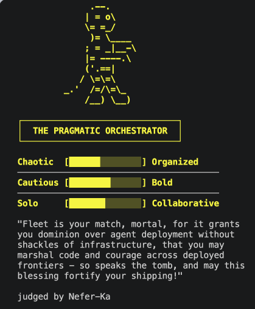

# Official course repository: Python, TypeScript, lesson sources, and agent UI: thinkific/src/m1/m1.9-practice.md

[Course index](../../../../../../README.md) · [Original source](https://github.com/langchain-ai/lca-deepagents/blob/HEAD/thinkific/src/m1/m1.9-practice.md) · [Raw file](../../../../../../raw/repositories/lca-deepagents/thinkific/src/m1/m1.9-practice.md)

Retrieved: 2026-11-13T16:50:31.645872+00:00

[For translation, open lesson in new tab and use Chrome translate](../../../../../lessons/m1.9-practice.md)

Python TypeScript

<a id="test-your-skills-build-a-judge-persona"></a>


# Test Your Skills: Build a Judge Persona

↓ click to celebrate ↓

<a id="get-started-btn"></a>
 Congratulations on finishing Module 1!

<a id="confetti-canvas"></a>

You’ve now covered

✓Running a deep agent

✓Choosing models

✓Writing system prompts

✓Optimizing with prompt caching

✓Building custom tools

✓Connecting MCP servers

✓Messages, threads, checkpointers

✓Human-in-the-loop approval

↓

Fun Personality Quiz!

In this practice, everything you just learned comes together into a fun personality quiz that figures out what kind of developer/builder you are, then matches you to a real LangChain product based on that style.

How it works: each answer scores you on a few traits. Your highest-scoring traits pick your matched product from `PRODUCT_MATCHES`. You don’t design this part, you just wire TODO 2 into it.

```javascript

(function () {
  var canvas, ctx, particles = [], running = false, animId;

  var COLORS = [
    '#006DDD','#3399FF','#7FC8FF','#CCE9FF',
    '#0E9F6E','#34D399','#99F6E4',
    '#FFE9A8','#FF8FA3','#ffffff'
  ];

  function Confetti(x, y) {
    this.x = x; this.y = y;
    this.vx = (Math.random() - 0.5) * 7;
    this.vy = -(9 + Math.random() * 10);
    this.gravity = 0.32 + Math.random() * 0.16;
    this.rotation = Math.random() * Math.PI * 2;
    this.rotationSpeed = (Math.random() - 0.5) * 0.3;
    this.width = 5 + Math.random() * 5;
    this.height = 3 + Math.random() * 4;
    this.color = COLORS[Math.floor(Math.random() * COLORS.length)];
    this.life = 0;
    this.maxLife = 90 + Math.floor(Math.random() * 45);
  }

  Confetti.prototype.update = function () {
    this.vy += this.gravity;
    this.x += this.vx;
    this.y += this.vy;
    this.rotation += this.rotationSpeed;
    this.life++;
  };

  Confetti.prototype.alpha = function () {
    var fadeStart = this.maxLife * 0.7;
    if (this.life < fadeStart) return 1;
    return Math.max(0, 1 - (this.life - fadeStart) / (this.maxLife - fadeStart));
  };

  Confetti.prototype.dead = function () {
    return this.life >= this.maxLife || this.y > (canvas ? canvas.height + 40 : 1e9);
  };

  Confetti.prototype.draw = function (ctx) {
    var a = this.alpha();
    if (a <= 0) return;
    ctx.save();
    ctx.globalAlpha = a;
    ctx.translate(this.x, this.y);
    ctx.rotate(this.rotation);
    ctx.fillStyle = this.color;
    ctx.fillRect(-this.width / 2, -this.height / 2, this.width, this.height);
    ctx.restore();
  };

  function spawnConfetti() {
    var x = Math.random() * window.innerWidth;
    var y = window.innerHeight + 10;
    particles.push(new Confetti(x, y));
  }

  function loop() {
    ctx.clearRect(0, 0, canvas.width, canvas.height);
    particles = particles.filter(function (p) { return !p.dead(); });
    particles.forEach(function (p) { p.update(); p.draw(ctx); });
    if (running || particles.length > 0) animId = requestAnimationFrame(loop);
    else { canvas.style.display = 'none'; }
  }

  window.launchConfetti = function () {
    if (!canvas) {
      canvas = document.getElementById('confetti-canvas');
      ctx = canvas.getContext('2d');
    }
    canvas.width = window.innerWidth;
    canvas.height = window.innerHeight;
    canvas.style.display = 'block';

    var btn = document.getElementById('get-started-btn');
    if (!btn.style.width) btn.style.width = btn.offsetWidth + 'px';
    btn.textContent = 'Again!';

    particles = [];
    running = true;

    var shots = 0, maxShots = 16;
    function fire() {
      if (shots >= maxShots) { running = false; return; }
      var count = 10 + Math.floor(Math.random() * 10);
      for (var i = 0; i < count; i++) spawnConfetti();
      shots++;
      setTimeout(fire, 90 + Math.random() * 180);
    }

    if (animId) cancelAnimationFrame(animId);
    fire();
    loop();
  };
})();

```

---

**This practice was restructured slightly for clarity on September 28, 2026.** The TODOs are now numbered in the order you work through them, and the MCP stretch goal (now TODO 6) no longer has to be finished before the script runs. Pull the latest changes from the repo root to get the new version:

```text
git pull
```

If you’ve already edited `judge_card_practice.py`, copy your persona and any code you wrote somewhere safe first, since the pull may conflict with your edits.

If you’ve already edited `judge_card_practice.ts`, copy your persona and any code you wrote somewhere safe first, since the pull may conflict with your edits.

<a id="what-youll-build"></a>


## What you’ll build

Open `python/m1/Practice/judge_card_practice.py`. Once it’s finished, one run:

1. Asks you the 8-question quiz in your terminal.
2. Hands your answers to an agent running your judge persona.
3. The agent scores your traits, matches you to a real LangChain product, and renders your result card as ASCII art in your terminal (also saved to `output/`).
4. The agent drafts a post announcing your result. Once you’ve done TODO 4, it pauses so you can approve, edit, or reject the post before it goes out. The post is a mock, nothing actually leaves your terminal, so screenshot your real card and post it on X or LinkedIn with @LangChain tagged, we would love to see what you build!

<a id="whats-provided"></a>


## What’s provided

The mechanical parts live in `judge_card_helpers.py`, same idea as `models.py`: shared setup you import without needing to read it for this exercise.

- `run_quiz()`: the 8-question arrow-key quiz.
- `PRODUCT_MATCHES`: the trait -> real LangChain product lookup.
- `render_card()`: renders and saves your finished card as ASCII art.
- `post_card()`: the “publish” tool. Renders a mock post on our fake X platform; nothing ever leaves your terminal.
- `run_judge()`: the invoke/interrupt-resume loop. You already wrote this once in the HITL lesson, no need to write it again.
- `TOOL_SEQUENCE`: the tool-calling steps every persona shares.

We’ve provided the quiz and scoring code above so you can focus on the lesson content.

<a id="what-you-fill-in"></a>


## What you fill in

6 TODOs: small direct changes tied to a Module 1 lesson, numbered in the order they appear in the file.

TODO

Lesson

What you do

Required?

1The System Prompt: PersonaWrite your own judge persona, a name and a voice. This is the card that gets posted.Yes

- **Where:** the `"your_persona"` entry in `JUDGE_PERSONAS`, below the three example judges.
- **What to do:** replace the placeholder text with your judge’s personality, starting with “You are <Name>, …”. The three example judges show what this looks like.
- **What to skip:** don’t describe the steps (scoring, matching, posting). `TOOL_SEQUENCE` already adds those to every persona for you.


2Tools: Custom ToolsFinish `score_and_match()`: turn the tallied trait scores into a matched product.Yes

- **Where:** the `# TODO here` comment inside `score_and_match()`.
- **What to do:** follow the four numbered comments to pick the matched product and return it. The score tallying above it is already written.
- **Until it’s done:** the script stops with `Stopped: TODO 2`. That’s expected.
- **Run it:** take the quiz. You should see one card signed by your judge, then a “posted” banner.


3Messages, Threads, and CheckpointersAdd an example judge to `JUDGES_TO_RUN` so it runs in its own thread; compare both cards.Yes

- **Where:** `JUDGES_TO_RUN`.
- **What to do:** add one example judge’s key, for example `"ancient_mummy"`. You don’t need to write another persona.
- **Run it:** you should get one card per judge, each from its own thread, judging the same quiz answers.


4Human-in-the-Loop: Decision TypesSet `INTERRUPT_ON` so posting the card requires your approval first.Yes

- **Where:** `INTERRUPT_ON`.
- **What to do:** set it so `post_card` needs your approval. The comment next to it shows the shape.
- **Run it:** before each post, you should see a draft and an `approve/edit/reject` prompt. Try `edit` to rewrite a caption.


5ModelsSet `MODEL` to `strong_model` and compare comedic timing.Optional

- **Where:** `MODEL`.
- **What to do:** add `strong_model` to the `from models import model` line at the top of the file, then set `MODEL = strong_model`.
- **Run it:** compare the comedic timing with the default model.


6MCPReplace the placeholder product fact with a real one from the LangChain docs MCP server.Stretch goal

- **Where:** `fetch_product_fact`, near the bottom of the file.
- **What to do:** follow the comment block above it to look up one fact from the LangChain docs MCP server, the same way `m1.6_agent_mcp.py` does.
- **Until it’s done:** the tool returns `PLACEHOLDER_FACT`, so verdicts are based on your trait scores only.
- **If the lookup fails:** print the error, then return `PLACEHOLDER_FACT`. The agent gets the same placeholder text whether TODO 6 is unfinished or the docs server is unreachable, so the printed error is how you tell the two apart.
<a id="run-it"></a>


## Run it

```text
cd python
uv run python m1/Practice/judge_card_practice.py
```

Stuck, or want to see the finished shape before you start? `judge_card_practice_filled.py` is a reference copy with TODOs 1 to 4 and the TODO 6 stretch goal filled in; run it the same way to see what “done” looks like end to end.

Try to avoid peeking unless you’re really stuck. You’ll get more out of this by working through the TODOs yourself first.

<a id="what-youll-build-1"></a>


## What you’ll build

Open `typescript/m1/Practice/judge_card_practice.ts`. Once it’s finished, one run:

1. Asks you the 8-question quiz in your terminal.
2. Hands your answers to an agent running your judge persona.
3. The agent scores your traits, matches you to a real LangChain product, and renders your result card as ASCII art in your terminal (also saved to `output/`).
4. The agent drafts a post announcing your result. Once you’ve done TODO 4, it pauses so you can approve, edit, or reject the post before it goes out. The post is a mock, nothing actually leaves your terminal, so screenshot your real card and post it on X or LinkedIn with @LangChain tagged, we would love to see what you build!

<a id="whats-provided-1"></a>


## What’s provided

The mechanical parts live in `judge_card_helpers.ts`, same idea as `models.ts`: shared setup you import without needing to read it for this exercise.

- `runQuiz()`: the 8-question arrow-key quiz.
- `PRODUCT_MATCHES`: the trait -> real LangChain product lookup.
- `renderCard`: renders and saves your finished card as ASCII art.
- `postCard`: the “publish” tool. Renders a mock post on our fake X platform; nothing ever leaves your terminal.
- `runJudge()`: the invoke/interrupt-resume loop. You already wrote this once in the HITL lesson, no need to write it again.
- `TOOL_SEQUENCE`: the tool-calling steps every persona shares.

We’ve provided the quiz and scoring code above so you can focus on the lesson content.

<a id="what-you-fill-in-1"></a>


## What you fill in

6 TODOs: small direct changes tied to a Module 1 lesson, numbered in the order they appear in the file.

TODO

Lesson

What you do

Required?

1The System Prompt: PersonaWrite your own judge persona, a name and a voice. This is the card that gets posted.Yes

- **Where:** the `"your_persona"` entry in `JUDGE_PERSONAS`, below the three example judges.
- **What to do:** replace the placeholder text with your judge’s personality, starting with “You are <Name>, …”. The three example judges show what this looks like.
- **What to skip:** don’t describe the steps (scoring, matching, posting). `TOOL_SEQUENCE` already adds those to every persona for you.


2Tools: Custom ToolsFinish `scoreAndMatch`: turn the tallied trait scores into a matched product.Yes

- **Where:** the `// TODO here` comment inside `scoreAndMatch`.
- **What to do:** follow the four numbered comments to pick the matched product and return it. The score tallying above it is already written.
- **Until it’s done:** the script stops with `Stopped: TODO 2`. That’s expected.
- **Run it:** take the quiz. You should see one card signed by your judge, then a “posted” banner.


3Messages, Threads, and CheckpointersAdd an example judge to `JUDGES_TO_RUN` so it runs in its own thread; compare both cards.Yes

- **Where:** `JUDGES_TO_RUN`.
- **What to do:** add one example judge’s key, for example `"ancient_mummy"`. You don’t need to write another persona.
- **Run it:** you should get one card per judge, each from its own thread, judging the same quiz answers.


4Human-in-the-Loop: Decision TypesSet `INTERRUPT_ON` so posting the card requires your approval first.Yes

- **Where:** `INTERRUPT_ON`.
- **What to do:** set it so `post_card` needs your approval. The comment next to it shows the shape.
- **Run it:** before each post, you should see a draft and an `approve/edit/reject` prompt. Try `edit` to rewrite a caption.


5ModelsSet `MODEL` to `strongModel` and compare comedic timing.Optional

- **Where:** `MODEL`.
- **What to do:** add `strongModel` to the `import { model } from "../../models.js"` line at the top of the file, then set `const MODEL = strongModel`.
- **Run it:** compare the comedic timing with the default model.


6MCPReplace the placeholder product fact with a real one from the LangChain docs MCP server.Stretch goal

- **Where:** `fetchProductFact`, near the bottom of the file.
- **What to do:** follow the comment block above it to look up one fact from the LangChain docs MCP server, the same way `m1.6_agent_mcp.ts` does.
- **Until it’s done:** the tool returns `PLACEHOLDER_FACT`, so verdicts are based on your trait scores only.
- **If the lookup fails:** log the error, then return `PLACEHOLDER_FACT`. The agent gets the same placeholder text whether TODO 6 is unfinished or the docs server is unreachable, so the logged error is how you tell the two apart.
<a id="run-it-1"></a>


## Run it

```text
cd typescript
pnpm tsx ./m1/Practice/judge_card_practice.ts
```

Stuck, or want to see the finished shape before you start? `judge_card_practice_filled.ts` is a reference copy with TODOs 1 to 4 and the TODO 6 stretch goal filled in; run it the same way to see what “done” looks like end to end.

Try to avoid peeking unless you’re really stuck. You’ll get more out of this by working through the TODOs yourself first.

Sneak Peek [click to expand]



<a id="share-it"></a>


## Share it

Got a card you like? Screenshot it, tag @LangChain on X or LinkedIn, and show us what your judge came up with. We want to see what you build!
