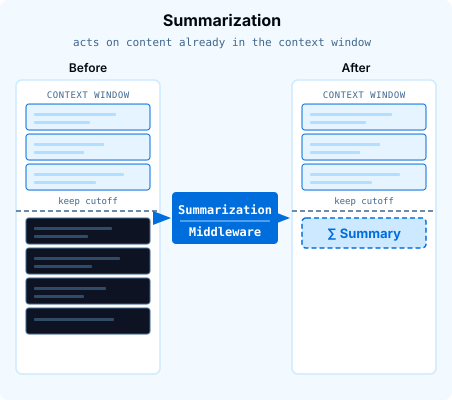
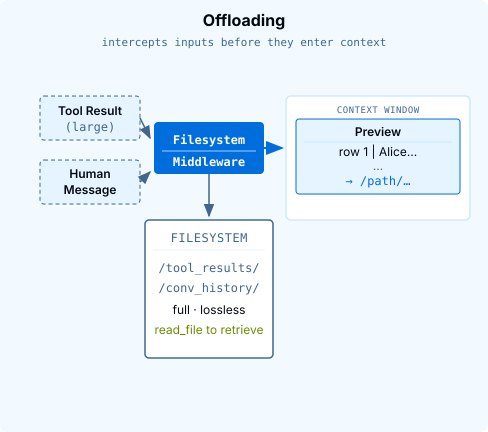
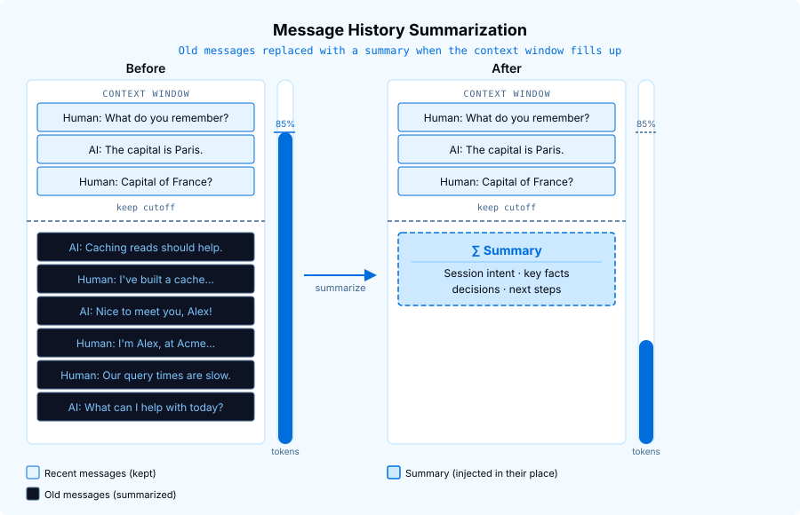
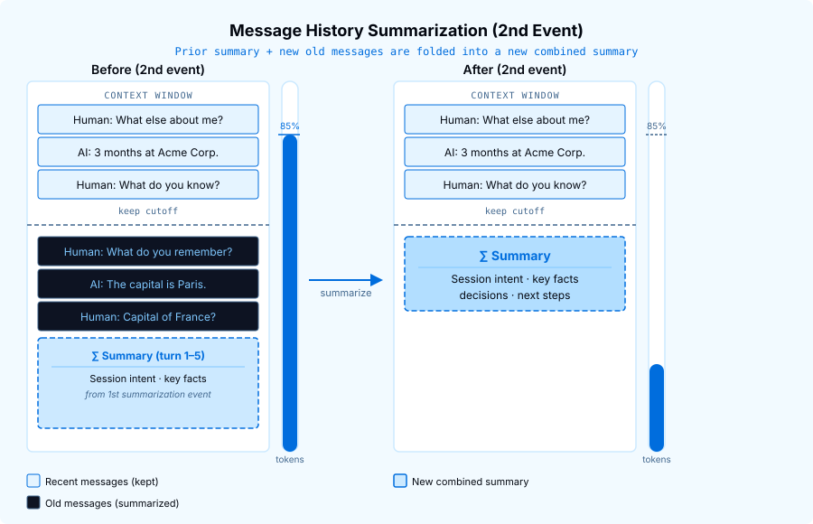

# Official course repository: Python, TypeScript, lesson sources, and agent UI: thinkific/src/m3/m3.1-summarization-context-offloading.md

[Course index](../../../../../../README.md) · [Original source](https://github.com/langchain-ai/lca-deepagents/blob/HEAD/thinkific/src/m3/m3.1-summarization-context-offloading.md) · [Raw file](../../../../../../raw/repositories/lca-deepagents/thinkific/src/m3/m3.1-summarization-context-offloading.md)

Retrieved: 2026-11-13T16:50:31.645872+00:00

[For translation, open lesson in new tab and use Chrome translate](../../../../../lessons/m3.1-summarization-context-offloading.md)

Python TypeScript

<a id="summarization-and-context-offloading"></a>


# Summarization and Context Offloading

```text
<button class="lt-tab active" data-p="summ" role="tab" aria-selected="true">Lesson</button>
```

```text
<button class="lt-tab" data-p="quiz" role="tab" aria-selected="false">Quiz</button>
```

```text
<button class="lt-tab" data-p="homework" role="tab" aria-selected="false">Homework</button>
```

<a id="p-summ"></a>


Offloading and Summarization in 5 minutes

[Offloading and Summarization in 5 minutes](https://www.youtube.com/embed/Ud5RsBegyfw)


Lesson Video Walkthrough

[Public video walkthrough](../../../../../videos/YARdGwwHje9.md)

 

Long-running agents build up long message histories, and Deep Agents handles this in two ways. Summarization condenses older messages once the context window fills up. Offloading catches large tool results and human messages before they reach the model, saves the full content to the filesystem, and leaves a short pointer in its place.

---

<a id="summarization"></a>


## Summarization

<a id="how-the-context-window-fills-up"></a>


### How the context window fills up

Think of the context window like a thermometer. Every new message adds tokens and the level rises. When it crosses **85%** of the model’s limit, by default, the middleware fires.

<a id="ss-summarization"></a>

### Slideshow: ss-summarization

#### Slide 1 of 2



When the context hits 85%, the middleware picks a cutoff point that keeps the most recent messages intact and summarizes older messages into a single block. The messages being summarized are appended to /conversation\_history/{session\_id}.md on the filesystem. The middleware generates the session ID internally. The summary message the model receives includes a link to that file, so the agent can read those older sections back with read\_file if it needs the detail. Because a summary is far more compact than the messages it replaces, the token count drops sharply and the conversation can continue.

#### Slide 2 of 2



On a second summarization event, the prior summary is treated like any other old message: it gets folded into a new combined summary along with whatever else has aged past the cutoff. There is no special handling for summaries; the same logic applies every time. This is what makes summarization scale indefinitely: each event produces one summary block, regardless of how many rounds have run before.

Note: in Python deepagents 0.7.0, the version the Python labs pin, this file is named `/conversation_history/{thread_id}.md`. Newer Python versions and the TypeScript SDK name it by session ID instead.

---

<a id="what-the-summary-contains"></a>


### What the summary contains

The middleware makes a separate LLM call to generate the summary. It uses a structured prompt that asks the model to extract:

- **Session intent**: what the user is trying to accomplish
- **Key facts & decisions**: important context from the conversation
- **Artifacts**: files or resources created or modified
- **Next steps**: what remains to do

The resulting text is injected as a single `HumanMessage` at the top of the preserved recent messages. The middleware also embeds a link to the saved older sections, so the agent can retrieve them with `read_file` if it needs the detail.

---

<a id="seeing-it-in-action"></a>


### Seeing it in action

Lesson Video Walkthrough

[Public video walkthrough](../../../../../videos/jyMqNJVwvLd.md)

The default trigger is 85% of the model’s real context window: 170,000 tokens for Claude Haiku 4.5.

As of deepagents 0.7:

- passing `trigger=("fraction", 0.5)` to `SummarizationMiddleware` sets the threshold to 50% instead of the default 85% (you can swap in any fraction you want).

To observe the default in a demo we set the model’s reported context window to a small value so the threshold is hit after a few turns:

```text
# python/m3/m3.1_summarization.py
from models import model

# Lower the reported context window so summarization fires at ~595 tokens
# (85% of 700) instead of the real threshold. Must pass model object, not string.
model.profile = {**model.profile, "max_input_tokens": 700}

agent = create_deep_agent(
    model=model,
    checkpointer=MemorySaver(),
    system_prompt="You are a helpful assistant. Keep every response to one sentence.",
)
```

Because this demo uses separate `ainvoke()` calls, it relies on the runtime pattern from Module 1: a checkpointer plus the same `thread_id` lets message history accumulate across turns. Without either piece, there would be much less history to summarize.

From the repo root:

```text
cd python
uv run python m3/m3.1_summarization.py
```

```text
// typescript/m3/m3.1_summarization.ts
import { createDeepAgent } from "deepagents";
import { MemorySaver } from "@langchain/langgraph";

import { model } from "../models.js";

// Shrink the reported context window so summarization triggers at ~340 tokens
// (85% of 400) instead of the real threshold. Must use model object, not string.
Object.defineProperty(model, "profile", {
  value: { ...model.profile, maxInputTokens: 400 },
  configurable: true,
});

const agent = createDeepAgent({
  model,
  checkpointer: new MemorySaver(),
  systemPrompt: "You are a helpful assistant. Keep every response to one sentence.",
});
```

Because this demo uses separate `agent.invoke()` calls, it relies on the runtime pattern from Module 1: a checkpointer plus the same `thread_id` lets message history accumulate across turns. Without either piece, there would be much less history to summarize.

From the repo root:

```text
cd typescript
pnpm tsx ./m3/m3.1_summarization.ts
```

**Expected output:**

```text
──────────────────────────────────────────────────
Turn 1  User:  My name is Alex. I work at Acme Corp.
Turn 1  Agent: Hello Alex, it's nice to meet you - welcome from Acme Corp!
  stored : 2 message(s) (raw history, never trimmed)

──────────────────────────────────────────────────
Turn 2  User:  What is 2 + 2?
Turn 2  Agent: 2 + 2 equals 4.
  stored : 4 message(s) (raw history, never trimmed)

──────────────────────────────────────────────────
Turn 3  User:  I have been building a distributed cache for three months.
Turn 3  Agent: That sounds like a substantial project - distributed caches are complex but rewarding to build!
  stored : 6 message(s) (raw history, never trimmed)
  model saw : summary + messages[4:]  [SUMMARIZED]

──────────────────────────────────────────────────
Turn 4  User:  What is the capital of France?
Turn 4  Agent: The capital of France is Paris.
  stored : 8 message(s) (raw history, never trimmed)
  model saw : summary + messages[4:]  [SUMMARIZED]

──────────────────────────────────────────────────
Turn 5  User:  What do you remember about me?
Turn 5  Agent: You mentioned your name is Alex, you work at Acme Corp, and you've been building a distributed cache for three months.
  stored : 10 message(s) (raw history, never trimmed)
  model saw : summary + messages[4:]  [SUMMARIZED]
```

**Passing `model` not `MODEL`.** Notice `create_deep_agent(model=model, ...)` receives the model *object*, not the string `"anthropic:claude-haiku-4-5"`. Passing the string would re-initialize the model internally and ignore the `profile` override.

**Passing `model` not `MODEL`.** Notice `createDeepAgent({ model, ... })` receives the model *object*, not the string `"anthropic:claude-haiku-4-5"`. Passing the string would re-initialize the model internally and ignore the `Object.defineProperty` override above.

When summarization fires, a private `_summarization_event` key appears in the agent’s state. In the normal summarization path, the raw `state["messages"]` history is not replaced by the summary; summarization changes what gets *sent* to the model each turn.

When summarization fires, a private `_summarizationEvent` key appears in the agent’s state. In the normal summarization path, the raw `state.messages` history is not replaced by the summary; summarization changes what gets *sent* to the model each turn.

---

<a id="offloading"></a>


## Offloading

Lesson Video Walkthrough

[Public video walkthrough](../../../../../videos/DBjUzgBYFJG.md)

Summarization compacts messages that have already accumulated in context. Offloading handles a different case: a single large input. Instead of letting it land in context, **FilesystemMiddleware** intercepts oversized content before it reaches the model. It writes the full data to the filesystem and leaves behind a short preview plus a file path. The agent reads the full content with `read_file` only when it needs it.

Two kinds of data are offloaded this way: large **tool results** and large **human messages**.

<a id="tool-result-offloading"></a>


### Tool result offloading

A single tool call can return a large result, such as a full database export, hundreds of search matches, or a long code generation output. Storing it inline would use a large share of the context window at once.

**FilesystemMiddleware** handles this automatically with tool result offloading. When a tool returns a result that exceeds roughly **20,000 tokens**, the middleware:

1. Writes the full result to `/large_tool_results/<tool_call_id>` on the agent’s filesystem
2. Replaces the inline `ToolMessage` with a short preview (first and last 5 lines) and a file reference

The message the model actually sees looks like this:

```text
Tool result too large, the result of this tool call <id> was saved in the
filesystem at this path: /large_tool_results/<tool_call_id>

You can read the result from the filesystem by using the read_file tool,
but make sure to only read part of the result at a time.

Here is a preview showing the head and tail of the result:

     1  | SELECT id, name, email FROM users WHERE ...
     2  | 1, Alice, alice@example.com
     3  | 2, Bob, bob@example.com
     4  | 3, Carol, carol@example.com
     5  | 4, Dave, dave@example.com
... [1 823 lines truncated] ...
  1828  | 1827, Zara, zara@example.com
  1829  | 1828, Zoe, zoe@example.com
  1830  | 1829, ...
```

The agent can then call `read_file` with `offset` and `limit` to page through the full result on demand - reading only the portion that is relevant rather than loading everything into context at once.

The tools `ls`, `glob`, `grep`, `read_file`, `edit_file`, and `write_file` are excluded from offloading. They either have their own built-in truncation, return minimal confirmation text, or (for `read_file`) re-reading a truncated file would not help.

<a id="human-message-offloading"></a>


### Human message offloading

The same mechanism applies when a *user* message is very large, for example pasting in a long document or transcript. When a human message exceeds roughly **50,000 tokens**, FilesystemMiddleware writes the full text to `/conversation_history/` and replaces it in the model’s view with a preview and a file reference. The agent can `read_file` that path to retrieve the full message on demand.

The behavior the agent sees, a preview plus a pointer, is identical to a tool result. Only the threshold (50k vs 20k tokens) and the storage location differ.

Offloaded tool results and conversation history are written through whatever `backend=` the agent already has. The default `StateBackend` keeps them thread-scoped; route `default=` to a real disk or store backend via `CompositeBackend` to share them across threads.


**LangChain Blog**

[How Harmonic rebuilt Scout on Deep Agents](https://www.langchain.com/blog/how-harmonic-rebuilt-scout-on-deep-agents-and-4xd-retention-with-langsmith)

Harmonic rebuilt its Scout agent on filesystem-based context offloading, writing large results to disk and paging them back in on demand. Week one-to-four retention jumped 4x, and average session length increased 10x.

**Optional: want to go deeper?**

- **Managing what’s already in context** (this lesson): [Context Engineering: How Deep Agents Remember](https://www.langchain.com/blog/context-engineering-deep-agents-remember) (blog) · [Agent Memory 101: Context Engineering](https://events.langchain.com/on-demand/64cd2752-8cf2-415f-8e64-791dc61e39ac) (webinar)
- **The first line of defense, retrieval** (what reaches the context window at all): [Context Engineering Starts with Retrieval](https://www.langchain.com/blog/context-engineering-starts-with-retrieval) (blog) · [Agent Memory 102: Context Retrieval & Storage](https://events.langchain.com/on-demand/fd1ca72d-936d-49ef-99ef-dca8c67b6aeb) (webinar)

---

<a id="recap"></a>


## Recap

- **SummarizationMiddleware** intercepts every LLM request via `wrap_model_call`; it runs before the model sees any messages
- When total tokens exceed 85% of `max_input_tokens` (the default; configurable via `trigger`), old messages are partitioned at the **keep cutoff** and replaced with a summary
- The summary is generated by a separate LLM call using the same model as the agent
- In the normal summarization path, raw `state["messages"]` is preserved and summarization is tracked in a private `_summarization_event` field
- Passing `model.profile["max_input_tokens"]` overrides the threshold, making it practical to demo
- **FilesystemMiddleware** also offloads individual tool results that exceed ~20k tokens, writing them to `/large_tool_results/` and replacing them with a preview + file reference
- The same offloading applies to oversized **human messages** (over ~50k tokens), written to `/conversation_history/` with a preview + file reference

- **SummarizationMiddleware** intercepts every LLM request via `wrapModelCall`; it runs before the model sees any messages
- When total tokens exceed 85% of `maxInputTokens` (the default; configurable via `trigger`), old messages are partitioned at the **keep cutoff** and replaced with a summary
- The summary is generated by a separate LLM call using the same model as the agent
- In the normal summarization path, raw `state.messages` is preserved and summarization is tracked in a private `_summarizationEvent` field
- Overriding `model.profile` with `Object.defineProperty` (a plain assignment won’t work) lets you lower the threshold, making it practical to demo
- **FilesystemMiddleware** also offloads individual tool results that exceed ~20k tokens, writing them to `/large_tool_results/` and replacing them with a preview + file reference
- The same offloading applies to oversized **human messages** (over ~50k tokens), written to `/conversation_history/` with a preview + file reference

<a id="next"></a>


## Next

Complete the **Quiz** above, then continue to the next lesson on skills: how to package reusable agent behaviours so the model can load them on demand.

---

<a id="references"></a>


## References

**Documentation:**

- [SummarizationMiddleware: Deep Agents](../../../../../readings/docs-langchain-com-oss-python-deepagents-context-engineering-e0a127e9.md)
- [Context Engineering overview](../../../../../readings/docs-langchain-com-oss-python-deepagents-context-engineering-e0a127e9.md)

**Go deeper: read the source** *(optional)*

*The lesson shows how to use this. To see how it’s implemented, start with these files:*

- [`middleware/summarization.py`](../../../../../readings/github-58edde9fcb78.md): summarization, and offloading the summarized history
- [`middleware/filesystem.py`](../../../../../readings/github-62dcec2cfc6c.md): offloading large tool results and human messages

**Documentation:**

- [SummarizationMiddleware: Deep Agents](../../../../../readings/docs-langchain-com-oss-javascript-deepagents-context-engineering-de9e92ff.md)
- [Context Engineering overview](../../../../../readings/docs-langchain-com-oss-javascript-deepagents-context-engineering-de9e92ff.md)

**Go deeper: read the source** *(optional)*

*The lesson shows how to use this. To see how it’s implemented, start with these files:*

- [`middleware/summarization.ts`](../../../../../readings/github-1005b89f4ba4.md): summarization, and offloading the summarized history
- [`middleware/fs.ts`](../../../../../readings/github-a8e9d998757b.md): offloading large tool results and human messages

<a id="p-quiz"></a>


## Check your understanding

<a id="p-homework"></a>


<a id="trigger-chained-summarization"></a>


## Trigger Chained Summarization

In the lesson, `SummarizationMiddleware` compressed a short demo conversation once the context window filled past 85%. On a long enough conversation, it fires again and again. Each new summary builds on the previous one, and every evicted message is added to a single backend file, `/conversation_history/{thread_id}.md`.

In this homework, you’ll write a conversation long enough to trigger summarization **at least twice**. Then check two things: the model can still recall a detail from your very first turn, and the conversation history file has more than one “Summarized at …” section.

Open `python/m3/m3.1_homework.py`.

1. **TODO 1**: write your own list of at least 8 user turns about a topic you pick. Put a concrete detail in one of your first two turns, keep talking about the topic for several more turns, then end with a turn that asks the agent to recall that early detail.
2. **TODO 2**: choose `model.profile["max_input_tokens"]` so that summarization fires **at least twice** before your last turn, not just once. Keep it in the low thousands (the reference copy uses 3000 for ten turns). If you set it much lower, summarization fires on nearly every turn. Each summary then gets compacted away before the next one lands, and the final recall question fails.

Note: if the agent calls `read_file` on its own conversation history mid-run, you may see a blank or duplicated “Summarized at …” section; that’s expected model behavior, and your code is fine.

The script’s event count and the number of “Summarized at …” sections can differ. Each summarization writes one section, but the script only checks for a new event once per turn, so two summarizations inside the same turn are counted as one. Treat the event count as a lower bound rather than an exact tally.

<a id="run-it"></a>


### Run it

```text
cd python
uv run ./m3/m3.1_homework.py
```

Stuck, or want to see the finished shape before you start? `m3.1_homework_filled.py` is a reference copy with every TODO filled in (using a backyard-vegetable-garden planning conversation); run it the same way to see what “done” looks like end to end.

Try to avoid peeking unless you’re really stuck. You’ll get more out of this by working through the TODOs yourself first.

<a id="trigger-chained-summarization-1"></a>


## Trigger Chained Summarization

In the lesson, `SummarizationMiddleware` compressed a short demo conversation once the context window filled past 85%. On a long enough conversation, it fires again and again. Each new summary builds on the previous one, and every evicted message is added to a single backend file, `/conversation_history/{session_id}.md`.

In this homework, you’ll write a conversation long enough to trigger summarization **at least twice**. Then check two things: the model can still recall a detail from your very first turn, and the conversation history file has more than one “Summarized at …” section.

Open `typescript/m3/m3.1_homework.ts`.

1. **TODO 1**: write your own list of at least 8 user turns about a topic you pick. Put a concrete detail in one of your first two turns, keep talking about the topic for several more turns, then end with a turn that asks the agent to recall that early detail.
2. **TODO 2**: choose `model.profile.maxInputTokens` (set with `Object.defineProperty`) so that summarization fires **at least twice** before your last turn, not just once. Keep it in the low thousands (the reference copy uses 3000 for ten turns). If you set it much lower, summarization fires on nearly every turn. Each summary then gets compacted away before the next one lands, and the final recall question fails.

Note: if the agent calls `read_file` on its own conversation history mid-run, you may see a blank or duplicated “Summarized at …” section; that’s expected model behavior, and your code is fine.

The script’s event count and the number of “Summarized at …” sections can differ. Each summarization writes one section, but the script only checks for a new event once per turn, so two summarizations inside the same turn are counted as one. Treat the event count as a lower bound rather than an exact tally.

<a id="run-it-1"></a>


### Run it

```text
cd typescript
pnpm tsx ./m3/m3.1_homework.ts
```

Stuck, or want to see the finished shape before you start? `m3.1_homework_filled.ts` is a reference copy with every TODO filled in (using a backyard-vegetable-garden planning conversation); run it the same way to see what “done” looks like end to end.

Try to avoid peeking unless you’re really stuck. You’ll get more out of this by working through the TODOs yourself first.

```javascript

(function () {
  var tabs = document.querySelectorAll('.lt-tab');
  function show(p) {
    tabs.forEach(function (t) {
      var on = t.getAttribute('data-p') === p;
      t.classList.toggle('active', on);
      t.setAttribute('aria-selected', on ? 'true' : 'false');
    });
    document.querySelectorAll('.lt-panel').forEach(function (panel) {
      panel.classList.toggle('active', panel.id === 'p-' + p);
    });
  }
  tabs.forEach(function (t) {
    t.addEventListener('click', function () { show(t.getAttribute('data-p')); });
  });
})();

```
