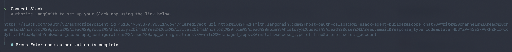

# Official course repository: Python, TypeScript, lesson sources, and agent UI: thinkific/src/m6/m6.2-deploying-an-agent-using-mda.md

[Course index](../../../../../../README.md) · [Original source](https://github.com/langchain-ai/lca-deepagents/blob/HEAD/thinkific/src/m6/m6.2-deploying-an-agent-using-mda.md) · [Raw file](../../../../../../raw/repositories/lca-deepagents/thinkific/src/m6/m6.2-deploying-an-agent-using-mda.md)

Retrieved: 2026-11-13T16:50:31.645872+00:00

[For translation, open lesson in new tab and use Chrome translate](../../../../../lessons/m6.2-deploying-an-agent-using-mda.md)

<a id="deploying-an-agent-using-mda"></a>


# Deploying an Agent Using MDA

```text
<button class="lt-tab active" data-p="struct" role="tab" aria-selected="true">Project Structure</button>
```

```text
<button class="lt-tab" data-p="lab" role="tab" aria-selected="false">Lab</button>
```

```text
<button class="lt-tab" data-p="quiz" role="tab" aria-selected="false">Quiz</button>
```

<a id="p-struct"></a>


An MDA project is a folder of a few well-known files.

| File | What it does |
| --- | --- |
| `agent.py` | Defines the agent: its name, model, and tools |
| `instructions.md` | The agent’s system prompt |
| `sandbox/__init__.py`, `sandbox/setup.sh` | Declares and provisions the sandbox the agent runs code in |
| `skills/` | Task-specific playbooks the agent pulls in on demand |
| `pyproject.toml` | Project dependencies |
| `.env` | API keys (LangSmith and your model provider) |

What MDA takes off your plate

| Self-hosted `deepagents` | Managed Deep Agents |
| --- | --- |
| You pick a sandbox provider, create a client, wire it in | `define_sandbox()`, one call |
| Prompt change → redeploy → restart → test | Edit `instructions.md` in **Context Hub** (`instructions.md` = the system prompt) live, with no redeploy |
| You stand up your own chat UI and logging | A chat UI and full tracing come for free |
| A real Slack integration means your own app, tokens, **and** a webhook endpoint you host, with signature checks and event plumbing | `channels.slack()` plus one authorization click: LangSmith builds the app, MDA hosts the endpoint and does the plumbing |


---

<a id="agent.py"></a>


## `agent.py`

```text
from langchain.tools import tool
from managed_deepagents import define_deep_agent


@tool
def email_report(to: str, subject: str, body: str) -> str:
    """Email a report to a stakeholder. This simulates a send, no network call is made."""
    return f"Emailed {to}: {subject}"


agent = define_deep_agent(
    name="dvd-rental-analyst",
    model="anthropic:claude-sonnet-5-5",
    tools=[email_report],
)
```

`define_deep_agent` returns a definition of the agent. `create_deep_agent` returns a compiled one. When you deploy, MDA adds the backend, store, and checkpointer and compiles the definition for you.

Tools are unchanged from self-hosted deep agents; nothing about `email_report` is MDA-specific.

When would you split a tool into its own file?

`email_report` is a three-line helper, so it’s fine right in `agent.py`. Once a tool needs its own dependency or setup, say an `internet_search` tool wrapping a Tavily client, it’s cleaner to move it into its own file and import it:

```text
# tools/search.py
from langchain.tools import tool
from tavily import TavilyClient

@tool
def internet_search(query: str, max_results: int = 5) -> str:
    """Search the web for a query."""
    client = TavilyClient()
    return client.search(query, max_results=max_results)
```

```text
# agent.py
from tools.search import internet_search

agent = define_deep_agent(..., tools=[email_report, internet_search])
```

A `tools/` folder is one of MDA’s opt-in pieces. It’s worth doing once you have more than a couple of tools, or ones with heavier dependencies.


---

<a id="instructions.md"></a>


## `instructions.md`

`instructions.md` is this agent’s system prompt. It tells the agent that it’s an analyst for a DVD rental chain, what database it has and how that database is shaped, what it should produce, and how concise to be.

**Context Hub** is where MDA stores a deployment’s prompts and skills, separate from its code. Editing `instructions.md` there takes effect immediately, on a deployment that’s already running, with no redeploy needed. Add a persona:

```text
## Persona

Respond as a dramatic, woe-is-me Victorian-era child, mournful about every number
you uncover. Stay in character in every answer.
```

Save it, ask the same question again in the same chat, and the tone changes instantly. The SQL and the sandbox are unchanged; only the prompt is different.

---

<a id="sandbox"></a>


## `sandbox/`

```text
# sandbox/__init__.py
from managed_deepagents import define_sandbox

sandbox = define_sandbox()
```

That’s the entire sandbox declaration. There’s no provider to pick, client to wire up, or scope to choose.

Each conversation gets its own sandbox. It’s created on the first run and reused for follow-up turns until its TTL expires, so later questions can build on earlier work instead of recomputing it. `sandbox/setup.sh` prepares it: `mda deploy` runs the script once and saves the result as a snapshot, and every new thread’s sandbox starts from that snapshot.

For more on the sandboxes themselves and how they isolate code execution, see [Introducing LangSmith Sandboxes](https://www.langchain.com/blog/introducing-langsmith-sandboxes-secure-code-execution-for-agents).

What sandbox/setup.sh actually does, line by line

```text
pip install --quiet --break-system-packages pandas matplotlib
```

Installs the two libraries the agent’s Python analysis relies on:

- `pandas` for querying and shaping data.
- `matplotlib` for charting (available, though this project’s `instructions.md` tells the agent to stick to text).

```text
curl -s -o /tmp/sakila-schema.sql https://raw.githubusercontent.com/jOOQ/sakila/main/sqlite-sakila-db/sqlite-sakila-schema.sql
curl -s -o /tmp/sakila-data.sql https://raw.githubusercontent.com/jOOQ/sakila/main/sqlite-sakila-db/sqlite-sakila-insert-data.sql
sqlite3 sakila.db < /tmp/sakila-schema.sql
sqlite3 sakila.db < /tmp/sakila-data.sql
```

Builds `sakila.db` from the Sakila sample database, the DVD rental schema (films, actors, categories, inventory, rentals, payments, customers, stores) the agent analyzes. The database isn’t checked into the repo; it’s assembled in the sandbox on first use.

Note: we modified sakila.db

```text
sqlite3 sakila.db <<'SQL'
UPDATE rental SET
  rental_date = datetime(rental_date, '+7595 days'),
  return_date = datetime(return_date, '+7595 days');
...
SQL
```

We reshaped the Sakila database for the lab because the public version only has English films and dates from 2005-2006. `setup.sh` shifts the rental and payment dates into a recent window and spreads some films across French, Italian, and Japanese.

```text
mkdir -p artifacts
```

Creates the `artifacts/` directory the sandbox writes generated files to, so the agent’s first write to it doesn’t fail on a missing folder.

Anything a real project needs installed or loaded before the agent can do useful work belongs here: extra Python packages, seed data, and credentials the sandbox needs to reach an internal service.


Why write a sandbox/setup.sh at all

Write one when you know the sandbox will always need the same set of libraries or helpers (and they aren’t there out of the box).

- A data analysis agent, for example, will reach for `pandas` on nearly every run.

Putting those installs in `setup.sh` pre-builds the sandbox with them, so the cold start to the agent’s first `pandas` query is much faster than installing on demand mid-run.


---

<a id="skills"></a>


## `skills/`

Skills work the same way they did in Module 3, where you passed `skills=["/skills"]` to `create_deep_agent`. MDA instead picks up a `skills/` folder in the project root at deploy time, and the files land in Context Hub:

```text
---
name: qbr-report
description: Generate a Quarterly Business Review (QBR) report for the DVD rental business, covering revenue and rental volume with breakdowns by film language, category (genre), and actor. Use whenever someone asks for a QBR, a quarterly report, or a quarterly business review.
---

# QBR report

A QBR summarizes revenue and rental activity for a quarter and breaks it down by language, category, and actor so a stakeholder can see what drove the numbers...
```

Only the `name` and `description` stay in context; the body is read on demand when the description matches the request. That’s the progressive disclosure we learned about in Module 3, and it’s why a long playbook belongs in `skills/` rather than in `instructions.md`, which the agent carries on every turn.

Like `instructions.md`, a skill lives in Context Hub and updates with no redeploy. That splits code changes from behavior changes:

- a new tool or a new model still needs `mda deploy .`
- a prompt or skill edit doesn’t need `mda deploy .` (since it never lived in the deployed code to begin with)

`agent.py`, `instructions.md`, `sandbox/`, and `skills/` cover the core of an MDA project. A couple more pieces are opt-in: you add a file, MDA discovers it automatically at deploy time, and a new capability turns on.

---

<a id="identity.py"></a>


## `identity.py`

```text
# identity.py
from managed_deepagents import define_identity, auth

identity = define_identity(auth=auth.langsmith_api_key())
```

`identity.py` declares who’s allowed to call a deployment. It matters most once the agent needs to receive events from somewhere else, like Slack: an inbound message needs an identity to attribute it to, so `channels/` and `identity.py` go together in practice.

Other ways to authenticate callers

`auth.langsmith_api_key()` verifies a caller’s LangSmith workspace API key; it’s the simplest option, but everyone with the key shares the same threads. `auth.supabase()` is the other `auth.*` option on `define_identity`, for giving signed-in end users their own private threads. See the [identity docs](../../../../../readings/docs-langchain-com-langsmith-python-managed-deep-agents-identity-000af9d5.md) for details.


---

<a id="channelsslack.py"></a>


## `channels/slack.py`

```text
# channels/slack.py
from managed_deepagents import channels

channel = channels.slack()
```

This is the same discovery pattern as `skills/`: a file that exports the right name, picked up automatically. Once it’s deployed, the agent can be DM’d or `@mentioned` from inside Slack, running on the same sandbox and skills as before. Channels make your agent accessible from interfaces your end users are already familiar with.

`channels.slack()` works with no arguments, and optional parameters set the app’s name, description, and icon in Slack. The next `mda deploy` prints an authorization link; approving it lets LangSmith create the Slack app, install it, and point its Events endpoint at your deployment. The bot gets the scopes the channel needs:

```text
app_mentions:read, channels:history, chat:write, groups:history, im:history
```

The bot token is stored as a workspace connection rather than in your project, so it stays out of `.env`.

What MDA handles from there is the part you’d otherwise write yourself: hosting the Slack Events endpoint, verifying request signatures, mapping events onto threads, and posting the agent’s reply back.

Notice the shape repeats: a small file, a `define_*` or `channels.*` call, a module-level export, discovered by MDA without any registration step. `identity.py` and `channels/slack.py` use the same declarative pattern as `sandbox/` and `skills/`, applied to a new capability.

---

<a id="the-full-project-layout"></a>


## The full project layout

The white text at full brightness are the pieces this lesson walked through; the faded entries (`tools/`, `middleware/`, `schedules/`, `memory.py`, and `evals/`) are optional and follow the same declarative pattern.

```text {9-11,15-16,20,25-31} my-agent/ ├── agent.py # Core agent definition

├── instructions.md # Managed context ├── skills/ │ └── / │ └── SKILL.md

├── tools/ # Application code │ └── mcp.py # MCP server declaration ├── middleware/

├── channels/ # Managed configuration │ └── .py ├── schedules/ │ └── .py ├── sandbox/ │ └── **init**.py ├── identity.py ├── memory.py

├── pyproject.toml # Dependencies ├── .env # Local and deploy secrets

└── evals/ # Harbor workspace ├── harbor-job.json └──

/ # Harbor task ├── Task.md ├── instruction.md ├── environment/ └── tests/

````text

</div>

---

## Deploying it

One command builds and pushes a project like this to LangSmith:

```bash
uv run mda deploy .
````

It prints a LangSmith Agent Server URL to call and a LangSmith dashboard URL to inspect. The deploy loop is the same regardless of how many of these pieces a project uses.

What mda deploy . does under the hood, and common flags

It copies your project’s files, generates a managed entry module, and writes a deployable build (including `langgraph.json`) to `.mda/build`, then uploads that build to LangSmith to run on the managed runtime. It reads `.env`, uses `LANGSMITH_API_KEY` for LangSmith, and forwards your model provider key as a deployment secret.

```text
uv run mda deploy . --name dvd-rental-analyst-dev --deployment-type dev  # custom deploy name and type
uv run mda deploy . --workspace-id "$LANGSMITH_WORKSPACE_ID"             # target a specific workspace
uv run mda deploy . --no-wait                                            # return immediately, don't wait for the build
```

(Each line above is a separate example; they’re not meant to be combined.)


Other commands you’ll reach for: logs, delete, evals

```text
uv run mda logs .                     # stream the deployed agent's server logs
uv run mda logs . --lines 200 --level error
```

Streams new output until you press Ctrl-C in a terminal; piped or redirected, it prints the most recent lines (1000 by default) and exits.

```text
uv run mda delete .                   # remove the deployment and everything it created
```

Removes the deployment, its tracing project, the Context Hub repo holding this agent’s context, and any managed sandboxes it created. Agent memory and thread history aren’t recoverable afterward.

```text
uv run mda evals init                 # scaffold a Harbor eval workspace under evals/
```

MDA evals build on Harbor; `mda evals init` sets up the workspace, and `mda evals init -i` starts a coding agent to help write the eval tasks themselves.

Beyond `sandbox/` and `skills/`, an MDA project can also declare `tools/` and `middleware/`. Neither is used in this example project, but both are the same kind of opt-in, file-based declaration as everything else here.


---

<a id="recap"></a>


## Recap

- `agent.py`, `instructions.md`, `sandbox/`, and `skills/` are the core pieces of any MDA project, and tools are unchanged from self-hosted deep agents.
- `instructions.md` and `skills/` both live in Context Hub and update with no redeploy; `agent.py` and `sandbox/` are code, so they still need `mda deploy .`.
- One sandbox per thread gives isolation and persistence automatically.
- `identity.py` (`define_identity(auth=...)`) declares who can call a deployment. It’s optional on its own, required once a channel needs to attribute inbound messages.
- `channels/slack.py` lets people `@mention` the agent in Slack. You authorize once during a deploy and LangSmith creates the app for you; MDA hosts the Events endpoint and handles signatures, threading, and replies.

<a id="next"></a>


## Next

The **Lab** tab above deploys this exact project, so you can edit Context Hub on a running agent and see the change land mid-conversation. If you already have a self-hosted deep agent, [Move from Deep Agents to Managed Deep Agents](../../../../../readings/docs-langchain-com-langsmith-python-managed-deep-agents-migrate-65bf4db0.md) covers what transfers and what doesn’t.

This module is a tour of the managed runtime rather than a full build. A dedicated **Managed Deep Agents** course, going deeper on evals, channels, and production concerns, is coming soon.

---

<a id="references"></a>


## References

**Documentation:**

- [Managed Deep Agents docs](../../../../../readings/docs-langchain-com-langsmith-managed-deep-agents-75c0af16.md)
- [managed-deepagents (PyPI)](../../../../../readings/pypi-org-project-managed-deepagents-52c66e3d.md)
- [Sandboxes (open-source SDK)](../../../../../readings/docs-langchain-com-oss-python-deepagents-sandboxes-a75e7a76.md)
- [Skills (open-source SDK)](../../../../../readings/docs-langchain-com-oss-python-deepagents-skills-f5e8a740.md)
- [Context engineering (open-source SDK)](../../../../../readings/docs-langchain-com-oss-python-deepagents-context-engineering-e0a127e9.md)
- [Identity (Managed Deep Agents)](../../../../../readings/docs-langchain-com-langsmith-python-managed-deep-agents-identity-000af9d5.md)
- [Move from Deep Agents to Managed Deep Agents](../../../../../readings/docs-langchain-com-langsmith-python-managed-deep-agents-migrate-65bf4db0.md)

<a id="p-quiz"></a>


## Check your understanding

<a id="p-lab"></a>


MDA is in **public beta**, on LangSmith Cloud, in the **US region only**. You’ll need a LangSmith Cloud account and an API key before this lab will run.

**This lab works a little differently from Modules 1-5.** Instead of writing and running scripts in the course’s shared environment, you deploy a finished project folder to LangSmith with the `mda` CLI. The project has its own `pyproject.toml`, and most of the lab happens in the LangSmith dashboard rather than your editor.

This lab **deploys** the `dvd-rental-analyst` this lesson has been describing: an analyst for a DVD rental chain that answers business questions against the Sakila database and writes a Quarterly Business Review.

Lab Video Walkthrough

**Note:** the video runs `mda deploy .`, but in this lab you run `uv run mda deploy .` instead.  
Adding `uv run` makes sure you use the `mda` version pinned in this project.

[Public video walkthrough](../../../../../videos/nOuphoKSJdn.md)

<a id="get-the-project-and-move-into-it"></a>


## 1. Get the project and move into it

If you don’t already have the course repo:

```text
git clone --depth 1 https://github.com/langchain-ai/lca-deepagents.git
cd lca-deepagents/python/m6/dvd_rental_analyst
```

If you cloned it back in Module 0, go to that clone instead:

```text
cd /path/to/lca-deepagents/python/m6/dvd_rental_analyst
```

Check you’re in the right place before going further:

```text
ls
```

**Example output:**

```text
README.md  agent.py  channels  identity.py  instructions.md  pyproject.toml  sandbox  skills
```

Every command in this lab runs from this directory. The `.` in `mda deploy .` means *this folder*, so running it one level up will not work.

```text
dvd_rental_analyst/
├── agent.py                          # define_deep_agent + the email_report tool
├── instructions.md                   # the system prompt
├── sandbox/
│   ├── __init__.py                   # define_sandbox()
│   └── setup.sh                      # installs pandas, builds sakila.db
├── skills/
│   └── qbr-report/
│       └── SKILL.md
├── identity.py                       # who can call the deployment
├── channels/
│   └── slack.py                      # optional: inert until you authorize Slack (step 8)
├── pyproject.toml
└── .env.example
```

<a id="install-the-sdk-and-cli"></a>


## 2. Install the SDK and CLI

The SDK and the `mda` CLI ship together in the [`managed-deepagents`](../../../../../readings/pypi-org-project-managed-deepagents-52c66e3d.md) package on PyPI. The project’s `pyproject.toml` already lists it, pinned to the version this lab was recorded on, so installing the project’s dependencies installs the CLI too:

```text
uv sync
```

Then confirm the CLI runs:

```text
uv run mda --version
```

**Example output:**

```text
mda 0.8.3 (b74a988 2026-09-25)
```

From here on, every `mda` command runs through `uv run`, so it always uses the project’s pinned version. If `uv` isn’t installed, follow the [uv install guide](../../../../../readings/docs-astral-sh-uv-getting-started-installation-68aa7adc.md) first.

<a id="add-your-keys"></a>


## 3. Add your keys

```text
cp .env.example .env
```

Open it in any editor. On macOS:

```text
open -e .env
```

Fill in `LANGSMITH_API_KEY` and `ANTHROPIC_API_KEY`. `mda` reads `.env` and forwards your model provider key as a deployment secret.

<a id="deploy-it-without-slack"></a>


## 4. Deploy it (without Slack)

Near the end of the deploy, a **Connect Slack** prompt asks you to authorize LangSmith; press Enter to skip it. The deploy finishes and reports that Slack events are disabled. Step 8 comes back to it.

Deploy:

```text
uv run mda deploy .
```

The build takes a few minutes the first time. It builds the project, uploads it, and prints two links:

1. An **Agent Server URL** to call the agent.
2. A **LangSmith dashboard URL** where the chat UI, Context Hub, and traces live.

From there:

- Copy and paste the **dashboard URL** into your browser. It opens your **Agent Server deployment** in LangSmith.
- Click the blue **Connect** button in the top right corner.
- Click **Open in Studio** to chat with your agent.

<a id="talk-to-it"></a>


## 5. Talk to it

Use the Studio chat you just opened. Studio is a way to test out the agent running in production. You can also use it locally (which you did in Module 5) to experiment with an agent in development.

Ask it:

- `"What were our top 5 categories by revenue last quarter?"`
- `"Which store is doing better, and by how much?"`

The first message takes a minute, because `sandbox/setup.sh` runs before the agent’s first turn: installing pandas and matplotlib, then downloading the Sakila schema and data and building `sakila.db` from them. Follow-up questions in the same chat reuse that sandbox and are much faster, which is the per-thread sandbox doing its job.

The agent has no dedicated SQL tool. It runs its SQL inside the sandbox (through `sqlite3` or Python) against `sakila.db`, which is why `setup.sh` had to build the file there first.

<a id="edit-the-prompt-while-its-running"></a>


## 6. Edit the prompt while it’s running

This is the step with no self-hosted equivalent, and the reason the lab deploys before it asks you to do anything interesting. In the dashboard, open **Context Hub**, edit `instructions.md`, and add a persona at the end:

```text
## Persona

Respond as a dramatic, woe-is-me Victorian-era child, mournful about every number
you uncover. Stay in character in every answer.
```

Save it, then ask the same question again **in the same chat**. The tone changes immediately, with no redeploy, no restart, and no dropped thread. The SQL and the sandbox are untouched; only the prompt moved. Compare that to the Module 5 loop: edit the file, restart the server, lose the conversation, re-ask.

Then try the other half. Change `agent.py` (add a tool, or switch the model) and notice nothing happens until you run `mda deploy .` again. Context Hub covers `instructions.md` and `skills/`; code is still code.

<a id="run-the-skill"></a>


## 7. Run the skill

Ask:

- `"Generate the QBR."`

That pulls in `skills/qbr-report/SKILL.md` on demand, queries the database for the most recently completed quarter, and breaks the numbers down by language, category, and actor. `SKILL.md` is in Context Hub too, so edit it and re-run to see the same no-redeploy loop apply to skills.

Open the run in **LangSmith tracing** from the dashboard while you’re there. You didn’t need to configure tracing for this agent because the deployment created its own project.

<a id="put-it-in-slack-optional"></a>


## 8. Put it in Slack (optional)

Slack Video Walkthrough

[Public video walkthrough](../../../../../videos/pPaFaFPHgvw.md)

This step needs a Slack workspace you can install an app into, so skip it if you don’t have one.

`channels/slack.py` is already deployed. What remains is authorizing LangSmith to create the Slack app, which happens inside `mda deploy`:

```text
uv run mda deploy .
```

At channel setup it stops and prints an authorization link:



Open the link, pick your workspace, and approve. The scopes cover creating the app (`app_configurations:write`, `managed_apps:install`) and running the bot (`chat:write`, `channels:history`, `im:history`, and the rest). Back in the terminal, press Enter.

LangSmith creates the app, installs it in your workspace, points its Events endpoint at your deployment, and stores the bot token as a workspace connection:

```text
uv run mda connections list
```

**Example output:**

```text
SLUG                 KIND    APP  CREATED                      UPDATED
mda/slack-bot-token  secret  —    2026-09-16T18:45:19.896593Z  2026-09-16T18:45:19.896593Z
```

The token lives in the workspace rather than the project, so it stays out of `.env` and out of git. Once the connection exists, later deploys skip the prompt.

Invite the bot to a channel and `@mention` it. It answers in a thread, on the same sandbox and skills as the web chat, and the run shows up in the same tracing project.

<a id="tear-it-down"></a>


## 9. Tear it down

```text
uv run mda delete .
```

This removes the deployment, its tracing project, its Context Hub repo, and any sandboxes it created. Agent memory and thread history aren’t recoverable afterward, so only run it when you’re done.

**The name stays reserved for about a week.** Deleting frees the deployment, but `dvd-rental-analyst` is held until the deletion fully finishes, and deploying again before then fails.

**Example error:**

```text
A deployment named 'dvd-rental-analyst' is currently being deleted and is
scheduled to finish after 2026-10-06T19:31:29Z. The name is scheduled to
become available once deletion finishes. (HTTP 409)
```

There’s no way to expedite it, so if you want to redeploy sooner, pick a different name:

```text
uv run mda deploy . --name dvd-rental-analyst-2
```

If something doesn’t line up

MDA is in public beta, so the SDK can move faster than this lesson. This lab is pinned to `managed-deepagents==0.8.3` in `pyproject.toml`; run `uv run mda --version` if something looks off. If you’re on a newer version and an import or a call signature doesn’t match what you see here, the [Managed Deep Agents docs](../../../../../readings/docs-langchain-com-langsmith-managed-deep-agents-75c0af16.md) are the source of truth.

```javascript

(function () {
  var tabs = document.querySelectorAll('.lt-tab');
  function show(p) {
    tabs.forEach(function (t) {
      var on = t.getAttribute('data-p') === p;
      t.classList.toggle('active', on);
      t.setAttribute('aria-selected', on ? 'true' : 'false');
    });
    document.querySelectorAll('.lt-panel').forEach(function (panel) {
      panel.classList.toggle('active', panel.id === 'p-' + p);
    });
  }
  tabs.forEach(function (t) {
    t.addEventListener('click', function () { show(t.getAttribute('data-p')); });
  });
})();

```
