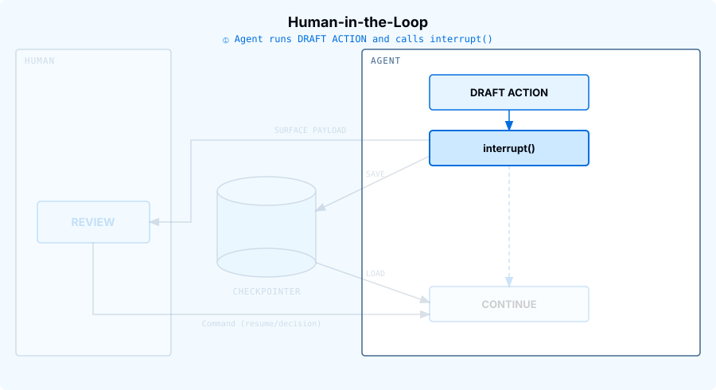
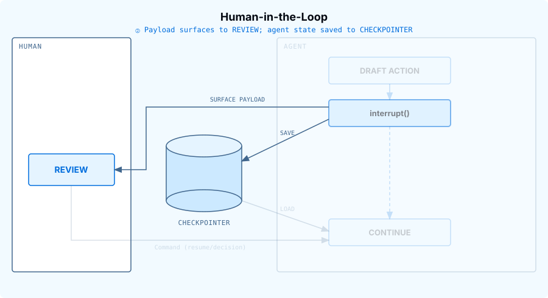
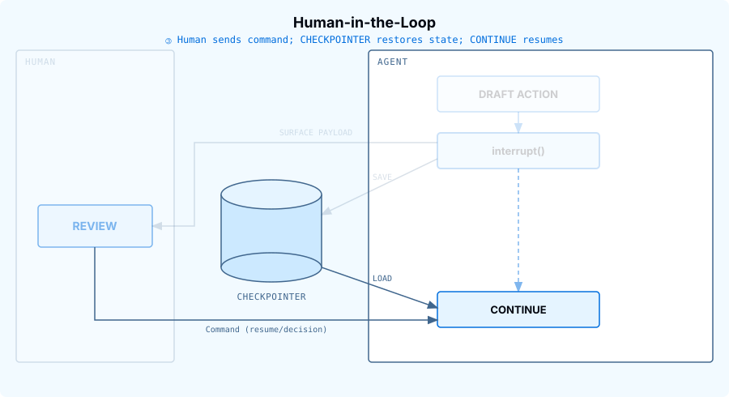

# Course tutor: references/m1.8-hitl.md

[Course index](../../../README.md) · [Original source](https://raw.githubusercontent.com/langchain-ai/lca-tutors/main/lca-deepagents/references/m1.8-hitl.md) · [Raw file](../../../raw/tutors/references/m1.8-hitl.md)

Retrieved: 2026-11-13T16:56:57.043495+00:00

[For translation, open lesson in new tab and use Chrome translate](../../lessons/m1.8-hitl.md)

<a id="human-in-the-loop"></a>


# Human-in-the-Loop

```text
<button class="lt-tab active" data-p="hitl" role="tab" aria-selected="true">Human-in-the-Loop</button>
```

```text
<button class="lt-tab" data-p="lab" role="tab" aria-selected="false">Lab 1</button>
<button class="lt-tab" data-p="lab2" role="tab" aria-selected="false">Lab 2</button>
```

```text
<button class="lt-tab" data-p="quiz" role="tab" aria-selected="false">Quiz</button>
```

```text
<button class="lt-tab" data-p="homework" role="tab" aria-selected="false">Homework</button>
```

<a id="p-hitl"></a>


Lesson Video Walkthrough

[Public video walkthrough](../../videos/iKsrBQZlPN3.md)

In the tools lesson, you saw that tools can do more than retrieve information: they can also take actions. In the previous lesson, you saw how messages, threads, and checkpointers let an agent save and resume state. Human-in-the-Loop (HITL) combines those ideas: pause before a sensitive action and let a person approve, edit, reject, or respond to it.

The main reason is safety. If an agent is about to send an email, update a database, or delete a file, you may want a human checkpoint before the side effect happens. HITL also lets the agent suspend execution while it waits instead of staying active indefinitely.

---

<a id="how-it-works"></a>


## How it works

Step through the sequence to see each phase:

<a id="hitl-concept"></a>

### Slideshow: hitl-concept

#### ① Tool call proposed



The model asks to call a sensitive tool, such as send\_email. Because that tool is listed in interrupt\_on, the tool does not execute yet.

#### ② Review &amp; Save



The agent pauses and returns the pending tool call for human review. The checkpointer saves the agent state so the run can resume later from the same point.

#### ③ Continue &amp; Load



The human sends a resume command with a decision. On approve, the tool executes. On edit, revised arguments execute. On reject, the tool does not run and the agent receives a cancellation result. On respond, the tool does not run either; the human's message is returned to the model as if the tool had produced it.

There are four pieces to remember:

| Piece | What it does |
| --- | --- |
| `interrupt_on` | Names the tools that require human review before execution. |
| `checkpointer` | Saves the paused agent state. For local development, use `MemorySaver()`. |
| `thread_id` | Identifies the saved run state. Resume with the same `thread_id`. |
| `Command(resume=…)` | Continues the paused run with the human decision. |

---

<a id="decision-types"></a>


## Decision types

Lesson Video Walkthrough

[Public video walkthrough](../../videos/KZb6UyoCWiX.md)

The `allowed_decisions` list controls what actions a human can take when reviewing a tool call:

| Decision Type | Description | Example Use Case |
| --- | --- | --- |
| `approve` | Execute the tool with the original arguments as proposed by the agent. | Send an email draft exactly as written |
| `edit` | Modify the tool arguments before execution. | Change the recipient before sending an email |
| `reject` | Skip executing this tool call entirely and return rejection feedback to the agent. | Deny file deletion and explain why |
| `respond` | Return the human’s message directly as a synthetic tool result, skipping execution, for “ask user” style tools. | The agent calls `ask_user(“What’s your budget?”)`; the human types “$500”, and that becomes the tool’s result. |

`reject` blocks an action the tool would otherwise perform, like deleting a file.

`respond` is different: it’s for tools where the human’s answer *is* the result, like `ask_user`. Never use `respond` to block a side-effecting tool such as `send_email` or `delete_file`; the model will read the human’s message as a successful result, not a denial, and may believe the action already happened.

When **editing** tool arguments, make changes conservatively. Significant modifications to the original arguments may cause the model to re-evaluate its approach and potentially execute the tool multiple times or take unexpected actions.


---

<a id="references"></a>


## References

**Documentation:**

- [Human-in-the-Loop (Deep Agents)](../../readings/docs-langchain-com-oss-python-deepagents-human-in-the-loop-65328403.md)
- [Deep Agents overview](../../readings/docs-langchain-com-oss-python-deepagents-overview-6f3fda49.md)

<a id="p-lab"></a>


<a id="lab-reviewing-an-email-tool"></a>


## Lab: Reviewing an Email Tool

Lab Video Walkthrough

[Public video walkthrough](../../videos/FXc8O0Aoa62.md)

**[View this run here in LangSmith.](https://smith.langchain.com/public/44ebac6d-44d1-4a21-9418-b031655ced8b/r/019f1fbc-ab9a-7733-95b6-a919142f2038)** Notice the run pausing on the `send_email` tool call and resuming after the human decision.

LangSmith Video Walkthrough

[Public video walkthrough](../../videos/6S9gpfxnmMD.md)

Open `python/m1/m1.8_hitl.py`. It defines a mock `send_email` tool. The tool does not contact a real email service; it returns a string so the lab is safe to run.

<a id="define-an-action-tool"></a>


### 1. Define an action tool

```text
from langchain_core.tools import tool

@tool
def send_email(to: str, subject: str, body: str) -> str:
    """Send an email to a recipient."""
    return f"Email sent to {to} with subject {subject!r}. Body: {body}"
```

<a id="configure-hitl-on-that-tool"></a>


### 2. Configure HITL on that tool

```text
from deepagents import create_deep_agent
from langgraph.checkpoint.memory import MemorySaver

agent = create_deep_agent(
    model=model,
    tools=[send_email],
    system_prompt=SYSTEM_PROMPT,
    interrupt_on={"send_email": True},
    checkpointer=MemorySaver(),
)
```

`interrupt_on={"send_email": True}` means: if the agent tries to call `send_email`, pause before the tool executes and surface the pending action for review.

The checkpointer is required because the agent needs somewhere to save the paused state. Without it, there is nothing to resume.

<a id="invoke-with-a-stable-thread-id"></a>


### 3. Invoke with a stable thread ID

```text
config = {"configurable": {"thread_id": "m1-7-hitl-demo"}}

result = agent.invoke(
    {
        "messages": [
            {
                "role": "user",
                "content": "Send an email to jane@example.com saying I will be 10 minutes late.",
            }
        ]
    },
    config=config,
    version="v2",
)
```

The `thread_id` is how the checkpointer finds this paused run again. When you resume, pass the same `config`.

<a id="review-and-resume"></a>


### 4. Review and resume

```text
from langgraph.types import Command

while result.interrupts:
    pending = result.interrupts[0].value
    decisions = []
    for req in pending["action_requests"]:
        print(f"\nApproval required for {req['name']}:")
        print(req["args"])

        choice = input("\nApprove, edit, or reject? (approve/edit/reject): ").strip().lower()
        if choice in ("approve", "yes", "y"):
            decisions.append({"type": "approve"})
        elif choice in ("edit", "e"):
            edited_args = dict(req["args"])
            edited_args["body"] = input("New email body: ")
            decisions.append(
                {
                    "type": "edit",
                    "edited_action": {"name": req["name"], "args": edited_args},
                }
            )
        else:
            decisions.append(
                {"type": "reject", "message": "User rejected this email draft."}
            )

    result = agent.invoke(Command(resume={"decisions": decisions}), config=config, version="v2")
```

If you approve, `send_email` runs as proposed. If you edit, the tool runs with your revised arguments. If you reject, the tool never runs; the agent receives a cancellation result and should respond accordingly.

<a id="run-it"></a>


### Run it

From the repo root:

```text
cd python
uv run python m1/m1.8_hitl.py
```

Try all three paths:

- run once and type `approve`;
- run again and type `edit`, then provide a new email body;
- run again and type `reject`.

You should see the pending tool arguments before each decision. That is the safety checkpoint: the side effect is visible before it happens.

<a id="p-lab2"></a>


<a id="lab-2-asking-the-user-a-question"></a>


## Lab 2: Asking the User a Question

The first lab reviewed a single tool with `approve`, `edit`, and `reject`. This lab adds a second tool, `ask_user`, whose only allowed decision is `respond`.

All four decision types live on the same `allowed_decisions` list; a tool is not “a respond tool” or “an approve/edit/reject tool” by nature. `ask_user` is restricted to `respond` here because that is the only decision that makes sense for a tool whose entire job is answering a question, not because `respond` belongs to some separate system.

**Scenario:** “Email professor.weng@university.edu that I’ll be late, but first check whether I should just apologize or ask for a short extension.” The agent cannot draft a good email until it knows which one you want, so it calls `ask_user` before it ever calls `send_email`.

Lab Video Walkthrough

[Public video walkthrough](../../videos/RZpyOTGLtaB.md)

**[View this run here in LangSmith.](https://smith.langchain.com/public/2fcc0462-1090-4d52-8f16-7e3464635298/r/019f4479-3ed5-7531-b2cc-e4bd396e8c77)** Notice the run pausing on the `ask_user` tool call, then again on `send_email`, resuming after each human decision.

LangSmith Video Walkthrough

[Public video walkthrough](../../videos/UVi0Mf9NUwx.md)


In the trace, look at the `ask_user` tool call: it never actually runs. `respond` simulates the tool call for it, and the tool’s output in the trace is not the placeholder string from the function body, it’s the human’s answer, inserted as if the tool had returned it.


**Why not just put this in the system prompt?** You could instruct the model to “ask the user to pick an option before continuing.” The difference is enforcement. A system prompt only shapes what the model *tends* to do; it can still skip the question, phrase it as free text, or drift off-script.

`allowed_decisions=["respond"]` is enforced by the framework itself: the tool call always pauses, and the only valid decision is a `respond` message. That guarantee is what lets you safely render the choices as real UI, like buttons or a dropdown, instead of a plain-text chat box, because you know the interrupt will always be there to catch the answer.

Open `python/m1/m1.8_hitl_respond.py`. It defines two tools: `ask_user` and `send_email`.

<a id="define-the-clarifying-question-tool"></a>


### 1. Define the clarifying-question tool

```text
from langchain_core.tools import tool

@tool
def ask_user(question: str, choices: list[str]) -> str:
    """Ask the user a clarifying question with a fixed set of choices."""
    return f"[No response recorded for: {question}]"
```

The function body is a placeholder. Because `ask_user` will always be configured to only allow `respond`, the tool itself never actually runs; the human’s answer is returned in its place.

<a id="restrict-each-tool-to-its-own-decisions"></a>


### 2. Restrict each tool to its own decisions

```text
agent = create_deep_agent(
    model=model,
    tools=[ask_user, send_email],
    system_prompt=SYSTEM_PROMPT,
    interrupt_on={
        "ask_user": {"allowed_decisions": ["respond"]},
        "send_email": {"allowed_decisions": ["approve", "edit", "reject"]},
    },
    checkpointer=MemorySaver(),
)
```

`ask_user` can only be answered with `respond`. `send_email` can only be approved, edited, or rejected. Passing an `edit` decision for `ask_user`, for example, would raise an error; the framework enforces the boundary between “answer a question” and “review a side effect” for you.

<a id="render-the-choices-as-an-actual-menu"></a>


### 3. Render the choices as an actual menu

```text
import questionary

while result.interrupts:
    pending = result.interrupts[0].value
    decisions = []
    for req in pending["action_requests"]:
        if req["name"] == "ask_user":
            selected = questionary.select(
                req["args"]["question"],
                choices=req["args"]["choices"],
            ).ask()
            decisions.append({"type": "respond", "message": selected})

        elif req["name"] == "send_email":
            ...  # same approve/edit/reject handling as Lab 1

    result = agent.invoke(Command(resume={"decisions": decisions}), config=config, version="v2")
```

`questionary` is a third-party CLI library, not part of deepagents or LangGraph. `questionary.select(question, choices=...)` just renders an arrow-key menu in the terminal and returns whichever choice the user picks. It’s here purely as a stand-in UI; a real app could swap in a web form or a Slack button and the agent-side code would not change.

This is the payoff of restricting `ask_user` to `respond`: because the tool’s args always carry a `question` and a fixed `choices` list, the CLI can hand them to `questionary.select(...)` and render a real arrow-key menu instead of a free-text `input()` prompt. Whatever the student picks becomes the `respond` message verbatim, so the model receives an unambiguous answer, not a string it has to interpret.

<a id="run-it-1"></a>


### Run it

```text
cd python
uv run python m1/m1.8_hitl_respond.py
```

You will be asked to pick “apologize” or “ask for a short extension” before the agent drafts anything. Whichever you choose, watch how it changes the drafted email that then goes through the `send_email` approve/edit/reject review.

<a id="p-quiz"></a>


## Check your understanding

<a id="p-homework"></a>


<a id="gate-your-own-action-tool"></a>


## Gate Your Own Action Tool

**If you started this course before July 21, 2026:** this homework assignment is new. Pull the latest changes from the repo root to access it:

```text
git pull
```

Lab 1 gated one action tool, `send_email`, behind `interrupt_on` and walked through approve/edit/reject on it. This homework asks you to do the same thing for an action tool of your own choosing: post a tweet, book a meeting room, place an order, delete a file, whatever you like.

Open `python/m1/m1.8_homework.py`.

1. **TODO 1**: define your own `@tool`-decorated action tool. Pick any side-effecting action you like; the function body can just return a confirmation string, the same way Lab 1’s `send_email` did.
2. **TODO 2**: configure `interrupt_on` for your tool with an `allowed_decisions` list of your choosing, and write a system prompt plus an initial user request that would lead the model to propose calling it.

The review loop in the file (borrowed from Lab 1, unchanged) prints any pending tool call and asks you to approve, edit, or reject it. Run the script more than once, picking a different choice each time, to see both an approve/edit path and a reject path.

<a id="run-it-2"></a>


### Run it

```text
cd python
uv run ./m1/m1.8_homework.py
```

Stuck, or want to see the finished shape before you start? `m1.8_homework_filled.py` is a reference copy with every TODO filled in (using a `post_tweet` action tool); run it the same way to see what “done” looks like end to end.

Try to avoid peeking unless you’re really stuck, you’ll get more out of this by working through the TODOs yourself first.

```javascript

(function () {
  var tabs = document.querySelectorAll('.lt-tab');
  function show(p) {
    tabs.forEach(function (t) {
      var on = t.getAttribute('data-p') === p;
      t.classList.toggle('active', on);
      t.setAttribute('aria-selected', on ? 'true' : 'false');
    });
    document.querySelectorAll('.lt-panel').forEach(function (panel) {
      panel.classList.toggle('active', panel.id === 'p-' + p);
    });
  }
  tabs.forEach(function (t) {
    t.addEventListener('click', function () { show(t.getAttribute('data-p')); });
  });
})();

```
