# Project background: biglocalnews.org/content/about/

[Course index](../../README.md) · [Original source](https://biglocalnews.org/content/about/) · [Raw file](../../raw/project-references/biglocalnews-org-content-about.html)

Retrieved: 2026-11-13T17:05:06.819903+00:00

# About

Who we are and what we’re working on

Big Local News, based at Stanford University, helps newsrooms do important accountability journalism without the need for their own data specialists or extensive programming knowledge. We gather data to investigate patterns and detect newsworthy events, and provide datasets, [tools](https://biglocalnews.org/content/tools/), and training free to any newsroom. We also [collaborate](https://biglocalnews.org/content/collaborations/) with local journalists to turn interesting datasets into multi-newsroom reporting projects.

The [biglocalnews.org](https://biglocalnews.org) site offers a free archiving service for journalists to store, share, and publish data. Selected projects are preserved by the [Stanford Digital Repository](https://biglocalnews.org/content/affiliates/). Our [Industrial Affiliates program](https://biglocalnews.org/content/affiliates/) offers specialized services for more sophisticated data work through an annual membership.

## Leadership

[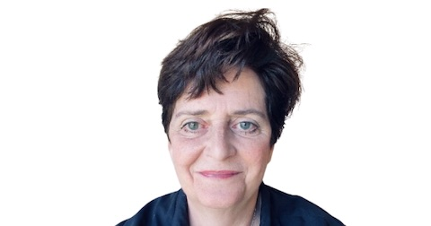

Cheryl Phillips

Founder and Co-director, Hearst Professional in Residence](https://journalism.stanford.edu/people/cheryl-phillips)
[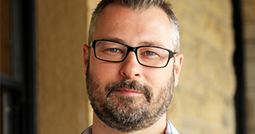

Serdar Tumgoren

Co-director, Lorry I. Lokey Visiting Professor](https://journalism.stanford.edu/people/serdar-tumgoren)
[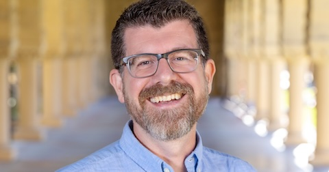

Ryan Pitts

Managing Director](https://www.linkedin.com/in/ryanapitts/)

## Staff

[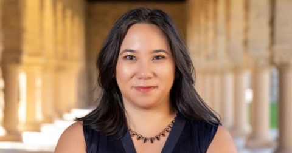

Kim Bui

Project Manager](https://www.linkedin.com/in/kimbui)
[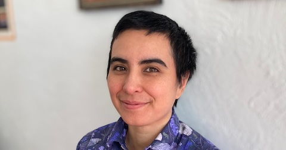

Rosie Cima

Senior Data Journalist](https://www.linkedin.com/in/rosie-cima-91784540/)
[

Sarah Cohen

Senior Data Journalist](https://www.linkedin.com/in/sarahcnyt)
[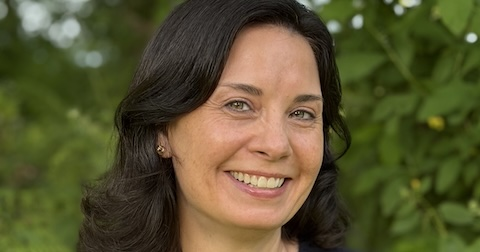

Emily Guadagno

Director of Product](https://www.linkedin.com/in/emilyiguadagno/)
[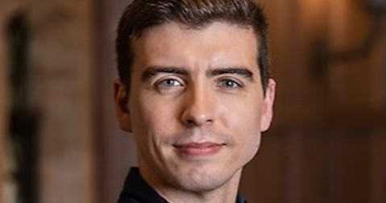

Jake Kara

Software Developer/Engineer](https://www.linkedin.com/in/jakekara/)
[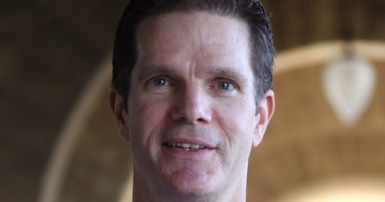

Justin Mayo

Senior Data Journalist](https://www.linkedin.com/in/mayojustin/)
[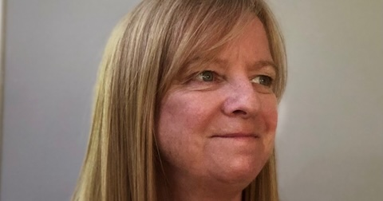

Shawn McIntosh

Senior Adviser of Strategy](https://www.linkedin.com/in/shawnemcintosh/)
[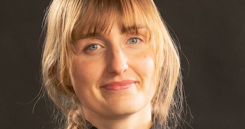

Paige Moody

Software Developer/Engineer](https://www.linkedin.com/in/paige-moody/)
[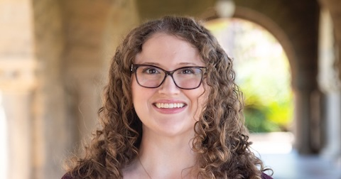

Kenzie Possee

Data Journalist](https://www.linkedin.com/in/kenziepossee/)
[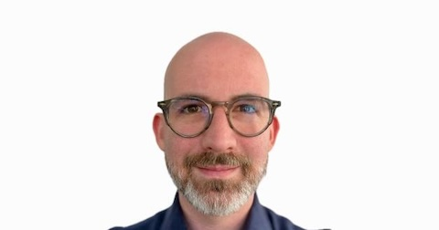

Gerald Rich

Software Developer/Engineer](https://www.linkedin.com/in/geraldrich)
[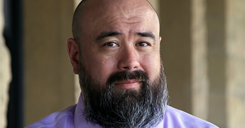

Eric Sagara

Senior Data Journalist](https://www.linkedin.com/in/esagara/)
[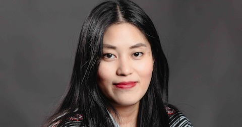

Cherry Salazar

Data Journalist](https://www.linkedin.com/in/cmgsalazar)
[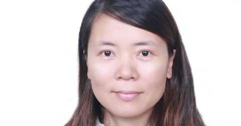

Doris Zhou

Administrative Associate](https://www.linkedin.com/in/doris-zhou-8b81899/)

## Supporting Faculty

[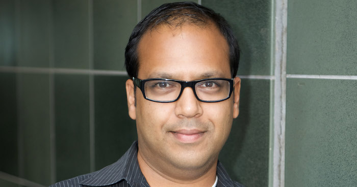

Maneesh Agrawala

Forest Basket Professor of Computer Science, Brown Institute for Media Innovation Director](https://profiles.stanford.edu/maneesh-agrawala)
[

R.B. Brenner

Lecturer and Managing Director, Stanford Journalism and Democracy Initiative](https://comm.stanford.edu/people/rb-brenner)
[

Sharad Goel

Professor of Public Policy, Harvard Kennedy School](https://5harad.com/)
[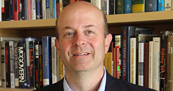

James Hamilton

Hearst Professor of Communication, Department of Communication Chair](https://profiles.stanford.edu/james-hamilton)

## Collaborators

[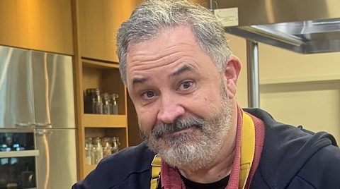

Sef Kloninger](https://sef.kloninger.com/)
[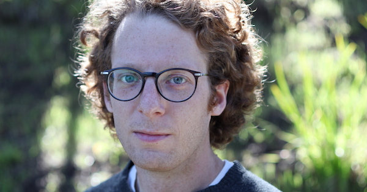

Joe Nudell](https://github.com/jnu)
[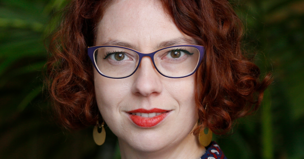

Lisa Pickoff White](https://www.linkedin.com/in/lpickoffwhite/)
[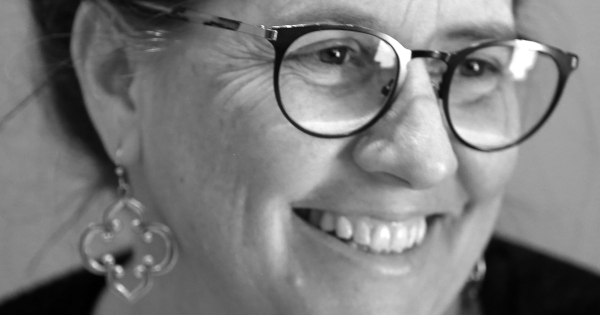

Regina Lee Roberts](https://profiles.stanford.edu/regina-roberts)
[

Mike Stucka](https://www.linkedin.com/in/mike-stucka)
[

Ben Welsh](https://palewi.re/who-is-ben-welsh/)
[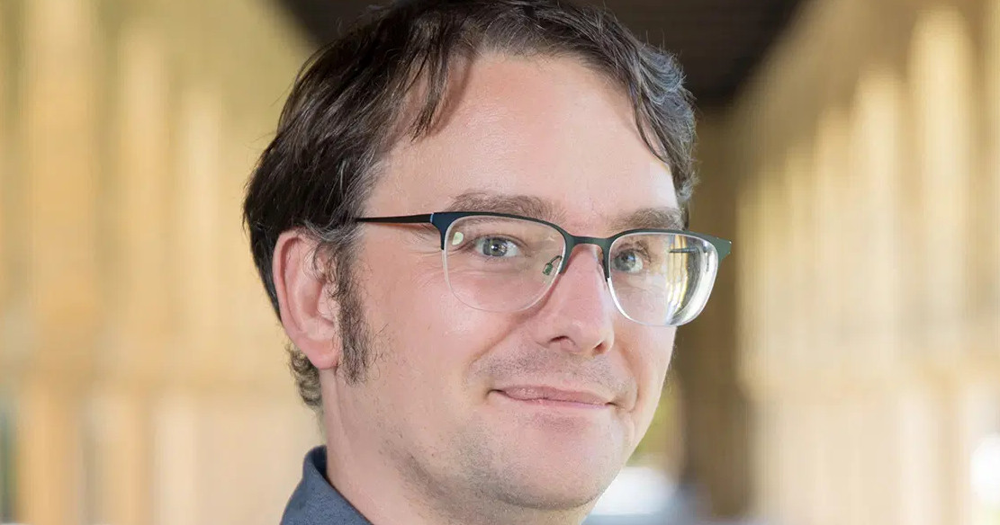

Simon Willison](https://simonwillison.net/)

## Support our work

Big Local News is funded through grants and donations. Please help support the project by making a donation at [makeagift.stanford.edu](https://makeagift.stanford.edu/). In the form, select School of Humanities and Social Science and specify Dept. of Communication, Big Local News project.

## Partners

[

Brown Institute for Media Innovation](https://brown.columbia.edu/)
[

Google News Initiative](https://newsinitiative.withgoogle.com/)
[

John S. and James L. Knight Foundation](https://knightfoundation.org)
[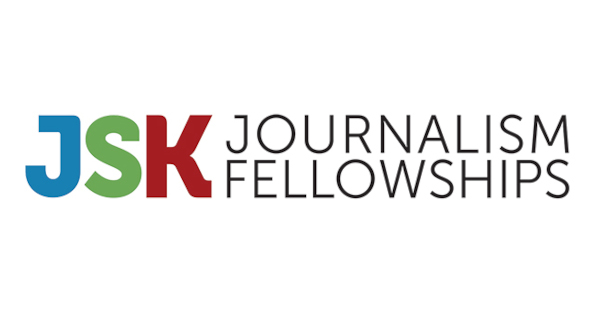

John S. Knight Journalism Fellowships](https://jsk.stanford.edu/)
[

Stanford Journalism and Democracy Initiative](https://jdi.stanford.edu/jdi.png)
[

Stanford Libraries](https://library.stanford.edu/)

## Contact us

Address: 450 Jane Stanford Way, Building 120, Stanford, CA 94305

E-mail: [biglocalnews@stanford.edu](mailto:biglocalnews@stanford.edu)

Phone: 650-498-2469
