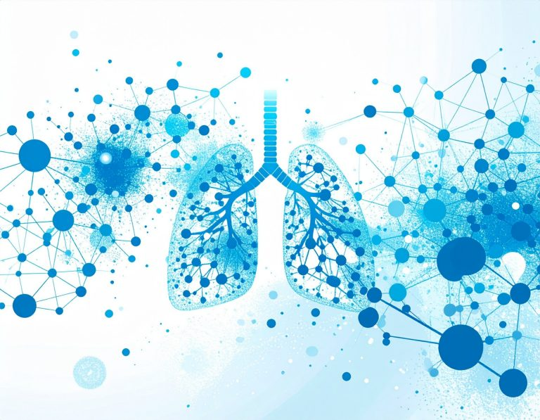
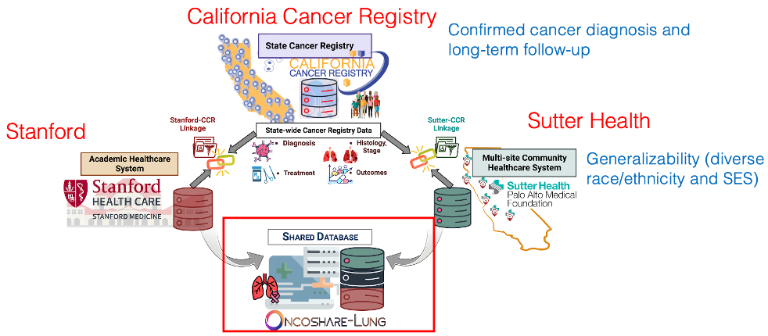

# Project background: med.stanford.edu/oncoshare.html

[Course index](../../README.md) · [Original source](https://med.stanford.edu/oncoshare.html) · [Raw file](../../raw/project-references/med-stanford-edu-oncoshare-html.html)

Retrieved: 2026-11-13T17:07:34.399252+00:00

## The Stanford-Sutter Health Oncoshare Project

# What We Do

The Stanford-Sutter Health Oncoshare Project was founded in 2008 with the goal of using a “big data” approach to improve breast cancer care. The aim was to build a comprehensive cancer research tool that integrates data from a number of unique local and national resources: the statewide, population-based California Cancer Registry; electronic medical records (EMRs) from Stanford University Hospital and multiple sites of the community-based Sutter Health system; detailed genomic sequencing results from clinical testing laboratories; and patient-reported data on cancer care preferences and experiences. Spanning two healthcare systems, Oncoshare is unique in its breadth of focus coupled to its depth of clinical detail. This “big data” approach enables us to generate high-resolution maps of cancer treatment, and thus to identify care pathways that yield the best outcomes for patients.

## Our Initiatives

## [Breast Initiative](https://med.stanford.edu/oncoshare/breast.html)

[Learn More About Oncoshare-Breast](https://med.stanford.edu/oncoshare/breast.html)

## [Lung Initiative](https://med.stanford.edu/oncoshare/lung.html)

[Learn More About Oncoshare-Lung](https://med.stanford.edu/oncoshare/lung.html)

## What is 3-way linkage?

The linkage consists of linking EHR from Stanford Healthcare, Sutter Health, and the California Cancer Registry. Stanford Healthcare – an academic practice – and Sutter Health – a neighboring community practice in the same catchment area complements data from each other. Stanford provides data in a referral setting while Sutter Health provides a more consistent, continuous record of care. Linkage to the California Cancer Registry allows accurate ascertainment of cancer cases and curated baseline and long-term follow-up data, while EHR provides nuanced in-between treatment records.   This approach covering a broad geographical region in Northern California also enhances the generalizability of study findings by capturing a more diverse range of race, ethnicity, and socioeconomic status.

[Graphic viewable in PDF format](https://med.stanford.edu/content/dam/sm/oncoshare/lung/CancerRegistry.pdf)

### Lack of detail in cancer registry data

Registry data provide accurately ascertained lung cancer cases, tumor characteristics, first-line treatments and long-term follow-up outcome. However, registry data lack the refined details such as cancer surveillance, presence of biomarkers or driver mutations, subsequent lines of therapy, and progression-free survival. With increasing use of novel therapies such as immunotherapy and targeted therapy, such information is crucial for performing real-world evidence studies.

### Data missingness in EHR

The EHR contains rich and granular details about a patient’s medical and treatment history – but only as far as the patient visits the same health system for their care. Thus, single institution clinical research is often limited by fragmented patient history. Records at community practices may not reflect treatments completed at tertiary, referral academic practices, while those at academic practices may lack the comprehensive view of community practices. Further, EHR does not does not track the list of lung cancer diagnoses nor guarantee long-term follow-up.

## Software

### Dynamic - LM

Dynamic-LM is an R package for dynamic risk prediction in survival data. It enables continuous updates to a patient's risk profile based on changing conditions and treatments. The package has advanced features for data preparation, predictive modeling, and model evaluation. It can handle high-dimensional data analysis with penalization. The methodology showed high predictive accuracy in lung cancer mortality studies by integrating diverse risk factors from multiple data sources.

[View more info here](https://med.stanford.edu/summerhanlab/software/dynamiclm.html)

[The R package is publicly available in GitHub](https://github.com/thehanlab/DistinCT)
