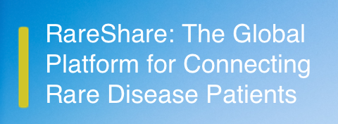
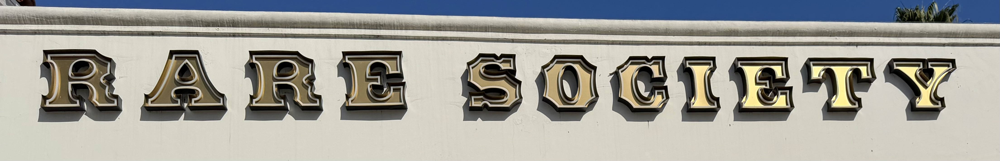
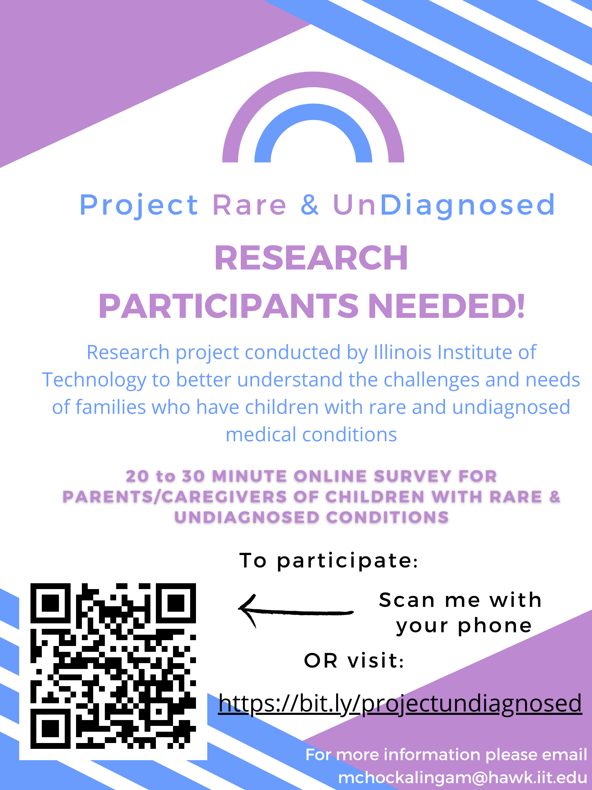
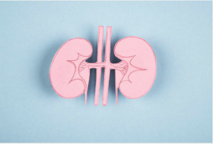
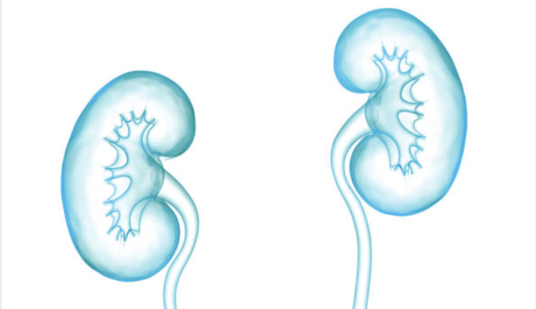
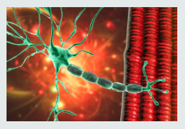
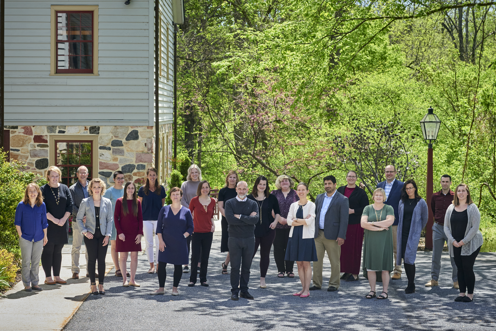
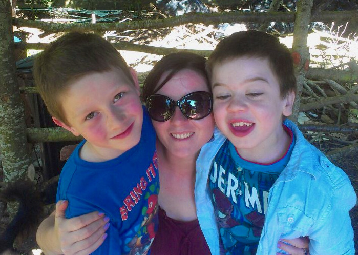

# Project background: RareShare.org

[Course index](../../README.md) · [Original source](http://RareShare.org) · [Raw file](../../raw/project-references/rareshare-org.html)

Retrieved: 2026-11-13T17:05:19.632564+00:00

Cookies help us deliver our services. By using our services, you agree to our use of cookies.

 OK 
 [Learn more](https://rareshare.org/pages/faq#cookies_Policy)

#### WHY RARE DISORDERS?

Even though there are 7,000 known rare conditions, many of the 300 million affected patients around the globe feel alone. RareShare was founded in 2008 to give these people and their loved ones a sense of community; a place to sympathize, celebrate, and share their experiences and expertise, together.

#### WHY RARESHARE?

RareShare is built on a premise that sharing information is good, especially when it comes to information about rare diseases. The more you share the more you have an opportunity to help others whose lives have been touched by rare disease. By joining our community of support and sharing information about your experience, you will help others, including researchers, better understand your disease. Please keep in mind that the content and extent to which you share is ultimately your choice and responsibility.

Create a sense of community for those affected by rare disorders

Communicate with others that are affected by the same condition

Contribute condition-related information, experiences, support, and resources

### Rareshare news News articles related to Rareshare and Rareshare communities

---

#### [Help test a new version of RareShare!](https://rareshare.org/articles/help-test-a-new-version-of-rareshare)

Publication date: 18 Oct 2026

Preview and test the next version of RareShare.

[Read full article](https://rareshare.org/articles/help-test-a-new-version-of-rareshare)

---

#### [RareShare Disease Guides for Patients, Families and Caregivers](https://rareshare.org/articles/rareshare-disease-guides-for-patients-families-and-caregivers)

Publication date: 8 Sep 2026

[Read full article](https://rareshare.org/articles/rareshare-disease-guides-for-patients-families-and-caregivers)

---

#### [RareShare Spring 2026 Newsletter](https://rareshare.org/articles/rareshare-spring-2026-newsletter)

Publication date: 15 Apr 2026

Newsletter

Participate in a AI user survey, see our recently updated disease summaries and visit your RareShare community.

[Read full article](https://rareshare.org/articles/rareshare-spring-2026-newsletter)

---

#### [Rare Disease Day 2026](https://rareshare.org/articles/rare-disease-day-2026)

Publication date: 14 Feb 2026

[Read full article](https://rareshare.org/articles/rare-disease-day-2026)

---

#### [We're back!](https://rareshare.org/articles/we-re-back)

Publication date: 18 Dec 2025

RareShare is online again.

[Read full article](https://rareshare.org/articles/we-re-back)

---

#### [RareShare Autumn 2025 Newsletter](https://rareshare.org/articles/rareshare-autumn-2025-newsletter)

Publication date: 15 Sep 2025

Read about some of the key challenges faced by virtually all rare disease patients.

[Read full article](https://rareshare.org/articles/rareshare-autumn-2025-newsletter)

---

#### [RareShare Guide on Chromosomal Nomenclature](https://rareshare.org/articles/rareshare-guide-on-chromosomal-nomenclature)

Publication date: 4 Jun 2025

Guide

Chromosomal positioni information and naming conventions can be somewhat obscure. Here's a quick guide to help understand how the names are derived.

[Read full article](https://rareshare.org/articles/rareshare-guide-on-chromosomal-nomenclature)

---

#### [Do you have a story to share?](https://rareshare.org/articles/do-you-have-a-story-to-share)

Publication date: 18 Apr 2025

RareShare is looking for stories that can be posted in its newsletter or which can be used in its podcast series.

[Read full article](https://rareshare.org/articles/do-you-have-a-story-to-share)

---

#### [NORD Living Rare Study Seeks to Document Rare Disease Patient Challenges](https://rareshare.org/articles/nord-living-rare-study-seeks-to-document-rare-disease-patient-challenges)

Publication date: 8 Mar 2025

Rare disease patients in the U.S. are encouraged to participate in a National Organization for Rare Diseases (NORD) research study intended to capture data on how rare diseases impact life, ranging from healthcare access and treatments to emotional, social and financial difficulties.

[Read full article](https://rareshare.org/articles/nord-living-rare-study-seeks-to-document-rare-disease-patient-challenges)

---

#### [Rare Disease Day is More Important Than Ever](https://rareshare.org/articles/rare-disease-day-is-more-important-than-ever)

Publication date: 14 Feb 2025

A call to action for Rare Disease Day.

[Read full article](https://rareshare.org/articles/rare-disease-day-is-more-important-than-ever)

---

#### [RareShare December 2024 Newsletter](https://rareshare.org/articles/rareshare-december-2024-newsletter-c60a5466-da73-45e5-ba69-41b42c2d14c2)

Publication date: 3 Dec 2024

Rare diseases are more common than you may think, and RareShare taps into AI.

[Read full article](https://rareshare.org/articles/rareshare-december-2024-newsletter-c60a5466-da73-45e5-ba69-41b42c2d14c2)

---

#### [FDA Initiates START Pilot Program for Rare Diseases](https://rareshare.org/articles/fda-initiates-start-pilot-program-for-rare-diseases)

Publication date: 23 Sep 2024

Support for clinical Trials Advancing Rare disease Therapeutics (START) program to accelerate drug and biological products for rare diseases.

[Read full article](https://rareshare.org/articles/fda-initiates-start-pilot-program-for-rare-diseases)

---

#### [Research Survey on Navigating the Alphabet Soup of Rare Disease Names](https://rareshare.org/articles/research-survey-on-navigating-the-alphabet-soup-of-rare-disease-names)

Publication date: 18 Jul 2024

Rare disease parents are invited to particpate in a paid survey.

[Read full article](https://rareshare.org/articles/research-survey-on-navigating-the-alphabet-soup-of-rare-disease-names)

---

#### [Help Researchers Understand Burnout in Adult Patients During the Diagnostic Odyssey](https://rareshare.org/articles/help-researchers-understand-burnout-in-adult-patients-during-the-diagnostic-odyssey)

Publication date: 22 Jun 2024

Getting to a correct diagnosis for a rare disease can be a years long ordeal known as the "Diagnostic Odyssey." Help University of North Carolina Greensboro researchers compile survey results from real patients by participating in an online survey.

[Read full article](https://rareshare.org/articles/help-researchers-understand-burnout-in-adult-patients-during-the-diagnostic-odyssey)

---

#### [Online Study for Families with Children Having Undiagnosed Medical Conditions or a Rare Disease](https://rareshare.org/articles/online-study-for-families-with-children-having-undiagnosed-medical-conditions-or-a-rare-disease)

Publication date: 16 May 2024

Join a study investigating challenges and experiences of families with a child having a rare disease or undiagnosed medical condition

[Read full article](https://rareshare.org/articles/online-study-for-families-with-children-having-undiagnosed-medical-conditions-or-a-rare-disease)

---

#### [Genetic Counseling and Rare Diseases Podcast](https://rareshare.org/articles/genetic-counseling-and-rare-diseases-podcast)

Publication date: 7 Mar 2024

Genetic Counseling and Rare Diseases Podcast produced by RareShare.

[Read full article](https://rareshare.org/articles/genetic-counseling-and-rare-diseases-podcast)

---

#### [Rare Disease (Leap) Day](https://rareshare.org/articles/rare-disease-leap-day)

Publication date: 23 Feb 2024

Rare Disease Day is February 29th.

[Read full article](https://rareshare.org/articles/rare-disease-leap-day)

---

#### [Why Rare Diseases?](https://rareshare.org/articles/why-rare-diseases)

Publication date: 5 Dec 2023

Newsletter

For rare diseases, a broad-based approach may be essential in increasing awareness and advocating for better outcomes.

[Read full article](https://rareshare.org/articles/why-rare-diseases)

---

#### [Contact Us](https://rareshare.org/articles/contact-us)

Publication date: 24 Oct 2023

[Read full article](https://rareshare.org/articles/contact-us)

---

#### [Role of Physical Therapists in Pediatric Muscular Disorders](https://rareshare.org/articles/role-of-physical-therapist-in-pediatric-muscular-disorders)

Publication date: 19 Sep 2023

An article posted on the Rare Genomics Institute website discusses the valuable role of physical therapists in pediatric muscular disorders.

[Read full article](https://rareshare.org/articles/role-of-physical-therapist-in-pediatric-muscular-disorders)

---

#### [Primary Sclerosing Cholangitis Clinical Trial](https://rareshare.org/articles/primary-sclerosing-cholangitis-clinical-trial)

Publication date: 9 Sep 2023

**Community:**
[Primary Sclerosing Cholangitis](https://rareshare.org/communities/primary-sclerosing-cholangitis)

A clinical trial for Primary Sclerosing Cholangitis (PSC) is enrolling patients.

[Read full article](https://rareshare.org/articles/primary-sclerosing-cholangitis-clinical-trial)

---

#### [Health Equity and Rare Diseases Podcast](https://rareshare.org/articles/health-equity-and-rare-diseases-podcast)

Publication date: 5 Aug 2023

Podcast

[Read full article](https://rareshare.org/articles/health-equity-and-rare-diseases-podcast)

---

#### [Neuroimmune Foundation Advocates for Those with Neuroimmune and Inflammatory Brain Conditions](https://rareshare.org/articles/neuroimmune-foundation-advocates-for-those-with-neuroimmune-and-inflammatory-brain-conditions)

Publication date: 27 Jul 2023

**Community:**
[PANDAS](https://rareshare.org/communities/pandas)

[Read full article](https://rareshare.org/articles/neuroimmune-foundation-advocates-for-those-with-neuroimmune-and-inflammatory-brain-conditions)

---

#### [RareShare Guide on Genetic Inheritance](https://rareshare.org/articles/guide)

Publication date: 3 Jun 2023

Guide

RareShare's content development team has prepared a summary of terms and concepts used to explain the role of genetics in the development and treatment of rare diseases.

[Read full article](https://rareshare.org/articles/guide)

---

#### [Rare Disease Day 2023](https://rareshare.org/articles/rare-disease-day-2023)

Publication date: 26 Feb 2023

February 28th is Rare Disease Day.

[Read full article](https://rareshare.org/articles/rare-disease-day-2023)

---

#### [Seeking volunteers with homocystinuria to join a paid clinical research study. Find out if you’re eligible today.](https://rareshare.org/articles/seeking-volunteers-with-homocystinuria-to-join-a-paid-clinical-research-study-find-out-if-you-re-eligible-today)

Publication date: 1 Feb 2023

**Community:**
[Homocystinuria](https://rareshare.org/communities/homocystinuria)

Do you have classical homocystinuria? You could qualify for a new paid clinical study, from home.

[Read full article](https://rareshare.org/articles/seeking-volunteers-with-homocystinuria-to-join-a-paid-clinical-research-study-find-out-if-you-re-eligible-today)

---

#### [New members welcome! Support re-opened.](https://rareshare.org/articles/new-members-welcome-support-re-opened)

Publication date: 24 Dec 2022

New member sign-up and password reset on RareShare has been restored. Email address for support requests provided.

[Read full article](https://rareshare.org/articles/new-members-welcome-support-re-opened)

---

#### [A Kidney Disease Trial is Enrolling Now](https://rareshare.org/articles/a-kidney-disease-trial-is-enrolling-now)

Publication date: 8 Dec 2022

**Community:**
[Membranoproliferative Glomerulonephritis (aka Complement 3 Glomerulopathy C3G)](https://rareshare.org/communities/membranoproliferative-glomerulonephritis)

Complement 3 Glomerulopathy study recruitment continues.

[Read full article](https://rareshare.org/articles/a-kidney-disease-trial-is-enrolling-now)

---

#### [Welcome Back!](https://rareshare.org/articles/welcome-back)

Publication date: 4 Dec 2022

RareShare is back online.

[Read full article](https://rareshare.org/articles/welcome-back)

---

#### [Rare Diseases and Mental Health](https://rareshare.org/articles/rare-diseases-and-mental-health)

Publication date: 4 Dec 2022

The mental health impact of rare diseases is often overlooked.

[Read full article](https://rareshare.org/articles/rare-diseases-and-mental-health)

---

#### [Researchers are in need of IgAN (IgA Nephropathy) patients for a clinical trial.](https://rareshare.org/articles/researchers-are-in-need-of-igan-iga-nephropathy-patients-for-a-clinical-trial)

Publication date: 2 Sep 2022

**Community:**
[IgA Nephropathy](https://rareshare.org/communities/iga-nephropathy)

Researchers are currently studying an investigational IgAN oral drug aimed at slowing the progression of kidney disease symptoms. Volunteers are needed — learn more today via  
Antidote.

[Read full article](https://rareshare.org/articles/researchers-are-in-need-of-igan-iga-nephropathy-patients-for-a-clinical-trial)

---

#### [Volunteers are needed for a kidney disease clinical trial.](https://rareshare.org/articles/volunteers-are-needed-for-a-kidney-disease-clinical-trial)

Publication date: 2 Aug 2022

**Community:**
[Membranoproliferative Glomerulonephritis (aka Complement 3 Glomerulopathy C3G)](https://rareshare.org/communities/membranoproliferative-glomerulonephritis)

Complement 3 Glomerulonephritis (C3G) study is looking for volunteers.

[Read full article](https://rareshare.org/articles/volunteers-are-needed-for-a-kidney-disease-clinical-trial)

---

#### [Early Diagnosis of Rare Diseases](https://rareshare.org/articles/easy-diagnosis-of-rare-diseases)

Publication date: 23 Jul 2022

Newsletter

Prenatal or neonatal diagnosis of many genetic rare diseases is becoming possible. Should it be done?

[Read full article](https://rareshare.org/articles/easy-diagnosis-of-rare-diseases)

---

#### [LELANTOS II Duchenne Muscular Dystrophy Study](https://rareshare.org/articles/lelantos-ii-duchenne-muscular-dystrophy-study)

Publication date: 11 Feb 2022

**Community:**
[Muscular Dystrophy, Duchenne and Becker Types](https://rareshare.org/communities/muscular-dystrophy-duchenne-and-becker-types)

[Read full article](https://rareshare.org/articles/lelantos-ii-duchenne-muscular-dystrophy-study)

---

#### [Clinic for Special Children Podcast](https://rareshare.org/articles/clinic-for-special-children-podcast)

Publication date: 5 Feb 2022

Podcast

Serving the Amish and Mennonite communities in Central Pennsylvania, the Clinic for Special Children provides counseling and healthcare for rare disorders affecting the local population. In doing so, it has become a recognized leader in the treatment and scientific understanding of conditions such as Maple Syrup Urine Disease. Listen to an in-depth, fascinating story of the clinic, its goals, accomplishments and challenges as told by current staff members. You'll almost certainly agree that it is truly a special place!

[Read full article](https://rareshare.org/articles/clinic-for-special-children-podcast)

---

#### [AI to Advance Rare Disease Understanding](https://rareshare.org/articles/ai-to-advance-rare-disease-understanding)

Publication date: 3 Nov 2021

Artificial intelligence (AI) will inevitably revolutionize the diagnosis and treatment of rare diseases.  Taken as a whole, the number of rare diseases, their diverse characteristics and complex causes comprise an ever expanding data set that will require computational help to decipher.  An estimated 40% of rare disorders are misdiagnosed at the outset, leading to incorrect management and treatment delays.

As rare conditions are frequently first noticed in young children, the consequences of misdiagnosis and delayed treatment can profoundly impact disease severity over a lifetime.

[Read full article](https://rareshare.org/articles/ai-to-advance-rare-disease-understanding)

---

#### [May 2021 Newsletter](https://rareshare.org/articles/may-2021-newsletter)

Publication date: 27 May 2021

Newsletter

May 2021 Newsletter

- The Diagnostic Odyssey
- Ethan and Me Podcast
- RareShare Disease Summaries

[Read full article](https://rareshare.org/articles/may-2021-newsletter)

---

#### [Rare Diseases as Pre-Existing Conditions](https://rareshare.org/articles/rare-diseases-as-pre-existing-conditions)

Publication date: 11 Dec 2020

Most rare diseases are “pre-existing” conditions. Depending upon where you live and your financial circumstances, this may disqualify you from health insurance benefits and continuous medical treatment. At face value, this is an absurdity. Many diseases, not just rare ones, manifest themselves over years. This includes cancer, heart disease, diabetes, high blood pressure, allergies to name a few. Initiating treatment of such diseases at their most acute symptomatic phase is often too late and ignores the fact that preventative measures could have been taken.

[Read full article](https://rareshare.org/articles/rare-diseases-as-pre-existing-conditions)

---

[View all Rareshare news](https://rareshare.org/articles)

### Need Help?

---

#### Need help with the site?

Visit our how-to guides page to find helpful guides on how to use the rareshare site.

[VISIT HOW-TO GUIDES](https://rareshare.org/guides)

### FAQ

---

#### Have questions about rareshare?

Visit our Frequently Asked Questions page to find the answers to some of the most commonly asked questions.

[VISIT FAQ](https://rareshare.org/pages/faq)

#### LOG INTO YOUR ACCOUNT

[Sign in with Facebook](https://rareshare.org/users/auth/facebook)

|
[Sign in with Google](https://rareshare.org/users/auth/google_oauth2)

#### DON'T HAVE AN ACCOUNT? BECOME A MEMBER

It's free and easy to join RareShare.

[SIGN UP NOW](https://rareshare.org/users/sign_up)

#### INTERESTED IN CONTACTING RARESHARE?

[Contact Us](https://rareshare.org/contact_us)

### Our Communities

Join Rareshare to meet other people that have been touched by rare diseases. Learn, engage, and grow with our communities.

[FIND YOUR COMMUNITY](https://rareshare.org/communities)

### Our Resources

Our rare disease resources include e-books and podcasts

[VIEW OUR EBOOKS](https://rareshare.org/ebooks)

[LISTEN TO OUR PODCASTS](https://rareshare.org/podcasts)

[VIEW OUR GUIDES](https://rareshare.org/guides)

### Our Community Leaders

Community leaders are active users that have been touched by the rare disease that they are a part of. Not only are they there to help facilitate conversations and provide new information that is relevant for the group, but they are there for you and to let you know you have a support system on Rareshare.

[MEET THE LEADERS](https://rareshare.org/home/leader_list)
