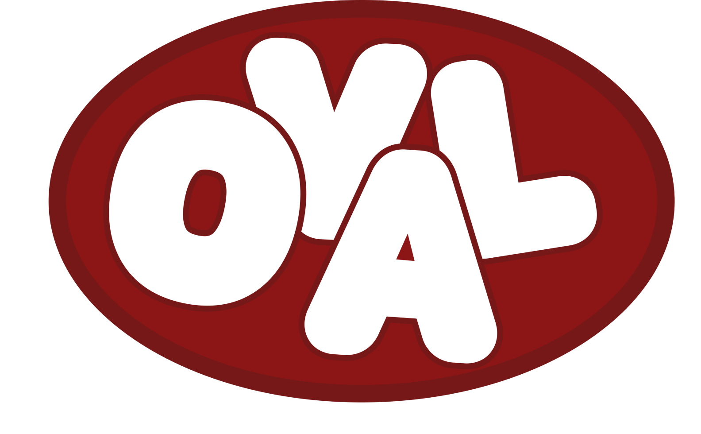
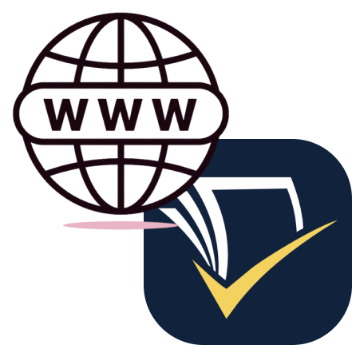
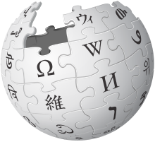
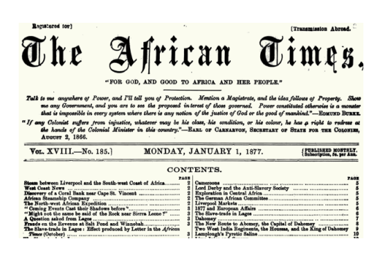
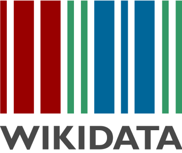
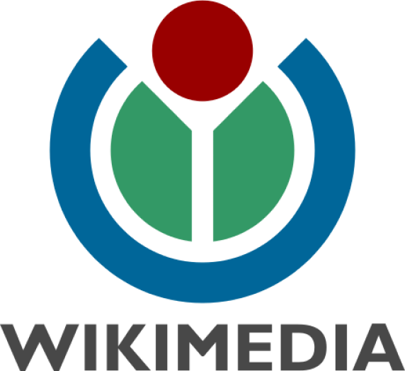
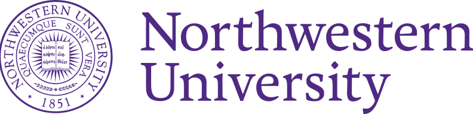
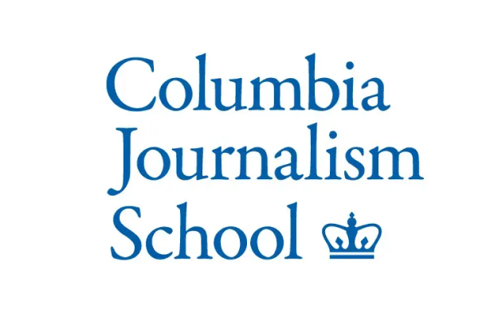
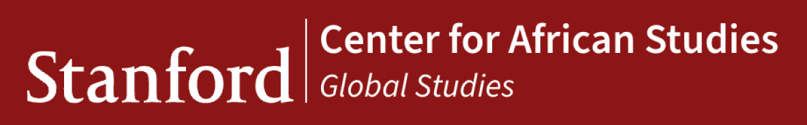

# Project background: WWKnowledge.org

[Course index](../../README.md) · [Original source](https://WWKnowledge.org) · [Raw file](../../raw/project-references/wwknowledge-org.html)

Retrieved: 2026-11-13T17:01:02.607049+00:00

The  [**Stanford Open Virtual Assistant Lab**](https://oval.cs.stanford.edu/)   presents a pilot of

A Public AI Assistant to World Wide Knowledge

Advancing global education and accelerating knowledge discovery with Artificial Intelligence

Access the WWKnowledge Assistant:

BROWSING

[Collaboratively research the web with Storm. Create research articles with comprehensive and accurate bibliographies.

Get your own article now

](https://storm.genie.stanford.edu)

[Chat with popular Wikipedias in different languages

Start chatting in English, Deutsch, Français, Español, 日本語, Русский, Português, Italiano, 中文, فارسی, …

](https://wikichat.genie.stanford.edu)

DEEP-DIVE

[*The African Times* newspaper   
 (1867 and 1910), available digitally for the first time.

Chat with the African diaspora in that period

](https://history.genie.stanford.edu)

[Co-hosted with Wikidata from Wikimedia, explore the world's knowledge

Deep-dive into 15 billion facts and ask questions

](https://spinach.genie.stanford.edu)

[Explore FEC campaign donation data (built in partnership with Big Local News)

Chat and ask questions about campaign donations

](https://datatalk.genie.stanford.edu/)

Contributing to WWKnowledge:

Upload your Sources

We are always welcoming new data sources to include in WWKnowledge.

[Upload your CSV](https://datatalk-ingestion.genie.stanford.edu/)

[Upload your corpora](https://search.genie.stanford.edu/upload_collection)

[Learn the Genie Framework

WWKnowledge is developed on the Stanford OVAL Lab's Genie Agent Framework

Learn to build with Genie](https://github.com/stanford-oval)

[Learn at our Workshops

Learn about the Genie framework from its creators, and about funding and collaboration opportunities

Watch the 2025 recordings](https://hai.stanford.edu/events/first-workshop-public-ai-assistant-world-wide-knowledge-wwk)

In Collaboration With

    

Sponsored By Verdant Foundation, Alfred P. Sloan Foundation, Brown Institute, Microsoft Azure Services, NSF NAIRR Pilot program, and Stanford HAI
