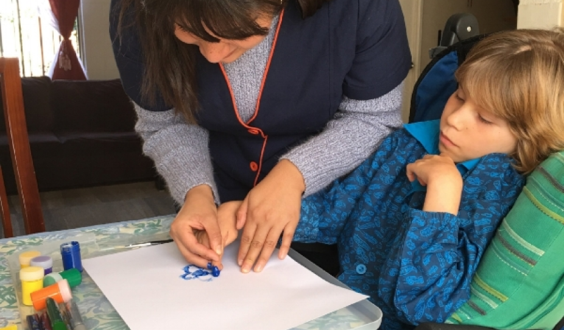
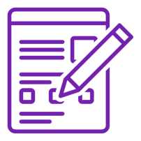
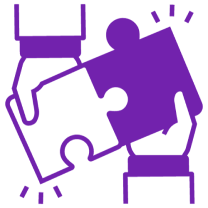
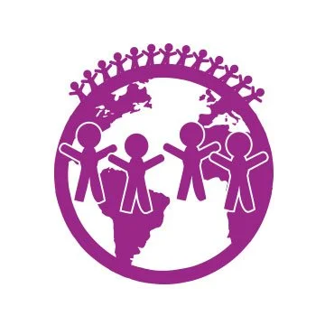
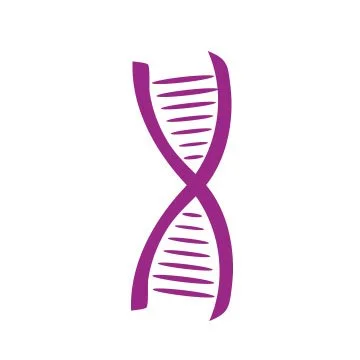
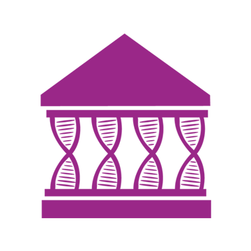

# Project background: www.raregenomics.org/patient-research-services

[Course index](../../README.md) · [Original source](https://www.raregenomics.org/patient-research-services) · [Raw file](../../raw/project-references/www-raregenomics-org-patient-research-services.html)

Retrieved: 2026-11-13T17:06:16.055966+00:00

## **Patient Research Services**

[**Programs**](https://www.raregenomics.org/programs) **> Patient Research Services**

### **What is Patient Research Services?**

New scientific research is being published all the time leading to new insights into the genome and genetic disease. Patient Research Services (PRS) works to find answers for patients and their families. Our research team reviews genetic sequencing data of patients to look for possible variants and diagnoses based on new scientific information.

### **How it works**

PRS utilizes a secure platform provided by Patients Know Best (PKB) to securely exchange clinical and sequencing data between the patient and researchers. This enables the safe and efficient exchange of records between the two.   
   
Through PRS you'll be connected with an RG patient advocate to help you through the process and act a go between you and the research team. They are dedicated to making progress as secure and efficient as possible.  
   
Together we are working to find answers for patients and their families affected by rare disease.

#### **Getting Started with PRS**

- Who is eligible?

  Anyone who has had whole exome or whole genome sequencing (WES/WGS) completed is eligible. Raw sequencing data and the sequencing files of biological family members will need to be provided.
- How do I join PRS?

  Follow the steps under the ‘How to apply’ section. If your inquiry is a match for the PRS program, a patient advocate will reach out and help you submit the necessary records.
- Necessary Records For Acceptance

  - Whole Exome Sequencing (WES) / Whole Genome Sequencing (WGS) raw data files, preferably in vcf format.
  - Any available information about sequencer technology and exome capture kit used for analysis.
  - Personal medical history including descriptions, symptoms, treatments, and how your condition has changed over time.
  - Family history, particularly any inherited or shared conditions among parents or other family members
  - Results from any other genetic tests, including single/panel targeted sequencing, microarray, karyotype, common aneuploidy, MLPA, FISH, STR, methylation, UPD, DNA repair, MSI testing, etc.

### **What to expect from PRS**

Patients who enroll in PRS should do so with the following possible outcomes in mind.

- PRS reanalyzes the raw sequencing data based on medical history and new medical and scientific literature.
- We generate a report based on our findings that patients can discuss further with their medical team.
- These findings may include new publications, new possible variants, and avenues to explore with their medical team.
- Our research team will provide a report that summarizes the relevant scientific literature and potential ideas that may shed light on your case. The entire process can take between 60-90 days.

### **How To Join Our Programs**

# **1**

#### **Fill out the Application Form**

Complete the form so we have basic information to prepare for your case review.

[Apply Now](https://www.raregenomics.org/contact-us)

# **2**

#### **Patient Advocate Review**

An advocate will get in contact within 3 business days to get detailed information so they help determine whether one of our services can fulfill your needs.

# **3**

#### **Get Matched**

After determining if we have a suitable program for you, we will assist in connecting you with the appropriate programs uniquely suited to your needs.

### **The Program’s Impact**

To date, we have helped more than **410** rare disease families and **600+** individual patients with over **$5.2M** worth of next-generation genome sequencing.

Rare Genomics has experienced great success and raised more than **$2M** since 2012 with partnership programs such as our annual BeHeard Science Challenge.

In 2023 alone, over **$750,000** in funds were raised to support 23 rare disease studies globally.
