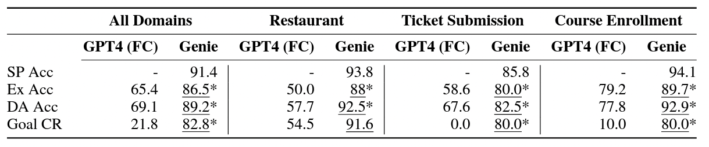

# Project code: stanford-oval/genie-worksheets: web/index.html

[Course index](../../../../README.md) · [Original source](https://github.com/stanford-oval/genie-worksheets/blob/HEAD/web/index.html) · [Raw file](../../../../raw/repositories/stanford-oval-genie-worksheets/web/index.html)

Retrieved: 2026-11-13T17:06:24.900930+00:00

# Genie Worksheets: Coding Reliable LLM-based Integrated Task and Knowledge Agents

[Harshit Joshi](https://harshitjoshi.com),

[Shicheng Liu](https://george1459.github.io/),

[James Chen](#),

[Robert Weigle](#),

[Monica S. Lam](https://suif.stanford.edu/~lam/)

Stanford OVAL lab    
Stanford University

[Paper](https://arxiv.org/pdf/2407.05674.pdf)


[Code](../../stanford-oval-genie-worksheets.md)


[arXiv](../../../readings/arxiv-2407-05674.md)


[Docs](docs/index-html.md)

[


](static/videos/genie_banner_video.mp4)

## GenieWorksheets is a programmable framework for creating reliable task-oriented conversational agents that can handle complex user interactions and knowledge access.


## Abstract

LLMs present an opportunity to create automated assistants that can help users navigate
complex tasks. However, existing approaches have limitations in: (i) handling conditional logic, (ii)
integrating knowledge sources, and (iii) consistently following instructions. Researchers and industry
professionals often employ ad-hoc pipelines to construct conversational agents. These pipelines aim to
maintain context, address failure cases, and minimize hallucinations, yet frequently fail to achieve these
objectives.

We present *Genie* - a programmable framework for creating conversational agents
that are designed to handle complex user interactions and knowledge queries. **Unlike LLMs**, *Genie*
provides reliable grounded responses, with controllable agent policies through its expressive specification,
*Genie Worksheet*. **In contrast to dialog trees**, it is resilient to diverse user queries, helpful
with knowledge sources, and offers ease of programming policies through its declarative paradigm.


## Features

1. **High-Level Declarative Specification:** Allows developers to easily define variables and actions for conversations through a spreadsheet-like format, without needing to manually code complex dialogue trees or manage LLM prompts.
2. **Integrated Knowledge and Task Handling:** Uniquely combines the ability to handle both structured database queries and API calls in a single conversation flow, letting users seamlessly mix questions with task completion.
3. **Reliable State Tracking:** Maintains conversation context through a formal dialogue state representation, reducing hallucinations and repetitive questioning common in pure LLM approaches.
4. **Programmable Agent Policies:** Provides fine-grained control over agent behavior through explicit policy definitions, while still maintaining natural conversation flow and handling unexpected user inputs.


| Features | Pure LLMs | Dialog Trees | GenieWorksheets |
| --- | --- | --- | --- |
| Handles unexpected queries | ✅ | ❌ | ✅ |
| Consistent output | ❌ | ✅ | ✅ |
| Knowledge integration | ✅ | ❌ | ✅ |
| Easy maintenance | ❌ | ❌ | ✅ |
| Natural conversations | ✅ | ❌ | ✅ |
| Control over responses | ❌ | ✅ | ✅ |
| Complex logic support | ❌ | ❌ | ✅ |
| Low hallucination risk | ❌ | ✅ | ✅ |
| Handles interruptions | ✅ | ❌ | ✅ |
| Programmable behaviors | ❌ | ✅ | ✅ |
| Dynamic field dependencies | ❌ | ❌ | ✅ |
| Development speed | ✅ | ❌ | ✅ |


## Results

We perform a real user study with 62 users across three domains. We choose three diverse applications with
varying complexities. Compared to the 3 StarV2 domains, these real-world applications are much more complicated, as shown in Table 5 in the Appendix.

1. **Restaurant Reservation:** Making a restaurant reservation requires finding a suitable restaurant and
   providing booking information to complete a transaction. We use the real-life dataset containing
   restaurants from Yelp.com.
2. **Ticket Submission:** University portal contains various tasks categorized under different sections and
   subsections, posing a navigational challenge for students seeking to locate the appropriate link.
   Additionally, they often contain a vast corpus of free-text data, which students must peruse before
   submitting a ticket. We evaluate agents' capability to handle nested webpages with predicates and subsequent actions.
3. **Course Enrollment:** Combines hybrid data sources to search for course details and fill out complicated nested
   forms. The assistants allow students to ask questions about course requirements, student reviews,
   and ratings while filling out their enrollment forms. We collect a real-life dataset containing courses
   from the Computer Science program, with 4 tables (courses, offerings, ratings, and programs).

We find that Genie performs significantly better than GPT-4 with Function Calling ability on the three applicable metrics.



## BibTeX

```
@article{genieworksheets,
  title={Coding Reliable LLM-based Integrated Task and Knowledge Agents with GenieWorksheets},
  author={Joshi, Harshit and Liu, Shicheng and Chen, James and Weigle, Robert and Lam, Monica S},
  journal={arXiv preprint arXiv:2407.05674},
  year={2024}
}
```

A [Stanford Open Virtual Assistant Lab](https://oval.cs.stanford.edu/)

work.
