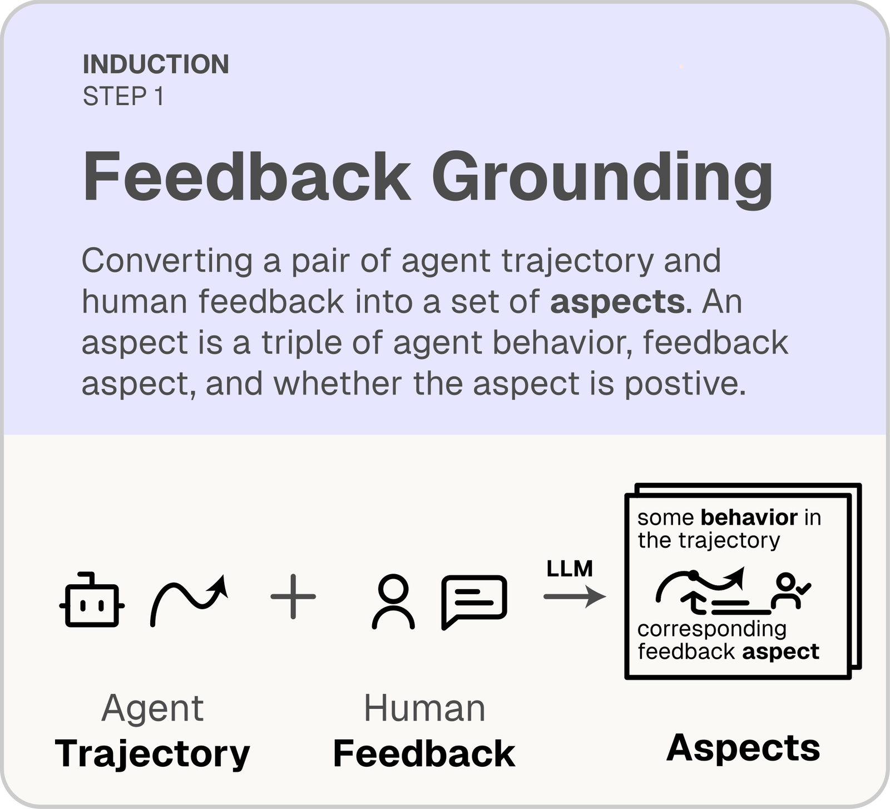
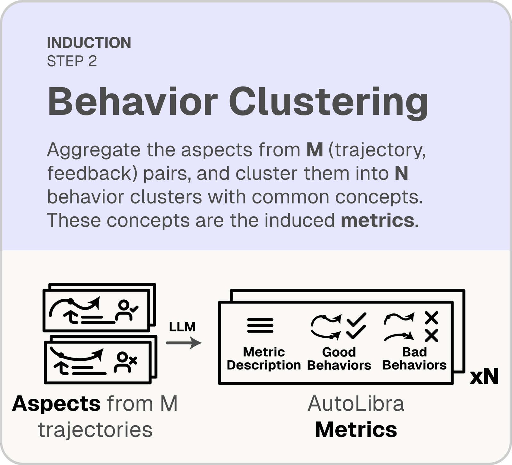
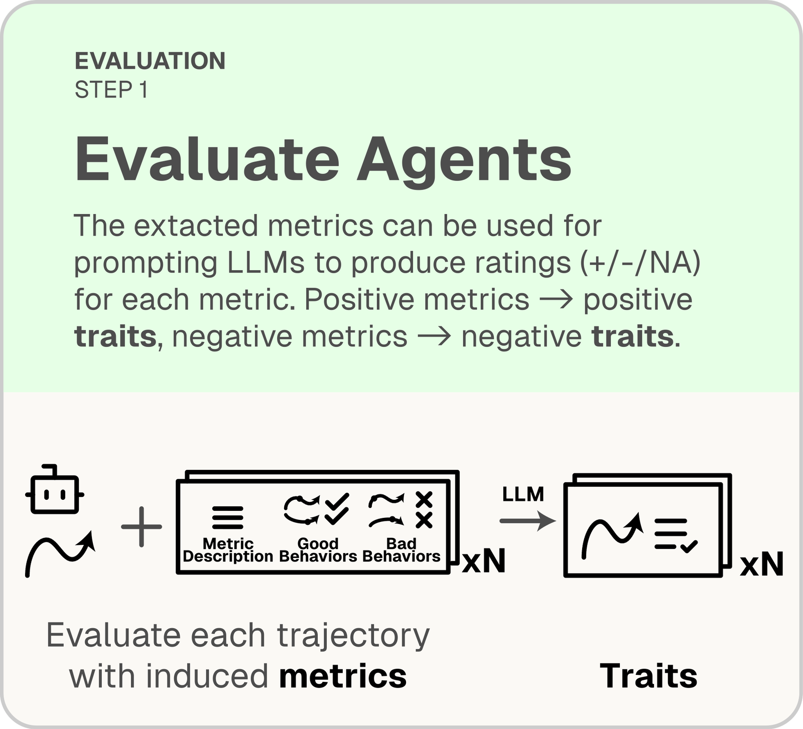
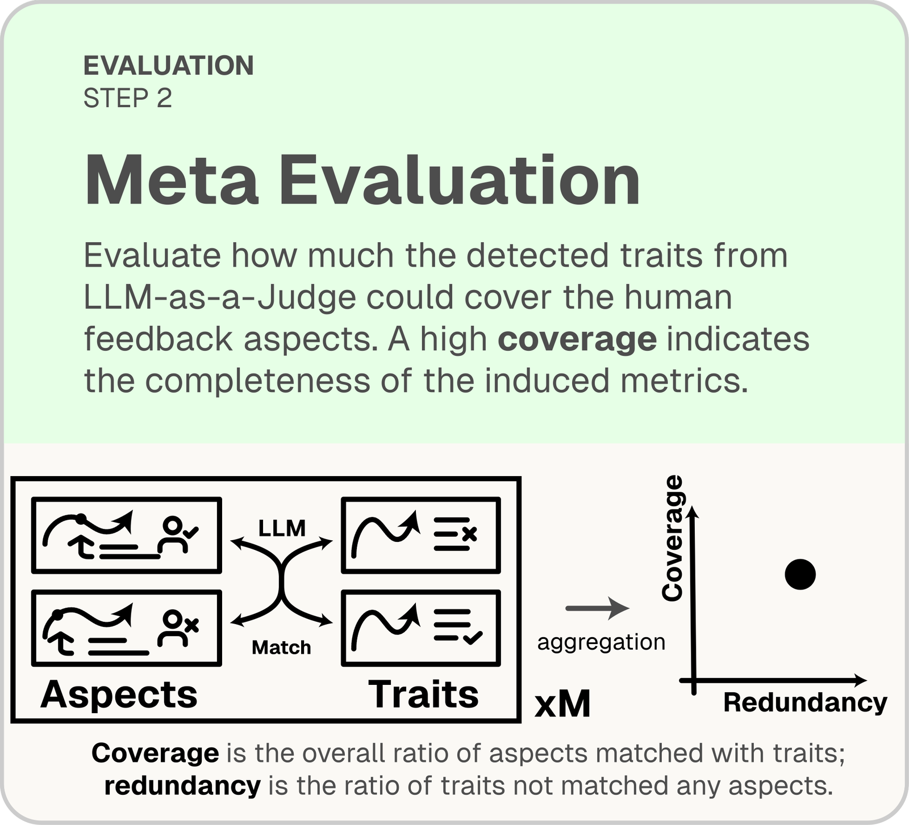
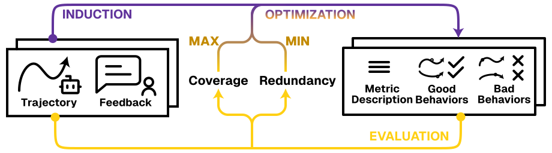
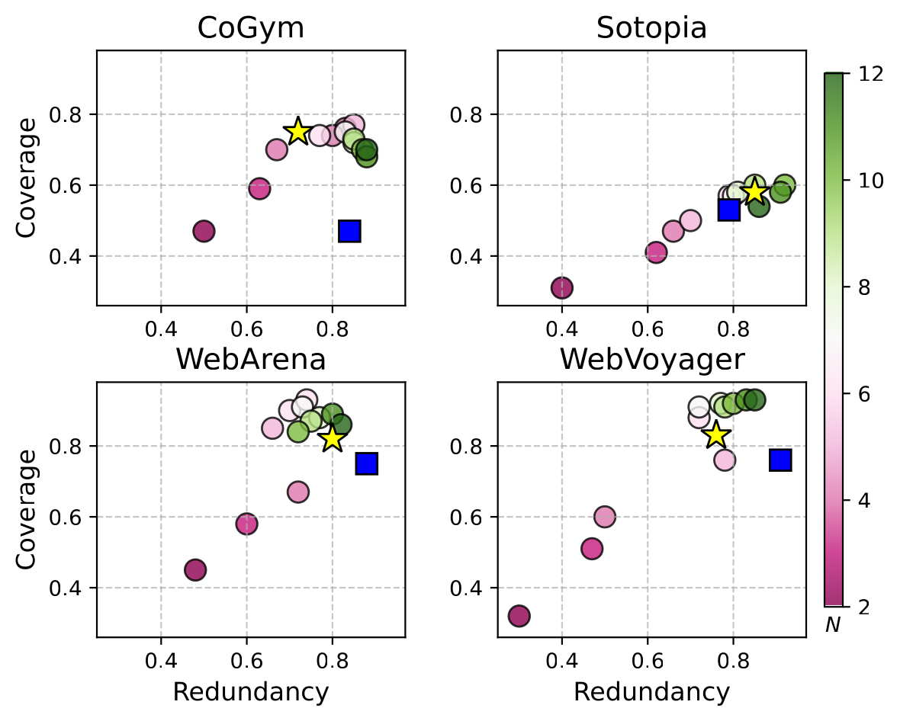
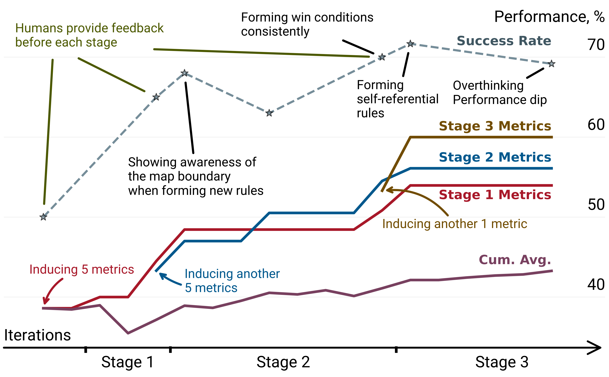
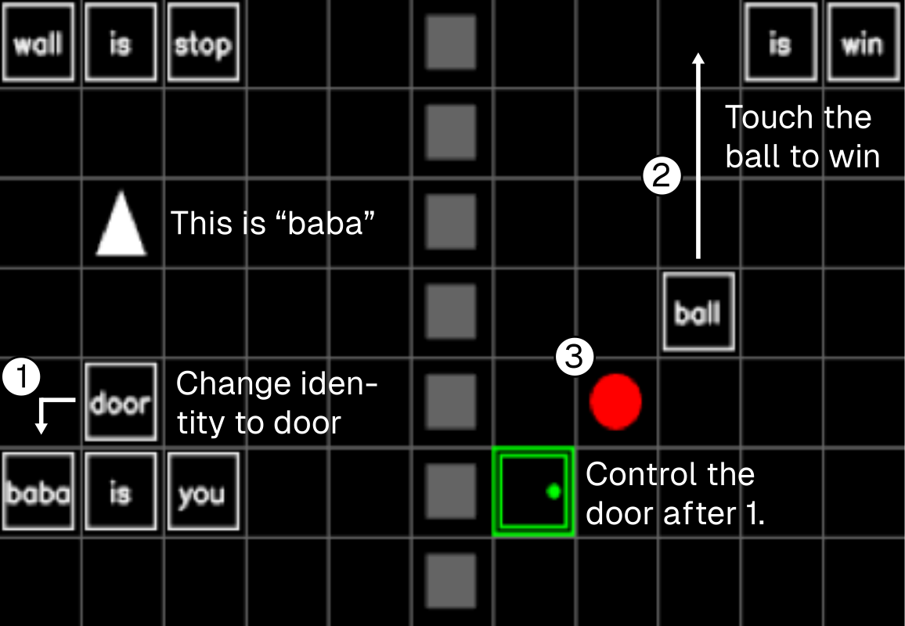
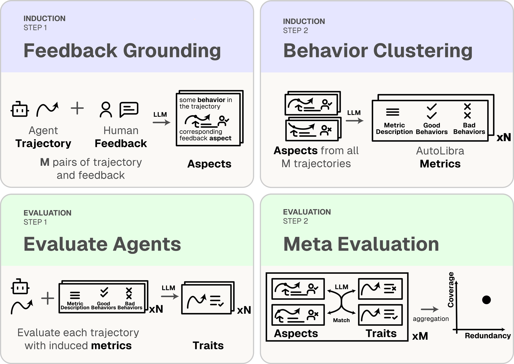

# AutoLibra author page and full-text provenance

[Course index](../../README.md) · [Original source](https://autolibra.org/) · [Raw file](../../raw/metadata/autolibra-author-page.html)

Retrieved: 2026-11-13T16:37:57.055309+00:00

[ICLR 2026](https://iclr.cc/)

# AutoLibra

Agent Metric Induction from Open-Ended Human Feedback

Hao Zhu1,
Phil Cuvin2,
Xinkai Yu3,
Charlotte Ka Yee Yan1,
Jason Zhang1,
Diyi Yang1

1Stanford University  · 
2University of Toronto  · 
3University of Pennsylvania

[arXiv](../readings/arxiv-2505-02820.md)
[OpenReview](../readings/arxiv-2505-02820.md)
[PDF](../readings/arxiv-2505-02820.md)
[Code](https://github.com/Open-Social-World/autolibra)
[Data](https://huggingface.co/datasets/open-social-world/autolibra)
[BibTeX](autolibra-author-page.md)


TL;DR.
Task success is a blunt instrument for evaluating AI agents.
**AutoLibra** turns informal natural-language feedback
— from end-users or expert annotators — into concrete,
fine-grained metrics that diagnose *why* agents succeed or fail,
and serve as optimization targets that improve agents by
**>20% success rate** with only 18 annotated trajectories per stage.

[

### Induce Metrics

Ground open-ended feedback to specific behaviors, cluster similar behaviors, and induce
interpretable metrics with definitions and concrete examples.](https://autolibra.org/#method)
[

### Evaluate Agents

AutoLibra as a *lens*: discover fine-grained and novel failure modes across
web, social, collaborative, and game environments.](https://autolibra.org/#lens)
[

### Improve Agents

AutoLibra as a *ladder*: use induced metrics as optimization targets to
improve prompts, with self-regulated iterative training.](https://autolibra.org/#ladder)

At a glance

## From a sentence of feedback to a fleet of metrics

A user watches a web agent shop for a phone and writes:
*"the agent did not choose iPhone 14/15."*
AutoLibra grounds that aspect to the agent's action
(selecting *iPhone 16 Pro* from a drop-down), clusters it with similar
behaviors across trajectories, and distills a reusable metric —
Element Interaction Accuracy.

### Collect human feedback for agent trajectories

### Ground feedback into aspects

### Induce metrics from aspects

### Collect human feedback for agent trajectories

Compare prices and chips for the **iPhone 14 Pro** and **iPhone 15 Pro**…

Instance


Click "iPhone" tab

Click "iPhone 16 Pro Max"

"The agent did not interact with the drop-down to choose iPhone 14/15 Pro."

Search climbing gear & **sort by price**.

Instance


Click "All Departments"

"The agent did the right search, but didn't sort by price."

Other trajectory-feedback pairs.

### Ground feedback into aspects

Aspect

Agent Behavior

Agent selected iPhone 16 Pro Max.

Human Feedback Aspect
−

The agent did not select the iPhone 14 or 15 in the task.

Aspect

Agent Behavior

Clicked product categories…

Human Feedback Aspect
−

Did not use the correct drop-down for price sorting.

Aspect

Agent Behavior
+

The agent used the right query.

Aspect

Human Feedback Aspect
−

Specific query not supported.

Other feedback aspects.

### Induce metrics from aspects

👉📱
Element Interaction Accuracy

Metric

Metric Description

Evaluates if the agent interacts with the correct UI elements. Good
behaviors show **accurate targeting of links, buttons, and
textboxes**; bad behaviors…

Good Behaviors

1. Agent correctly uses the search bar to search for news related to Brexit.
2. Agent uses the filter feature to check for audio datasets.
3. …

Bad Behaviors

🔎✅
Query and Search Strategy

Metric

Metric Description

Craft and refine search queries…

Good Behaviors

Bad Behaviors

Other induced metrics.

### These metrics are ready to be used for agent evaluation

### Judgment with LLMs

### Evaluate how much unseen human feedback is covered

### These metrics are ready to be used for agent evaluation

Could you find a recipe with **Chicken** and **Quinoa** and save it?

Instance


Click "Slow Cooked Chicken Stew"

Click "Save"

Unseen human feedback

"The agent efficiently found a recipe, but the recipe contained no chicken breast or quinoa."

### Judgment with LLMs

LLM-as-a-Judge output

Traits

Positive Traits

🔎✅Search query is correct.

👉📱Using the correct buttons…

Negative Traits

📝✅should choose "Chicken w/…"

🏁💯recipe not desired w/o quinoa

Not Applicable Metrics

🏁🚨
🔄🚫
🎯
🎯⏱

### Evaluate how much unseen human feedback is covered

Meta Evaluation

Meta-metrics

Aspect

Recipe by the agent contained no chicken breast or quinoa.

Covered by
🏁💯

Aspect

The agent efficiently found a recipe.

Not covered
since
🎯⏱
is judged as N/A.

**1 out of 2** feedback aspects covered;  
**3 out of 4** detected traits are redundant.

Aggregated Feedback Coverage
82%

Aggregated Metric Redundancy
75%

**Figure 1.** AutoLibra

induces agent-evaluation metrics from human feedback, uses them to
evaluate agents, and meta-evaluates the metrics via their coverage of
unseen feedback. Real examples of agent trajectories, human feedback,
aspects, induced metrics and evaluation results on
WebVoyager [He et al., 2024].

Motivation

## Task success isn't enough

Agents today are primarily evaluated by coarse task-success metrics that
experts hand-design up front. Those metrics miss
*why* an agent fails, overlook emergent behaviors, and
don't scale to new domains. On the other hand, humans readily *describe*
what went well or poorly —
*"If you find that the button is disabled,
don't click it again,"* or *"this agent has
too much autonomy."*

AutoLibra closes this gap: it treats free-form feedback as the
signal, and the metrics themselves as the *output*. Inspired by
thematic analysis in social sciences, the pipeline grounds each aspect of
feedback to concrete agent behaviors, then clusters them into a minimal
set of reusable, interpretable metrics — no per-task metric design
required.

Method

## A closed loop: induce, evaluate, meta-evaluate

AutoLibra is a closed-loop pipeline. An **induction process** converts
agent trajectories and open-ended feedback into metrics.
An **evaluation process** applies those metrics with an LLM-as-a-Judge,
then meta-evaluates the metrics by measuring their
*coverage* and *redundancy* against unseen feedback.

1

### Feedback grounding

Break down each piece of feedback into *aspects* —
triples of (behavior, feedback, sign) — each pointing to
a specific part of the agent trajectory.



2

### Behavior clustering

Cluster similar aspects with an LLM; each cluster becomes a
metric with a definition plus positive and negative
behavior examples.



3

### LLM-as-a-Judge

An LLM rates each agent trajectory on every induced
metric with {+1, −1, N/A}, producing
positive and negative *traits*.



4

### Meta-evaluation

Match traits to aspects on unseen feedback.
**Coverage** = fraction of aspects matched;
**redundancy** = fraction of traits unmatched.






**Figure 2.** Metric optimization: the induction
process produces metrics from trajectories and feedback; the
evaluation process measures their coverage and redundancy;
optimizing the induction maximizes coverage while minimizing
redundancy.

 Lens

## AutoLibra as a lens for agent behavior

Across four diverse agent domains — collaborative
([CoGym](https://arxiv.org/abs/2412.15701)),
social ([Sotopia](https://arxiv.org/abs/2310.11667)),
web ([WebArena](https://arxiv.org/abs/2307.13854),
[WebVoyager](https://arxiv.org/abs/2401.13919))
— AutoLibra induces metrics that are
**more concrete** than expert-designed categories and
surfaces **novel** evaluation dimensions.




**Figure 3.** Coverage and redundancy of AutoLibra metrics
on four agentic datasets. Stars mark the best metrics on held-out
feedback; squares show the ablation where positive/negative behavior
examples are removed — coverage drops by up to 30%.


88%

Coverage on WebArena and WebVoyager, with held-out performance within 5% of the induction set.

>85%

Human-validated agreement on grounding, LLM-as-a-Judge, and meta-evaluation steps across five datasets.

+novel

Metrics like *Negotiation Tactics* (Sotopia) and *Query Search Strategy* (WebVoyager) are missed by expert frameworks.

On CoGym, AutoLibra not only recovers the five failure categories
proposed by the authors — it decomposes *Communication*
into *Responsiveness & Efficiency* and
*Communication Clarity*, revealing that a single expert label
was concealing two distinct behaviors.

 Ladder

## AutoLibra as a ladder for agent improvement

AutoLibra-induced metrics aren't just diagnostic — they're
**optimization targets**. On the challenging 2D game
[Baba-Is-AI](https://arxiv.org/abs/2411.13543),
3 stages of iterative feedback (only 18 trajectory annotations per stage)
drive **>20% absolute improvement** on task success
— without ever optimizing for success rate directly.




**Figure 4.** Iterative metric induction drives
continuous improvement on Baba-Is-AI. Success rate keeps rising
even though only metric scores are optimized.





**Figure 5.** A Baba-Is-AI task: change the rule
*"baba is you"* → *"door is you"*,
form *"ball is win,"* and navigate to the red ball.

### What the agent learned, stage by stage

1. 1
   Reading the map and finding rules to form, guided by `map-n-constraint-recognition`.
2. 2
   Assembling new win conditions, guided by `rule-manipulation-proficiency`.
3. 3
   Handling self-referential rule changes — a metacognitive skill that frontier LLMs struggle with.

Pipeline

## The full AutoLibra pipeline



Getting started

## Try AutoLibra on your own agents

A minimal walkthrough to induce and evaluate metrics on your own
trajectories. For the full guide, see the
[codebase README](https://github.com/Open-Social-World/autolibra).

1. 1

   ### Install

   Clone the repo and install with [uv](https://docs.astral.sh/uv/).

   Copy

   ```
   git clone https://github.com/Open-Social-World/autolibra
   cd autolibra
   uv sync
   ```
2. 2

   ### Download trajectories & feedback

   Pull the annotated datasets from our Hugging Face hub (CoGym, Sotopia, WebArena, WebVoyager, Baba-Is-AI, MiniHack).

   Copy

   ```
   git lfs install
   git clone https://huggingface.co/datasets/open-social-world/autolibra .data
   ```
3. 3

   ### Annotate your own trajectories

   Use the TTY annotator, or launch the Streamlit UI for a browser interface.

   Copy

   ```
   # Terminal
   uv run python src/tty/tty_annotation.py .data/webarena .data/annotations/webarena \
       --annotator-id <your-name>

   # Streamlit UI
   uv run streamlit run src/tty/tty_annotation.py .data/sotopia .data/annotations/sotopia \
       -- --annotator-id <your-name> --use-streamlit
   ```
4. 4

   ### Induce metrics & evaluate

   Run the generator over feedback + trajectories to produce metrics, then evaluate agents with an LLM-as-a-Judge.

   Copy

   ```
   uv run python -m autolibra_core.gen_eval.generator
   ```

[Full documentation](https://github.com/Open-Social-World/autolibra)
[Dataset on Hugging Face](https://huggingface.co/datasets/open-social-world/autolibra)

Citation

## Cite AutoLibra

If you use AutoLibra in your research, we'd appreciate a citation.

Copy

```
@inproceedings{zhu2026autolibra,
  title     = {AutoLibra: Agent Metric Induction from Open-Ended Human Feedback},
  author    = {Hao Zhu and Phil Cuvin and Xinkai Yu and
               Charlotte Ka Yee Yan and Jason Zhang and Diyi Yang},
  booktitle = {The Fourteenth International Conference on Learning Representations},
  year      = {2026},
  url       = {https://openreview.net/forum?id=4BjGVZ7Bxn}
}
```

### Acknowledgments

This work is supported by ONR grant N000142412532, NSF grant IIS-2247357,
and DARPA grant *Friction for Accountability in Conversational Transactions*.
We thank Google Cloud Platform and Modal for compute credits, and all
members of Stanford SALT Lab for their feedback throughout this project.
