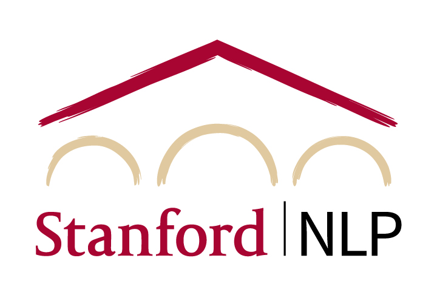

# Course schedule and readings

[Course index](../../README.md) · [Original source](https://cs329z.stanford.edu/) · [Raw file](../../raw/pages/index.html)

Retrieved: 2026-11-13T16:17:23.822124+00:00

# CS 329Z: Engineering AI Agents

### Stanford / Fall 2026

## Instructors

[

Diyi Yang, Instructor](https://cs.stanford.edu/~diyiy/)

[

Michael Ryan, Instructor](https://michryan.com/)

[

John Yang, Instructor](https://john-b-yang.github.io/)

[

Owen Queen, TA](https://owencqueen.github.io/)

[

Anusheh Chaudry, TA](https://www.linkedin.com/in/anushehchaudry/)

[

Shreyas Sharma, TA](https://www.linkedin.com/in/shreyas-n-sharma/)

[

Houjun Liu, TA](https://nlp.stanford.edu/~houjun/)

## Welcome!

The shift from monolithic language models to **compound AI systems** — systems with multiple
interacting components including LLMs, retrievers, tools, and optimizers — represents a fundamental
change in how AI applications are built for people. This course teaches students how to engineer
agentic systems: the full spectrum from simple LLM pipelines to compound AI systems to autonomous
agents. Students will learn to pick what types of problems to focus on, decompose problems, select
appropriate components, collect and curate data, build evaluations, and reason about the design
tradeoffs that arise when building these systems in practice.

Students first build core components (RAG, tool use, agent loops) from scratch, then learn how
frameworks like DSPy abstract these patterns. Through two fully applied homework assignments and a
quarter-long project, students gain hands-on experience building, optimizing, and evaluating agentic
systems.

For more information about coursework, office hours, and logistics, please refer to the [Logistics](logistics.md) page. You can also view course dates on the [Google Calendar](https://calendar.google.com/calendar/u/0/embed?src=59a6e4ad6abfe74cf389924dd1a5f8a9c7358ee32c2c7db1fd49d6ce4d252de1@group.calendar.google.com&ctz=America/Los_Angeles).

## Class Schedule

Note: the schedule is tentative and subject to change. Classes meet Mondays and Wednesdays, 1:30–2:50 p.m., in Skilling Auditorium. Lecture materials will be linked here as they are released.

| Week | Date | Lecture | Course Material |
| --- | --- | --- | --- |
| 1 | Wed Sep 23 | Foundations & Landscape Introduction — What Are Agentic Systems? Course logistics, a brief history of agents, and the anatomy of an agent: LLM core, reasoning, memory, tools, and environment. Compound AI systems and workflows vs. agents, plus the key challenges of reliability, training, safety, and evaluation.  [Slides](../slides/lecture01.md) [Video](../videos/video-dgi4vucr71w.md) | **Readings**:  - [Zaharia et al. "The Shift from Models to Compound AI Systems." BAIR Blog (2024).](../readings/zaharia-et-al-the-shift-from-models-to-compound-ai-systems-bair-blog-2024.md) - [Weng. "LLM Powered Autonomous Agents." Lil'Log (2023).](../readings/weng-llm-powered-autonomous-agents-lil-log-2023.md) - [Kapoor et al. "AI Agents That Matter." TMLR (2025).](../readings/arxiv-2407-01502.md) |
| 2 | Mon Sep 28 | LLMs for Builders Language model internals for agent builders: decoding strategies, transformer attention (including linear and hybrid) and context length, the pretraining-to-post-training pipeline, inference and test-time scaling, structured I/O and constrained decoding, and context engineering.  [Slides](../slides/lecture02.md) [Video](../videos/video-vr1nzh8bt44.md) | **Readings**:  - [Vaswani et al. "Attention Is All You Need." NeurIPS (2017).](../readings/arxiv-1706-03762.md) - [Katharopoulos et al. "Transformers are RNNs: Fast Autoregressive Transformers with Linear Attention." ICML (2020).](../readings/arxiv-2006-16236.md) - [Rajasekaran et al. "Effective Context Engineering for AI Agents." Anthropic (2025).](../readings/rajasekaran-et-al-effective-context-engineering-for-ai-agents-anthropic-2025.md) |
| 2 | Wed Sep 30 | Building Blocks Retrieval-Augmented Generation (RAG) Why retrieval helps, then the RAG pipeline end to end: indexing (chunking, contextual retrieval, RAPTOR, HNSW), retrievers from BM25 and DPR to hybrid search, reranking, and ColBERT, agentic RAG (Self-RAG, Search-R1), and common failure modes. Plus a course project overview.  [Slides](../slides/lecture03.md) [Video](../videos/video-pslc-46gqy0.md) | **Readings**:  - [Lewis et al. "Retrieval-Augmented Generation for Knowledge-Intensive NLP Tasks." NeurIPS (2020).](../readings/arxiv-2005-11401.md) - [Karpukhin et al. "Dense Passage Retrieval for Open-Domain Question Answering." EMNLP (2020).](../readings/arxiv-2004-04906.md) - [Khattab & Zaharia. "ColBERT: Efficient and Effective Passage Search via Contextualized Late Interaction over BERT." SIGIR (2020).](../readings/arxiv-2004-12832.md) |
| 3 | Mon Oct 5 | Tool Use & Function Calling Why LLMs need tools and how they learn to use them: Toolformer, scaling to thousands of APIs with Gorilla and ToolLLM, standard interfaces from REST to function calling to MCP, evaluating tool use with BFCL, ToolBench, and τ-bench, and common failure modes.  [Slides](../slides/lecture04.md) [Video](../videos/video-s0s38lz6o7m.md) | **Readings**:  - [Schick et al. "Toolformer: Language Models Can Teach Themselves to Use Tools." NeurIPS (2023).](../readings/arxiv-2302-04761.md) - [Patil et al. "Gorilla: Large Language Model Connected with Massive APIs." NeurIPS (2024).](../readings/arxiv-2305-15334.md) - [Model Context Protocol Specification, revision 2025-06-18. modelcontextprotocol.io (2025).](../readings/model-context-protocol-specification-revision-2025-06-18-modelcontextprotocol-io-2025.md) |
| 3 | Wed Oct 7 | Frameworks & Agent Design Frameworks & Orchestration The data, system, and evals pillars of agent engineering, with live demos of DSPy (signatures, modules, optimizers) and LangGraph (state, nodes, edges). A tour of open-source agent harnesses (mini-SWE-agent, OpenHands, Pi), durable orchestration with Temporal, observability tooling, and best practices.  [Slides](../slides/lecture05.md) [Code](../repositories/cs329z-lecture5-frameworks.md) | **Readings**:  - [Khattab et al. "DSPy: Compiling Declarative Language Model Calls into Self-Improving Pipelines." ICLR (2024).](../readings/arxiv-2310-03714.md) - [LangChain. "LangGraph Overview." LangChain Docs.](../readings/langchain-langgraph-overview-langchain-docs.md) - [Arena.ai. "HarnessTax: How Much Does the Harness Matter for Coding Agents?" Arena Blog (2026).](../readings/arena-ai-harnesstax-how-much-does-the-harness-matter-for-coding-agents-arena-blog-2026.md) |
| 4 | Mon Oct 12 | Agent Design Patterns & Scaffolds Workflows vs. agents and the design patterns for each: five composable workflow patterns, reasoning and acting patterns (ReAct, Reflexion, CodeAct, ReWOO), and context-management patterns (event logs, compaction, observation masking, context isolation). Case study of the Pi harness.  [Slides](../slides/lecture06.md) | **Readings**:  - [Yao et al. "ReAct: Synergizing Reasoning and Acting in Language Models." ICLR (2023).](../readings/arxiv-2210-03629.md) - [Schluntz & Zhang. "Building Effective AI Agents." Anthropic (2024).](../readings/schluntz-zhang-building-effective-ai-agents-anthropic-2024.md) - [LangChain. "Context Engineering." LangChain Blog (2025).](../readings/langchain-context-engineering-langchain-blog-2025.md)  Additional readings  - [Shinn et al. "Reflexion: Language Agents with Verbal Reinforcement Learning." NeurIPS (2023).](../readings/arxiv-2303-11366.md) - [Wang et al. "Executable Code Actions Elicit Better LLM Agents." ICML (2024).](../readings/arxiv-2402-01030.md) |
| 4 | Wed Oct 14 | Memory & Multi-Agent Systems Agent Memory Architectures Why agents need memory and the four types (working, episodic, semantic, procedural). Four architecture patterns: skill libraries, tiered hierarchies like MemGPT, reflective consolidation, and memory maintenance. Memory benchmarks and open problems in forgetting, privacy, and over-personalization.  [Slides](../slides/lecture07.md) | **Readings**:  - [Sumers et al. "Cognitive Architectures for Language Agents." TMLR (2024).](../readings/arxiv-2309-02427.md) - [Packer et al. "MemGPT: Towards LLMs as Operating Systems." arXiv (2023).](../readings/arxiv-2310-08560.md) - [Park et al. "Generative Agents: Interactive Simulacra of Human Behavior." UIST (2023).](../readings/arxiv-2304-03442.md) |
| 5 | Mon Oct 19 | Multi-Agent Systems When to use single vs. multi-agent systems and how to build them: orchestration patterns (orchestrator, swarm, hybrid), communication through handoffs, message boards, and the A2A protocol, and coordination infrastructure (task ledgers, shared memory, worktree isolation). Why multi-agent systems fail.  [Slides](../slides/lecture08.md) | **Readings**:  - [Wu et al. "AutoGen: Enabling Next-Gen LLM Applications via Multi-Agent Conversation." COLM (2024).](../readings/arxiv-2308-08155.md) - [Cemri et al. "Why Do Multi-Agent LLM Systems Fail?" NeurIPS Datasets & Benchmarks (2025).](../readings/arxiv-2503-13657.md) - [Kim et al. "Towards a Science of Scaling Agent Systems." arXiv (2025).](../readings/arxiv-2512-08296.md) |
| 5 | Wed Oct 21 | Optimization Optimization When optimization pays off and how to do it: context optimization (bootstrapped few-shot, MIPROv2, OPRO, TextGrad, GEPA), weight optimization (SFT on agent rollouts, RL with PPO and GRPO, on-policy distillation), agents as optimizers (Darwin Gödel Machine, autoresearch), and when to optimize prompts vs. weights.  [Slides](../slides/lecture09.md) | **Readings**:  - [Agrawal et al. "GEPA: Reflective Prompt Evolution Can Outperform Reinforcement Learning." ICLR (2026).](../readings/arxiv-2507-19457.md) - [Opsahl-Ong et al. "Optimizing Instructions and Demonstrations for Multi-Stage Language Model Programs." EMNLP (2024).](../readings/arxiv-2406-11695.md) - [Shao et al. "DeepSeekMath: Pushing the Limits of Mathematical Reasoning in Open Language Models." arXiv (2024).](../readings/arxiv-2402-03300.md) |
| 6 | Mon Oct 26 | 📺 Guest Lecture: Terminal-Bench [Ryan Marten](https://ryanmarten.com), [Alex Shaw](https://www.alexgshaw.com) Ryan Marten and Alex Shaw (Laude Institute), co-creators of Terminal-Bench, on benchmarking how well AI agents accomplish real-world tasks in a terminal environment.  [Slides](../slides/lecture10.md) | **Readings**:  - [Terminal-Bench project site (leaderboard, tasks, and harness).](../readings/terminal-bench-project-site-leaderboard-tasks-and-harness.md) - [Merrill et al. "Terminal-Bench: Benchmarking Agents on Hard, Realistic Tasks in Command Line Interfaces." ICLR (2026).](../readings/arxiv-2601-11868.md) |
| 6 | Wed Oct 28 | Data for Agentic Systems What Data Do Agents Need? Traces, demonstrations, and feedback, data for optimization vs. evaluation, data flywheels, synthetic data generation, and collecting data from human-agent interaction.  [Slides](../slides/lecture11.md) | **Readings**:  - [Shankar. "Data Flywheels for LLM Applications." (2024).](../readings/shankar-data-flywheels-for-llm-applications-2024.md)  Additional readings  - [Tan et al. "Large Language Models for Data Annotation and Synthesis: A Survey." EMNLP (2024).](../readings/tan-et-al-large-language-models-for-data-annotation-and-synthesis-a-survey-emnlp-2024.md) |
| 7 | Mon Nov 2 | Data Selection & Quality Finding maximally informative data, filtering and selection strategies, tiny-but-targeted benchmarks, annotation practices, quality assessment, and building datasets from agent traces.  [Slides](../slides/lecture12.md) | **Readings**:  - [Yang et al. "SWE-smith: Scaling Data for Software Engineering Agents." NeurIPS D&B (2025).](../readings/arxiv-2504-21798.md) - [Shankar et al. "Who Validates the Validators? Aligning LLM-Assisted Evaluation with Human Preferences." UIST (2024).](../readings/arxiv-2404-12272.md)  Additional readings  - [Zhou et al. "LIMA: Less Is More for Alignment." NeurIPS (2023).](../readings/arxiv-2305-11206.md) |
| 7 | Wed Nov 4 | Evaluation for Agentic Systems Evaluation Fundamentals & Benchmark Design Why evals are hard, the 4-tuple framework (request, environment, stopping criteria, scorer), designing each component, properties of good benchmarks, realistic scaffolding, and reliability dimensions.  [Slides](../slides/lecture13.md) | **Readings**:  - [Zhu et al. "Establishing Best Practices for Building Rigorous Agentic Benchmarks." (2025).](../readings/arxiv-2507-02825.md)  Additional readings  - [Press. "How to Build Good Language Modeling Benchmarks." (2024).](../readings/press-how-to-build-good-language-modeling-benchmarks-2024.md) - [Polo et al. "tinyBenchmarks: Evaluating LLMs with Fewer Examples." ICML (2024).](../readings/arxiv-2402-14992.md) |
| 8 | Mon Nov 9 | 📺 Fireside Chat with Andrew Ng [Andrew Ng](https://www.andrewng.org) A fireside chat with Andrew Ng, hosted by Diyi Yang. Professor Ng is the founder of DeepLearning.AI, co-founder of Coursera, founding lead of Google Brain, and an Adjunct Professor of Computer Science at Stanford. |  |
| 8 | Wed Nov 11 | LLM-as-Judge & Evaluation Infrastructure The three grader types, designing judge prompts, known biases, pairwise vs. pointwise evaluation, non-determinism metrics (pass@k vs. pass^k), harness design, and Anthropic's 8-step roadmap.  [Slides](../slides/lecture15.md) | **Readings**:  - [Grace et al. "Demystifying Evals for AI Agents." Anthropic (2026).](../readings/grace-et-al-demystifying-evals-for-ai-agents-anthropic-2026.md) - [Zheng et al. "Judging LLM-as-a-Judge with MT-Bench and Chatbot Arena." NeurIPS (2023).](../readings/arxiv-2306-05685.md) - [Ryan et al. "AutoMetrics: Approximate Human Judgements with Automatically Generated Evaluators." ICLR (2026).](../readings/arxiv-2512-17267.md)  Additional readings  - [Zhu et al. "AutoLibra: Agent Metric Induction from Open-Ended Human Feedback." ICLR (2026).](../readings/arxiv-2505-02820.md) |
| 9 | Mon Nov 16 | 📺 Guest Lecture: SWE-bench [Carlos Jimenez](https://www.carlosejimenez.com), [Alexander Wettig](https://codecreator.github.io) Carlos Jimenez and Alexander Wettig (Anthropic), creators of SWE-bench, on the evolution and future of evaluations for coding capabilities and beyond. | **Readings**:  - [Jimenez et al. "SWE-bench: Can Language Models Resolve Real-World GitHub Issues?" ICLR (2024).](../readings/arxiv-2310-06770.md) |
| 9 | Wed Nov 18 | Safety Agent Safety & Guardrails Privacy risks of tool access, prompt injection (including indirect injection), red-teaming, sandboxing and permission models, output guardrails, liability considerations, responsible deployment, and human-in-the-loop patterns. | **Readings**:  - [Shao et al. "PrivacyLens: Evaluating Privacy Norm Awareness of LMs in Action." NeurIPS D&B (2024).](../readings/arxiv-2409-00138.md) - [Zhang & Yang. "Searching for Privacy Risks in LLM Agents via Simulation." arXiv (2025).](../readings/arxiv-2508-10880.md) - [Li. "Agentic LLMs as Powerful Deanonymizers." arXiv (2026).](../readings/arxiv-2601-05918.md)  Additional readings  - [Wen et al. "Contextualized Privacy Defense for LLM Agents." arXiv (2026).](../readings/arxiv-2603-02983.md) - [OpenAI. "Understanding Prompt Injections: A Frontier Security Challenge." (2025).](../readings/openai-understanding-prompt-injections-a-frontier-security-challenge-2025.md) - [Anthropic. "Anthropic's Responsible Scaling Policy." (2023).](../readings/anthropic-anthropic-s-responsible-scaling-policy-2023.md) |
| 10 | Mon Nov 23 | No Class — Thanksgiving Recess |  |
| 10 | Wed Nov 25 | No Class — Thanksgiving Recess |  |
| 11 | Mon Nov 30 | Coding Agents & Personal Agents Coding & Software Agents How coding agents work end to end: the SWE-agent, Claude Code, and OpenHands architectures, scaffolds as design decisions, SWE-bench and the 4-tuple framework in practice, and the future of software development with agents. | **Readings**:  - [Yang et al. "SWE-agent: Agent-Computer Interfaces Enable Automated Software Engineering." NeurIPS (2024).](../readings/arxiv-2405-15793.md) - [Wang et al. "OpenHands: An Open Platform for AI Software Developers." ICLR (2025).](../readings/arxiv-2407-16741.md)  Additional readings  - [Anthropic. "Claude Code: Best Practices for Agentic Coding." (2025).](../readings/anthropic-claude-code-best-practices-for-agentic-coding-2025.md) - [Young. "Effective Harnesses for Long-Running Agents." Anthropic (2025).](../readings/young-effective-harnesses-for-long-running-agents-anthropic-2025.md) |
| 11 | Wed Dec 2 | Personal Agents From reactive to proactive, personal agents: General User Models (GUM), Next Action Prediction, open-source proactive personal agents, privacy and trust implications, and when agents should initiate vs. wait (mixed initiative). | **Readings**:  - [Shaikh et al. "Creating General User Models from Computer Use." UIST (2025).](../readings/arxiv-2505-10831.md)  Additional readings  - [Shaikh et al. "Learning Next Action Predictors from Human-Computer Interaction." arXiv (2026).](../readings/arxiv-2603-05923.md) - [Steinberger. "OpenClaw: Open-source proactive AI agent." (2025).](../readings/steinberger-openclaw-open-source-proactive-ai-agent-2025.md) |
| — | Wed Dec 9 | Open Problems & Final Demos Final Project Demo Day Held during the end-quarter examination period, 3:30–6:30 p.m. Location TBA. |  |

## Deadlines

All times are Pacific. Deadlines are subject to change; any changes will be announced in class and posted here.

| Week | Deadline | Date | Time |
| --- | --- | --- | --- |
| 3 | [HW1 Released](../repositories/cs329z-assignment1-harness.md) | Mon Oct 5 | — |
| 3 | Project Proposal Due | Fri Oct 9 | 11:59 p.m. |
| 6 | HW1 Due | Fri Oct 30 | 11:59 p.m. |
| 6 | [HW2 Released](../repositories/cs329z-assignment2-harness.md) | Sun Nov 1 | — |
| 7 | Midpoint Demo Video Due | Fri Nov 6 | 11:59 p.m. |
| 7 | Midway Report Due | Fri Nov 6 | 11:59 p.m. |
| 8 | [Paper Video Due (10–15 min)](../assignments/paper-video.md) | Fri Nov 13 | 11:59 p.m. |
| 10 | HW2 Task Submission Due (during Thanksgiving Break) | Mon Nov 23 | 11:59 p.m. |
| 11 | Paper Video Peer Reviews Due (2 videos) | Mon Nov 30 | 11:59 p.m. |
| 11 | HW2 Peer Reviews Due (3 tasks) | Wed Dec 2 | 11:59 p.m. |
| Finals | Final System Demo (Demo Day) | Wed Dec 9 | 3:30–6:30 p.m. |
| Finals | Final Report Due | Fri Dec 11 | 11:59 p.m. |

## Sponsors

We are grateful to our sponsors for their generous support of CS 329Z.

