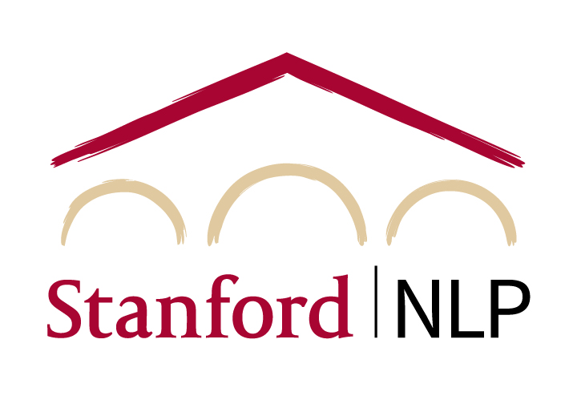

# Course logistics

[Course index](../../README.md) · [Original source](https://cs329z.stanford.edu/logistics.html) · [Raw file](../../raw/pages/logistics.html)

Retrieved: 2026-11-13T16:17:26.275960+00:00

# CS 329Z: Engineering AI Agents

### Stanford / Fall 2026

## Logistics

### Course Info

- **Units:** 3
- **Class number:** 27855
- **Grading:** Letter or Credit/No Credit
- **Session:** 2026–2027 Autumn 1
- **Meeting time:** Mondays and Wednesdays, 1:30–2:50 p.m.
- **Location:** Skilling Auditorium
- **Contact:** [cs329z-staff@lists.stanford.edu](mailto:cs329z-staff@lists.stanford.edu)
- **Discussion forum:** [Ed Discussion](https://edstem.org/us/courses/106723/discussion) i
- **Canvas:** [canvas.stanford.edu/courses/233286](https://canvas.stanford.edu/courses/233286) i

### Office Hours

- See the [weekly office hours schedule](logistics.md) below for times, locations, and staff availability.

### Prerequisites

- **Any of [CS224N](https://web.stanford.edu/class/cs224n/), [CS224U](https://web.stanford.edu/class/cs224u/), [CS224V](https://web.stanford.edu/class/cs224v/), [CS336](https://stanford-cs336.github.io/), or equivalent background in natural language processing.**

### Honor Code & AI Tools

Like every class at Stanford, we take the [Honor Code](https://ed.stanford.edu/academics/masters-handbook/honor-code)
seriously. Write your own solutions, and don't look up solutions or existing implementations of the
assignments online. We sometimes use automated methods to detect overly similar submissions.

This is a course about building with AI, so we expect you to use it. Treat generative AI tools as
collaborators you think alongside — asking them to explain a concept, debug your code, or critique a
design is fair game and encouraged. AI generated code is permitted for the project and on the homework
assignments provided that you can validate and explain all code. This will be verified through
oral examinations. AI is not allowed to be used to write the course project reports, however you are welcome to
use AI for brainstorming and feedback on your writing.

Two things remain off limits. Copying answers from other students or from the web is not permitted.
And using AI to substantially complete an assignment without actively understanding the work is an
Honor Code violation: if you submit it, you are responsible for knowing how and why it works.
HW-based quizzes are individual and closed-book.
When in doubt, ask us; see
Stanford's [Generative AI Policy Guidance](https://communitystandards.stanford.edu/generative-ai-policy-guidance)
for the university-wide baseline.

### Lecture Recordings

Video cameras located in the back of the room will capture the instructor presentations in this course. For your convenience, you can access these recordings by logging into the course Canvas site. These recordings might be reused in other Stanford courses, viewed by other Stanford students, faculty, or staff, or used for other education and research purposes. Note that while the cameras are positioned with the intention of recording only the instructor, occasionally a part of your image or voice might be incidentally captured. If you have questions, please contact a member of the teaching team.

### Academic Accommodations

From [Stanford's Office of Accessible Education](https://oae.stanford.edu/faculty-teaching-staff/syllabus-statement): Students who may need an academic accommodation based on the impact of a disability must initiate the request with the Office of Accessible Education (OAE). Professional staff will evaluate the request with required documentation, recommend reasonable accommodations, and prepare an Accommodation Letter for faculty dated in the current quarter in which the request is being made. Students should contact the OAE as soon as possible since timely notice is needed to coordinate accommodations.

If you already have an Academic Accommodation Letter, we invite you to share your letter with us. Letters should be shared at the earliest possible opportunity so we may partner with you and the OAE to identify any barriers to access and inclusion.

### Well-Being, Stress Management, & Mental Health

If you are experiencing personal, academic, or relationship problems and would like someone to talk to, reach out to Counseling and Psychological Services (CAPS) on campus. CAPS is the university's counseling center dedicated to student mental health and wellbeing. Phone assessment appointments can be made at CAPS by calling 650-723-3785, or by accessing the Vaden Patient portal. For more information, visit [vaden.stanford.edu/caps-and-wellness](https://vaden.stanford.edu/caps-and-wellness).

## Coursework

Two fully applied homework assignments build on the components covered in lecture. Each homework is
followed by a **10-minute HW-based quiz** where students explain their design decisions and tradeoffs
and demonstrate understanding.

- **[HW1: Build an Agentic Harness](../repositories/cs329z-assignment1-harness.md)** (Weeks 3–6). Build a company's internal AI assistant from
  scratch, with no agent frameworks: just a chat-completion call and code you write yourself. Start with
  LLM pipelines that retrieve and reason over a real corporate email archive, then grow them into a full
  agent harness with tools, a terminal, memory, and a human in the loop.
- **HW2: Evaluate an Agent** (Weeks 6–9). Given a pre-built agent, design a comprehensive evaluation
  suite with code-based graders, at least one LLM-as-judge eval, benchmark tasks built with the 4-tuple
  framework (request, environment, stopping criteria, scorer), and error analysis.

### Paper Video & Peer Reviews

Each student records a **[10–15 minute video](../assignments/paper-video.md)** about a recent agent paper of their choosing (due Week 8).
See the [Paper Video handout](../assignments/paper-video.md) for the full requirements and rubric.
Students also complete four peer-review activities during the quarter: reviews of paper videos, midway
demos, agent evaluations from HW2, and final system demos. Each activity involves reviewing two peers'
work using the provided review forms.

### Grading

- **Project [40%]**
  - Proposal [5%]
  - Midway report [5%]
  - Midpoint demo [5%]
  - Final submission [15%]
  - Final system demo [10%]
- **Homework [15%]**
  - HW1: Build an Agentic Harness [7.5%]
  - HW2: Evaluate an Agent [7.5%]
- **HW-based quizzes [15%]**
  - Quiz 1 (after HW1) [7.5%]
  - Quiz 2 (after HW2) [7.5%]
- **Paper video [10%]**
  - 10-minute paper video [10%]
- **Peer Review [20%]**
  - Peer review of paper videos [5%]
    - Provide feedback on 2 paper videos using the provided review forms [2.5% each]
  - Peer review of midway demos [5%]
    - Provide feedback on 2 projects using the provided review forms [2.5% each]
  - Peer review of agent evaluations (HW2) [5%]
    - Provide feedback on 2 evaluations using the provided review forms [2.5% each]
  - Peer review of final system demos [5%]
    - Provide feedback on 2 projects using the provided review forms [2.5% each]

## Office Hours

See the calendar below for current times and whether each session is in person or virtual. All times are Pacific. Zoom links are included in virtual calendar events when available.

To better accommodate remote students, we alternate which office hours are held virtually each week. Each week, three sessions are virtual and three are in person; the formats swap the following week. Students who are able to attend in person are encouraged to choose an in-person session.

[Open the office hours calendar in a new window](https://calendar.google.com/calendar/u/0/embed?src=59a6e4ad6abfe74cf389924dd1a5f8a9c7358ee32c2c7db1fd49d6ce4d252de1%40group.calendar.google.com&ctz=America%2FLos_Angeles).
