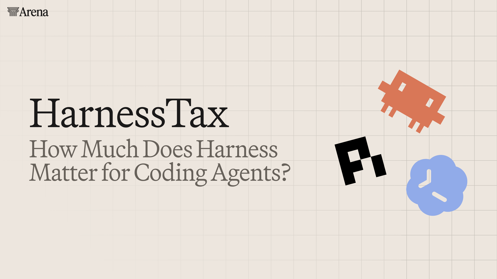
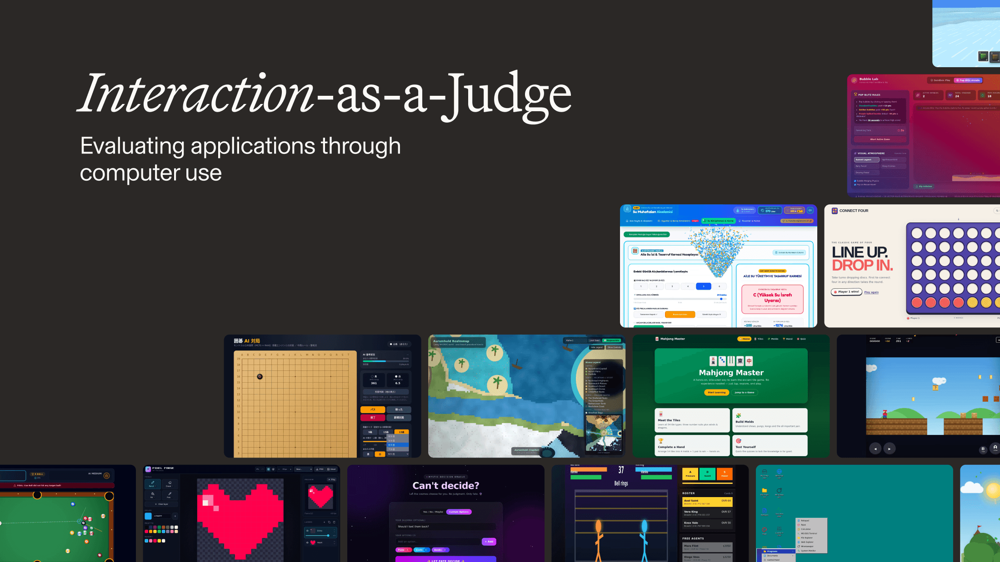
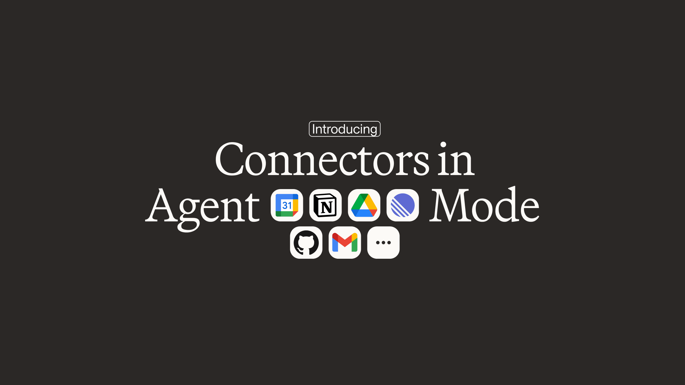
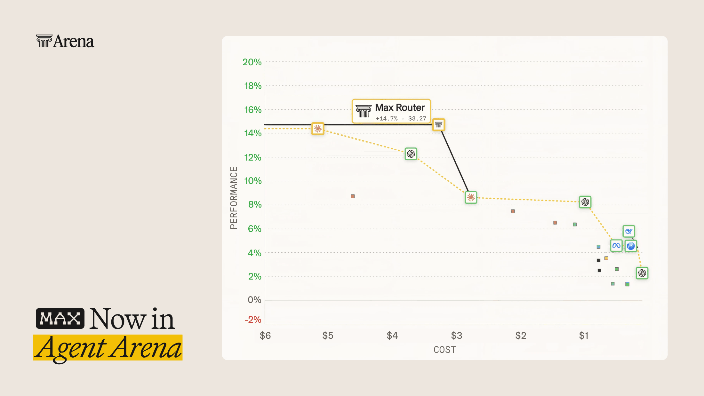
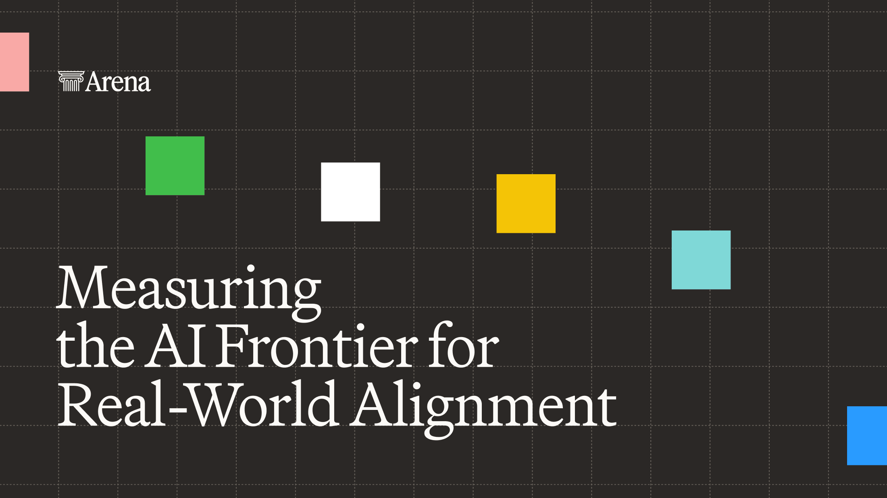
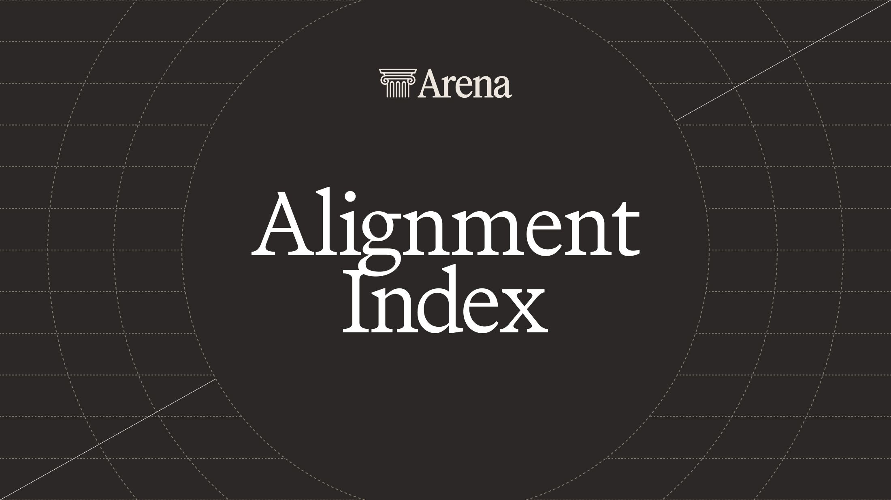
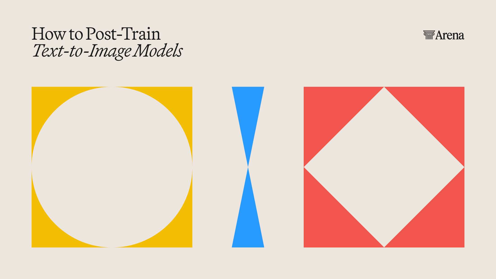
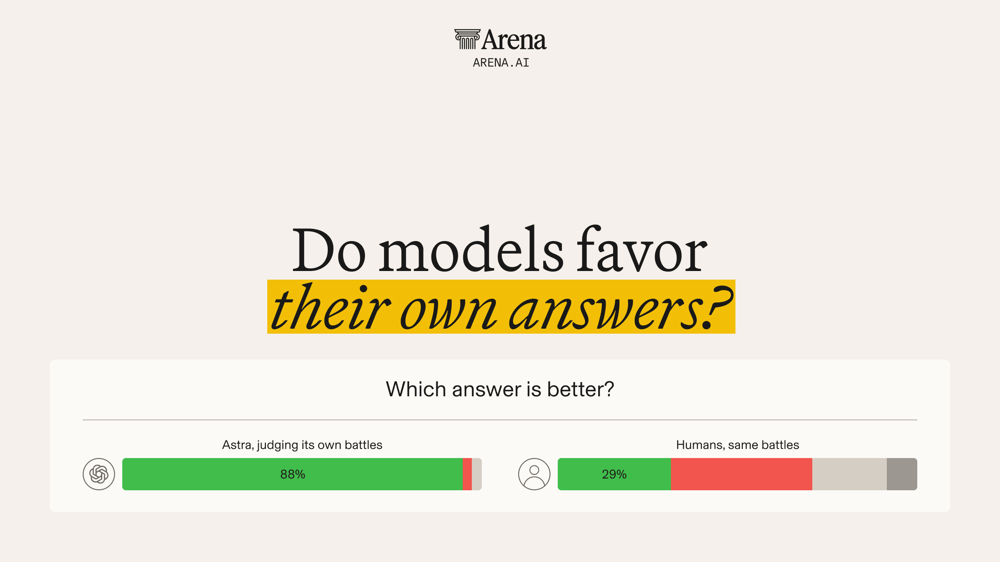
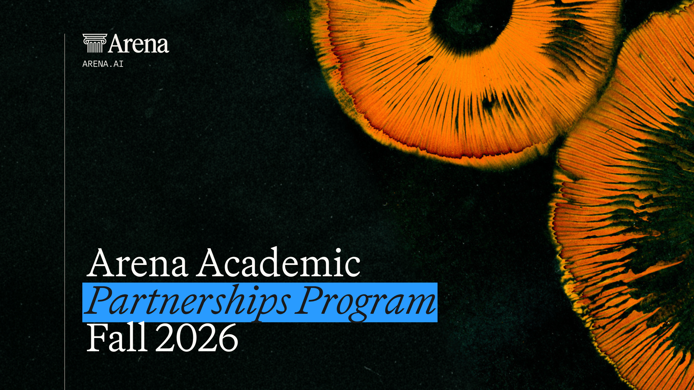
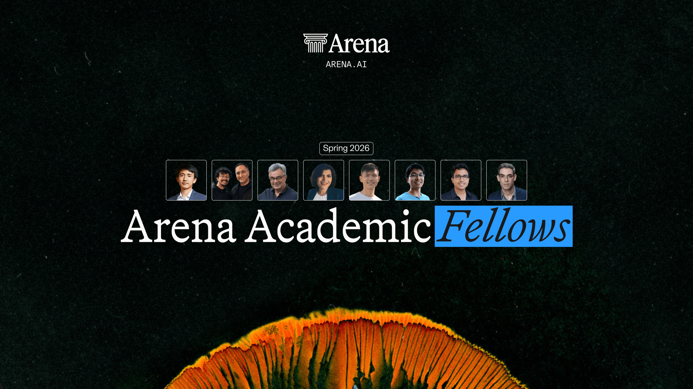

# Arena.ai. "HarnessTax: How Much Does the Harness Matter for Coding Agents?" Arena Blog (2026).

[Course index](../../README.md) · [Original source](https://arena.ai/blog/coding-agents-harness-tax) · [Raw file](../../raw/readings/arena-ai-harnesstax-how-much-does-the-harness-matter-for-coding-agents-arena-blog-2026.html)

Retrieved: 2026-11-13T16:20:57.263508+00:00

HarnessTax: How Much Does the Harness Matter for Coding Agents? - Arena.ai

[Skip to main content.](arena-ai-harnesstax-how-much-does-the-harness-matter-for-coding-agents-arena-blog-2026.md)

Menu

Menuclose

Company

Leaderboard Rankings

Use Cases

Follow

[Back to All Articles](https://arena.ai/blog)

Research

Arena Team

- Published on 16 Sept 2026
- Last updated on 18 Sept 2026
- Reading Time: 10 minutes

# HarnessTax: How Much Does the Harness Matter for Coding Agents?

We tested 21 coding agent model–harness combinations across Claude Code, Codex CLI, and Pi to understand how harness choice affects performance and cost. The results show that harness choice can significantly impact cost, even when task success rates are similar.

Language models are changing how we build software and solve computational problems [[1]](https://www.anthropic.com/research/how-ai-is-transforming-work-at-anthropic) [[2]](https://deepmind.google/blog/alphaevolve-a-gemini-powered-coding-agent-for-designing-advanced-algorithms/). Coding agents put these capabilities to work through harness, a software system that manages a model’s tools, context, and task execution [[3] [4]](https://www.anthropic.com/engineering/effective-harnesses-for-long-running-agents). While models provide the core intelligence behind coding agents, harnesses are increasingly seen as central to how effectively that intelligence is used [[5]](https://openai.com/index/codex-for-knowledge-work/) [[3]](https://arxiv.org/abs/2405.15793). Choosing a coding agent therefore means selecting both a model and a harness, even when the explicit focus is only on the model [[6]](https://www.databricks.com/blog/benchmarking-coding-agents-databricks-multi-million-line-codebase).

Millions of people already use coding agents [[7]](https://openai.com/index/codex-for-knowledge-work/), yet the impact of harness choice remains unclear. **Could another harness help the same model solve more tasks or reduce costs?**

We evaluate 21 model–harness pairs spanning seven models and three harnesses—Claude Code, Codex CLI, and Pi—on SWE-bench Lite and Terminal-Bench 2.0 [[8]](https://www.swebench.com/lite) [[9]](https://arxiv.org/abs/2601.11868). Our study reveals three surprising findings on these two open-source benchmarks:

1. **Harness choice has little effect on task success rate, but can significantly affect the cost** on the benchmarks we test. The same model can achieve similar success rates at up to 5x costs.
2. **A simple harness can be competitive.** Pi, a minimal, *open-source* harness can be competitive on both cost and task success rate.
3. **Models may perform better with other harnesses than with their own.** ***So it turns out that your Claude models may not need Claude Code…*** **🤔**

We examine each finding below and will publicly release our profiling traces.

Experiment Setup

We compare 21 model–harness pairs on the same 30 randomly sampled tasks from each benchmark: SWE-bench Lite and Terminal-Bench 2.0. We run each pair three times per task to capture variation between attempts. We start with each harness’s native configuration, select its high effort setting, and cap each attempt at 100 agent turns to control the cost of long runs. Turn counts and effort settings follow each harness’s own definitions. We measure task success using each benchmark’s official evaluator.

*Measurement details.* We average cost and success across each task’s three attempts, then across the 30 tasks. We estimate 95% confidence intervals using 10,000 bootstrap resamples, each drawing 30 task averages with replacement and recomputing the overall mean. We compute token costs using a fixed direct-API price list dated September 1, 2026, applying the same prices to each model across harnesses.

For SWE-bench Lite, we block external network access from all task containers, disable the default web tools in Claude Code and Codex, and reject hosted tool declarations at the API request level.

For Pi, we add two packages to configure subscription keys and control agent turns. We access Kimi K3 via Fireworks AI, using the single native thinking mode for this model across all three harnesses.

## Harness affects cost more than correctness

**The same model often achieves a similar success rate at substantially different costs.** GPT-5.6 Luna offers the lowest cost on both benchmarks, while Claude Fable 5 reaches the highest success rate on SWE-bench Lite. Kimi K3, an open-weight model, is close to the Pareto frontier near GPT 5.6 Sol in SWE-Bench Lite, and sits just below the Pareto frontier on Terminal-Bench 2.0. However, these models show no substantial performance differences across harnesses. Claude Fable 5 solves 97.8% of attempts in Claude Code, 96.7% in Codex and 96.7% in Pi, yet Claude Code costs about twice as much as Pi ($1.33 vs $0.67).

**Fable 5 achieves a slightly higher success rate in Claude Code than in Pi, at about twice the cost.** The cost gap extends beyond Fable 5. Across shared models, Claude Code costs about **2.0× as much as Pi and 1.6× as much as Codex on SWE-bench Lite**, and **1.5× as much as Pi on Terminal-Bench 2.0**, using geometric means of cost ratios. Meanwhile, the average harness effect on success rate stays within ±2% on SWE-bench Lite and within about ±5% on Terminal-Bench 2.0.

Paying extra for essentially the same quality because the use of different harnesses is like paying a… *Harness Tax* 💰...[[10]](https://portkey.ai/blog/the-harness-tax/) **And** **you may be paying such a hidden “harness tax**” **when you accept a coding agent’s default harness without comparing alternatives.** Model evaluations should therefore compare the same model’s cost and task success across commonly used harnesses.

## A simple harness can be competitive

**Pi reaches the Pareto frontier on both benchmarks by providing just four tools: read, write, edit, and bash** [[11]](https://github.com/earendil-works/pi/blob/main/packages/coding-agent/README.md)**.** To understand how harness design affects spending, we examine costs across completed attempts, recorded turn counts, and initial context.

**Agents can take similar numbers of turns at substantially different costs.** For Fable 5 on SWE-bench Lite, Pi and Claude Code average 15.4 and 15.3 turns per attempt, yet Claude Code costs about twice as much for a 1.1% increase in the success rate. This means higher spending per recorded turn, though turn definitions vary across harnesses.

**A harness tax can begin with the first model call.** Across all seven models, Claude Code’s mean initial context is over 10× Pi’s, with longer instructions and larger tool schemas. This additional context can raise costs, though total spending also depends on caching, generated tokens, and later calls.

**The effectiveness of Pi and Codex demonstrates opportunities for open-source harness research with existing models.** Researchers can work with SOTA coding harnesses without access to proprietary harnesses or co-training with the model. Richer harness features may still benefit other models, workloads, or interaction settings. Harness complexity should therefore be treated as an empirical trade-off.

## Models can perform competitively outside their provider’s harness

**Provider-specific optimization does not guarantee the best pairing.** Providers sometimes optimize models for their coding environments: OpenAI, for example, describes GPT-5-Codex as optimized for software engineering in Codex [[12]](https://openai.com/index/introducing-upgrades-to-codex/). Yet across the six Anthropic and OpenAI models and both benchmarks, **an alternative harness achieves the highest observed success rate in nine of twelve comparisons**.

**The result extends beyond Opus and beyond Claude Code.** Sonnet 4.6 solves 68.9% of attempts in Codex versus 66.7% in Claude Code on SWE-bench Lite at a similar cost. GPT-5.6 Sol also performs competitively outside its provider's harness: on Terminal-Bench 2.0, it achieves an 83.3% success rate in Pi versus 78.9% in Codex, at about half the cost ($0.42 versus $0.76). Across the six Anthropic and OpenAI models and both benchmarks, **an alternative harness achieves the highest observed success rate in nine of twelve comparisons**.

These results show that **a model’s capabilities are compatible, generalizable and can carry over to other harnesses.** Providers do report to optimize some models for their own coding environments: OpenAI, for example, describes GPT-5-Codex as optimized for agentic software engineering in Codex [[12]](https://openai.com/index/introducing-upgrades-to-codex/). Yet we observe that a shared provider does not guarantee the best pairing. The practical question remains which harness delivers the best balance of cost and task success for a given model and workload.

## Ending Notes

Our results show that **the same model can achieve similar success rates at substantially different costs.** On the benchmarks we test, simple open-source harnesses can be competitive, and models can perform well outside their own harness. A harness tax can go unnoticed when we focus only on task success.

Across models, Pi and Codex often achieve similar success at lower cost than Claude Code. These findings can be limited to the two open-source benchmarks we test, which the models may have encountered during training. Results may differ on other benchmarks and workloads.

Much prior work, including [our work on retrieval agents](https://arxiv.org/abs/2605.27361) [[13]](https://arxiv.org/abs/2605.27361), shows the value of choosing models and system configurations together. Harness selection is an even more pressing problem for coding agents given the volume and spread of its usage. The natural next step is to evaluate harnesses and automate their selection in real development workflows, where requirements evolve, developers provide feedback [[14]](https://arxiv.org/abs/2606.29957), and tasks extend across sessions [[3]](https://www.anthropic.com/engineering/effective-harnesses-for-long-running-agents).

More broadly, the need for different harnesses depends on the role of coding agents. For day-to-day tasks, coding agents are essentially interfaces to model intelligence: they manage context, access tools, and execute tasks [[15]](https://code.claude.com/docs/en/how-claude-code-works). As models become more capable, coding agents may need less of today’s scaffolding. General-purpose coding agents should therefore prioritize cost efficiency and reliability, as many tasks may not require fancy add-on features. For harder problems at the boundary of a model’s capabilities, including scientific discovery, (coding) agents may still benefit from harnesses that provide structured guidance for exploring ideas, evaluating candidates, and learning from feedback. Harness research can be viewed as a way to help models push the boundaries of knowledge, unlocking the next phase of intelligence in the process. Yet users should not have to make these configuration decisions themselves. We should envision a redesigned harness that adapts as tasks unfold while remaining general.

## Citation

If HarnessTax is useful in your research or work, please cite the project as:

Pan, M. Z., Yang, S., Arabzadeh, N., Chiang, W.-L., Stoica, I., & Zaharia, M. (2026). *HarnessTax: How Much Does Harness Matter for Coding Agents?* https://harnesstax.github.io/

Copy as BibTeX

## Acknowledgement

I thank the Amazon AI Fellowship for AWS compute credits, Arena Intelligence for sponsoring API access for our profiling experiments, and Laude for Anthropic API credits. I thank Michael Chang and Tyler Griggs for supporting AI subscriptions for my research, Mert Cemri for valuable feedback on the blog.

Our lab’s research is supported by gifts from Accenture, AMD, Anyscale, Broadcom Inc., Google, IBM, Intel, Intesa Sanpaolo, Lambda, Mibura Inc., Samsung SDS, and SAP. We thank all support for open research.

## Reference

[1] Saffron Huang et al. “[How AI Is Transforming Work at Anthropic](https://www.anthropic.com/research/how-ai-is-transforming-work-at-anthropic).” Anthropic Research, December 2, 2025.

[2] AlphaEvolve team. “[AlphaEvolve: A Gemini-powered coding agent for designing advanced algorithms](https://deepmind.google/blog/alphaevolve-a-gemini-powered-coding-agent-for-designing-advanced-algorithms/).” Google DeepMind, May 14, 2025.

[3] Justin Young. “[Effective harnesses for long-running agents](young-effective-harnesses-for-long-running-agents-anthropic-2025.md).” Anthropic Engineering, November 26, 2025.

[4] Michael Bolin. “[Unrolling the Codex agent loop](https://openai.com/index/unrolling-the-codex-agent-loop/).” OpenAI Engineering, January 23, 2026.

[5] John Yang et al. “[SWE-agent: Agent-Computer Interfaces Enable Automated Software Engineering](arxiv-2405-15793.md).” NeurIPS, 2024.

[6] Vinay Gaba, Ankit Mathur, Rishabh Singh, Patrick Wendell, and Matei Zaharia. “[Benchmarking Coding Agents on Databricks’ Multi-Million Line Codebase](https://www.databricks.com/blog/benchmarking-coding-agents-databricks-multi-million-line-codebase).” Databricks, July 8, 2026.

[7] OpenAI. “[Codex is becoming a productivity tool for everyone](https://openai.com/index/codex-for-knowledge-work/).” June 2, 2026.

[8] Carlos E. Jimenez, John Yang, and Jiayi Geng. “[SWE-bench Lite](https://www.swebench.com/lite).” Official benchmark description. Accessed September 16, 2026.

[9] Mike A. Merrill et al. “[Terminal-Bench: Benchmarking Agents on Hard, Realistic Tasks in Command Line Interfaces](arxiv-2601-11868.md).” arXiv:2601.11868, January 17, 2026.

[10] Siddharth Sambharia. “[The Harness Tax: The Dead Weight Inside Your Coding Agent](https://portkey.ai/blog/the-harness-tax/).” Portkey, April 13, 2026.

[11] Pi contributors. “[Pi coding agent](https://github.com/earendil-works/pi/blob/main/packages/coding-agent/README.md).” GitHub README. Accessed September 16, 2026.

[12] OpenAI. “[Introducing upgrades to Codex](https://openai.com/index/introducing-upgrades-to-codex/).” September 15, 2025.

[13] Melissa Z. Pan, Negar Arabzadeh, Mathew Jacob, Fiodar Kazhamiaka, Esha Choukse, and Matei Zaharia. “[Natural Language Query to Configuration for Retrieval Agents](https://arxiv.org/abs/2605.27361).” arXiv:2605.27361, May 26, 2026.

[14] Yifan Wu et al. “[SWE-Together: Evaluating Coding Agents in Interactive User Sessions](https://arxiv.org/abs/2606.29957).” arXiv:2606.29957, June 29, 2026.

[15] Anthropic. “[How Claude Code works](https://code.claude.com/docs/en/how-claude-code-works).” Claude Code documentation. Accessed September 16, 2026.

### Share this Article

[LinkedIn](https://www.linkedin.com/sharing/share-offsite/?url=https%3A%2F%2Farena.ai%2Fblog%2Fcoding-agents-harness-tax)[X](https://x.com/intent/post?url=https%3A%2F%2Farena.ai%2Fblog%2Fcoding-agents-harness-tax&text=HarnessTax%3A+How+Much+Does+the+Harness+Matter+for+Coding+Agents%3F)

Copy Link

### Related Articles

[

Read Article

### Interaction-as-a-Judge

We study Interaction-as-a-Judge, a paradigm which uses computer-use agents to evaluate applications. We find that Interaction-as-a-Judge improves both evaluation and downstream generation. We see improvements to inference-time scaling (55.4% → 75.5%) and find that we can do reinforcement learning with an interaction-only reward model (+50 Arena points).

Research

Arena Team—12 Nov 2026](https://arena.ai/blog/interaction-as-a-judge)

[

Read Article

### Introducing Connectors in Agent Mode

With the release of Connectors in Agent Mode, you can now bring your everyday tools — including Gmail, Vercel, Supabase, Google Drive, Calendar, Linear and many more — right into the Agent Mode experience, without the need for copy-pasting between tabs.

Product

Arena Team—27 Oct 2026](https://arena.ai/blog/connectors-in-agent-mode)

[

Read Article

### Introducing Max in Agent Arena

Today, we are releasing our newest version of Max, Arena’s agentic router that achieves frontier performance in Agent Arena with 37% cost savings compared to top models.

Product

Arena Team—12 Oct 2026](https://arena.ai/blog/max-router-tops-agent-arena)

[

Read Article

### Measuring the AI Frontier for Real-World Alignment: Arena's $200 Million Series B

Arena announces a $200 million Series B at a $3.1 billion valuation to advance real-world AI evaluation. Alongside this milestone, we're introducing the Arena Alignment Index, ‌​​‌‌‍​‌​‌​​​​​‌​​​​‍​‍‌‍‌‌​‌‍‌‌​​‌‍‌‌​‌‌‍​‌‌​‍‌‌​‌‍‍‌‌‍​‌‍​‌‍‌‌​‍‌‍‌​​‌‍​‌‌‌​‌‍‍​​‌‌‍‌‌‌‍​‌‍​‌‍‌‌‌​‍‌​​‌‌​​‍‍‌‌​‌‍‌‌‌‍​‌‌​​‍​‍‌‌a new measurement of how well frontier AI models act in line with human intent.​​​​‌‍​‍​‍‌‍‌​‍‌‍‍‌‌‍‌‌‍‍‌‌‍‍​‍​‍​‍‍​‍​‍‌​‌‍​‌‌‍‍‌‍‍‌‌‌​‌‍‌​‍‍‌‍‍‌‌‍​‍​‍​‍​​‍​‍‌‍‍​‌​‍‌‍‌‌‌‍‌‍​‍​‍​‍‍​‍​‍‌‍‍​‌‌​‌‌​‌​​‌​​‍‍​‍​‍‌‍​‌‌​‍‌‍‌‌‌‍‍‌‍​‌​‍‍‌‍​‌‌‍‍‌​‍‌​‌‌​‌‌‌‌‍‌​‌‍‍‌‌‍​‍‌‍‍‌‌‍‍‌‌​‌‍‌‌‌‍‍‌‌​​‍‌‍‌‌‌‍‌​‌‍‍‌‌‌​​‍‌‍‌‌‍‌‍‌​‌‍‌‌​‌‌​​‌​‍‌‍‌‌‌​‌‍‌‌‌‍‍‌‌​‌‍​‌‌‌​‌‍‍‌‌‍‌‍‍​‍‌‍‍‌‌‍‌​​‌‌‍‌‌‌‍‌​​​‍​‌‌‍​‌‍‌‌​‌‍​‍​​‍‌​​​​‌‍‌‌​‌​​‍‌​‌​​‌​​‌​‌‍​‍‌​‍‌‌‍​‍‌‍‌‍​​‌​‍‌‌‍‌​​‌​​‌‍‌‍‌‌​​‌​​‌‌‍​‌​‌​​​​​‌​​​​‍​‍‌‌​‌‍‌‌​​‌‍‌‌​‌‌‍​‌‌​‍‌‌​‌‍‍‌‌‍​‌‍​‌‍‌‌​‍‌​​‌‍​‌‌‌​‌‍‍​​‌‌‍‌‌‌‍​‌‍​‌‍‌‌‌​‍‌​​‌‌​​‍‍‌‌​‌‍‌‌‌‍​‌‌​​‌‍​‍‌‍​‌‌​‌‍‌‌‌‌‌‌‌​‍‌‍​​‌‌‍‍​‌‌​‌‌​‌​​‌​​‍‌‌​​‌​​‌​‍‌‌​​‍‌​‌‍​‍‌‌​​‍‌​‌‍‌‍​‌‌​‍‌‍‌‌‌‍‍‌‍​‌​‍‍‌‍​‌‌‍‍‌​‍‌‌​​‍‌​‌‍‌​‌‌​‌‌‌‌‍‌​‌‍‍‌‌‍​‍‌‍‌‍‍‌‌‍‌​​‌‌‍‌‌‌‍‌​​​‍​‌‌‍​‌‍‌‌​‌‍​‍​​‍‌​​​​‌‍‌‌​‌​​‍‌​‌​​‌​​‌​‌‍​‍‌​‍‌‌‍​‍‌‍‌‍​​‌​‍‌‌‍‌​​‌​​‌‍‌‍‌‌​​‌​​‌‌‍​‌​‌​​​​​‌​​​​‍​‍‌‍‌‌​‌‍‌‌​​‌‍‌‌​‌‌‍​‌‌​‍‌‌​‌‍‍‌‌‍​‌‍​‌‍‌‌​‍‌‍‌​​‌‍​‌‌‌​‌‍‍​​‌‌‍‌‌‌‍​‌‍​‌‍‌‌‌​‍‌​​‌‌​​‍‍‌‌​‌‍‌‌‌‍​‌‌​​‍​‍‌‌

News

Arena Team—8 Oct 2026](https://arena.ai/blog/series-b)

[

Read Article

### Arena Alignment Index

Today we are introducing the Arena Alignment Index, comparing 27 models across 90,000 real-world agent sessions. GPT-6.1 Sol, Claude Opus 5.5, and Grok 4.7 are among the highest-scoring models, with alignment improving across generations. Yet even frontier models still fail in consequential ways, from deleting files without permission to claiming checks they never performed.

Research

Arena Team—8 Oct 2026](https://arena.ai/blog/ai-alignment-index)

[

Read Article

### How to Post-Train Text-to-Image Models: Combining Preference and Rubric Rewards

We introduce a post-training approach that combines human preference signals with explicit rubric-based rewards. Trained on 5M Arena pairwise preference votes, it pushes FLUX.2-dev to #2 on the live T2I leaderboard and Ideogram 4 past every publicly listed open-source model.

Research

Arena Team—2 Oct 2026](https://arena.ai/blog/post-training-text-to-image-models)

[

Read Article

### Self-Preference of AI Judges

LLM judges prefer their own responses 70% more often than humans do.

Research

Arena Team—30 Sept 2026](https://arena.ai/blog/llm-judge-self-preference)

[

Read Article

### Call for Proposals: Arena's Academic Partnerships Program, Fall 2026

Arena's Academic Partnerships Program opens a call for research proposals twice a year, every Spring and Fall. We're excited to open the Fall 2026 cycle today, with submissions due October 30, 2026.

Arena Team—1 Sept 2026](https://arena.ai/blog/academic-program-fall-2026)

[

Read Article

### Announcing the First Cohort of Arena's Academic Partnerships Program

We're glad to introduce the first cohort of researchers supported through the Arena Academic Partnerships program.

Arena Team—1 Sept 2026](https://arena.ai/blog/academic-partnerships-program-first-cohort)

[See All Articles](https://arena.ai/blog)
