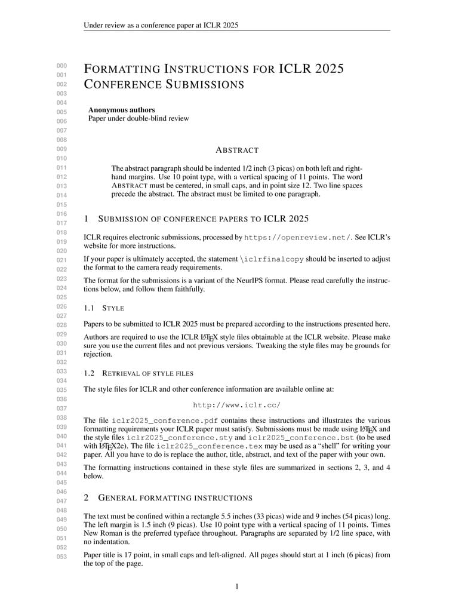

# Project report: ICLR submission format

[Course index](../../README.md) · [Original source](https://www.overleaf.com/latex/templates/template-for-iclr-2025-conference-submission/gqzkdyycxtvt) · [Raw file](../../raw/references/project-report-iclr-submission-format.html)

Retrieved: 2026-11-13T16:35:37.448638+00:00

[arrow\_left\_altBack to all templates](https://www.overleaf.com/latex/templates)

# Template for ICLR 2025 Conference Submission

[Open as Template](https://www.overleaf.com/project/new/template/38004?id=594403658&latexEngine=pdflatex&mainFile=iclr2025_conference.tex&templateName=Template+for+ICLR+2025+Conference+Submission&texImage=texlive-full%3A2024.1)View Source[View PDF](https://www.overleaf.com/latex/templates/template-for-iclr-2025-conference-submission/gqzkdyycxtvt.pdf)

**Author:**

ICLR

**Last Updated:**

2 years ago

**License:**

Creative Commons CC BY 4.0

**Abstract:**

Official template for paper submission.
Source:
https://github.com/ICLR/Master-Template/tree/master/iclr2025

**Tags:**

[Conference Paper](https://www.overleaf.com/gallery/tagged/conference-paper)[2025 Conference](https://www.overleaf.com/gallery/tagged/conf2025)

\begin{now}

Discover why over 30 million people worldwide trust Overleaf with their work.

[Sign up for free](https://www.overleaf.com/register)[Explore all plans](https://www.overleaf.com/user/subscription/plans)
