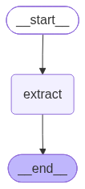
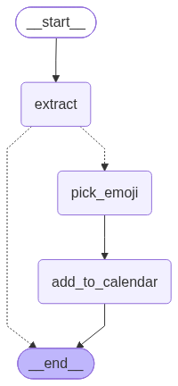
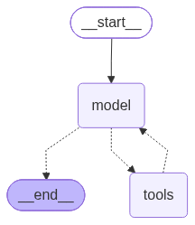

# Code: lecture5-frameworks: lecture5.ipynb

[Course index](../../../README.md) · [Original source](https://github.com/cs329z/lecture5-frameworks/blob/HEAD/lecture5.ipynb) · [Raw file](../../../raw/repositories/cs329z-lecture5-frameworks/lecture5.ipynb)

Retrieved: 2026-11-13T16:20:40.422150+00:00

## Cell 1

# Lecture 5: Frameworks

## Cell 2

## Setup Libraries

DSPy, LangGraph, and Temporal setup.

## Cell 3

```python
import os
from dotenv import load_dotenv
from IPython.display import Image

load_dotenv()
OPENROUTER_API_KEY = os.environ["OPENROUTER_API_KEY"]
OPENROUTER_BASE_URL = "https://openrouter.ai/api/v1"
MODEL = "openai/gpt-5.4-nano"
```

## Cell 4

### DSPy

## Cell 5

```python
import dspy

dspy_llm = dspy.LM(f"openrouter/{MODEL}", api_key=OPENROUTER_API_KEY)
dspy.configure(lm=dspy_llm)
```

## Cell 6

### LangGraph

## Cell 7

```python
from langchain_openai import ChatOpenAI          # LangGraph uses LangChain's model wrappers
from langgraph.graph import StateGraph, START, END
from langchain_core.globals import set_llm_cache
from llm_cache import SQLiteLLMCache               # small helper in this repo; LangChain core only ships an in-memory cache

langchain_llm = ChatOpenAI(model=MODEL, base_url=OPENROUTER_BASE_URL, api_key=OPENROUTER_API_KEY)
set_llm_cache(SQLiteLLMCache(".langchain_cache.db"))   # like DSPy's cache: identical calls are replayed, not re-billed
```

## Cell 8

### Temporal

## Cell 9

```python
import logging
from temporalio import activity, workflow
from temporalio.client import Client
from temporalio.worker import Worker
from temporalio.testing import WorkflowEnvironment

# Starts a local Temporal dev server (downloads the binary on first run; works on macOS/Linux/Windows).
env = await WorkflowEnvironment.start_local(ui=True, ui_port=8233, dev_server_log_level="never")
client = env.client
logging.getLogger("temporalio").setLevel(logging.ERROR)   # hide the SDK's warning tracebacks when an activity attempt fails
print("Temporal UI: http://localhost:8233")
```

```text
Temporal UI: http://localhost:8233

```

## Cell 10

### tinycal

The calendar app our agents will control. Starts empty every time the notebook runs.

## Cell 11

```python
import tinycal

# For lecture, run `uv run python -m tinycal` in a separate terminal first so the calendar
# survives kernel restarts. If nothing is running, this starts one inside the kernel instead.
print("tinycal UI:", tinycal.ensure_server())
print(tinycal.clear_calendar())  # start from an empty calendar
tinycal.add_event("CS329Z Lecture", "2026-10-05", "13:30", "14:50")
tinycal.add_event("CS329Z Lecture", "2026-10-07", "13:30", "14:50")
print(tinycal.today())
print(tinycal.api())  # what the agents will be able to do
```

```text
tinycal UI: http://127.0.0.1:8765
calendar cleared
2026-10-04 (Sunday)
tinycal SDK  (http://127.0.0.1:8765)

  today()                                                                                      -> str       Get today's date and weekday, e.g. "2026-10-03 (Saturday)".
  list_events(start_date=None, end_date=None)                                                  -> list[dict] List calendar events, sorted by date and start time.
  add_event(title, date, start, end=None, duration_minutes=None, notes='', emoji='')           -> dict      Add an event to the calendar.
  update_event(event_id, title=None, date=None, start=None, end=None, notes=None, emoji=None)  -> dict      Change one or more fields of an existing event. Only the given fields are changed.
  delete_event(event_id)                                                                       -> str       Delete an event by id. Returns a confirmation message.
  find_free_slots(date, duration_minutes=60, day_start='09:00', day_end='18:00')               -> list[str] Find open time windows on a date that can fit an event of the given length.
  clear_calendar()                                                                             -> str       Delete every event in the calendar. Returns a confirmation message.

  Dates are 'YYYY-MM-DD', times are 24-hour 'HH:MM'. Errors raise CalendarError.

```

## Cell 12

# Part 1: DSPy

## Cell 13

## Signatures

## Cell 14

```python
# The simplest signatures are string signatures

signature = "message -> response"
chat = dspy.Predict(signature)

print(chat(message="Hello, how are you?").response)
```

```text
Temporal CLI 1.9.1 (Server 1.32.0, UI 2.54.1)

Temporal Server:      localhost:56693
Temporal Persistence: in-memory
Temporal UI:          http://localhost:8233
Temporal Metrics:     http://localhost:56694/metrics
Hello! I’m doing well—thanks for asking. How are you today?

```

## Cell 15

```python
# Signatures are great for structured input and output

sentiment_signature = "message -> sentiment"
sentiment_classifier = dspy.Predict(sentiment_signature)

print(sentiment_classifier(message="I am very happy today!").sentiment)
print(sentiment_classifier(message="I am very angry today!").sentiment)
print(sentiment_classifier(message="I am very confused today!").sentiment)
```

```text
positive
Negative
negative

```

## Cell 16

```python
# We can apply types
typed_signature = "message: str -> sentiment: " \
   "Literal['positive','negative','neutral'], confidence: float"
typed_sentiment_classifier = dspy.Predict(typed_signature)

print(typed_sentiment_classifier(message="I am very happy today!"))
print(typed_sentiment_classifier(message="I am very angry today!"))
print(typed_sentiment_classifier(message="I am very confused today!"))
```

```text
Prediction(
    sentiment='positive',
    confidence=0.98
)
Prediction(
    sentiment='negative',
    confidence=0.9
)
Prediction(
    sentiment='negative',
    confidence=0.86
)

```

## Cell 17

```python
dspy_llm.inspect_history(n=3)
```

```text


[2026-10-04T04:22:53.837132]

System message:

Your input fields are:
1. `message` (str):
Your output fields are:
1. `sentiment` (Literal['positive', 'negative', 'neutral']): 
2. `confidence` (float):
All interactions will be structured in the following way, with the appropriate values filled in.

[[ ## message ## ]]
{message}

[[ ## sentiment ## ]]
{sentiment}        # note: the value you produce must exactly match (no extra characters) one of: positive; negative; neutral

[[ ## confidence ## ]]
{confidence}        # note: the value you produce must be a single float value

[[ ## completed ## ]]
In adhering to this structure, your objective is: 
        Given the fields `message`, produce the fields `sentiment`, `confidence`.


User message:

[[ ## message ## ]]
I am very happy today!

Respond with the corresponding output fields, starting with the field `[[ ## sentiment ## ]]` (must be formatted as a valid Python Literal['positive', 'negative', 'neutral']), then `[[ ## confidence ## ]]` (must be formatted as a valid Python float), and then ending with the marker for `[[ ## completed ## ]]`.


Response:

[[ ## sentiment ## ]]
positive
[[ ## confidence ## ]]
0.98
[[ ## completed ## ]]


[2026-10-04T04:22:53.843228]

System message:

Your input fields are:
1. `message` (str):
Your output fields are:
1. `sentiment` (Literal['positive', 'negative', 'neutral']): 
2. `confidence` (float):
All interactions will be structured in the following way, with the appropriate values filled in.

[[ ## message ## ]]
{message}

[[ ## sentiment ## ]]
{sentiment}        # note: the value you produce must exactly match (no extra characters) one of: positive; negative; neutral

[[ ## confidence ## ]]
{confidence}        # note: the value you produce must be a single float value

[[ ## completed ## ]]
In adhering to this structure, your objective is: 
        Given the fields `message`, produce the fields `sentiment`, `confidence`.


User message:

[[ ## message ## ]]
I am very angry today!

Respond with the corresponding output fields, starting with the field `[[ ## sentiment ## ]]` (must be formatted as a valid Python Literal['positive', 'negative', 'neutral']), then `[[ ## confidence ## ]]` (must be formatted as a valid Python float), and then ending with the marker for `[[ ## completed ## ]]`.


Response:

[[ ## sentiment ## ]]
negative
[[ ## confidence ## ]]
0.9
[[ ## completed ## ]]


[2026-10-04T04:22:53.849053]

System message:

Your input fields are:
1. `message` (str):
Your output fields are:
1. `sentiment` (Literal['positive', 'negative', 'neutral']): 
2. `confidence` (float):
All interactions will be structured in the following way, with the appropriate values filled in.

[[ ## message ## ]]
{message}

[[ ## sentiment ## ]]
{sentiment}        # note: the value you produce must exactly match (no extra characters) one of: positive; negative; neutral

[[ ## confidence ## ]]
{confidence}        # note: the value you produce must be a single float value

[[ ## completed ## ]]
In adhering to this structure, your objective is: 
        Given the fields `message`, produce the fields `sentiment`, `confidence`.


User message:

[[ ## message ## ]]
I am very confused today!

Respond with the corresponding output fields, starting with the field `[[ ## sentiment ## ]]` (must be formatted as a valid Python Literal['positive', 'negative', 'neutral']), then `[[ ## confidence ## ]]` (must be formatted as a valid Python float), and then ending with the marker for `[[ ## completed ## ]]`.


Response:

[[ ## sentiment ## ]]
negative
[[ ## confidence ## ]]
0.86
[[ ## completed ## ]]


```

## Cell 18

```python
# When your signature gets more complicated
#     you may want to use a Signature class
import datetime as dt

class ExtractEvent(dspy.Signature):
    """Extract event details from an email."""
    email: str = dspy.InputField()
    event_name: str | None = dspy.OutputField()
    date: dt.date | None = dspy.OutputField()
    start: dt.time | None = dspy.OutputField(desc="24-hour clock")
    duration_minutes: int | None = dspy.OutputField(desc="duration of the event in minutes, if known")

extract = dspy.Predict(ExtractEvent)
extract(email="We have a meeting scheduled for this Friday," \
                                    " October 9th at 10 AM PST.")
```

```text
Prediction(
    event_name='meeting',
    date=datetime.date(2026, 10, 9),
    start=datetime.time(10, 0),
    duration_minutes=None
)
```

## Cell 19

```python
dspy_llm.inspect_history(n=1)
```

```text


[2026-10-04T04:22:53.884680]

System message:

Your input fields are:
1. `email` (str):
Your output fields are:
1. `event_name` (UnionType[str, NoneType]): 
2. `date` (UnionType[date, NoneType]): 
3. `start` (UnionType[time, NoneType]): 24-hour clock
4. `duration_minutes` (UnionType[int, NoneType]): duration of the event in minutes, if known
All interactions will be structured in the following way, with the appropriate values filled in.

[[ ## email ## ]]
{email}

[[ ## event_name ## ]]
{event_name}        # note: the value you produce must adhere to the JSON schema: {"anyOf": [{"type": "string"}, {"type": "null"}]}

[[ ## date ## ]]
{date}        # note: the value you produce must adhere to the JSON schema: {"anyOf": [{"type": "string", "format": "date"}, {"type": "null"}]}

[[ ## start ## ]]
{start}        # note: the value you produce must adhere to the JSON schema: {"anyOf": [{"type": "string", "format": "time"}, {"type": "null"}]}

[[ ## duration_minutes ## ]]
{duration_minutes}        # note: the value you produce must adhere to the JSON schema: {"anyOf": [{"type": "integer"}, {"type": "null"}]}

[[ ## completed ## ]]
In adhering to this structure, your objective is: 
        Extract event details from an email.


User message:

[[ ## email ## ]]
We have a meeting scheduled for this Friday, October 9th at 10 AM PST.

Respond with the corresponding output fields, starting with the field `[[ ## event_name ## ]]` (must be formatted as a valid Python UnionType[str, NoneType]), then `[[ ## date ## ]]` (must be formatted as a valid Python UnionType[date, NoneType]), then `[[ ## start ## ]]` (must be formatted as a valid Python UnionType[time, NoneType]), then `[[ ## duration_minutes ## ]]` (must be formatted as a valid Python UnionType[int, NoneType]), and then ending with the marker for `[[ ## completed ## ]]`.


Response:

[[ ## event_name ## ]]
meeting

[[ ## date ## ]]
2026-10-09

[[ ## start ## ]]
10:00:00

[[ ## duration_minutes ## ]]
None

[[ ## completed ## ]]


```

## Cell 20

## Modules

## Cell 21

```python
# Sometimes you may want a different inference
#      strategy than the default "Predict"

extract_cot = dspy.ChainOfThought(ExtractEvent)
extract_cot(email="We have a meeting scheduled for this Friday," \
                                    " October 9th at 10 AM PST.")
```

```text
Prediction(
    reasoning='The email states there is a meeting “this Friday, October 9th at 10 AM PST.” So the event name is “meeting,” the date is October 9, and the start time is 10:00 AM in PST. No duration is provided.',
    event_name='meeting',
    date=datetime.date(2026, 10, 9),
    start=datetime.time(10, 0),
    duration_minutes=None
)
```

## Cell 22

```python
# A second, tiny LLM call we can compose with the first one

class PickEmoji(dspy.Signature):
    """Pick one emoji that best represents a calendar event."""
    event_name: str = dspy.InputField()
    emoji: str = dspy.OutputField(desc="exactly one emoji character")

pick_emoji = dspy.ChainOfThought(PickEmoji)
pick_emoji(event_name="Dentist")
```

```text
Prediction(
    reasoning='A dentist appointment is a healthcare-related calendar event, so a dental-themed emoji fits best.',
    emoji='🦷'
)
```

## Cell 23

```python
# Modules are composable and can include python logic

class UpdateCalendarFromEmail(dspy.Module):
    def __init__(self):
        self.extract = dspy.ChainOfThought(ExtractEvent)   # LLM call 1
        self.pick_emoji = dspy.ChainOfThought(PickEmoji)   # LLM call 2

    def forward(self, email: str):
        details = self.extract(email=email)

        # Plain Python control flow: not every email contains an event.
        if details.event_name is None or details.date is None or details.start is None:
            return dspy.Prediction(event=None, status="no event found in email")

        emoji = self.pick_emoji(event_name=details.event_name).emoji
        event = tinycal.add_event(
            title=details.event_name,
            date=details.date,
            start=details.start,
            duration_minutes=details.duration_minutes,  # tinycal assumes 1 hour if None
            emoji=emoji,
        )
        return dspy.Prediction(event=event, status="added to calendar")
```

## Cell 24

```python
update_calendar = UpdateCalendarFromEmail()
print(update_calendar(email="We have a meeting scheduled for this Friday, October 9th at 10 AM PST."))
print(update_calendar(email="Thanks for sending the slides, they look great!"))
```

```text
Prediction(
    event={'id': 'f25c43aa', 'notes': '', 'emoji': '📅', 'title': 'meeting', 'date': '2026-10-09', 'start': '10:00', 'end': '11:00'},
    status='added to calendar'
)
Prediction(
    event=None,
    status='no event found in email'
)

```

## Cell 25

## Optimizers

Can a **small** model do the extraction task? Let's let DSPy's GEPA optimizer rewrite the prompt for us.

## Cell 26

```python
# 1. The data: 50 realistic emails with gold labels (see data/emails.json)
import json, random

rows = json.load(open("data/emails.json"))
print(rows[0]["email"])
print("GOLD:", {k: v for k, v in rows[0].items() if k != "email"})
```

```text
Dear Prof. Lindqvist,

My thesis committee meeting is scheduled for Wednesday, October 28, 2026 at 2:45pm in Huang 018. It will run for one hour. I'll circulate slides two days before.

Best,
Tomas
GOLD: {'event_name': 'thesis committee meeting', 'date': '2026-10-28', 'start': '14:45', 'duration_minutes': 60}

```

## Cell 27

```python
# Turn them into dspy.Examples. Input: email. Labels: everything else.
examples = [dspy.Example(**row).with_inputs("email") for row in rows]
random.Random(0).shuffle(examples)
trainset, testset = examples[:30], examples[30:]
print(len(trainset), "train /", len(testset), "test")
```

```text
30 train / 20 test

```

## Cell 28

```python
# 2. The metric: 1 if the date, start time, and duration ALL exactly match the gold label, else 0.
#    (event_name is free-form text, so we don't grade it.)
#    It also returns feedback text: GEPA shows this to the reflection model.
def event_metric(gold, pred, trace=None, pred_name=None, pred_trace=None):
    checks = {
        "date": str(pred.date) == gold.date,
        "start": str(pred.start)[:5] == gold.start,
        "duration_minutes": pred.duration_minutes == gold.duration_minutes,
    }
    score = float(all(checks.values()))
    wrong = [f"{k}: expected {getattr(gold, k)!r}, got {getattr(pred, k)!r}" for k, ok in checks.items() if not ok]
    feedback = "All fields correct." if not wrong else "Wrong -> " + "; ".join(wrong)
    return dspy.Prediction(score=score, feedback=feedback)

evaluate = dspy.Evaluate(devset=testset, metric=event_metric, num_threads=8, display_progress=True)
```

## Cell 29

```python
# Sanity check: our big model (gpt-5.4-nano) should ace this
extract_big = dspy.Predict(ExtractEvent)   # uses dspy_llm (gpt-5.4-nano), the default LM
evaluate(extract_big)
```

```text
Average Metric: 20.00 / 20 (100.0%): 100%|██████████| 20/20 [00:00<00:00, 33.72it/s] 
```

```text
2026/10/04 04:22:54 INFO dspy.evaluate.evaluate: Average Metric: 20.0 / 20 (100.0%)

```

```text


```

```text
EvaluationResult(score=100.0, results=<list of 20 results>)
```

## Cell 30

```python
# 3. The small model: Gemma 3 12B. 
small_lm = dspy.LM("openrouter/google/gemma-3-12b-it", api_key=OPENROUTER_API_KEY, max_tokens=1024, temperature=0.0)

extract_small = dspy.Predict(ExtractEvent)   # same signature...
extract_small.set_lm(small_lm)               # ...but this predictor uses the small model

# 4. Score the small model BEFORE optimization
before = evaluate(extract_small)
```

```text
Average Metric: 11.00 / 20 (55.0%): 100%|██████████| 20/20 [00:00<00:00, 255.80it/s]
```

```text
2026/10/04 04:22:54 INFO dspy.evaluate.evaluate: Average Metric: 11.0 / 20 (55.0%)

```

```text


```

## Cell 31

```python
# What is the small model actually seeing and saying? Its instructions are just the docstring.
print("INSTRUCTIONS BEFORE:", repr(extract_small.signature.instructions))
small_lm.inspect_history(n=1)
```

```text
INSTRUCTIONS BEFORE: 'Extract event details from an email.'


[2026-10-04T04:22:54.904864]

System message:

Your input fields are:
1. `email` (str):
Your output fields are:
1. `event_name` (UnionType[str, NoneType]): 
2. `date` (UnionType[date, NoneType]): 
3. `start` (UnionType[time, NoneType]): 24-hour clock
4. `duration_minutes` (UnionType[int, NoneType]): duration of the event in minutes, if known
All interactions will be structured in the following way, with the appropriate values filled in.

Inputs will have the following structure:

[[ ## email ## ]]
{email}

Outputs will be a JSON object with the following fields.

{
  "event_name": "{event_name}        # note: the value you produce must adhere to the JSON schema: {\"anyOf\": [{\"type\": \"string\"}, {\"type\": \"null\"}]}",
  "date": "{date}        # note: the value you produce must adhere to the JSON schema: {\"anyOf\": [{\"type\": \"string\", \"format\": \"date\"}, {\"type\": \"null\"}]}",
  "start": "{start}        # note: the value you produce must adhere to the JSON schema: {\"anyOf\": [{\"type\": \"string\", \"format\": \"time\"}, {\"type\": \"null\"}]}",
  "duration_minutes": "{duration_minutes}        # note: the value you produce must adhere to the JSON schema: {\"anyOf\": [{\"type\": \"integer\"}, {\"type\": \"null\"}]}"
}
In adhering to this structure, your objective is: 
        Extract event details from an email.


User message:

[[ ## email ## ]]
Hello,

Your appointment to open a business account is booked for October 22nd, 2026 at 9:15 AM. It's a quick 15-minute check-in. Please bring your EIN letter.

Wells Fargo

Respond with a JSON object in the following order of fields: `event_name` (must be formatted as a valid Python UnionType[str, NoneType]), then `date` (must be formatted as a valid Python UnionType[date, NoneType]), then `start` (must be formatted as a valid Python UnionType[time, NoneType]), then `duration_minutes` (must be formatted as a valid Python UnionType[int, NoneType]).


Response:

{
  "event_name": "open a business account",
  "date": "2026-10-22",
  "start": "09:15:00+00:00",
  "duration_minutes": 15
}


```

## Cell 32

```python
# 5. Optimize with GEPA on a small budget (100 metric calls, ~3 minutes).
#    The big model (dspy_llm) reflects on the small model's mistakes; the small model is what gets tuned.
gepa = dspy.GEPA(metric=event_metric, max_metric_calls=100, reflection_lm=dspy_llm, num_threads=8)
extract_optimized = gepa.compile(extract_small, trainset=trainset)
```

```text
2026/10/04 04:22:54 INFO dspy.teleprompt.gepa.gepa: Running GEPA for approx 100 metric calls of the program. This amounts to 3.33 full evals on the train set.
2026/10/04 04:22:54 WARNING dspy.teleprompt.gepa.gepa: No valset provided; Using trainset as valset. This is useful as an inference-time scaling strategy where you want GEPA to find the best solutions for the provided tasks in the trainset, as it makes GEPA overfit prompts to the provided trainset. In order to ensure generalization and perform well on unseen tasks, please provide separate trainset and valset. Provide the smallest valset that is just large enough to match the downstream task distribution, while keeping trainset as large as possible.
2026/10/04 04:22:54 INFO dspy.teleprompt.gepa.gepa: Using 30 examples for tracking Pareto scores.
GEPA Optimization:   0%|          | 0/100 [00:00<?, ?rollouts/s]2026/10/04 04:22:55 INFO dspy.evaluate.evaluate: Average Metric: 23.0 / 30 (76.7%)
2026/10/04 04:22:55 INFO dspy.teleprompt.gepa.gepa: Iteration 0: Base program full valset score: 0.7666666666666667 over 30 / 30 examples
GEPA Optimization:  30%|███       | 30/100 [00:00<00:00, 155.96rollouts/s]
```

```text
Average Metric: 2.00 / 3 (66.7%): 100%|██████████| 3/3 [00:00<00:00, 5485.14it/s]
```

```text
2026/10/04 04:22:55 INFO dspy.evaluate.evaluate: Average Metric: 2.0 / 3 (66.7%)
2026/10/04 04:22:55 INFO dspy.teleprompt.gepa.gepa: Iteration 1: Selected program 0 score: 0.7666666666666667
2026/10/04 04:22:55 INFO dspy.teleprompt.gepa.gepa: Iteration 1: Proposed new text for self: You are given an email (plain text). Your job is to extract a single calendar event from it and return structured fields.

Input format:
- The input will be one email message as a text block.
- The email may contain:
  - An event title (often a phrase like “Design review …”, “Appointment reminder: …”, “parent-teacher conference …”)
  - A date in common human formats (e.g., “Tue 10/13/2026”, “Nov 10, 2026”, “7 December 2026”)
  - A start time (e.g., “12:30”, “1:15pm”, “6:00 p.m.”), sometimes with timezone like “+00:00” inferred/required
  - A duration (e.g., “15-minute check-in”, “two-hour session”, “about 30 minutes”)
  - Location info (e.g., “meet in room 14”), though output fields may not include it unless explicitly required
- If multiple events exist, focus on the clearest single primary event described.

Output fields (infer these are always required):
1) event_name
- Extract the event title/description as a short phrase.
- Prefer the most specific name mentioned in the email (e.g., “Design review for the checkout redesign”, “haircut”, “parent-teacher conference”).

2) date
- Output in ISO format: YYYY-MM-DD.
- Correctly parse month/day/year ambiguity:
  - If the date is written with slashes like “10/13/2026” and both month and day are <= 12/31, treat it as MM/DD/YYYY unless the email explicitly indicates otherwise.
  - Examples:
    - “Tue 10/13/2026” → 2026-10-13 (not year 1013).
- Never drop the year.

3) start
- Output time in HH:MM:SS.
- If an am/pm is present, convert to 24-hour time.
  - “1:15pm” → 13:15:00
  - “6:00 p.m.” → 18:00:00
- If no timezone is present in the email, you may omit timezone.
- If you must include timezone and the examples indicate UTC style (e.g., “+00:00”), use +00:00. Otherwise keep it consistent with examples.

4) duration_minutes
- Extract duration and convert to integer minutes.
  - “15-minute check-in” → 15
  - “two-hour session” → 120
  - “about 30 minutes” → 30
- If duration is not explicitly stated, set duration_minutes to None (or null) rather than guessing.

General strategy:
- Step 1: Identify the event name from the most prominent “subject” phrase near “confirmed”, “appointment reminder”, “design review”, etc.
- Step 2: Extract date and normalize to YYYY-MM-DD with correct interpretation of numeric month/day ordering for slash formats.
- Step 3: Extract start time and normalize to 24-hour HH:MM:SS; convert from am/pm when present.
- Step 4: Extract duration; recognize units like minute(s), hour(s), two-hour, “about”, etc., and convert hours to minutes.
- Step 5: If any required field (date/start/duration_minutes) cannot be found, return None only for missing duration_minutes if the email lacks it; do not fabricate values.

Important correctness notes from feedback:
- Do not mis-parse dates like “10/13/2026”; ensure the year stays 2026 and the output is 2026-10-13.
- Ensure duration_minutes is extracted when present (e.g., 15 minutes in the first example). If duration is present but missed, that is an error.

```

```text

Average Metric: 1.00 / 3 (33.3%): 100%|██████████| 3/3 [00:00<00:00, 246.00it/s]
```

```text
2026/10/04 04:22:55 INFO dspy.evaluate.evaluate: Average Metric: 1.0 / 3 (33.3%)
2026/10/04 04:22:55 INFO dspy.teleprompt.gepa.gepa: Iteration 1: New subsample score 1.0 is not better than old score 2.0, skipping

```

```text

Average Metric: 3.00 / 3 (100.0%): 100%|██████████| 3/3 [00:00<00:00, 3366.22it/s]
```

```text
2026/10/04 04:22:55 INFO dspy.evaluate.evaluate: Average Metric: 3.0 / 3 (100.0%)
2026/10/04 04:22:55 INFO dspy.teleprompt.gepa.gepa: Iteration 2: Selected program 0 score: 0.7666666666666667
2026/10/04 04:22:55 INFO dspy.teleprompt.gepa.gepa: Iteration 2: All subsample scores perfect for parent 0. Skipping.
2026/10/04 04:22:55 INFO dspy.teleprompt.gepa.gepa: Iteration 2: Reflective mutation did not propose a new candidate

```

```text

Average Metric: 2.00 / 3 (66.7%): 100%|██████████| 3/3 [00:00<00:00, 449.63it/s] 
```

```text
2026/10/04 04:22:55 INFO dspy.evaluate.evaluate: Average Metric: 2.0 / 3 (66.7%)
2026/10/04 04:22:55 INFO dspy.teleprompt.gepa.gepa: Iteration 3: Selected program 0 score: 0.7666666666666667
2026/10/04 04:22:55 INFO dspy.teleprompt.gepa.gepa: Iteration 3: Proposed new text for self: You are an email-to-calendar event extractor.

Given an email text, extract event details and return them in a structured format with these fields:
- event_name (string): A concise title for the event (e.g., “Quarterly planning”, “Biscuit's vet appointment”, “Thesis defense for Wei Zhang”). Use the most relevant subject/action phrase from the email.
- date (YYYY-MM-DD): The event date in ISO format (4-digit year).
- start (HH:MM:SS+00:00): The event start time in 24-hour format. If the email provides “am/pm”, convert to 24-hour time. If no timezone is mentioned, use +00:00.
- duration_minutes (integer or None): If the email states a planned duration (e.g., “Plan for half an hour”, “for 30 minutes”), convert it to minutes (e.g., 30). If no duration is given, output None.

Important rules / edge cases:
1. Date parsing: Do NOT misread month/day/year. The email may contain ambiguous-looking numeric dates; always ensure the extracted date matches the intended year-month-day. In particular, “11/17/2026” must become date=2026-11-17 (not an incorrect interpretation that changes the year or day/month positions).
2. Time parsing: Handle times like “9:15 a.m.”, “3:45pm”, “at noon”. Convert “noon” to 12:00:00 and “midnight” (if encountered) to 00:00:00.
3. Formatting:
   - date must be exactly YYYY-MM-DD.
   - start must be exactly HH:MM:SS+00:00 (include seconds).
4. Duration:
   - Recognize phrases like “half an hour”, “30 minutes”, “for half an hour”.
   - If duration is not explicitly stated, duration_minutes must be None.

Generalizable extraction strategy:
- Scan the email for explicit event descriptors:
  - the main event phrase (what is happening),
  - the date/time (look for patterns like mm/dd/yyyy, “on <date>”, or “Monday, <Month> <day>, <year>”, and “at <time>”, “noon”, “am/pm”),
  - any duration language (“Plan for …”, “for …”, “duration …”).
- Populate the fields using only the explicit information found; do not guess missing values.

Output format:
Return only the extracted fields, one per line:
event_name
date
start
duration_minutes
(and no extra commentary).

```

```text

Average Metric: 3.00 / 3 (100.0%): 100%|██████████| 3/3 [00:00<00:00, 325.85it/s]
```

```text
2026/10/04 04:22:55 INFO dspy.evaluate.evaluate: Average Metric: 3.0 / 3 (100.0%)

```

```text

Average Metric: 29.00 / 30 (96.7%): 100%|██████████| 30/30 [00:00<00:00, 175.17it/s] 
```

```text
2026/10/04 04:22:55 INFO dspy.evaluate.evaluate: Average Metric: 29.0 / 30 (96.7%)
2026/10/04 04:22:55 INFO dspy.teleprompt.gepa.gepa: Iteration 3: Accepted candidate (subsample score 2.0 -> 3.0); running full eval.
2026/10/04 04:22:55 INFO dspy.teleprompt.gepa.gepa: Iteration 3: Found a better program on the valset with score 0.9666666666666667.
2026/10/04 04:22:55 INFO dspy.teleprompt.gepa.gepa: Iteration 3: Valset score for new program: 0.9666666666666667 (coverage 30 / 30)
2026/10/04 04:22:55 INFO dspy.teleprompt.gepa.gepa: Iteration 3: Val aggregate for new program: 0.9666666666666667
2026/10/04 04:22:55 INFO dspy.teleprompt.gepa.gepa: Iteration 3: Individual valset scores for new program: {0: 1.0, 1: 1.0, 2: 1.0, 3: 1.0, 4: 1.0, 5: 1.0, 6: 1.0, 7: 1.0, 8: 1.0, 9: 1.0, 10: 1.0, 11: 1.0, 12: 1.0, 13: 1.0, 14: 1.0, 15: 1.0, 16: 1.0, 17: 1.0, 18: 1.0, 19: 1.0, 20: 1.0, 21: 1.0, 22: 1.0, 23: 1.0, 24: 1.0, 25: 1.0, 26: 1.0, 27: 1.0, 28: 1.0, 29: 0.0}
2026/10/04 04:22:55 INFO dspy.teleprompt.gepa.gepa: Iteration 3: New valset pareto front scores: {0: 1.0, 1: 1.0, 2: 1.0, 3: 1.0, 4: 1.0, 5: 1.0, 6: 1.0, 7: 1.0, 8: 1.0, 9: 1.0, 10: 1.0, 11: 1.0, 12: 1.0, 13: 1.0, 14: 1.0, 15: 1.0, 16: 1.0, 17: 1.0, 18: 1.0, 19: 1.0, 20: 1.0, 21: 1.0, 22: 1.0, 23: 1.0, 24: 1.0, 25: 1.0, 26: 1.0, 27: 1.0, 28: 1.0, 29: 1.0}
2026/10/04 04:22:55 INFO dspy.teleprompt.gepa.gepa: Iteration 3: Valset pareto front aggregate score: 1.0
2026/10/04 04:22:55 INFO dspy.teleprompt.gepa.gepa: Iteration 3: Updated valset pareto front programs: {0: {0, 1}, 1: {1}, 2: {0, 1}, 3: {1}, 4: {0, 1}, 5: {0, 1}, 6: {0, 1}, 7: {1}, 8: {1}, 9: {0, 1}, 10: {0, 1}, 11: {0, 1}, 12: {0, 1}, 13: {1}, 14: {0, 1}, 15: {0, 1}, 16: {0, 1}, 17: {0, 1}, 18: {0, 1}, 19: {0, 1}, 20: {0, 1}, 21: {0, 1}, 22: {0, 1}, 23: {1}, 24: {0, 1}, 25: {0, 1}, 26: {0, 1}, 27: {0, 1}, 28: {1}, 29: {0}}
2026/10/04 04:22:55 INFO dspy.teleprompt.gepa.gepa: Iteration 3: Best valset aggregate score so far: 0.9666666666666667
2026/10/04 04:22:55 INFO dspy.teleprompt.gepa.gepa: Iteration 3: Best program as per aggregate score on valset: 1
2026/10/04 04:22:55 INFO dspy.teleprompt.gepa.gepa: Iteration 3: Best score on valset: 0.9666666666666667
2026/10/04 04:22:55 INFO dspy.teleprompt.gepa.gepa: Iteration 3: Linear pareto front program index: 1
2026/10/04 04:22:55 INFO dspy.teleprompt.gepa.gepa: Iteration 3: New program candidate index: 1
GEPA Optimization:  75%|███████▌  | 75/100 [00:00<00:00, 144.06rollouts/s]2026/10/04 04:22:55 INFO dspy.teleprompt.gepa.gepa: Iteration 4: No merge candidates found

```

```text

Average Metric: 3.00 / 3 (100.0%): 100%|██████████| 3/3 [00:00<00:00, 1164.55it/s]
```

```text
2026/10/04 04:22:55 INFO dspy.evaluate.evaluate: Average Metric: 3.0 / 3 (100.0%)
2026/10/04 04:22:55 INFO dspy.teleprompt.gepa.gepa: Iteration 4: Selected program 0 score: 0.7666666666666667
2026/10/04 04:22:55 INFO dspy.teleprompt.gepa.gepa: Iteration 4: All subsample scores perfect for parent 0. Skipping.
2026/10/04 04:22:55 INFO dspy.teleprompt.gepa.gepa: Iteration 4: Reflective mutation did not propose a new candidate

```

```text

Average Metric: 3.00 / 3 (100.0%): 100%|██████████| 3/3 [00:00<00:00, 968.66it/s] 
```

```text
2026/10/04 04:22:55 INFO dspy.evaluate.evaluate: Average Metric: 3.0 / 3 (100.0%)
2026/10/04 04:22:55 INFO dspy.teleprompt.gepa.gepa: Iteration 5: Selected program 1 score: 0.9666666666666667
2026/10/04 04:22:55 INFO dspy.teleprompt.gepa.gepa: Iteration 5: All subsample scores perfect for parent 1. Skipping.
2026/10/04 04:22:55 INFO dspy.teleprompt.gepa.gepa: Iteration 5: Reflective mutation did not propose a new candidate

```

```text

Average Metric: 3.00 / 3 (100.0%): 100%|██████████| 3/3 [00:00<00:00, 471.76it/s]
```

```text
2026/10/04 04:22:55 INFO dspy.evaluate.evaluate: Average Metric: 3.0 / 3 (100.0%)
2026/10/04 04:22:55 INFO dspy.teleprompt.gepa.gepa: Iteration 6: Selected program 1 score: 0.9666666666666667
2026/10/04 04:22:55 INFO dspy.teleprompt.gepa.gepa: Iteration 6: All subsample scores perfect for parent 1. Skipping.
2026/10/04 04:22:55 INFO dspy.teleprompt.gepa.gepa: Iteration 6: Reflective mutation did not propose a new candidate

```

```text

Average Metric: 2.00 / 3 (66.7%): 100%|██████████| 3/3 [00:00<00:00, 677.78it/s] 
```

```text
2026/10/04 04:22:55 INFO dspy.evaluate.evaluate: Average Metric: 2.0 / 3 (66.7%)
2026/10/04 04:22:55 INFO dspy.teleprompt.gepa.gepa: Iteration 7: Selected program 0 score: 0.7666666666666667
2026/10/04 04:22:55 INFO dspy.teleprompt.gepa.gepa: Iteration 7: Proposed new text for self: You are given a single email (plain text). Your job is to extract calendar event details from it and return them in a structured JSON-like set of fields.

Input/format:
- Input is an email body that may contain a date, start time, duration, and a short description of the activity.
- Dates are written in common human formats such as: M/D/YYYY, DD Month YYYY, or “Monday, December 7, 2026”.
- Times are written like “10:45am”, “1:15 PM”, or “09:30”.
- Durations may be explicitly stated as “two-hour session”, “15-minute check-in”, “It’s a quick 15-minute check-in”, etc.
- The email may include a location or additional notes, but you only need to extract the fields described below.

Output fields (use these keys exactly):
- event_name: short title of the event/activity (e.g., “Home inspection”, “Soccer practice”, “Moving”).
- date: the event date in ISO format YYYY-MM-DD.
- start: the start time in HH:MM:SS format, and when the source examples imply timezone offsets, include the offset; otherwise omit timezone.
  - In Example 2, “PM” was converted to 24-hour time and a -05:00 offset was used (13:15:00-05:00).
  - If no timezone is provided in the email, keep it timezone-naive (e.g., “09:30:00” as in Example 3).
- duration_minutes: duration in whole minutes as an integer if a duration is mentioned; otherwise return null (or None).

Extraction rules:
1. event_name:
   - Use the main activity/event described in the email.
   - Prefer the concise noun phrase (e.g., “Home inspection” from “The home inspection for…”).
   - Example evidence: “Your movers are scheduled…” -> event_name “Moving”.

2. date:
   - Identify the explicit calendar date mentioned for the event.
   - Convert it to YYYY-MM-DD regardless of how it appears in the email (e.g., “12/7/2026” -> 2026-12-07, “20 November 2026” -> 2026-11-20).

3. start:
   - Identify the explicit start time corresponding to that date.
   - Convert 12-hour times with AM/PM to 24-hour time.
   - Always format as HH:MM:SS.
   - Include timezone offset only if the email (or the inferred context from examples) provides enough information to do so. If not, omit timezone (timezone-naive).

4. duration_minutes (critical):
   - If the email includes a duration like “two-hour”, “15-minute”, “It's a two-hour session”, etc., convert to minutes accurately:
     - “two-hour session” -> 120
     - “15-minute check-in” -> 15
   - Do NOT leave duration_minutes as null when an explicit duration is present. Example 3 shows the assistant must extract “two-hour session” as 120 (the prior response was marked wrong for missing it).

General strategy:
- First, scan the email for an event/activity phrase (event name).
- Then locate the date and start time that are tied to that event.
- Finally, look for duration expressions (hours/minutes) and convert them to duration_minutes.
- If duration is not explicitly stated, set duration_minutes to null (None).

Return only the extracted fields (no commentary), formatted with the exact keys:
- event_name
- date
- start
- duration_minutes

```

```text

Average Metric: 3.00 / 3 (100.0%): 100%|██████████| 3/3 [00:00<00:00, 159.45it/s]
```

```text
2026/10/04 04:22:55 INFO dspy.evaluate.evaluate: Average Metric: 3.0 / 3 (100.0%)

```

```text

Average Metric: 30.00 / 30 (100.0%): 100%|██████████| 30/30 [00:00<00:00, 158.70it/s]
```

```text
2026/10/04 04:22:55 INFO dspy.evaluate.evaluate: Average Metric: 30.0 / 30 (100.0%)
2026/10/04 04:22:55 INFO dspy.teleprompt.gepa.gepa: Iteration 7: Accepted candidate (subsample score 2.0 -> 3.0); running full eval.
2026/10/04 04:22:55 INFO dspy.teleprompt.gepa.gepa: Iteration 7: Found a better program on the valset with score 1.0.
2026/10/04 04:22:55 INFO dspy.teleprompt.gepa.gepa: Iteration 7: Valset score for new program: 1.0 (coverage 30 / 30)
2026/10/04 04:22:55 INFO dspy.teleprompt.gepa.gepa: Iteration 7: Val aggregate for new program: 1.0
2026/10/04 04:22:55 INFO dspy.teleprompt.gepa.gepa: Iteration 7: Individual valset scores for new program: {0: 1.0, 1: 1.0, 2: 1.0, 3: 1.0, 4: 1.0, 5: 1.0, 6: 1.0, 7: 1.0, 8: 1.0, 9: 1.0, 10: 1.0, 11: 1.0, 12: 1.0, 13: 1.0, 14: 1.0, 15: 1.0, 16: 1.0, 17: 1.0, 18: 1.0, 19: 1.0, 20: 1.0, 21: 1.0, 22: 1.0, 23: 1.0, 24: 1.0, 25: 1.0, 26: 1.0, 27: 1.0, 28: 1.0, 29: 1.0}
2026/10/04 04:22:55 INFO dspy.teleprompt.gepa.gepa: Iteration 7: New valset pareto front scores: {0: 1.0, 1: 1.0, 2: 1.0, 3: 1.0, 4: 1.0, 5: 1.0, 6: 1.0, 7: 1.0, 8: 1.0, 9: 1.0, 10: 1.0, 11: 1.0, 12: 1.0, 13: 1.0, 14: 1.0, 15: 1.0, 16: 1.0, 17: 1.0, 18: 1.0, 19: 1.0, 20: 1.0, 21: 1.0, 22: 1.0, 23: 1.0, 24: 1.0, 25: 1.0, 26: 1.0, 27: 1.0, 28: 1.0, 29: 1.0}
2026/10/04 04:22:55 INFO dspy.teleprompt.gepa.gepa: Iteration 7: Valset pareto front aggregate score: 1.0
2026/10/04 04:22:55 INFO dspy.teleprompt.gepa.gepa: Iteration 7: Updated valset pareto front programs: {0: {0, 1, 2}, 1: {1, 2}, 2: {0, 1, 2}, 3: {1, 2}, 4: {0, 1, 2}, 5: {0, 1, 2}, 6: {0, 1, 2}, 7: {1, 2}, 8: {1, 2}, 9: {0, 1, 2}, 10: {0, 1, 2}, 11: {0, 1, 2}, 12: {0, 1, 2}, 13: {1, 2}, 14: {0, 1, 2}, 15: {0, 1, 2}, 16: {0, 1, 2}, 17: {0, 1, 2}, 18: {0, 1, 2}, 19: {0, 1, 2}, 20: {0, 1, 2}, 21: {0, 1, 2}, 22: {0, 1, 2}, 23: {1, 2}, 24: {0, 1, 2}, 25: {0, 1, 2}, 26: {0, 1, 2}, 27: {0, 1, 2}, 28: {1, 2}, 29: {0, 2}}
2026/10/04 04:22:55 INFO dspy.teleprompt.gepa.gepa: Iteration 7: Best valset aggregate score so far: 1.0
2026/10/04 04:22:55 INFO dspy.teleprompt.gepa.gepa: Iteration 7: Best program as per aggregate score on valset: 2
2026/10/04 04:22:55 INFO dspy.teleprompt.gepa.gepa: Iteration 7: Best score on valset: 1.0
2026/10/04 04:22:55 INFO dspy.teleprompt.gepa.gepa: Iteration 7: Linear pareto front program index: 2
2026/10/04 04:22:55 INFO dspy.teleprompt.gepa.gepa: Iteration 7: New program candidate index: 2
GEPA Optimization:  84%|████████▍ | 84/100 [00:00<00:00, 91.58rollouts/s] 
```

```text


```

```text


```

## Cell 33

```python
# 6. Score the small model AFTER optimization
after = evaluate(extract_optimized)
print(f"small model before: {before.score:.1f}%   after: {after.score:.1f}%")
```

```text
Average Metric: 20.00 / 20 (100.0%): 100%|██████████| 20/20 [00:00<00:00, 227.11it/s]
```

```text
2026/10/04 04:22:55 INFO dspy.evaluate.evaluate: Average Metric: 20.0 / 20 (100.0%)

```

```text

small model before: 55.0%   after: 100.0%

```

## Cell 34

```python
# The only thing GEPA changed is the instructions text:
print(extract_optimized.signature.instructions)
```

```text
You are given a single email (plain text). Your job is to extract calendar event details from it and return them in a structured JSON-like set of fields.

Input/format:
- Input is an email body that may contain a date, start time, duration, and a short description of the activity.
- Dates are written in common human formats such as: M/D/YYYY, DD Month YYYY, or “Monday, December 7, 2026”.
- Times are written like “10:45am”, “1:15 PM”, or “09:30”.
- Durations may be explicitly stated as “two-hour session”, “15-minute check-in”, “It’s a quick 15-minute check-in”, etc.
- The email may include a location or additional notes, but you only need to extract the fields described below.

Output fields (use these keys exactly):
- event_name: short title of the event/activity (e.g., “Home inspection”, “Soccer practice”, “Moving”).
- date: the event date in ISO format YYYY-MM-DD.
- start: the start time in HH:MM:SS format, and when the source examples imply timezone offsets, include the offset; otherwise omit timezone.
  - In Example 2, “PM” was converted to 24-hour time and a -05:00 offset was used (13:15:00-05:00).
  - If no timezone is provided in the email, keep it timezone-naive (e.g., “09:30:00” as in Example 3).
- duration_minutes: duration in whole minutes as an integer if a duration is mentioned; otherwise return null (or None).

Extraction rules:
1. event_name:
   - Use the main activity/event described in the email.
   - Prefer the concise noun phrase (e.g., “Home inspection” from “The home inspection for…”).
   - Example evidence: “Your movers are scheduled…” -> event_name “Moving”.

2. date:
   - Identify the explicit calendar date mentioned for the event.
   - Convert it to YYYY-MM-DD regardless of how it appears in the email (e.g., “12/7/2026” -> 2026-12-07, “20 November 2026” -> 2026-11-20).

3. start:
   - Identify the explicit start time corresponding to that date.
   - Convert 12-hour times with AM/PM to 24-hour time.
   - Always format as HH:MM:SS.
   - Include timezone offset only if the email (or the inferred context from examples) provides enough information to do so. If not, omit timezone (timezone-naive).

4. duration_minutes (critical):
   - If the email includes a duration like “two-hour”, “15-minute”, “It's a two-hour session”, etc., convert to minutes accurately:
     - “two-hour session” -> 120
     - “15-minute check-in” -> 15
   - Do NOT leave duration_minutes as null when an explicit duration is present. Example 3 shows the assistant must extract “two-hour session” as 120 (the prior response was marked wrong for missing it).

General strategy:
- First, scan the email for an event/activity phrase (event name).
- Then locate the date and start time that are tied to that event.
- Finally, look for duration expressions (hours/minutes) and convert them to duration_minutes.
- If duration is not explicitly stated, set duration_minutes to null (None).

Return only the extracted fields (no commentary), formatted with the exact keys:
- event_name
- date
- start
- duration_minutes

```

## Cell 35

## Agents

## Cell 36

```python
# An agent in one line.  Specify the inputs/outputs and the tools it can use.
agent = dspy.ReAct("request -> summary", tools=tinycal.TOOLS)

result = agent(request="Schedule a 30-minute coffee with John on Oct 7, 2026 in the afternoon after my lectures, "
                       "and put a book emoji on every one of my lectures for that same week.")
print(result.summary)
```

```text
- Added 📚 to lectures on:
  - 2026-10-05 (13:30–14:50) — CS329Z Lecture
  - 2026-10-07 (13:30–14:50) — CS329Z Lecture
- Scheduled:
  - “Coffee with John” on 2026-10-07 from 15:00–15:30

```

## Cell 37

```python
# RLMs can handle really long context
rows = json.load(open("data/emails.json"))
inbox = "\n\n=====\n\n".join(row["email"] for row in rows)

rlm = dspy.RLM("inbox, question -> event_names: list[str], dates: list[str]", max_iters=8)
result = rlm(inbox=inbox, question="Which events are held in the Gates building, and on what dates?")
print(result.event_names)
print(result.dates)
```

```text
['The thesis defense for Wei Zhang']
['Monday, December 7, 2026']

```

## Cell 38

# Part 2: LangGraph

## Cell 39

## Defining a Graph

## Cell 40

```python
# Structured Output is Possible in LangGraph too.

from pydantic import BaseModel, Field

class EventDetails(BaseModel):
    """Extract event details from an email."""
    event_name: str | None = Field(description="short title for the event, e.g. 'Dentist' or 'Meeting'. Always set when the email mentions an event")
    date: dt.date | None
    start: dt.time | None = Field(description="24-hour clock")
    duration_minutes: int | None = Field(description="duration of the event in minutes, if known")

extract_llm = langchain_llm.with_structured_output(EventDetails)
```

## Cell 41

```python
# First we define the state
from typing import TypedDict

class State(TypedDict):
    email: str
    details: EventDetails | None
```

## Cell 42

```python
# Next: a node that reads the state, performs some computation,
#       and returns the part you changed
def extract_node(state: State):                       
    return {"details": extract_llm.invoke(state["email"])}
```

## Cell 43

```python
from langgraph.graph import StateGraph, START, END

# Build the Graph
builder = StateGraph(State)
builder.add_node("extract", extract_node)
builder.add_edge(START, "extract")
builder.add_edge("extract", END)
graph = builder.compile()
```

## Cell 44

```python
# Visualize the graph
Image(graph.get_graph().draw_mermaid_png())
```



## Cell 45

```python
# Invoke the graph 
graph.invoke({"email": "We have a meeting scheduled for this Friday, October 9th at 10 AM PST."})
```

```text
{'email': 'We have a meeting scheduled for this Friday, October 9th at 10 AM PST.',
 'details': EventDetails(event_name='Meeting', date=datetime.date(2026, 10, 9), start=datetime.time(10, 0, tzinfo=TzInfo(-25200)), duration_minutes=None)}
```

## Cell 46

## Conditional Edges (Enable Workflows)

## Cell 47

```python
# Define the State
class CalendarState(State):
    emoji: str
    status: str
```

## Cell 48

```python
# Create Nodes
def pick_emoji_node(state: CalendarState):
    reply = langchain_llm.invoke(f"Reply with exactly one emoji character, nothing else, for a calendar event called '{state['details'].event_name}'.")
    return {"emoji": reply.text.strip()}

def add_to_calendar_node(state: CalendarState):
    d = state["details"]
    tinycal.add_event(d.event_name, d.date, d.start, duration_minutes=d.duration_minutes, emoji=state["emoji"])
    return {"status": "added to calendar"}
```

## Cell 49

```python
# Create a Conditional Edge
from typing import Literal

def route(state: CalendarState) -> Literal["pick_emoji", "__end__"]:   # plain Python decides where to go next
    d = state["details"]
    return "pick_emoji" if d.event_name and d.date and d.start else END
```

## Cell 50

```python
# Build the graph
builder = StateGraph(CalendarState)
builder.add_node("extract", extract_node)
builder.add_node("pick_emoji", pick_emoji_node)
builder.add_node("add_to_calendar", add_to_calendar_node)

builder.add_edge(START, "extract")
builder.add_conditional_edges("extract", route)        # dotted arrows in the drawing
builder.add_edge("pick_emoji", "add_to_calendar")
builder.add_edge("add_to_calendar", END)

calendar_graph = builder.compile()
```

## Cell 51

```python
Image(calendar_graph.get_graph().draw_mermaid_png())
```



## Cell 52

```python
calendar_graph.invoke({"email":"Dentist Appointment Confirmed, Wedndesday October 7th at 11am."})
```

```text
{'email': 'Dentist Appointment Confirmed, Wedndesday October 7th at 11am.',
 'details': EventDetails(event_name='Dentist Appointment', date=datetime.date(2026, 10, 7), start=datetime.time(11, 0, tzinfo=TzInfo(0)), duration_minutes=None),
 'emoji': '🦷',
 'status': 'added to calendar'}
```

## Cell 53

```python
calendar_graph.invoke({"email":"CS329Z Open Router Credits have arrived!  Please check your inbox."})
```

```text
{'email': 'CS329Z Open Router Credits have arrived!  Please check your inbox.',
 'details': EventDetails(event_name='Open Router Credits Arrival', date=None, start=None, duration_minutes=None)}
```

## Cell 54

## Agents

## Cell 55

```python
# Similar to DSPy we can make an agent in two lines
from langchain.agents import create_agent
langchain_cal_agent = create_agent(langchain_llm, tools=tinycal.TOOLS)
```

## Cell 56

```python
Image(langchain_cal_agent.get_graph().draw_mermaid_png())
```



## Cell 57

```python
langchain_cal_agent.invoke({"messages": [("user", "Please move my coffee with John on Oct 7th to be 30 minutes later")]})
```

```text
{'messages': [HumanMessage(content='Please move my coffee with John on Oct 7th to be 30 minutes later', additional_kwargs={}, response_metadata={}, id='2117ed53-9d09-4e8b-a4d5-9c9519ca0550'),
  AIMessage(content='', additional_kwargs={'refusal': None}, response_metadata={'token_usage': {'completion_tokens': 34, 'prompt_tokens': 710, 'total_tokens': 744, 'completion_tokens_details': {'accepted_prediction_tokens': None, 'audio_tokens': 0, 'reasoning_tokens': 0, 'rejected_prediction_tokens': None, 'image_tokens': 0}, 'prompt_tokens_details': {'audio_tokens': 0, 'cache_write_tokens': 0, 'cached_tokens': 0, 'video_tokens': 0}, 'cost': 0.0001845, 'is_byok': False, 'cost_details': {'upstream_inference_cost': 0.0001845, 'upstream_inference_prompt_cost': 0.000142, 'upstream_inference_completions_cost': 4.25e-05}}, 'model_provider': 'openai', 'model_name': 'openai/gpt-5.4-nano', 'system_fingerprint': None, 'id': 'gen-1791104067-tEqGStCR3WsIPHpQixP3', 'service_tier': 'default', 'finish_reason': 'tool_calls', 'logprobs': None}, id='lc_run--01a1061f-28c6-76f1-82f3-23f419085661-0', tool_calls=[{'name': 'list_events', 'args': {'start_date': '2026-10-07', 'end_date': '2026-10-07'}, 'id': 'call_KLnPp4ecsZgvRkjV14nj1ynz', 'type': 'tool_call'}], invalid_tool_calls=[], usage_metadata={'input_tokens': 710, 'output_tokens': 34, 'total_tokens': 744, 'input_token_details': {'audio': 0, 'cache_read': 0, 'cache_creation': 0}, 'output_token_details': {'audio': 0, 'reasoning': 0}, 'total_cost': 0}),
  ToolMessage(content='[{"id": "4e771c89", "notes": "", "emoji": "🦷", "title": "Dentist Appointment", "date": "2026-10-07", "start": "11:00", "end": "12:00"}, {"id": "306046c3", "notes": "", "emoji": "📚", "title": "CS329Z Lecture", "date": "2026-10-07", "start": "13:30", "end": "14:50"}, {"id": "33981fa6", "notes": "", "emoji": "", "title": "Coffee with John", "date": "2026-10-07", "start": "15:00", "end": "15:30"}]', name='list_events', id='a27dff9e-78ce-44d2-a5aa-aa3dc6db3d2d', tool_call_id='call_KLnPp4ecsZgvRkjV14nj1ynz'),
  AIMessage(content='', additional_kwargs={'refusal': None}, response_metadata={'token_usage': {'completion_tokens': 50, 'prompt_tokens': 922, 'total_tokens': 972, 'completion_tokens_details': {'accepted_prediction_tokens': None, 'audio_tokens': 0, 'reasoning_tokens': 0, 'rejected_prediction_tokens': None, 'image_tokens': 0}, 'prompt_tokens_details': {'audio_tokens': 0, 'cache_write_tokens': 0, 'cached_tokens': 0, 'video_tokens': 0}, 'cost': 0.0002469, 'is_byok': False, 'cost_details': {'upstream_inference_cost': 0.0002469, 'upstream_inference_prompt_cost': 0.0001844, 'upstream_inference_completions_cost': 6.25e-05}}, 'model_provider': 'openai', 'model_name': 'openai/gpt-5.4-nano', 'system_fingerprint': None, 'id': 'gen-1791112992-RBJJWCm5r9a9mpc7W9XX', 'service_tier': 'default', 'finish_reason': 'tool_calls', 'logprobs': None}, id='lc_run--01a106a7-5738-7f90-80fe-1c001c2bceba-0', tool_calls=[{'name': 'update_event', 'args': {'event_id': '33981fa6', 'title': None, 'date': None, 'start': '15:30', 'end': '16:00', 'notes': None, 'emoji': None}, 'id': 'call_A9C9hFwvqelEemysLpFvxOGV', 'type': 'tool_call'}], invalid_tool_calls=[], usage_metadata={'input_tokens': 922, 'output_tokens': 50, 'total_tokens': 972, 'input_token_details': {'audio': 0, 'cache_read': 0, 'cache_creation': 0}, 'output_token_details': {'audio': 0, 'reasoning': 0}}),
  ToolMessage(content='{"id": "33981fa6", "notes": "", "emoji": "", "title": "Coffee with John", "date": "2026-10-07", "start": "15:30", "end": "16:00"}', name='update_event', id='9bb09d81-eb37-41ee-92e5-e7ad0b807d57', tool_call_id='call_A9C9hFwvqelEemysLpFvxOGV'),
  AIMessage(content='Done — I moved **Coffee with John** on **Oct 7** 30 minutes later, from **15:00–15:30** to **15:30–16:00**.', additional_kwargs={'refusal': None}, response_metadata={'token_usage': {'completion_tokens': 45, 'prompt_tokens': 1035, 'total_tokens': 1080, 'completion_tokens_details': {'accepted_prediction_tokens': None, 'audio_tokens': 0, 'reasoning_tokens': 0, 'rejected_prediction_tokens': None, 'image_tokens': 0}, 'prompt_tokens_details': {'audio_tokens': 0, 'cache_write_tokens': 0, 'cached_tokens': 0, 'video_tokens': 0}, 'cost': 0.00026325, 'is_byok': False, 'cost_details': {'upstream_inference_cost': 0.00026325, 'upstream_inference_prompt_cost': 0.000207, 'upstream_inference_completions_cost': 5.625e-05}}, 'model_provider': 'openai', 'model_name': 'openai/gpt-5.4-nano', 'system_fingerprint': None, 'id': 'gen-1791112993-vdqSq6RQa7akgZbwejUr', 'service_tier': 'default', 'finish_reason': 'stop', 'logprobs': None}, id='lc_run--01a106a7-5b04-7992-867d-718571e9c33f-0', tool_calls=[], invalid_tool_calls=[], usage_metadata={'input_tokens': 1035, 'output_tokens': 45, 'total_tokens': 1080, 'input_token_details': {'audio': 0, 'cache_read': 0, 'cache_creation': 0}, 'output_token_details': {'audio': 0, 'reasoning': 0}})]}
```

## Cell 58

# Part 3: Temporal

## Cell 59

## Making a Durable Workflow

## Cell 60

```python
# Activities are functional units that can fail
#       They are orchestrated by the workflow
#       Here we reuse our DSPy extraction and emoji selection modules
emoji_cot = dspy.ChainOfThought(PickEmoji)
@activity.defn
def extract_event(email: str) -> dict | None:
    d = extract_cot(email=email)
    if d.event_name is None or d.date is None or d.start is None:
        return None
    return {"title": d.event_name, 
            "date": str(d.date), 
            "start": str(d.start)[:5], 
            "duration_minutes": d.duration_minutes}

@activity.defn
def select_emoji(title: str) -> str:
    return emoji_cot(event_name=title).emoji

@activity.defn
def add_to_calendar(details: dict, emoji: str) -> str:
    tinycal.add_event(**details, emoji=emoji)
    return "added to calendar"
```

## Cell 61

```python
# The workflow: UpdateCalendarFromEmail.forward, with execute_activity around every call that can fail.
# It must be deterministic (no LLM calls, no I/O of its own), because Temporal re-runs it from the record.
from datetime import timedelta
from temporalio.common import RetryPolicy

RETRY = RetryPolicy(initial_interval=timedelta(seconds=1), maximum_attempts=5)

@workflow.defn(sandboxed=False)              
class CalendarWorkflow:
    @workflow.run
    async def run(self, email: str) -> str:
        details = await workflow.execute_activity(extract_event, email, 
                                                start_to_close_timeout=timedelta(minutes=1), retry_policy=RETRY)
        if details is None:
            return "no event found in email"
        emoji = await workflow.execute_activity(select_emoji, details["title"], 
                                                start_to_close_timeout=timedelta(minutes=1), retry_policy=RETRY)
        return await workflow.execute_activity(add_to_calendar, args=[details, emoji], 
                                               start_to_close_timeout=timedelta(minutes=1), retry_policy=RETRY)
```

## Cell 62

```python
# A worker is the process that actually runs workflows and activities.
import asyncio
from concurrent.futures import ThreadPoolExecutor

worker = Worker(client, task_queue="calendar", 
                workflows=[CalendarWorkflow], 
                activities=[extract_event, select_emoji, add_to_calendar],
                activity_executor=ThreadPoolExecutor(4))
worker_task = asyncio.create_task(worker.run())
```

## Cell 63

```python
# Run it. Every step is recorded: open http://localhost:8233 and click on calendar-1.
print(await client.execute_workflow(CalendarWorkflow.run, 
                                    "Office hours are Thursday October 8th at 3pm",
                                    id="calendar-1", 
                                    task_queue="calendar")
                                )
print(await client.execute_workflow(CalendarWorkflow.run,
                                    "Thanks for sending the slides, they look great!",
                                    id="calendar-2",
                                    task_queue="calendar")
                                )
```

```text
added to calendar
no event found in email

```

## Cell 64

## Retry Flaky Activities

## Cell 65

```python
# This activity simulates a flaky service that fails twice before succeeding.

@activity.defn(name="select_emoji") # activities are matched by name
def flaky_select_emoji(title: str) -> str:
    print("select_emoji attempt", activity.info().attempt)
    if activity.info().attempt < 3:
        raise RuntimeError("503 Service Unavailable")
    return emoji_cot(event_name=title).emoji
```

## Cell 66

```python
# Activities fail: rate limits, timeouts, flaky networks. 
#       The server retries the activity for you, according to the `RetryPolicy`.

worker = Worker(client, task_queue="retries", 
                workflows=[CalendarWorkflow], 
                activities=[extract_event, flaky_select_emoji, add_to_calendar],
                activity_executor=ThreadPoolExecutor(4))
retry_worker_task = asyncio.create_task(worker.run())

await client.execute_workflow(CalendarWorkflow.run,
                               "Go for a walk on Tuesday, October 6, 2026 at 9am," \
                               " should take 30 minutes.", id="retry-1", task_queue="retries")
```

```text
select_emoji attempt 1
select_emoji attempt 2
select_emoji attempt 3

```

```text
'added to calendar'
```

## Cell 67

## Server-based timing

## Cell 68

```python
# Add the event now, then sleep until it's time for a reminder. 
#       A workflow can sleep for a months or even years in one line.
@workflow.defn(sandboxed=False)
class ReminderWorkflow:
    @workflow.run
    async def run(self, email: str, seconds: int) -> str:
        status = await workflow.execute_child_workflow(CalendarWorkflow.run,
                                email, id="reminder-1-calendar")
        await workflow.sleep(seconds)
        return f"Reminder! ({email})"

worker = Worker(client, task_queue="reminders", 
                workflows=[ReminderWorkflow, CalendarWorkflow], 
                activities=[extract_event, select_emoji, add_to_calendar],
                activity_executor=ThreadPoolExecutor(4))
reminder_worker_task = asyncio.create_task(worker.run())
```

## Cell 69

```python
# Start it, let the calendar steps finish, then kill the worker in the middle of the sleep.
handle = await client.start_workflow(ReminderWorkflow.run, 
                    args=["Lab meeting on Thursday, October 8th, 2026 at 11am for 60 minutes.", 20],
                    id="reminder-1", 
                    task_queue="reminders"
               )
await asyncio.sleep(10)
reminder_worker_task.cancel()
print("workflow status:", (await handle.describe()).status.name)      # still RUNNING, with no worker alive
```

```text
workflow status: RUNNING

```

## Cell 70

```python
# Bring a worker back. The timer fires and the workflow finishes. 
#       The LLM steps are not re-run: their results were already recorded.
worker = Worker(client, task_queue="reminders", 
                workflows=[ReminderWorkflow, CalendarWorkflow], 
                activities=[extract_event, select_emoji, add_to_calendar],
                activity_executor=ThreadPoolExecutor(4)
            )
reminder_worker_task = asyncio.create_task(worker.run())

print(await handle.result())
print([e["title"] for e in tinycal.list_events("2026-10-08")])       # one Lab meeting, not two
```

```text
Reminder! (Lab meeting on Thursday, October 8th, 2026 at 11am for 60 minutes.)
['Lab meeting', 'Office hours']

```
